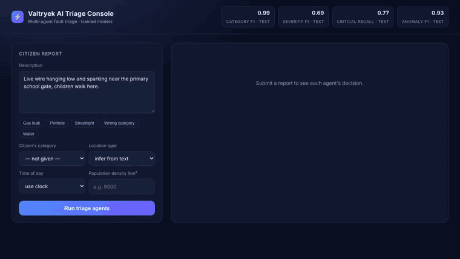
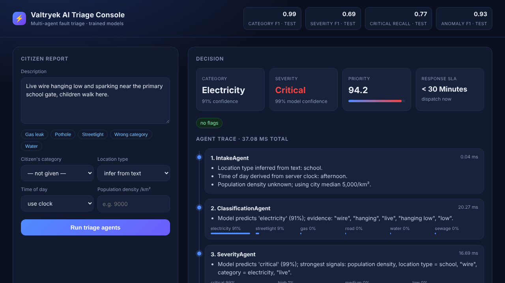
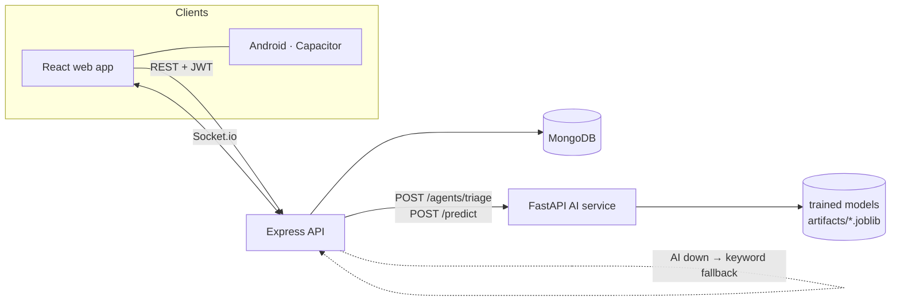
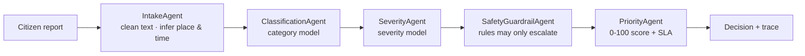
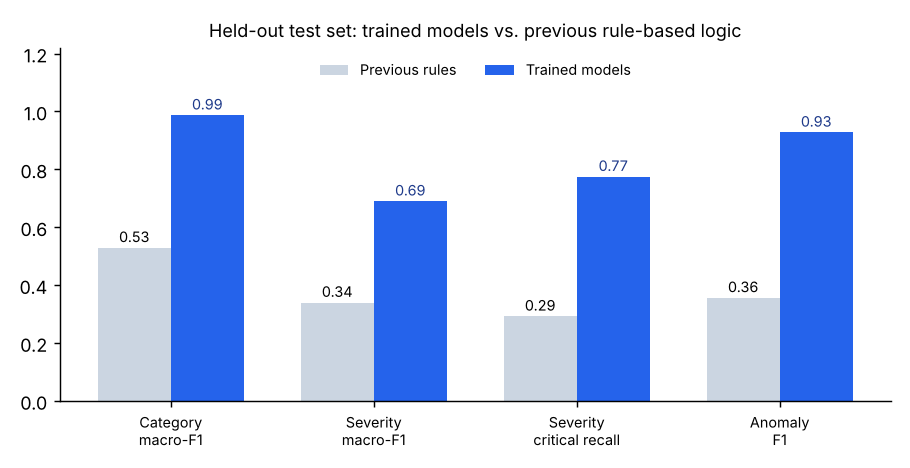
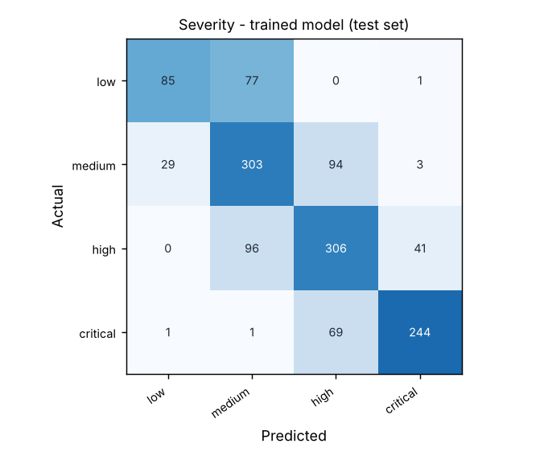
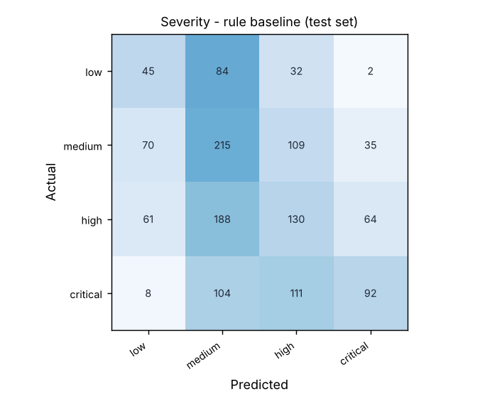

<h1 align="center">⚡ Valtryek: Agentic AI Utility Fault System</h1>

<p align="center">
  <b>Citizens report electricity, water, road, streetlight, sewage and gas faults.<br/>
  A pipeline of trained AI agents classifies, scores and prioritises each report in about 20 ms,<br/>
  and technicians and admins track the fix in real time.</b>
</p>

<p align="center">
  
  
  
  
  
  
  
  
  
</p>

<p align="center">
  <a href="#-demo">Demo</a> ·
  <a href="#-how-it-works">How it works</a> ·
  <a href="#-dataset">Dataset</a> ·
  <a href="#-results">Results</a> ·
  <a href="#-quick-start">Quick start</a> ·
  <a href="#-api-reference">API</a> ·
  <a href="#-testing">Testing</a>
</p>

---

## 🎬 Demo

<p align="center">
  
</p>

▶️ **Full demo video (66 s):** [`docs/demo/valtryek-demo.mp4`](docs/demo/valtryek-demo.mp4)

It shows the dataset being built, model selection on the validation split and the final test-set scores.
It then runs the live triage console on three reports: a gas leak at night, a missing manhole that the
citizen filed under *road*, and a fused street lamp. It ends with the automated test suites.

The console ships with the AI service at `http://localhost:8000/demo`:

<p align="center"></p>

---

## ✨ Features

| Area | What you get |
|---|---|
| **Citizen app** | Report a fault with category, description, photo and GPS location; upvote; give feedback; follow status live |
| **AI triage** | 5-agent pipeline: **Intake → Classification → Severity → Safety guardrail → Priority**, with a readable trace of every decision |
| **Trained models** | TF-IDF + logistic-regression text classifiers for category and severity; gradient-boosting anomaly detector for sensor telemetry |
| **Safety first** | Hard, unit-tested rules can only *raise* severity (gas leak, fire, live wire, open manhole, injury); low-confidence cases are flagged for human review |
| **Resilience** | If the AI service is down or slow (4 s timeout), the backend falls back to keyword rules and records `source: "rules_fallback"` |
| **Technicians** | Kanban board, skill- and distance-based auto-assignment, accept/reject, live location |
| **Admins** | Analytics dashboard, map with heat layer, broadcast announcements |
| **Real-time** | Socket.io rooms per role, user, city and fault (Redis adapter optional) |
| **Mobile** | Capacitor Android wrapper of the web app (`frontend/android`) |
| **Ops** | Docker Compose for the full stack, GitHub Actions CI (retrain + test AI, backend tests, frontend build) |

---

## 🧠 How it works



### The agent pipeline (`ai-service/agents/agent_system.py`)



| Agent | Responsibility |
|---|---|
| **IntakeAgent** | Normalises text, infers location type from the text (hospital, school, highway, market…), derives time of day from the timestamp, fills missing density |
| **ClassificationAgent** | Predicts the utility category. Keeps the citizen's choice unless the model is ≥ 90% sure it is wrong, then re-routes and flags `category_corrected` |
| **SeverityAgent** | Predicts `low / medium / high / critical` from text **and** context (category, place, time, population density), and explains the strongest signals |
| **SafetyGuardrailAgent** | Auditable regex rules that can only escalate. Flags `requires_human_review` when model confidence < 50% |
| **PriorityAgent** | Converts severity and context to a 0-100 dispatch score and a response SLA (critical < 30 min … low < 72 h) |

The backend stores the result on each fault (`aiCategory`, `severity`, `confidenceScore`, `aiAnalysis.{source,
responseSla, escalations, flags, requiresHumanReview}`). When the citizen and the AI disagree on severity,
the **higher** level is kept so a report is never under-triaged.

---

## 📊 Dataset

Full datasheet: [`ai-service/DATASET.md`](agentic-ai-utility-system-main/ai-service/DATASET.md)

| | Fault reports | Sensor telemetry |
|---|---|---|
| Size | **9,000** labelled reports | **17,280** hourly readings from 24 sensors |
| Labels | category (6) + severity (4, ordinal) | anomaly yes/no + fault type |
| **Train / validation / test** | **6,300 / 1,350 / 1,350** (70 / 15 / 15) | **12,096 / 2,304 / 2,880** |
| Split method | stratified on category × severity | chronological (days 1-21 / 22-25 / 26-30) |
| Files | `data/splits/{train,val,test}.csv` | `data/sensors/{train,val,test}.csv` |

> **The corpus is synthetic.** No public, licence-clean dataset of Indian municipal utility complaints with
> severity labels was available. Instead of the random numbers the service used before, the data comes from a
> documented, seeded generator (`python -m ml.generate_dataset`). It has 44 fault scenarios, real Indian
> localities, typos, SMS spelling, Hinglish, overlapping vocabulary, a written severity rubric, and deliberate
> label noise (6% severity, 1.5% category). The results below show how the pipeline compares with the old
> rules on this data. They are **not** a claim about accuracy on real complaints. Retrain on real data before
> production; any CSV with the same columns drops straight in.

Sample rows (from `test.csv`):

| description | category | severity | location | time |
|---|---|---|---|---|
| Please help, complete power outage in the whole area at night. Someone could get hurt. | electricity | critical | residential | night |
| Please help, drain water entering homes, very bad smell near the warehouse lane just now. | sewage | high | industrial | night |
| complaint: water pressure is too low to reach the tank near block c at night. someone could get hurt. | water | medium | residential | night |
| Hello team, single lamp post not glowing near the community park in Bopal since yesterday night. | streetlight | low | residential | afternoon |

Leakage and quality checks run in CI (`tests/test_dataset.py`): no ID or identical text shared between
splits, ratios within ±0.5%, class shares within 2 points across splits, reproducible generation, and a
strictly chronological sensor split.

---

## 📈 Results

Protocol for every model: fit candidates on **train** → pick the best on **validation** (macro-F1, ties broken
by log-loss) → refit on train + validation → score **once** on the held-out **test** split. Each model is
compared with the logic the project used before (ported in `ml/baselines.py`).

<p align="center"></p>

| Task (test set) | Selected model | Trained | Previous rules |
|---|---|---|---|
| Category, macro-F1 | TF-IDF word + char n-grams → LogReg (C=16) | **0.987** | 0.529 (keywords) |
| Severity, macro-F1 | TF-IDF + one-hot context + log density → LogReg (C=2) | **0.690** | 0.340 (hand-tuned scorer) |
| Severity, critical recall | ″ | **0.775** | 0.292 |
| Severity, within one level | ″ | **0.996** | 0.821 |
| Sensor anomaly, F1 | HistGradientBoosting (beat IsolationForest on validation: 0.99 vs 0.70) | **0.928** | 0.356 (raw-value IsolationForest) |

**Full agent pipeline** (models + guardrail) on the 1,350 test reports (`artifacts/pipeline_metrics.json`):
category accuracy 0.987, severity macro-F1 0.662, critical recall **0.781**, under-triage 13.5%
(the severity model alone: 14.5%), 8.5% sent for human review, **~20 ms per report**. The guardrail gives up
a little macro-F1 to cut under-triage, which is the right trade for public safety.

| Severity: trained model | Severity: previous rules |
|---|---|
|  |  |

Per-class precision and recall, and everything not covered, are in the
[model card](agentic-ai-utility-system-main/ai-service/artifacts/MODEL_CARD.md).

---

## 🚀 Quick start

### Option A: Docker (whole stack)

```bash
cd agentic-ai-utility-system-main
docker compose up --build
```

| Service | URL |
|---|---|
| Web app | http://localhost:5173 |
| REST API | http://localhost:5000 |
| AI service docs (Swagger) | http://localhost:8000/docs |
| AI triage console | http://localhost:8000/demo |

The AI image retrains the models during the build, so the model files always match its scikit-learn version.

### Option B: run each service

**Prerequisites:** Node 20+, Python 3.11+, MongoDB 6+ (local or Atlas).

```bash
# 1. AI service
cd agentic-ai-utility-system-main/ai-service
pip install -r requirements-dev.txt
python -m ml.generate_dataset      # optional: data is already committed
python -m ml.train                 # ~20 s: selection, test scores, figures, MODEL_CARD.md
uvicorn main:app --port 8000

# 2. Backend
cd ../backend
cp .env.example .env               # set MONGO_URI, JWT_SECRET, AI_SERVICE_URL
npm install && npm run dev

# 3. (optional) seed demo users and faults
cd ../database && npm install && node seed.js

# 4. Frontend
cd ../frontend
cp .env.example .env               # VITE_API_URL=http://localhost:5000/api
npm install && npm run dev
```

Key environment variables:

| Variable | Where | Default | Purpose |
|---|---|---|---|
| `MONGO_URI` | backend | none | MongoDB connection string |
| `JWT_SECRET` / `JWT_REFRESH_SECRET` | backend | none | token signing |
| `AI_SERVICE_URL` | backend | `http://127.0.0.1:8000` | where the triage agents run |
| `AI_SERVICE_TIMEOUT` | backend | `4000` ms | fall back to rules after this |
| `AI_SERVICE_DISABLED` | backend | `false` | force rule-based analysis |
| `ALLOW_TRAINING` | ai-service | `false` | enable `POST /train` |
| `CORS_ORIGINS` | ai-service | `*` | comma-separated allowed origins |
| `VITE_API_URL` | frontend | `http://localhost:5000/api` | API base URL |

---

## 🔌 API reference

### AI service (`:8000`, interactive docs at `/docs`)

| Method | Path | Body (JSON) | Returns |
|---|---|---|---|
| `POST` | `/agents/triage` | `description`, optional `category`, `location_type`, `time_of_day`, `population_density`, `timestamp` | category, severity, confidences, `priority_score`, `response_sla`, `escalations`, `flags`, full agent `trace` |
| `POST` | `/classify` | `description` | category, probabilities, evidence terms |
| `POST` | `/predict-severity` | `description`, `category`, `location_type`, `time_of_day`, `population_density` | severity, probabilities, reasoning, SLA |
| `POST` | `/predict` | `sensor_value` (0-100), `utility`, optional `recent_values[]`, `hour_of_day` | `fault`, `anomaly_score`, severity |
| `POST` | `/batch-predict` | `sensor_values[]`, `utility`, `start_hour` | per-reading results |
| `POST` | `/analyze-image` | multipart `file`, optional `description` | image check + text triage (no pixel model, see limitations) |
| `POST` | `/analytics/fault-trends` | `records[]` from MongoDB | category, severity, status, hourly and resolution-time aggregates |
| `GET` | `/model-info` | none | selected models and test metrics |
| `POST` | `/train` | none | retrain everything (needs `ALLOW_TRAINING=true`) |

```bash
curl -X POST localhost:8000/agents/triage -H 'Content-Type: application/json' \
  -d '{"description":"manhole cover missing in the middle of the lane","category":"road"}'
# → category "sewage" (flag: category_corrected), severity "high", priority 66.2, SLA "< 2 hours", 5-step trace
```

### Backend (`:5000/api`)

| Group | Endpoints |
|---|---|
| Auth | `POST /auth/register`, `/auth/login`, `/auth/google`, `/auth/otp/request`, `/auth/otp/verify`, `/auth/refresh`, `/auth/logout`; `GET/PUT /auth/profile` |
| Faults | `POST /faults/report` (runs triage), `POST /faults/detect` (sensor), `GET /faults`, `/faults/:id`, `/faults/stats/dashboard`, `/faults/analytics`, `/faults/my-assignments`; `PUT /faults/:id/status`; `POST /faults/:id/respond`, `/faults/:id/feedback` |
| Others | `/technicians`, `/notifications`, `/complaints`, `/upload`, `/simulate`, `GET /status` |

---

## 🧪 Testing

```bash
# AI service: 43 tests (dataset integrity, model quality gates, agents, API)
cd agentic-ai-utility-system-main/ai-service && python -m pytest -v

# Backend: 7 tests (ML path, fallback on outage, HTTP errors, request shapes)
cd ../backend && npm test
```

The model tests are **quality gates**. CI fails if, for example, category macro-F1 drops below 0.95,
severity critical recall drops below 0.70, or a model stops beating its rule baseline by the required margin.

CI (`.github/workflows/ci.yml`) runs on every push and pull request. It retrains all models from the committed
splits, runs the pipeline evaluation and the AI tests, runs the backend tests, and builds the frontend. The
metrics and model card are uploaded as build artifacts.

---

## 🗂️ Project structure

```text
.
├── .github/workflows/ci.yml          CI: retrain + test AI, backend tests, frontend build
├── docs/demo/                        demo video, GIF and screenshot
└── agentic-ai-utility-system-main/
    ├── ai-service/                   FastAPI + scikit-learn
    │   ├── main.py                   HTTP API (+ /demo console)
    │   ├── agents/agent_system.py    5-agent triage pipeline
    │   ├── ml/
    │   │   ├── generate_dataset.py   seeded corpus + 70/15/15 splits
    │   │   ├── features.py           shared train/serve feature builders
    │   │   ├── baselines.py          previous rule logic, for comparison
    │   │   ├── train.py              selection on val, final test evaluation, figures, model card
    │   │   ├── evaluate_pipeline.py  end-to-end agent evaluation
    │   │   └── predictor.py          artifact loading + explanations (auto-retrains if incompatible)
    │   ├── data/                     raw/ splits/ sensors/
    │   ├── artifacts/                *.joblib, metrics.json, pipeline_metrics.json, MODEL_CARD.md, figures/
    │   ├── static/demo.html          triage console
    │   ├── tests/                    pytest suite
    │   └── DATASET.md                datasheet
    ├── backend/                      Express + Mongoose + Socket.io
    │   ├── src/agents/               fault analysis (AI + fallback), priority, assignment, rescheduler, learning
    │   ├── src/services/aiService.js  AI client with timeout
    │   └── test/                     node:test suite
    ├── frontend/                     React (Vite) + Leaflet + Chart.js, android/ (Capacitor)
    ├── database/                     seed scripts
    ├── docs/history/                 development logs from earlier phases
    └── docker-compose.yml
```

---

## 🛠️ What changed in this release

- **Real ML instead of placeholders.** The old service fitted its "severity model" on random numbers and
  returned a *random* category for images; analytics and `/train` returned random metrics. All of that was
  replaced by trained, evaluated models and real aggregations.
- **Dataset with proper splits.** 9,000 reports and 17,280 sensor readings, train / validation / test, datasheet, leakage tests.
- **Agent pipeline implemented.** `agent_system.py` was empty; it now runs five agents with explanations.
- **Backend wired to the AI.** `faultAnalysisAgent` calls `/agents/triage` with a timeout and falls back to rules;
  `aiService` previously sent the sensor value as a query string the API didn't accept.
- **Bugs fixed:**
  - `road` and `streetlight` reports were rejected with HTTP 400 even though the app offers them.
  - The admin dashboard requested `/api/api/...` when `VITE_API_URL` ended in `/api`.
  - `checkHistoricalFaults` returned random numbers; it now queries MongoDB.
  - `docker-compose.yml` had lost its indentation and could not be parsed.
  - The frontend container bound to the wrong port.
  - CI lived in a sub-folder where GitHub never ran it.

## ⚠️ Limitations and roadmap

1. **Synthetic training data.** Export real reports from MongoDB (or a municipal grievance portal), have them
   reviewed for severity, and retrain. The pipeline needs no code changes.
2. **No image model.** `/analyze-image` checks the photo, triages any attached text and asks a human to review.
   It never guesses from pixels. Next step: collect labelled fault photos and fine-tune a small CNN.
3. **English-centric text.** Light Hinglish only. Hindi and regional scripts need data and a multilingual encoder.
4. **Population density** is estimated from distance to a city centre; replace it with census grid data.

---

<p align="center">Built for smarter, safer cities ⚡</p>
