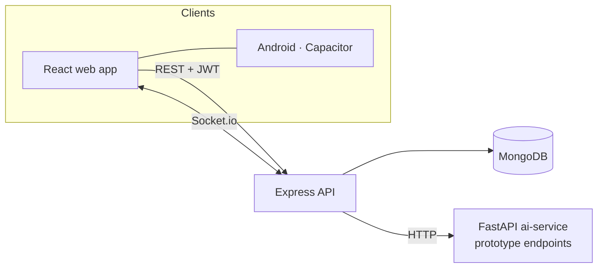

<h1 align="center">⚡ Valtryek: Public Utility Fault Reporting</h1>

<p align="center"><b>Citizens report electricity, water, road, streetlight, sewage and gas faults; technicians and admins track and resolve them in real time.</b></p>

<p align="center">
  
  
  
  
  
  
  
</p>

## What's implemented

| Area | Status | Details |
|---|---|---|
| Auth | ✅ | Register/login with JWT, Google sign-in route, protected routes |
| Fault reporting | ✅ | Report with category and location; upvotes, feedback, status updates |
| Role dashboards | ✅ | Citizen, Technician and Admin dashboards; analytics page |
| Map | ✅ | Leaflet map view of reported faults |
| Real-time | ✅ | Socket.io push updates (Redis adapter supported) |
| Android | ✅ | Capacitor wrapper of the web app (`frontend/android`) |
| AI service | ⚠️ Prototype | FastAPI service with `/predict`, `/predict-severity`, `/analyze-image` and analytics endpoints |

### Honest note on the AI service

The AI service is a **scaffold, not a trained system**:

- `/analyze-image` currently returns a **random** category and confidence; there is no trained vision model.
- The severity model is fitted on **synthetic random data** at startup, so its outputs are not meaningful.
- `ai-service/agents/agent_system.py` is **empty**, and no multi-agent orchestration is implemented yet.

The status reports in `docs/history/` describe intended phases; treat this table as the source of truth.

## Architecture



## Structure

```text
agentic-ai-utility-system-main/
  frontend/     React (Vite) app + android/ (Capacitor)
  backend/      Express + Mongoose + Socket.io
  ai-service/   FastAPI + scikit-learn (prototype)
  database/     seed / schema helpers
  docs/history/ phase and fix reports from development
  docker-compose.yml
```

## Run locally

```bash
cd agentic-ai-utility-system-main
docker compose up          # or run each service:
# backend:    cd backend && npm install && npm run dev
# frontend:   cd frontend && cp .env.example .env && npm install && npm run dev
# ai-service: cd ai-service && pip install -r requirements.txt && uvicorn main:app --port 8000
```

Set `MONGO_URI` and `JWT_SECRET` for the backend (see `DEPLOYMENT_GUIDE.md` in `docs/history/`).

## Next steps

1. Train a real image classifier on labelled fault photos and replace the random placeholder.
2. Implement the agent pipeline (triage → priority → assignment) in `agent_system.py`, with tests.
3. Add CI for backend tests and the frontend build.
