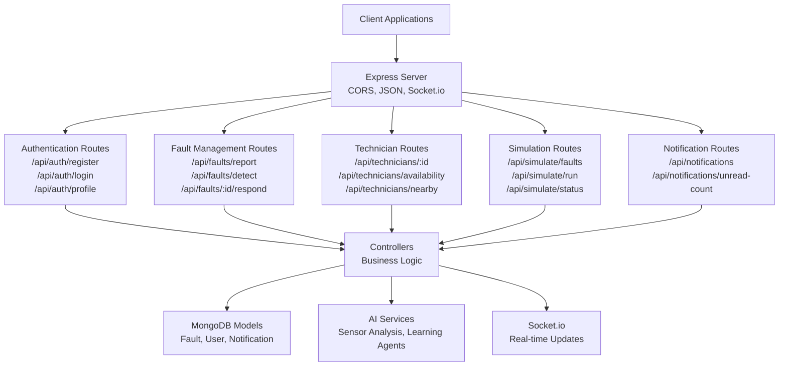
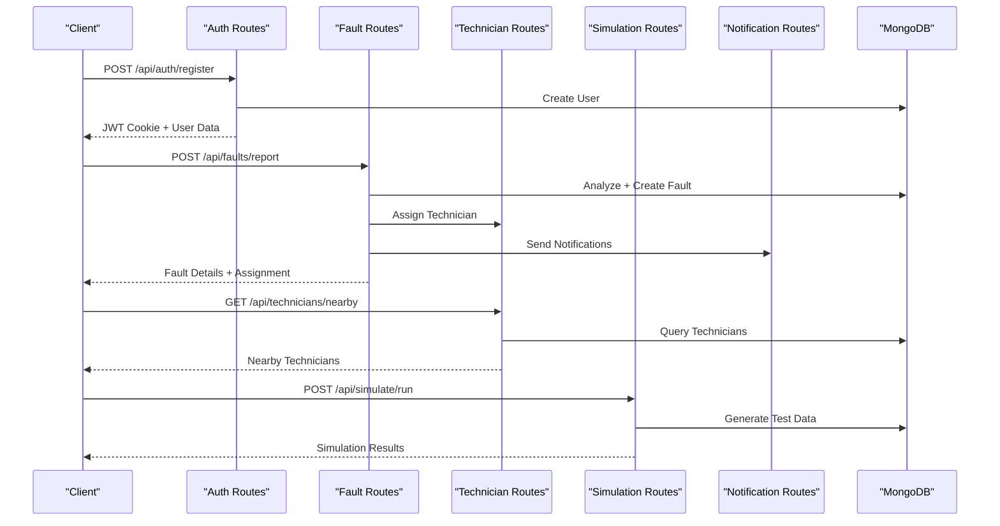
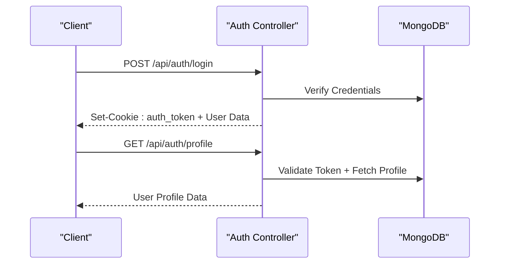
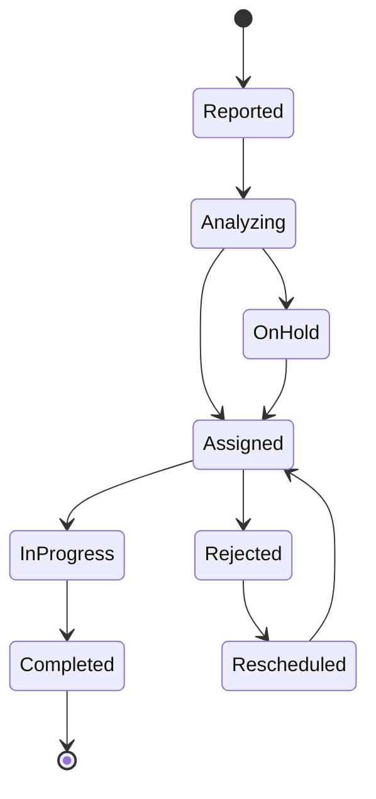

# API Documentation

<cite>
**Referenced Files in This Document**
- [backend/src/server.js](file://backend/src/server.js)
- [backend/src/routes/authRoutes.js](file://backend/src/routes/authRoutes.js)
- [backend/src/routes/faultRoutes.js](file://backend/src/routes/faultRoutes.js)
- [backend/src/routes/technicianRoutes.js](file://backend/src/routes/technicianRoutes.js)
- [backend/src/routes/simulationRoutes.js](file://backend/src/routes/simulationRoutes.js)
- [backend/src/routes/notificationRoutes.js](file://backend/src/routes/notificationRoutes.js)
- [backend/src/controllers/authController.js](file://backend/src/controllers/authController.js)
- [backend/src/controllers/faultController.js](file://backend/src/controllers/faultController.js)
- [backend/src/middleware/auth.js](file://backend/src/middleware/auth.js)
- [backend/src/services/aiService.js](file://backend/src/services/aiService.js)
- [backend/src/models/Fault.js](file://backend/src/models/Fault.js)
- [backend/src/models/Notification.js](file://backend/src/models/Notification.js)
- [backend/src/utils/notifier.js](file://backend/src/utils/notifier.js)
- [backend/package.json](file://backend/package.json)
</cite>

## Update Summary
**Changes Made**
- Added comprehensive fault management endpoints for fault reporting, detection, assignment, and analytics
- Integrated technician management endpoints for availability, location tracking, and assignment
- Implemented simulation mode endpoints for testing and development workflows
- Added notification system endpoints for real-time communication
- Enhanced AI service integration with sensor data analysis
- Updated base URL structure and versioning scheme

## Table of Contents
1. [Introduction](#introduction)
2. [Project Structure](#project-structure)
3. [Core Components](#core-components)
4. [Architecture Overview](#architecture-overview)
5. [Detailed Component Analysis](#detailed-component-analysis)
6. [Authentication System](#authentication-system)
7. [Fault Management System](#fault-management-system)
8. [Technician Operations](#technician-operations)
9. [Simulation Mode](#simulation-mode)
10. [Notification System](#notification-system)
11. [AI Service Integration](#ai-service-integration)
12. [Real-time Communication](#real-time-communication)
13. [Error Handling](#error-handling)
14. [Performance Considerations](#performance-considerations)
15. [Troubleshooting Guide](#troubleshooting-guide)
16. [Conclusion](#conclusion)
17. [Appendices](#appendices)

## Introduction
This document describes the RESTful API for the SMAN-GPT AI Chat Application, now enhanced with comprehensive fault management, technician operations, simulation mode, and AI service integration. The API provides a complete infrastructure for smart city utilities management, featuring real-time fault detection, intelligent assignment algorithms, and automated workflow orchestration.

## Project Structure
The backend exposes a versioned base path `/api` and mounts multiple specialized route groups for different functional domains. The system integrates MongoDB for data persistence, Socket.io for real-time communication, and external AI services for intelligent decision-making.



**Diagram sources**
- [backend/src/server.js:49-54](file://backend/src/server.js#L49-L54)
- [backend/src/routes/authRoutes.js:5-10](file://backend/src/routes/authRoutes.js#L5-L10)
- [backend/src/routes/faultRoutes.js:15-28](file://backend/src/routes/faultRoutes.js#L15-L28)
- [backend/src/routes/technicianRoutes.js:5-175](file://backend/src/routes/technicianRoutes.js#L5-L175)
- [backend/src/routes/simulationRoutes.js:9-490](file://backend/src/routes/simulationRoutes.js#L9-L490)
- [backend/src/routes/notificationRoutes.js:6-94](file://backend/src/routes/notificationRoutes.js#L6-L94)

**Section sources**
- [backend/src/server.js:49-54](file://backend/src/server.js#L49-L54)
- [backend/src/server.js:20-44](file://backend/src/server.js#L20-L44)

## Core Components
- **Versioned API**: Base URL `/api` with automatic versioning through route structure
- **Authentication**: JWT-based authentication with HTTP-only cookies for security
- **Real-time Communication**: Socket.io integration for live updates and notifications
- **AI Integration**: External AI services for fault analysis and decision-making
- **Database**: MongoDB with optimized indexes for performance
- **Middleware**: Comprehensive validation and authorization layers

Key implementation references:
- Server initialization and Socket.io setup: [backend/src/server.js:17-25](file://backend/src/server.js#L17-L25)
- Route mounting: [backend/src/server.js:49-54](file://backend/src/server.js#L49-L54)
- Authentication middleware: [backend/src/middleware/auth.js](file://backend/src/middleware/auth.js)
- AI service integration: [backend/src/services/aiService.js:3-8](file://backend/src/services/aiService.js#L3-L8)

**Section sources**
- [backend/src/server.js:17-25](file://backend/src/server.js#L17-L25)
- [backend/src/server.js:49-54](file://backend/src/server.js#L49-L54)
- [backend/src/middleware/auth.js](file://backend/src/middleware/auth.js)
- [backend/src/services/aiService.js:3-8](file://backend/src/services/aiService.js#L3-L8)

## Architecture Overview
The system follows a microservice-like architecture with specialized endpoints for different functional domains, all orchestrated through a central Express server with real-time capabilities.



**Diagram sources**
- [backend/src/routes/authRoutes.js:7-10](file://backend/src/routes/authRoutes.js#L7-L10)
- [backend/src/routes/faultRoutes.js:21-28](file://backend/src/routes/faultRoutes.js#L21-L28)
- [backend/src/routes/technicianRoutes.js:119-150](file://backend/src/routes/technicianRoutes.js#L119-L150)
- [backend/src/routes/simulationRoutes.js:326-434](file://backend/src/routes/simulationRoutes.js#L326-L434)
- [backend/src/routes/notificationRoutes.js:12-32](file://backend/src/routes/notificationRoutes.js#L12-32)

## Detailed Component Analysis

### Authentication System

#### POST /api/auth/register
- **Description**: Registers a new user with role-based access control
- **Authentication**: Not required
- **Request Body**:
  ```json
  {
    "name": "string",
    "email": "string",
    "password": "string",
    "role": "string"
  }
  ```
- **Responses**:
  - 201: User created successfully
  - 400: Invalid input data
  - 409: User already exists
  - 500: Server error

#### POST /api/auth/login
- **Description**: Authenticates user and creates session
- **Authentication**: Not required
- **Request Body**:
  ```json
  {
    "email": "string",
    "password": "string"
  }
  ```
- **Responses**:
  - 200: Login successful with user profile
  - 401: Invalid credentials
  - 500: Server error

#### GET /api/auth/profile
- **Description**: Retrieves authenticated user profile
- **Authentication**: Required (JWT)
- **Responses**:
  - 200: User profile data
  - 401: Invalid token
  - 404: User not found

**Section sources**
- [backend/src/routes/authRoutes.js:7-10](file://backend/src/routes/authRoutes.js#L7-L10)
- [backend/src/controllers/authController.js](file://backend/src/controllers/authController.js)

### Fault Management System

#### POST /api/faults/report
- **Description**: Reports a new fault with AI-powered analysis and automatic assignment
- **Authentication**: Required (JWT)
- **Request Body**:
  ```json
  {
    "type": "string",
    "description": "string",
    "location": {
      "lat": "number",
      "lng": "number",
      "address": "string"
    },
    "images": "array",
    "reporterName": "string",
    "reporterPhone": "string"
  }
  ```
- **Responses**:
  - 201: Fault reported and assigned successfully
  - 400: Missing required fields
  - 500: AI analysis or assignment failed

#### POST /api/faults/detect
- **Description**: Sensor-based fault detection using AI analysis
- **Authentication**: Not required (public endpoint)
- **Request Body**:
  ```json
  {
    "value": "number",
    "location": "object",
    "type": "string"
  }
  ```
- **Responses**:
  - 200: Fault detected with analysis
  - 400: Invalid sensor data
  - 500: Analysis failed

#### GET /api/faults/
- **Description**: Retrieves all faults with filtering options
- **Authentication**: Required (JWT)
- **Query Parameters**:
  - `status`: Filter by fault status
  - `severity`: Filter by severity level
  - `type`: Filter by fault type
  - `assignedTo`: Filter by assigned technician
  - `limit`: Maximum results (default: 50)

#### GET /api/faults/analytics
- **Description**: Provides system-wide analytics and metrics
- **Authentication**: Required (JWT)
- **Responses**:
  - 200: Analytics data including counts, distributions, and performance metrics

#### GET /api/faults/my-assignments
- **Description**: Retrieves faults assigned to the authenticated technician
- **Authentication**: Required (JWT)
- **Query Parameters**:
  - `status`: Filter by status

#### GET /api/faults/:id
- **Description**: Retrieves specific fault details
- **Authentication**: Required (JWT)
- **Responses**:
  - 200: Fault details with assigned technician and reporter information
  - 404: Fault not found

#### PUT /api/faults/:id/status
- **Description**: Updates fault status and associated timestamps
- **Authentication**: Required (JWT)
- **Request Body**:
  ```json
  {
    "status": "string",
    "notes": "string",
    "proofImage": "string"
  }
  ```

#### POST /api/faults/:id/respond
- **Description**: Technician accepts or rejects fault assignment
- **Authentication**: Required (JWT)
- **Request Body**:
  ```json
  {
    "action": "string", // 'accept' or 'reject'
    "reason": "string"
  }
  ```

#### POST /api/faults/:id/feedback
- **Description**: Submits citizen feedback for completed fault
- **Authentication**: Required (JWT)
- **Request Body**:
  ```json
  {
    "rating": "number",
    "comment": "string"
  }
  ```

**Section sources**
- [backend/src/routes/faultRoutes.js:17-28](file://backend/src/routes/faultRoutes.js#L17-L28)
- [backend/src/controllers/faultController.js:15-125](file://backend/src/controllers/faultController.js#L15-L125)
- [backend/src/controllers/faultController.js:196-236](file://backend/src/controllers/faultController.js#L196-L236)
- [backend/src/controllers/faultController.js:242-292](file://backend/src/controllers/faultController.js#L242-L292)
- [backend/src/controllers/faultController.js:298-340](file://backend/src/controllers/faultController.js#L298-L340)
- [backend/src/controllers/faultController.js:368-392](file://backend/src/controllers/faultController.js#L368-L392)
- [backend/src/controllers/faultController.js:398-448](file://backend/src/controllers/faultController.js#L398-L448)

### Technician Operations

#### GET /api/technicians/
- **Description**: Retrieves all technicians with filtering options
- **Authentication**: Required (JWT)
- **Query Parameters**:
  - `available`: Filter by availability status
  - `skill`: Filter by specific skill

#### GET /api/technicians/:id
- **Description**: Retrieves specific technician details with assigned faults
- **Authentication**: Required (JWT)
- **Responses**:
  - 200: Technician details with active assignments
  - 404: Technician not found

#### PUT /api/technicians/availability
- **Description**: Updates technician availability and location
- **Authentication**: Required (JWT)
- **Request Body**:
  ```json
  {
    "isAvailable": "boolean",
    "location": "object"
  }
  ```

#### PUT /api/technicians/location
- **Description**: Updates technician real-time location for tracking
- **Authentication**: Required (JWT)
- **Request Body**:
  ```json
  {
    "lat": "number",
    "lng": "number"
  }
  ```

#### GET /api/technicians/nearby
- **Description**: Finds nearby available technicians within specified radius
- **Authentication**: Required (JWT)
- **Query Parameters**:
  - `lat`: Latitude coordinate
  - `lng`: Longitude coordinate
  - `radius`: Search radius in kilometers (default: 10)

**Section sources**
- [backend/src/routes/technicianRoutes.js:11-27](file://backend/src/routes/technicianRoutes.js#L11-L27)
- [backend/src/routes/technicianRoutes.js:33-51](file://backend/src/routes/technicianRoutes.js#L33-L51)
- [backend/src/routes/technicianRoutes.js:57-81](file://backend/src/routes/technicianRoutes.js#L57-L81)
- [backend/src/routes/technicianRoutes.js:87-113](file://backend/src/routes/technicianRoutes.js#L87-L113)
- [backend/src/routes/technicianRoutes.js:119-150](file://backend/src/routes/technicianRoutes.js#L119-L150)

### Simulation Mode

#### POST /api/simulate/faults
- **Description**: Generates random faults for testing and development
- **Authentication**: Required (JWT)
- **Request Body**:
  ```json
  {
    "count": "number" // Default: 5
  }
  ```

#### POST /api/simulate/technicians
- **Description**: Creates test technician accounts for simulation
- **Authentication**: Required (JWT)

#### POST /api/simulate/responses
- **Description**: Simulates technician response behaviors
- **Authentication**: Required (JWT)
- **Request Body**:
  ```json
  {
    "acceptRate": "number" // Default: 0.8
  }
  ```

#### POST /api/simulate/completions
- **Description**: Simulates fault completion scenarios
- **Authentication**: Required (JWT)
- **Request Body**:
  ```json
  {
    "completionRate": "number" // Default: 0.3
  }
  ```

#### POST /api/simulate/run
- **Description**: Executes complete simulation cycle
- **Authentication**: Required (JWT)
- **Request Body**:
  ```json
  {
    "faults": "number", // Default: 5
    "acceptRate": "number", // Default: 0.8
    "completionRate": "number" // Default: 0.3
  }
  ```

#### GET /api/simulate/status
- **Description**: Retrieves current simulation status and statistics

#### DELETE /api/simulate/clear
- **Description**: Clears all simulation-generated data

**Section sources**
- [backend/src/routes/simulationRoutes.js:102-168](file://backend/src/routes/simulationRoutes.js#L102-L168)
- [backend/src/routes/simulationRoutes.js:174-228](file://backend/src/routes/simulationRoutes.js#L174-L228)
- [backend/src/routes/simulationRoutes.js:234-272](file://backend/src/routes/simulationRoutes.js#L234-L272)
- [backend/src/routes/simulationRoutes.js:278-320](file://backend/src/routes/simulationRoutes.js#L278-L320)
- [backend/src/routes/simulationRoutes.js:326-434](file://backend/src/routes/simulationRoutes.js#L326-L434)
- [backend/src/routes/simulationRoutes.js:440-463](file://backend/src/routes/simulationRoutes.js#L440-L463)
- [backend/src/routes/simulationRoutes.js:469-488](file://backend/src/routes/simulationRoutes.js#L469-L488)

### Notification System

#### GET /api/notifications
- **Description**: Retrieves user notifications with filtering options
- **Authentication**: Required (JWT)
- **Query Parameters**:
  - `unreadOnly`: Filter unread notifications only
  - `limit`: Maximum results (default: 20)

#### PUT /api/notifications/:id/read
- **Description**: Marks specific notification as read
- **Authentication**: Required (JWT)

#### PUT /api/notifications/read-all
- **Description**: Marks all user notifications as read
- **Authentication**: Required (JWT)

#### GET /api/notifications/unread-count
- **Description**: Retrieves count of unread notifications
- **Authentication**: Required (JWT)

#### DELETE /api/notifications/:id
- **Description**: Deletes specific notification
- **Authentication**: Required (JWT)

**Section sources**
- [backend/src/routes/notificationRoutes.js:12-32](file://backend/src/routes/notificationRoutes.js#L12-L32)
- [backend/src/routes/notificationRoutes.js:38-62](file://backend/src/routes/notificationRoutes.js#L38-L62)
- [backend/src/routes/notificationRoutes.js:68-79](file://backend/src/routes/notificationRoutes.js#L68-L79)
- [backend/src/routes/notificationRoutes.js:85-92](file://backend/src/routes/notificationRoutes.js#L85-L92)

## Authentication System
The system uses JWT tokens stored in HTTP-only, signed cookies for secure session management. The authentication middleware validates tokens and attaches user context to requests.

### JWT Configuration
- **Cookie Name**: `auth_token`
- **Properties**: HTTP-only, signed, domain-scoped, path "/"
- **Expiration**: Session-based (managed by server)
- **Verification**: Server-side validation using shared secret

### Authentication Flow


**Diagram sources**
- [backend/src/routes/authRoutes.js:7-10](file://backend/src/routes/authRoutes.js#L7-L10)
- [backend/src/middleware/auth.js](file://backend/src/middleware/auth.js)

**Section sources**
- [backend/src/middleware/auth.js](file://backend/src/middleware/auth.js)
- [backend/src/controllers/authController.js](file://backend/src/controllers/authController.js)

## Fault Management System
The fault management system provides comprehensive functionality for reporting, analyzing, assigning, and tracking utility faults with AI-powered intelligence.

### Fault Lifecycle


### AI Integration Features
- **Fault Analysis**: Automatic categorization and severity assessment
- **Priority Calculation**: Dynamic priority scoring based on multiple factors
- **Technician Assignment**: Intelligent matching algorithm considering proximity and expertise
- **Learning System**: Continuous improvement through historical data analysis

**Section sources**
- [backend/src/controllers/faultController.js:15-125](file://backend/src/controllers/faultController.js#L15-L125)
- [backend/src/controllers/faultController.js:196-236](file://backend/src/controllers/faultController.js#L196-L236)
- [backend/src/controllers/faultController.js:242-292](file://backend/src/controllers/faultController.js#L242-L292)
- [backend/src/models/Fault.js:3-67](file://backend/src/models/Fault.js#L3-L67)

## Technician Operations
The technician management system provides comprehensive functionality for managing field personnel, including availability tracking, real-time location updates, and intelligent assignment algorithms.

### Technician Capabilities
- **Availability Management**: Real-time availability status updates
- **Location Tracking**: GPS-based location monitoring with distance calculations
- **Skill Matching**: Advanced filtering based on technician expertise
- **Assignment History**: Complete tracking of past and current assignments

### Distance Calculation Algorithm
The system uses the Haversine formula for accurate distance calculations between geographic coordinates:

```javascript
const calculateDistance = (loc1, loc2) => {
  const R = 6371; // Earth's radius in km
  const dLat = toRadians(loc2.lat - loc1.lat);
  const dLon = toRadians(loc2.lng - loc1.lng);
  
  const a = Math.sin(dLat/2) * Math.sin(dLat/2) +
           Math.cos(toRadians(loc1.lat)) * Math.cos(toRadians(loc2.lat)) *
           Math.sin(dLon/2) * Math.sin(dLon/2);
  
  const c = 2 * Math.atan2(Math.sqrt(a), Math.sqrt(1-a));
  return R * c;
};
```

**Section sources**
- [backend/src/routes/technicianRoutes.js:119-150](file://backend/src/routes/technicianRoutes.js#L119-L150)
- [backend/src/routes/technicianRoutes.js:156-171](file://backend/src/routes/technicianRoutes.js#L156-L171)

## Simulation Mode
The simulation system enables comprehensive testing and development workflows by generating realistic test data and automating complex scenarios.

### Simulation Components
- **Test Data Generation**: Automated creation of faults, technicians, and user profiles
- **Workflow Simulation**: End-to-end simulation of fault lifecycle from reporting to completion
- **Performance Testing**: Load testing and stress testing capabilities
- **Development Support**: Rapid prototyping and feature validation

### Simulation Scenarios
The system supports various simulation scenarios:
- **Basic Fault Generation**: Simple fault creation for testing
- **Complete Workflow**: Full simulation including assignment and resolution
- **Edge Cases**: Testing of boundary conditions and error scenarios
- **Performance Metrics**: Collection of system performance data

**Section sources**
- [backend/src/routes/simulationRoutes.js:102-168](file://backend/src/routes/simulationRoutes.js#L102-L168)
- [backend/src/routes/simulationRoutes.js:326-434](file://backend/src/routes/simulationRoutes.js#L326-L434)

## Notification System
The notification system provides real-time communication capabilities with support for multiple notification channels and delivery mechanisms.

### Notification Types
- **Fault Assignments**: New fault assignments to technicians
- **Status Updates**: Fault status changes and progress updates
- **System Alerts**: Administrative notifications and system messages
- **User Interactions**: Citizen feedback and system responses

### Delivery Channels
- **In-App Notifications**: Real-time display within the application
- **Email Notifications**: Email-based alerts for critical events
- **SMS Notifications**: Text message alerts for urgent situations

### Real-time Updates
The system uses Socket.io for instant notification delivery:
- **User Rooms**: Individual rooms for targeted notifications
- **Broadcast Events**: System-wide announcements
- **Location Updates**: Real-time technician location sharing

**Section sources**
- [backend/src/routes/notificationRoutes.js:1-95](file://backend/src/routes/notificationRoutes.js#L1-L95)
- [backend/src/models/Notification.js:3-22](file://backend/src/models/Notification.js#L3-L22)
- [backend/src/utils/notifier.js:7-43](file://backend/src/utils/notifier.js#L7-L43)

## AI Service Integration
The system integrates with external AI services for intelligent decision-making and automated analysis.

### AI Service Features
- **Sensor Data Analysis**: Real-time processing of sensor readings
- **Predictive Modeling**: Machine learning-based predictions and recommendations
- **Pattern Recognition**: Historical data analysis for trend identification
- **Automated Decision Making**: AI-driven assignment and prioritization

### External Service Integration
The AI service is accessed via HTTP requests to external endpoints:
- **Service Endpoint**: `http://127.0.0.1:8000/predict`
- **Input Parameters**: Sensor values and contextual data
- **Output Processing**: Structured response handling and validation

**Section sources**
- [backend/src/services/aiService.js:1-9](file://backend/src/services/aiService.js#L1-L9)
- [backend/src/controllers/faultController.js:24-32](file://backend/src/controllers/faultController.js#L24-L32)

## Real-time Communication
The system leverages Socket.io for real-time bidirectional communication between clients and server.

### Socket.io Features
- **Live Updates**: Instant fault status and assignment notifications
- **Location Tracking**: Real-time technician position sharing
- **Interactive Features**: Live dashboards and monitoring interfaces
- **Scalability**: Support for multiple concurrent connections

### Event Types
- **New Fault Events**: Real-time fault creation notifications
- **Status Updates**: Live fault progress tracking
- **Location Updates**: Technician movement tracking
- **Notification Events**: In-app notification delivery

**Section sources**
- [backend/src/server.js:20-44](file://backend/src/server.js#L20-L44)

## Error Handling
The API implements comprehensive error handling with standardized response formats and appropriate HTTP status codes.

### Standardized Error Response
```json
{
  "success": false,
  "message": "Error description",
  "error": "Error code or type"
}
```

### Common Error Scenarios
- **Authentication Errors**: 401 Unauthorized for invalid or missing tokens
- **Validation Errors**: 400 Bad Request for malformed requests
- **Authorization Errors**: 403 Forbidden for insufficient permissions
- **Resource Errors**: 404 Not Found for missing resources
- **Server Errors**: 500 Internal Server Error for unexpected failures

### Error Categories
- **Business Logic Errors**: Validation failures and business rule violations
- **System Errors**: Database connection issues and service unavailability
- **Network Errors**: External service timeouts and connectivity problems
- **Security Errors**: Authentication failures and access denials

**Section sources**
- [backend/src/controllers/faultController.js:121-124](file://backend/src/controllers/faultController.js#L121-L124)
- [backend/src/routes/technicianRoutes.js:43-45](file://backend/src/routes/technicianRoutes.js#L43-L45)

## Performance Considerations
The system is designed for high performance and scalability with several optimization strategies.

### Database Optimization
- **Indexing Strategy**: Strategic indexes on frequently queried fields
- **Query Optimization**: Efficient aggregation and filtering operations
- **Connection Pooling**: Optimized database connection management
- **Caching Strategy**: Appropriate caching for static and semi-static data

### Real-time Performance
- **Event Emission**: Efficient broadcast and targeted event delivery
- **Connection Management**: Optimal socket.io connection handling
- **Memory Usage**: Controlled memory consumption for large datasets
- **Network Optimization**: Minimized payload sizes and efficient serialization

### Scalability Features
- **Horizontal Scaling**: Stateless design enabling load balancing
- **Microservice Architecture**: Modular components for independent scaling
- **External Dependencies**: AI services and external APIs for distributed processing
- **Monitoring Integration**: Comprehensive logging and performance metrics

## Troubleshooting Guide
Comprehensive troubleshooting guidance for common issues and their solutions.

### Authentication Issues
- **Symptom**: 401 Unauthorized on protected endpoints
- **Cause**: Expired or invalid JWT token
- **Solution**: Re-authenticate to obtain new token, verify cookie settings

### Database Connection Problems
- **Symptom**: 500 Internal Server Error with database errors
- **Cause**: MongoDB connection failures or query timeouts
- **Solution**: Check database connectivity, verify connection string, monitor database health

### AI Service Integration Issues
- **Symptom**: 500 Internal Server Error from AI service calls
- **Cause**: External AI service unavailability or timeout
- **Solution**: Verify AI service endpoint accessibility, check service health, implement retry logic

### Real-time Communication Failures
- **Symptom**: Notifications not received or delayed
- **Cause**: Socket.io connection issues or event emission failures
- **Solution**: Check WebSocket connectivity, verify event handlers, monitor server logs

### Performance Degradation
- **Symptom**: Slow response times and increased latency
- **Cause**: Database query bottlenecks or memory leaks
- **Solution**: Analyze query performance, implement indexing improvements, monitor memory usage

**Section sources**
- [backend/src/server.js:65-66](file://backend/src/server.js#L65-L66)
- [backend/src/services/aiService.js:3-8](file://backend/src/services/aiService.js#L3-L8)

## Conclusion
The SMAN-GPT API provides a comprehensive, production-ready solution for smart city utility management. The system combines modern authentication, real-time communication, AI-powered intelligence, and comprehensive operational workflows. With its modular architecture, extensive simulation capabilities, and robust error handling, it serves as a solid foundation for scalable utility management applications.

## Appendices

### Endpoint Reference Summary
- **Base URL**: `/api`
- **Versioning**: Automatic through route structure (`/api/v1` pattern)
- **Authentication**: JWT via HTTP-only cookies
- **Real-time**: Socket.io integration for live updates
- **AI Integration**: External services for intelligent decision-making
- **Testing**: Comprehensive simulation endpoints for development

### Client Implementation Guidelines
- **Authentication**: Handle JWT cookie management automatically
- **Real-time**: Implement Socket.io client for live updates
- **Error Handling**: Implement retry logic for transient failures
- **Performance**: Cache frequently accessed data locally
- **Testing**: Use simulation endpoints for development and QA

### API Versioning Strategy
The system uses route-based versioning with the pattern `/api/v{version}`. Current implementation uses `/api` as the base with individual route groups for different functional domains.

### Security Considerations
- **Authentication**: JWT tokens stored in HTTP-only cookies prevent XSS attacks
- **Authorization**: Role-based access control for different user types
- **Input Validation**: Comprehensive validation at multiple layers
- **Rate Limiting**: Implement at reverse proxy level for production deployments
- **CORS**: Configured for development environment with credential support

**Section sources**
- [backend/src/server.js:49-54](file://backend/src/server.js#L49-L54)
- [backend/src/middleware/auth.js](file://backend/src/middleware/auth.js)
- [backend/src/services/aiService.js:1-9](file://backend/src/services/aiService.js#L1-L9)