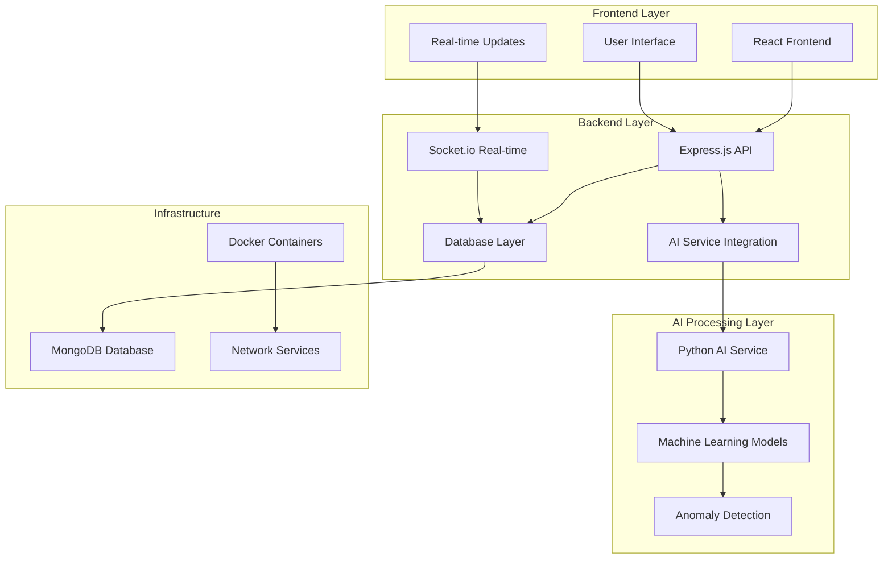
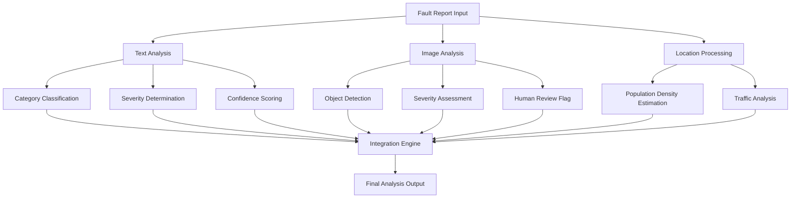
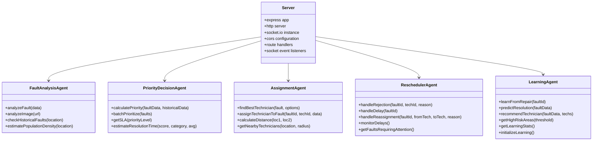
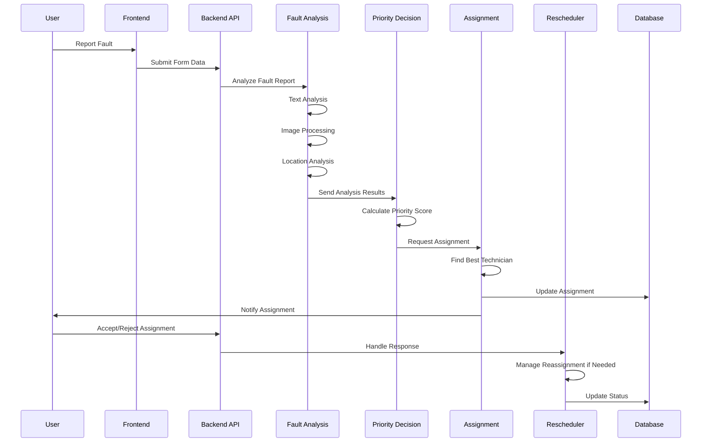
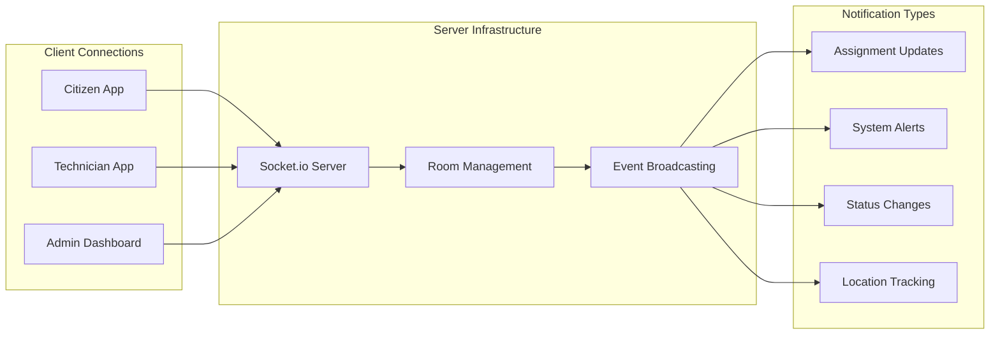
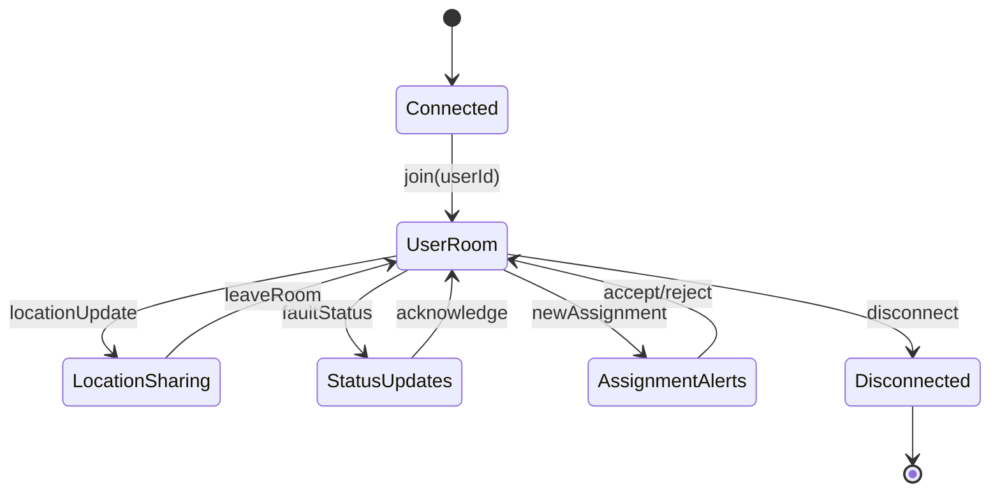
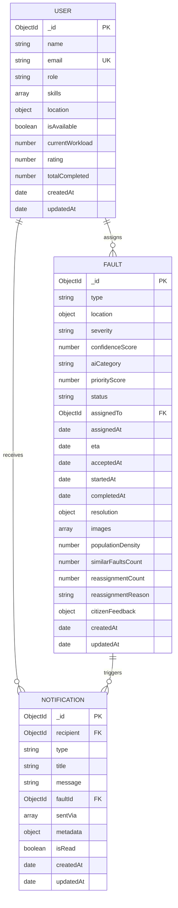
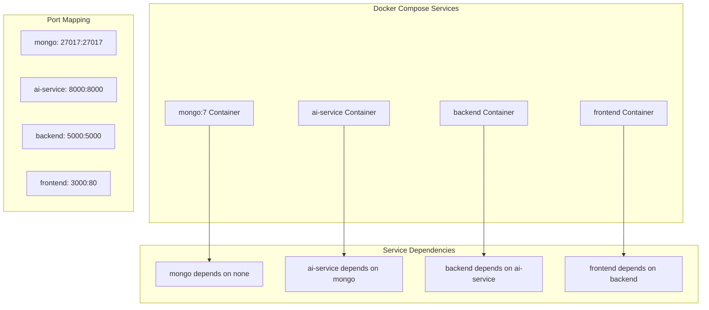

# AI Agent System

<cite>
**Referenced Files in This Document**
- [README.md](file://README.md)
- [docker-compose.yml](file://docker-compose.yml)
- [backend/src/server.js](file://backend/src/server.js)
- [backend/src/agents/faultAnalysisAgent.js](file://backend/src/agents/faultAnalysisAgent.js)
- [backend/src/agents/priorityDecisionAgent.js](file://backend/src/agents/priorityDecisionAgent.js)
- [backend/src/agents/assignmentAgent.js](file://backend/src/agents/assignmentAgent.js)
- [backend/src/agents/reschedulerAgent.js](file://backend/src/agents/reschedulerAgent.js)
- [backend/src/agents/learningAgent.js](file://backend/src/agents/learningAgent.js)
- [backend/src/models/Fault.js](file://backend/src/models/Fault.js)
- [backend/src/models/User.js](file://backend/src/models/User.js)
- [backend/src/services/aiService.js](file://backend/src/services/aiService.js)
- [backend/src/utils/notifier.js](file://backend/src/utils/notifier.js)
- [ai-service/main.py](file://ai-service/main.py)
- [frontend/src/App.jsx](file://frontend/src/App.jsx)
</cite>

## Table of Contents
1. [Introduction](#introduction)
2. [System Architecture](#system-architecture)
3. [AI Agent System](#ai-agent-system)
4. [Core Components](#core-components)
5. [Data Flow and Processing](#data-flow-and-processing)
6. [Technical Implementation](#technical-implementation)
7. [Real-time Communication](#real-time-communication)
8. [Database Design](#database-design)
9. [Deployment and Infrastructure](#deployment-and-infrastructure)
10. [Performance Considerations](#performance-considerations)
11. [Troubleshooting Guide](#troubleshooting-guide)
12. [Conclusion](#conclusion)

## Introduction

The Valtryek_001 Agentic AI Public Utility System is a comprehensive smart city application designed to revolutionize public utility fault detection, analysis, and repair scheduling. This multi-agent AI system enables citizens to report utility faults while leveraging advanced artificial intelligence to automatically analyze, prioritize, and assign repairs to the most suitable technicians based on location, skills, and workload.

The system operates as a production-level solution that integrates five specialized AI agents working in concert to provide autonomous fault management capabilities. It serves three primary user roles: citizens who report utility issues, technicians who receive optimized assignments, and administrators who monitor operations and access analytics.

## System Architecture

The AI Agent System follows a microservices architecture with clear separation of concerns across three main layers: frontend user interface, backend API services, and AI processing capabilities.

**Diagram sources**
- [docker-compose.yml:1-42](file://docker-compose.yml#L1-L42)
- [backend/src/server.js:1-74](file://backend/src/server.js#L1-L74)

The architecture employs a containerized deployment strategy using Docker Compose, ensuring scalability and easy deployment across different environments. The system maintains clear boundaries between the frontend React application, backend Node.js services, and AI processing components.

## AI Agent System

The heart of the Valtryek_001 system lies in its sophisticated multi-agent AI architecture, consisting of five specialized agents that work collaboratively to manage the entire fault lifecycle.

### Fault Analysis Agent

The Fault Analysis Agent serves as the initial processing unit, responsible for analyzing incoming fault reports through multiple data modalities including text descriptions, image uploads, and geographic location data. This agent employs keyword-based categorization algorithms and severity assessment heuristics to provide comprehensive fault analysis.

**Diagram sources**
- [backend/src/agents/faultAnalysisAgent.js:32-89](file://backend/src/agents/faultAnalysisAgent.js#L32-L89)

### Priority Decision Agent

The Priority Decision Agent calculates comprehensive priority scores ranging from 0-100 based on multiple factors including severity levels, population density, historical fault patterns, and temporal considerations. This agent determines the urgency level and estimated resolution time for each fault.

### Assignment Agent

The Assignment Agent implements sophisticated optimization algorithms to match faults with the most suitable technicians. The system considers distance calculations using the Haversine formula, skill matching algorithms, current workload balancing, and technician ratings to ensure optimal assignments.

### Rescheduler Agent

The Rescheduler Agent provides self-healing capabilities by managing technician rejections, handling delays, and facilitating automatic reassignments when necessary. This agent ensures system resilience and maintains operational continuity.

### Learning Agent

The Learning Agent continuously improves system performance by analyzing completed repairs, tracking technician performance metrics, identifying high-risk areas, and generating predictive insights for future fault management.

**Section sources**
- [README.md:13-46](file://README.md#L13-L46)

## Core Components

### Backend Server Infrastructure

The backend server acts as the central orchestrator, managing API routes, WebSocket connections, and coordinating between different AI agents. Built on Express.js with Socket.io for real-time communication, the server provides comprehensive fault management capabilities.

**Diagram sources**
- [backend/src/server.js:17-74](file://backend/src/server.js#L17-L74)
- [backend/src/agents/faultAnalysisAgent.js:144-149](file://backend/src/agents/faultAnalysisAgent.js#L144-L149)
- [backend/src/agents/priorityDecisionAgent.js:172-177](file://backend/src/agents/priorityDecisionAgent.js#L172-L177)
- [backend/src/agents/assignmentAgent.js:252-258](file://backend/src/agents/assignmentAgent.js#L252-L258)
- [backend/src/agents/reschedulerAgent.js:297-304](file://backend/src/agents/reschedulerAgent.js#L297-L304)
- [backend/src/agents/learningAgent.js:388-396](file://backend/src/agents/learningAgent.js#L388-L396)

### AI Service Integration

The AI Service component provides machine learning capabilities through a Python FastAPI application. Currently featuring anomaly detection using Isolation Forest algorithms and image analysis placeholders, this service can be extended with more sophisticated models for enhanced accuracy.

**Section sources**
- [backend/src/server.js:1-74](file://backend/src/server.js#L1-L74)
- [ai-service/main.py:1-209](file://ai-service/main.py#L1-L209)

## Data Flow and Processing

The system processes fault reports through a sophisticated pipeline that transforms raw user input into actionable repair assignments.

**Diagram sources**
- [backend/src/agents/faultAnalysisAgent.js:32-89](file://backend/src/agents/faultAnalysisAgent.js#L32-L89)
- [backend/src/agents/priorityDecisionAgent.js:37-111](file://backend/src/agents/priorityDecisionAgent.js#L37-L111)
- [backend/src/agents/assignmentAgent.js:127-190](file://backend/src/agents/assignmentAgent.js#L127-L190)
- [backend/src/agents/reschedulerAgent.js:27-112](file://backend/src/agents/reschedulerAgent.js#L27-L112)

The data flow ensures comprehensive fault analysis while maintaining real-time responsiveness through efficient API design and optimized database queries.

## Technical Implementation

### Real-time Communication Architecture

The system leverages Socket.io for bidirectional real-time communication, enabling instant notifications and live updates across all user interfaces.

**Diagram sources**
- [backend/src/server.js:27-44](file://backend/src/server.js#L27-L44)

### Database Schema Design

The MongoDB schema supports the complex relationships inherent in utility fault management through carefully designed collections and indexes.

**Section sources**
- [backend/src/models/Fault.js:1-75](file://backend/src/models/Fault.js#L1-L75)
- [backend/src/models/User.js:1-37](file://backend/src/models/User.js#L1-L37)

## Real-time Communication

The real-time communication system utilizes Socket.io to provide seamless updates across all client applications. The implementation includes user-specific room management, location sharing capabilities, and comprehensive notification broadcasting.

**Diagram sources**
- [backend/src/server.js:27-44](file://backend/src/server.js#L27-L44)

## Database Design

The database design supports the multi-faceted nature of utility fault management through specialized collections and optimized indexing strategies.

**Diagram sources**
- [backend/src/models/User.js:4-24](file://backend/src/models/User.js#L4-L24)
- [backend/src/models/Fault.js:3-67](file://backend/src/models/Fault.js#L3-L67)

**Section sources**
- [backend/src/models/User.js:1-37](file://backend/src/models/User.js#L1-L37)
- [backend/src/models/Fault.js:1-75](file://backend/src/models/Fault.js#L1-L75)

## Deployment and Infrastructure

The system employs Docker-based deployment using Docker Compose for streamlined container orchestration and service management.

**Diagram sources**
- [docker-compose.yml:3-42](file://docker-compose.yml#L3-L42)

The infrastructure supports horizontal scaling, health monitoring, and seamless updates through containerized deployment patterns.

**Section sources**
- [docker-compose.yml:1-42](file://docker-compose.yml#L1-L42)

## Performance Considerations

The system incorporates several performance optimization strategies including:

- **Database Indexing**: Strategic indexing on frequently queried fields including status, creation timestamps, and geospatial data
- **Caching Strategies**: In-memory learning data storage for frequently accessed patterns
- **Real-time Optimization**: Efficient Socket.io room management and event broadcasting
- **AI Model Efficiency**: Optimized machine learning inference with appropriate model selection
- **Load Balancing**: Container-based scaling for concurrent service requests

## Troubleshooting Guide

### Common Issues and Solutions

**Connection Problems**
- Verify Docker Compose services are running: `docker-compose ps`
- Check MongoDB connectivity: `mongo agentic-ai --eval "db.version()"`
- Validate AI service availability: `curl http://localhost:8000/`

**Authentication Failures**
- Confirm JWT token generation and validation
- Verify user role permissions
- Check password hashing implementation

**Real-time Communication Issues**
- Monitor Socket.io connection status
- Verify room joining functionality
- Check notification delivery mechanisms

**AI Service Integration Problems**
- Validate Python environment setup
- Confirm model loading and initialization
- Check sensor data processing pipeline

**Section sources**
- [backend/src/server.js:68-74](file://backend/src/server.js#L68-L74)
- [backend/src/utils/notifier.js:7-43](file://backend/src/utils/notifier.js#L7-L43)

## Conclusion

The Valtryek_001 AI Agent System represents a comprehensive solution for modern smart city utility management. Through its sophisticated multi-agent architecture, real-time communication capabilities, and scalable infrastructure, the system provides an autonomous fault management platform that enhances urban service delivery.

The modular design allows for continuous improvement and adaptation to evolving city needs, while the containerized deployment ensures reliable operation across diverse environments. The system's emphasis on learning and adaptation positions it for long-term success in increasingly complex urban infrastructure management scenarios.

Future enhancements including IoT sensor integration, predictive maintenance capabilities, and mobile application support will further strengthen the system's position as a leading smart city solution.