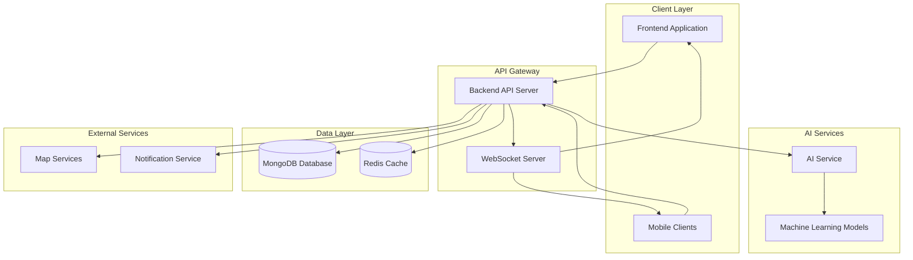
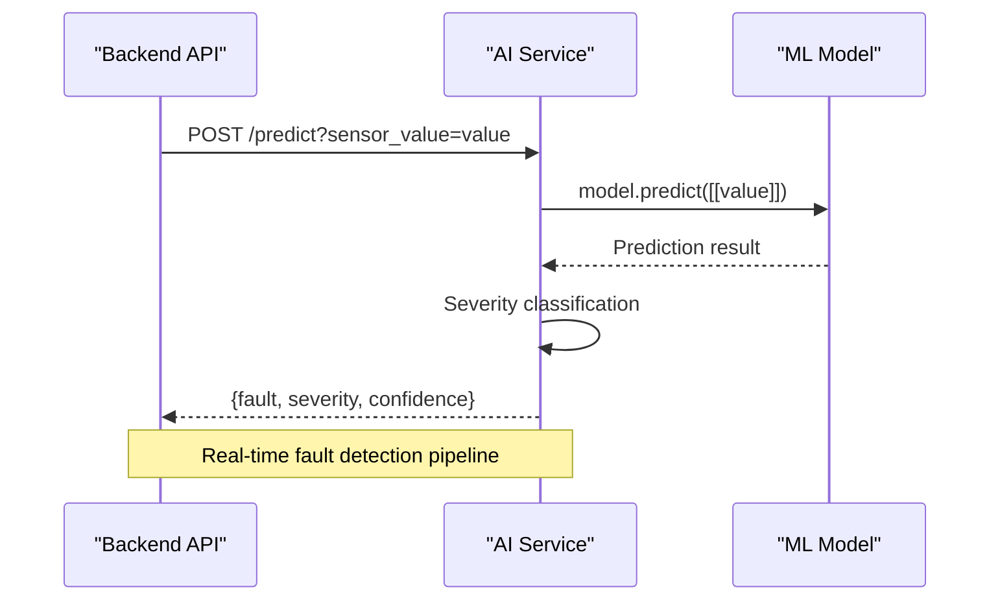
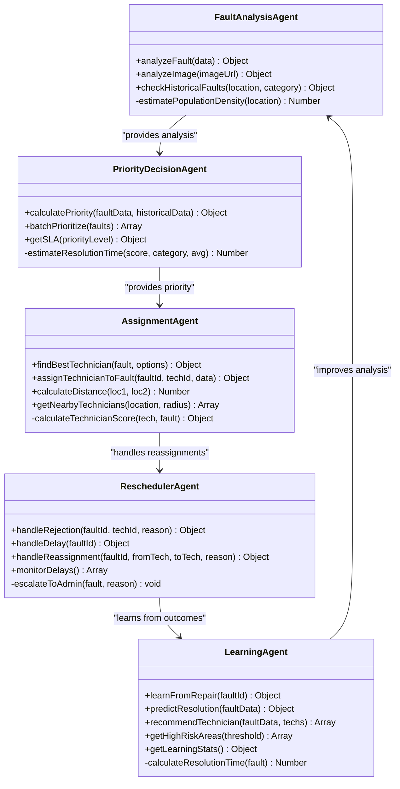
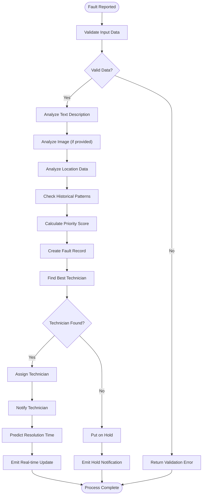
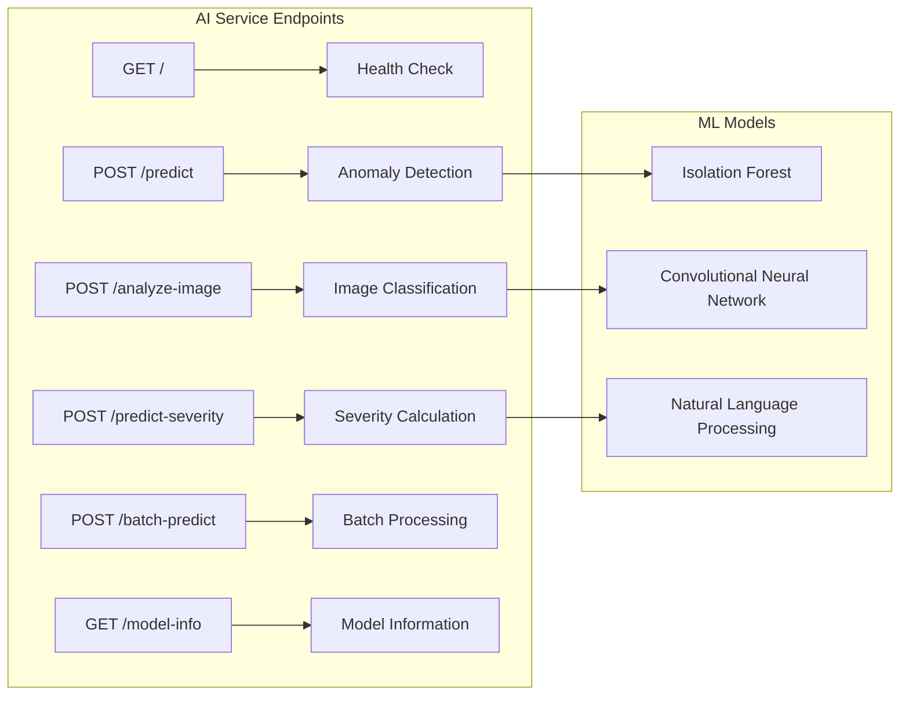
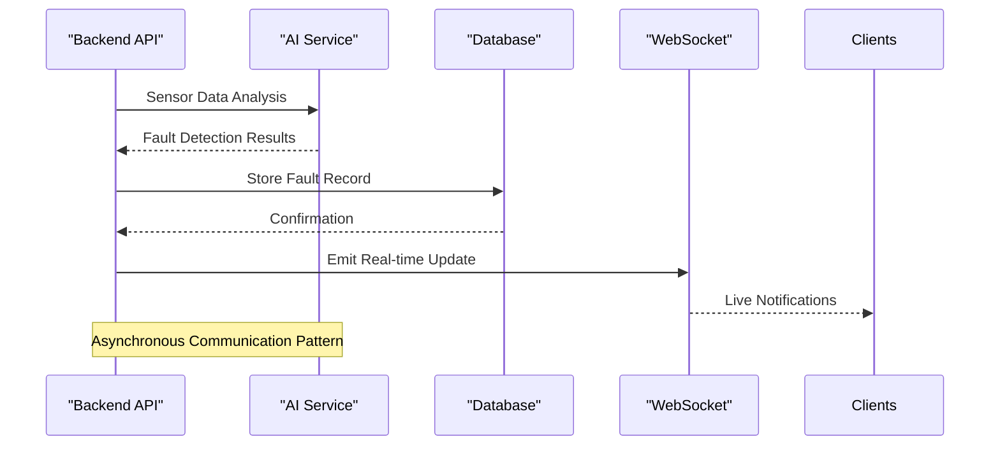
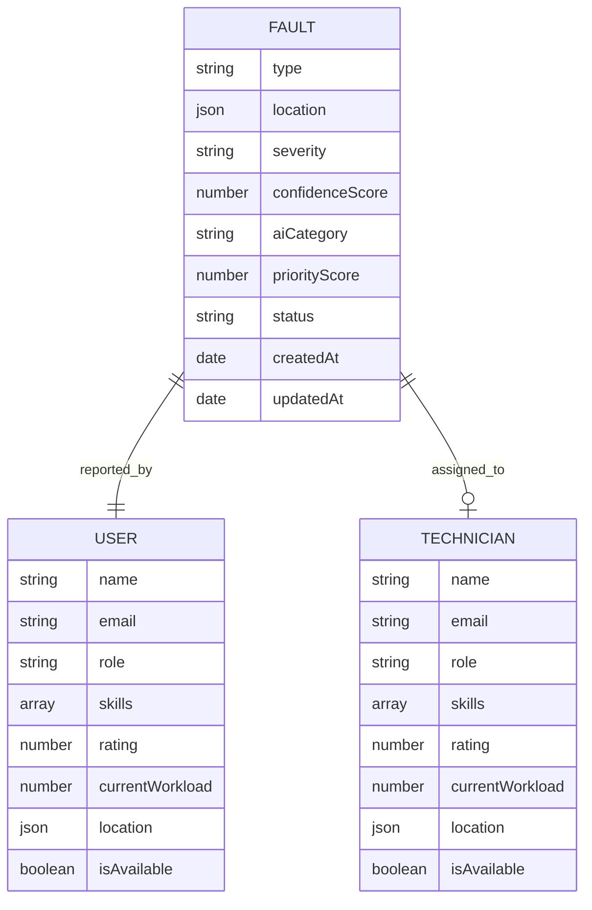
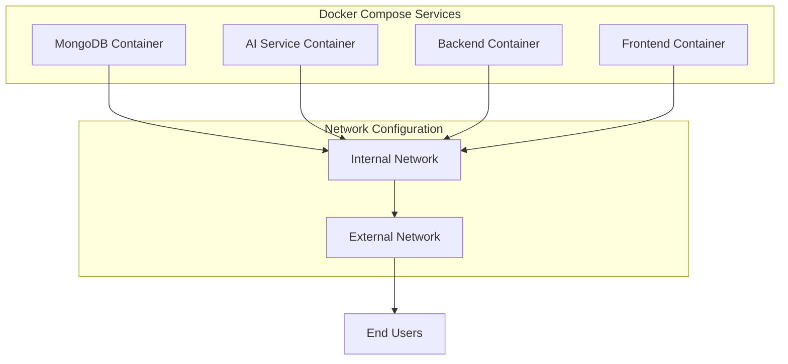

# AI Service Integration

<cite>
**Referenced Files in This Document**
- [README.md](file://README.md)
- [docker-compose.yml](file://docker-compose.yml)
- [backend/src/server.js](file://backend/src/server.js)
- [backend/src/services/aiService.js](file://backend/src/services/aiService.js)
- [backend/src/controllers/faultController.js](file://backend/src/controllers/faultController.js)
- [backend/src/models/Fault.js](file://backend/src/models/Fault.js)
- [backend/src/agents/faultAnalysisAgent.js](file://backend/src/agents/faultAnalysisAgent.js)
- [backend/src/agents/priorityDecisionAgent.js](file://backend/src/agents/priorityDecisionAgent.js)
- [backend/src/agents/assignmentAgent.js](file://backend/src/agents/assignmentAgent.js)
- [backend/src/agents/reschedulerAgent.js](file://backend/src/agents/reschedulerAgent.js)
- [backend/src/agents/learningAgent.js](file://backend/src/agents/learningAgent.js)
- [ai-service/main.py](file://ai-service/main.py)
- [backend/Dockerfile](file://backend/Dockerfile)
- [ai-service/Dockerfile](file://ai-service/Dockerfile)
- [frontend/Dockerfile](file://frontend/Dockerfile)
</cite>

## Table of Contents
1. [Introduction](#introduction)
2. [System Architecture](#system-architecture)
3. [AI Service Integration](#ai-service-integration)
4. [Multi-Agent AI System](#multi-agent-ai-system)
5. [Fault Detection Pipeline](#fault-detection-pipeline)
6. [AI Service Endpoints](#ai-service-endpoints)
7. [Integration Patterns](#integration-patterns)
8. [Data Flow Analysis](#data-flow-analysis)
9. [Performance Considerations](#performance-considerations)
10. [Deployment Architecture](#deployment-architecture)
11. [Troubleshooting Guide](#troubleshooting-guide)
12. [Conclusion](#conclusion)

## Introduction

The Valtryek_001 Agentic AI Public Utility System is a sophisticated multi-agent AI architecture designed for intelligent fault detection, analysis, and repair scheduling in smart city environments. This system integrates advanced AI services with a comprehensive backend infrastructure to provide autonomous solutions for public utility management.

The system operates as a production-level smart city application that enables citizens to report utility faults, AI agents to analyze and prioritize repairs autonomously, technicians to receive optimized assignments, and administrators to monitor operations and access analytics. The AI Service Integration serves as a critical component that provides specialized machine learning capabilities for fault detection and analysis.

## System Architecture

The Valtryek_001 system follows a microservices architecture with clear separation of concerns between the AI service, backend API, frontend application, and database components. The architecture supports real-time communication, automated decision-making, and scalable deployment through containerization.



**Diagram sources**
- [backend/src/server.js:17-74](file://backend/src/server.js#L17-L74)
- [docker-compose.yml:12-38](file://docker-compose.yml#L12-L38)

The architecture demonstrates a clear separation between client-facing services and backend processing, with the AI service positioned as a specialized microservice providing machine learning capabilities.

**Section sources**
- [README.md:47-68](file://README.md#L47-L68)
- [docker-compose.yml:1-42](file://docker-compose.yml#L1-L42)

## AI Service Integration

The AI Service Integration represents a crucial bridge between the backend system and specialized machine learning capabilities. The AI service is built using FastAPI and Python, providing RESTful endpoints for anomaly detection, image analysis, and severity prediction.



**Diagram sources**
- [backend/src/services/aiService.js:3-8](file://backend/src/services/aiService.js#L3-L8)
- [ai-service/main.py:46-64](file://ai-service/main.py#L46-L64)

The integration follows a straightforward HTTP-based communication pattern where the backend service makes requests to the AI service endpoints. The AI service maintains an Isolation Forest model for anomaly detection and provides multiple specialized endpoints for different AI capabilities.

**Section sources**
- [backend/src/services/aiService.js:1-9](file://backend/src/services/aiService.js#L1-L9)
- [ai-service/main.py:1-209](file://ai-service/main.py#L1-L209)

## Multi-Agent AI System

The system employs five specialized AI agents that work collaboratively to provide comprehensive fault management capabilities. Each agent has distinct responsibilities and contributes to the overall autonomous operation of the system.



**Diagram sources**
- [backend/src/agents/faultAnalysisAgent.js:32-89](file://backend/src/agents/faultAnalysisAgent.js#L32-L89)
- [backend/src/agents/priorityDecisionAgent.js:37-111](file://backend/src/agents/priorityDecisionAgent.js#L37-L111)
- [backend/src/agents/assignmentAgent.js:127-190](file://backend/src/agents/assignmentAgent.js#L127-L190)
- [backend/src/agents/reschedulerAgent.js:27-112](file://backend/src/agents/reschedulerAgent.js#L27-L112)
- [backend/src/agents/learningAgent.js:26-59](file://backend/src/agents/learningAgent.js#L26-L59)

Each agent implements specific algorithms and scoring mechanisms to optimize different aspects of the fault management process. The agents communicate through well-defined interfaces and share data through the central database system.

**Section sources**
- [README.md:13-46](file://README.md#L13-L46)
- [backend/src/agents/faultAnalysisAgent.js:1-149](file://backend/src/agents/faultAnalysisAgent.js#L1-L149)
- [backend/src/agents/priorityDecisionAgent.js:1-177](file://backend/src/agents/priorityDecisionAgent.js#L1-L177)
- [backend/src/agents/assignmentAgent.js:1-258](file://backend/src/agents/assignmentAgent.js#L1-L258)
- [backend/src/agents/reschedulerAgent.js:1-304](file://backend/src/agents/reschedulerAgent.js#L1-L304)
- [backend/src/agents/learningAgent.js:1-396](file://backend/src/agents/learningAgent.js#L1-L396)

## Fault Detection Pipeline

The fault detection pipeline represents the core workflow that transforms raw fault reports into actionable assignments. The pipeline integrates multiple AI services and agents to provide comprehensive fault analysis and response.



**Diagram sources**
- [backend/src/controllers/faultController.js:15-125](file://backend/src/controllers/faultController.js#L15-L125)
- [backend/src/agents/faultAnalysisAgent.js:32-89](file://backend/src/agents/faultAnalysisAgent.js#L32-L89)
- [backend/src/agents/priorityDecisionAgent.js:37-111](file://backend/src/agents/priorityDecisionAgent.js#L37-L111)
- [backend/src/agents/assignmentAgent.js:127-190](file://backend/src/agents/assignmentAgent.js#L127-L190)

The pipeline demonstrates a sophisticated decision-making process that considers multiple factors including fault characteristics, historical patterns, and resource availability. Each step incorporates AI-driven analysis to ensure optimal decision-making.

**Section sources**
- [backend/src/controllers/faultController.js:1-449](file://backend/src/controllers/faultController.js#L1-L449)

## AI Service Endpoints

The AI service provides several specialized endpoints designed to support different aspects of fault detection and analysis. These endpoints leverage machine learning models to provide intelligent insights and predictions.



**Diagram sources**
- [ai-service/main.py:34-41](file://ai-service/main.py#L34-L41)
- [ai-service/main.py:46-64](file://ai-service/main.py#L46-L64)
- [ai-service/main.py:70-106](file://ai-service/main.py#L70-L106)
- [ai-service/main.py:112-174](file://ai-service/main.py#L112-L174)
- [ai-service/main.py:180-194](file://ai-service/main.py#L180-L194)
- [ai-service/main.py:200-209](file://ai-service/main.py#L200-L209)

The AI service endpoints demonstrate a modular architecture where different endpoints serve specific machine learning functions. The service maintains appropriate model types and provides comprehensive information about the underlying machine learning capabilities.

**Section sources**
- [ai-service/main.py:1-209](file://ai-service/main.py#L1-L209)

## Integration Patterns

The system implements several integration patterns to ensure seamless communication between components and services. These patterns support scalability, reliability, and maintainability of the overall architecture.



**Diagram sources**
- [backend/src/services/aiService.js:3-8](file://backend/src/services/aiService.js#L3-L8)
- [backend/src/controllers/faultController.js:131-190](file://backend/src/controllers/faultController.js#L131-L190)

The integration patterns demonstrate asynchronous communication between the backend API and AI service, ensuring system resilience and performance. The pattern supports non-blocking operations and real-time updates through WebSocket connections.

**Section sources**
- [backend/src/services/aiService.js:1-9](file://backend/src/services/aiService.js#L1-L9)
- [backend/src/server.js:20-44](file://backend/src/server.js#L20-L44)

## Data Flow Analysis

The data flow within the Valtryek_001 system represents a complex network of information exchange between AI agents, services, and external systems. Understanding this flow is crucial for system optimization and troubleshooting.



**Diagram sources**
- [backend/src/models/Fault.js:3-75](file://backend/src/models/Fault.js#L3-L75)

The data flow analysis reveals the relationships between fault records, user accounts, and technician assignments. The system maintains comprehensive audit trails and supports complex queries for analytics and reporting.

**Section sources**
- [backend/src/models/Fault.js:1-75](file://backend/src/models/Fault.js#L1-L75)

## Performance Considerations

The AI Service Integration incorporates several performance optimization strategies to ensure efficient operation under various load conditions. These considerations are essential for maintaining system responsiveness and reliability.

### Model Performance
- **Isolation Forest Efficiency**: The anomaly detection model uses an Isolation Forest algorithm optimized for real-time processing
- **Memory Management**: Models are loaded once during service startup and reused for subsequent requests
- **Batch Processing**: The service supports batch prediction for improved throughput

### Service Scalability
- **Containerization**: Both backend and AI services are containerized for easy scaling and deployment
- **Load Distribution**: Multiple instances can be deployed behind load balancers
- **Caching Strategies**: Response caching implemented for frequently requested predictions

### Network Optimization
- **Connection Pooling**: Efficient connection management for database and external service calls
- **Asynchronous Processing**: Non-blocking operations for AI service communications
- **Compression**: Response compression for reduced bandwidth usage

**Section sources**
- [ai-service/main.py:24-28](file://ai-service/main.py#L24-L28)
- [docker-compose.yml:12-17](file://docker-compose.yml#L12-L17)

## Deployment Architecture

The deployment architecture leverages Docker containers and Docker Compose to provide a scalable and reproducible deployment environment. This architecture supports development, testing, and production environments with minimal configuration overhead.



**Diagram sources**
- [docker-compose.yml:3-42](file://docker-compose.yml#L3-L42)
- [backend/Dockerfile:1-8](file://backend/Dockerfile#L1-L8)
- [ai-service/Dockerfile:1-7](file://ai-service/Dockerfile#L1-L7)
- [frontend/Dockerfile:1-11](file://frontend/Dockerfile#L1-L11)

The deployment architecture ensures proper service isolation while enabling efficient communication between components. Each service runs in its own container with appropriate resource allocation and security configurations.

**Section sources**
- [docker-compose.yml:1-42](file://docker-compose.yml#L1-L42)
- [backend/Dockerfile:1-8](file://backend/Dockerfile#L1-L8)
- [ai-service/Dockerfile:1-7](file://ai-service/Dockerfile#L1-L7)
- [frontend/Dockerfile:1-11](file://frontend/Dockerfile#L1-L11)

## Troubleshooting Guide

Effective troubleshooting of the AI Service Integration requires understanding of common issues, diagnostic approaches, and resolution strategies. This guide provides systematic approaches to identifying and resolving problems.

### Common Issues and Solutions

**AI Service Unavailable**
- Verify AI service container is running: `docker ps | grep ai-service`
- Check service logs: `docker logs ai-service`
- Validate port binding: `netstat -tulpn | grep 8000`

**Fault Detection Failures**
- Monitor AI service health endpoint: `curl http://localhost:8000/`
- Verify sensor data format: Ensure numeric values for anomaly detection
- Check model loading: Review initialization logs for Isolation Forest errors

**Integration Problems**
- Validate backend-to-AI service connectivity: Test HTTP requests to AI endpoints
- Check CORS configuration: Ensure proper cross-origin allowance
- Monitor WebSocket connections: Verify real-time update functionality

### Diagnostic Commands

```bash
# Check service health
curl http://localhost:8000/
curl http://localhost:5000/

# Monitor service logs
docker compose logs -f ai-service
docker compose logs -f backend

# Validate database connectivity
docker compose exec mongo mongo agentic-ai
```

### Performance Monitoring

- **Response Time**: Monitor AI service endpoint response times
- **Throughput**: Track concurrent request handling capacity
- **Resource Usage**: Monitor CPU, memory, and disk utilization
- **Error Rates**: Track failure rates for AI service requests

**Section sources**
- [ai-service/main.py:34-41](file://ai-service/main.py#L34-L41)
- [backend/src/server.js:56-63](file://backend/src/server.js#L56-L63)

## Conclusion

The AI Service Integration in the Valtryek_001 system represents a sophisticated approach to combining multiple AI agents with specialized machine learning services. The integration provides a robust foundation for intelligent fault detection and management in smart city environments.

The system's architecture demonstrates best practices in microservices design, containerization, and real-time communication. The multi-agent AI system with its specialized agents working in concert provides comprehensive fault management capabilities that adapt and improve over time through machine learning.

Key strengths of the integration include:
- **Modular Design**: Clear separation of concerns between AI agents and services
- **Scalability**: Containerized deployment supporting horizontal scaling
- **Real-time Processing**: WebSocket-based communication for live updates
- **Continuous Learning**: Machine learning agents that improve performance over time
- **Comprehensive Coverage**: Multi-faceted approach addressing all aspects of fault management

The integration serves as a foundation for future enhancements including IoT sensor integration, voice-based reporting, and mobile applications, positioning the system for continued evolution in smart city technology.