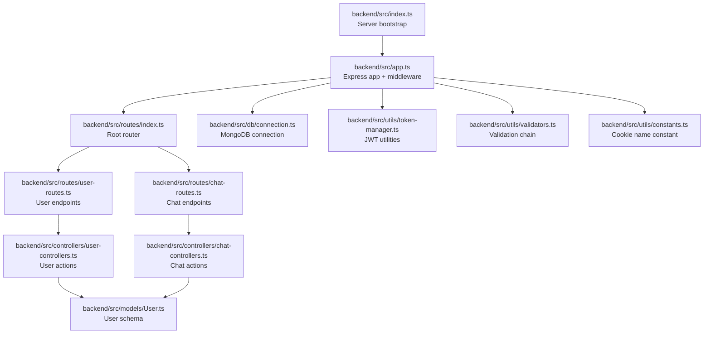
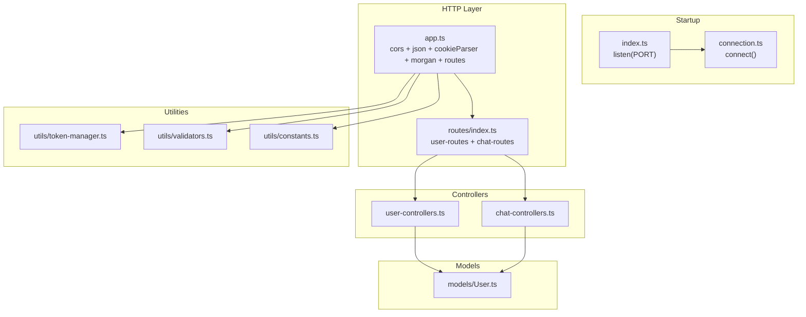
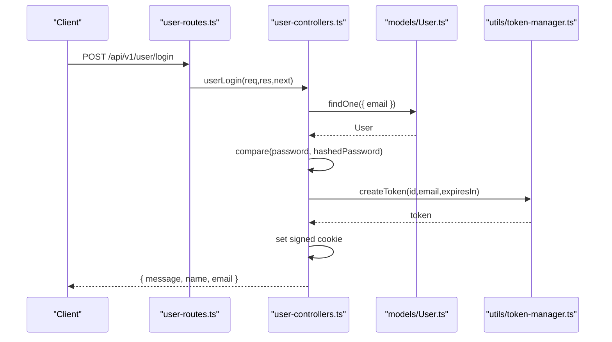
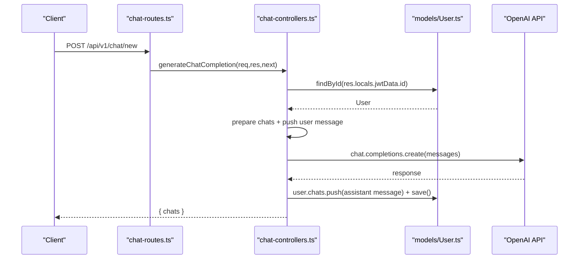
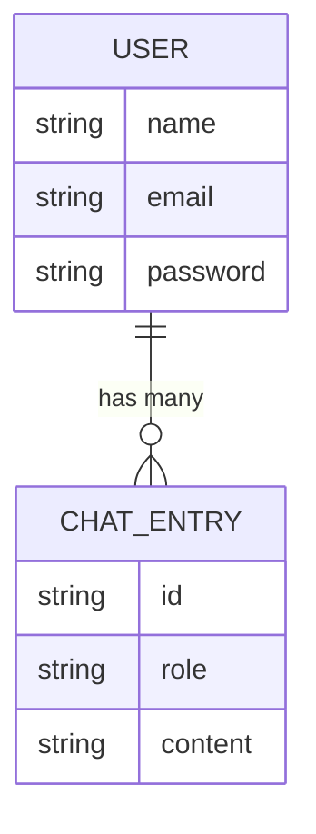
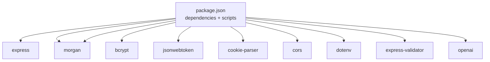

# Backend Development

<cite>
**Referenced Files in This Document**
- [backend/src/index.ts](file://backend/src/index.ts)
- [backend/src/app.ts](file://backend/src/app.ts)
- [backend/src/db/connection.ts](file://backend/src/db/connection.ts)
- [backend/src/models/User.ts](file://backend/src/models/User.ts)
- [backend/src/routes/index.ts](file://backend/src/routes/index.ts)
- [backend/src/routes/user-routes.ts](file://backend/src/routes/user-routes.ts)
- [backend/src/routes/chat-routes.ts](file://backend/src/routes/chat-routes.ts)
- [backend/src/controllers/user-controllers.ts](file://backend/src/controllers/user-controllers.ts)
- [backend/src/controllers/chat-controllers.ts](file://backend/src/controllers/chat-controllers.ts)
- [backend/src/utils/token-manager.ts](file://backend/src/utils/token-manager.ts)
- [backend/src/utils/validators.ts](file://backend/src/utils/validators.ts)
- [backend/src/utils/constants.ts](file://backend/src/utils/constants.ts)
- [backend/package.json](file://backend/package.json)
- [backend/README.md](file://backend/README.md)
- [README.md](file://README.md)
</cite>

## Table of Contents
1. [Introduction](#introduction)
2. [Project Structure](#project-structure)
3. [Core Components](#core-components)
4. [Architecture Overview](#architecture-overview)
5. [Detailed Component Analysis](#detailed-component-analysis)
6. [Dependency Analysis](#dependency-analysis)
7. [Performance Considerations](#performance-considerations)
8. [Troubleshooting Guide](#troubleshooting-guide)
9. [Conclusion](#conclusion)
10. [Appendices](#appendices)

## Introduction
This document provides comprehensive backend development documentation for the SMAN-GPT AI Chat Application. It covers Express server configuration, middleware setup, routing architecture, controller implementations for user authentication and chat message handling, Mongoose models, utility functions for JWT token management and input validation, database integration patterns, error handling strategies, security configurations (including CORS and cookies), and API endpoint documentation. The goal is to enable developers to understand, extend, and maintain the backend effectively.

## Project Structure
The backend follows a modular structure organized by concerns:
- Entry point initializes the server and database connection.
- Express application sets up middleware and mounts route groups.
- Routes define API endpoints grouped by feature (user, chat).
- Controllers implement business logic and interact with models.
- Models define Mongoose schemas for data persistence.
- Utilities encapsulate JWT token management, input validation, and constants.
- Database connection module centralizes MongoDB connectivity.

**Diagram sources**
- [backend/src/index.ts:1-13](file://backend/src/index.ts#L1-L13)
- [backend/src/app.ts:1-21](file://backend/src/app.ts#L1-L21)
- [backend/src/routes/index.ts:1-11](file://backend/src/routes/index.ts#L1-L11)
- [backend/src/routes/user-routes.ts:1-25](file://backend/src/routes/user-routes.ts#L1-L25)
- [backend/src/routes/chat-routes.ts:1-22](file://backend/src/routes/chat-routes.ts#L1-L22)
- [backend/src/controllers/user-controllers.ts:1-163](file://backend/src/controllers/user-controllers.ts#L1-L163)
- [backend/src/controllers/chat-controllers.ts:1-89](file://backend/src/controllers/chat-controllers.ts#L1-L89)
- [backend/src/models/User.ts:1-35](file://backend/src/models/User.ts#L1-L35)
- [backend/src/db/connection.ts:1-21](file://backend/src/db/connection.ts#L1-L21)
- [backend/src/utils/token-manager.ts:1-35](file://backend/src/utils/token-manager.ts#L1-L35)
- [backend/src/utils/validators.ts:1-36](file://backend/src/utils/validators.ts#L1-L36)
- [backend/src/utils/constants.ts:1-2](file://backend/src/utils/constants.ts#L1-L2)

**Section sources**
- [backend/src/index.ts:1-13](file://backend/src/index.ts#L1-L13)
- [backend/src/app.ts:1-21](file://backend/src/app.ts#L1-L21)
- [backend/src/routes/index.ts:1-11](file://backend/src/routes/index.ts#L1-L11)
- [backend/src/models/User.ts:1-35](file://backend/src/models/User.ts#L1-L35)
- [backend/src/utils/constants.ts:1-2](file://backend/src/utils/constants.ts#L1-L2)

## Core Components
- Express server initialization and lifecycle:
  - Starts the server after connecting to the database.
  - Uses environment variables for port and database URL.
- Express application configuration:
  - Enables CORS for a specific origin with credentials.
  - Parses JSON bodies and signed cookies.
  - Logs requests in development mode.
  - Mounts API routes under a versioned base path.
- Database connection:
  - Centralized connection and disconnection functions with error handling.
- Route composition:
  - Root router aggregates user and chat routers.
- Model definition:
  - User schema with nested chat entries.
- Utilities:
  - JWT creation and verification middleware.
  - Input validation chain and validator sets.
  - Cookie name constant.

**Section sources**
- [backend/src/index.ts:1-13](file://backend/src/index.ts#L1-L13)
- [backend/src/app.ts:1-21](file://backend/src/app.ts#L1-L21)
- [backend/src/db/connection.ts:1-21](file://backend/src/db/connection.ts#L1-L21)
- [backend/src/routes/index.ts:1-11](file://backend/src/routes/index.ts#L1-L11)
- [backend/src/models/User.ts:1-35](file://backend/src/models/User.ts#L1-L35)
- [backend/src/utils/token-manager.ts:1-35](file://backend/src/utils/token-manager.ts#L1-L35)
- [backend/src/utils/validators.ts:1-36](file://backend/src/utils/validators.ts#L1-L36)
- [backend/src/utils/constants.ts:1-2](file://backend/src/utils/constants.ts#L1-L2)

## Architecture Overview
The backend employs a layered architecture:
- Entry point orchestrates startup and error propagation.
- Express app configures middleware and routes.
- Routes define protected/unprotected endpoints and apply validation and auth middleware.
- Controllers coordinate data retrieval/saving via Mongoose models.
- Utilities encapsulate cross-cutting concerns (JWT, validation, constants).
- Database connection is established at startup and managed centrally.

**Diagram sources**
- [backend/src/index.ts:1-13](file://backend/src/index.ts#L1-L13)
- [backend/src/app.ts:1-21](file://backend/src/app.ts#L1-L21)
- [backend/src/db/connection.ts:1-21](file://backend/src/db/connection.ts#L1-L21)
- [backend/src/routes/index.ts:1-11](file://backend/src/routes/index.ts#L1-L11)
- [backend/src/controllers/user-controllers.ts:1-163](file://backend/src/controllers/user-controllers.ts#L1-L163)
- [backend/src/controllers/chat-controllers.ts:1-89](file://backend/src/controllers/chat-controllers.ts#L1-L89)
- [backend/src/models/User.ts:1-35](file://backend/src/models/User.ts#L1-L35)
- [backend/src/utils/token-manager.ts:1-35](file://backend/src/utils/token-manager.ts#L1-L35)
- [backend/src/utils/validators.ts:1-36](file://backend/src/utils/validators.ts#L1-L36)
- [backend/src/utils/constants.ts:1-2](file://backend/src/utils/constants.ts#L1-L2)

## Detailed Component Analysis

### Express Server and App Configuration
- Server bootstrap:
  - Reads port from environment variable with a fallback.
  - Establishes database connection before listening.
  - Catches and logs connection errors.
- App configuration:
  - CORS configured for a specific origin with credentials enabled.
  - JSON body parsing and signed cookie parsing with a secret.
  - Morgan logging in development.
  - Mounts versioned routes under "/api/v1".

Best practices:
- Keep environment variables for secrets and URLs.
- Ensure proper error handling during startup.
- Restrict CORS origin in production to your frontend domain.

**Section sources**
- [backend/src/index.ts:1-13](file://backend/src/index.ts#L1-L13)
- [backend/src/app.ts:1-21](file://backend/src/app.ts#L1-L21)

### Database Integration and Connection Management
- Connection:
  - Asynchronously connects to MongoDB using the provided URI.
  - Throws a descriptive error if connection fails.
- Disconnection:
  - Provides a function to disconnect cleanly with error handling.

Patterns:
- Centralize connection logic to enforce consistent startup behavior.
- Wrap connection attempts in try/catch blocks and propagate errors.

**Section sources**
- [backend/src/db/connection.ts:1-21](file://backend/src/db/connection.ts#L1-L21)

### Routing Architecture
- Root router composes user and chat routers.
- User routes:
  - GET "/" fetches all users.
  - POST "/signup" validates inputs and signs up a user.
  - POST "/login" validates inputs and logs in a user.
  - GET "/auth-status" verifies token and checks user.
  - GET "/logout" verifies token and clears cookie.
- Chat routes:
  - POST "/new" validates message, verifies token, and generates chat completion via OpenAI.
  - GET "/all-chats" verifies token and returns user chats.
  - DELETE "/delete" verifies token and clears user chats.

Middleware chain:
- Validation middleware runs before handlers to ensure request integrity.
- Token verification middleware protects endpoints requiring authentication.

**Section sources**
- [backend/src/routes/index.ts:1-11](file://backend/src/routes/index.ts#L1-L11)
- [backend/src/routes/user-routes.ts:1-25](file://backend/src/routes/user-routes.ts#L1-L25)
- [backend/src/routes/chat-routes.ts:1-22](file://backend/src/routes/chat-routes.ts#L1-L22)

### Controller Layer Implementation

#### User Authentication Controllers
Responsibilities:
- Retrieve all users.
- Handle user signup: validate inputs, check uniqueness, hash password, create JWT, set signed cookie.
- Handle user login: validate inputs, verify credentials, create JWT, set signed cookie.
- Verify user: confirm token validity and ownership.
- Logout: confirm token validity and ownership, then clear cookie.

Security considerations:
- Uses signed cookies and HTTP-only attributes.
- Clears existing cookie before setting a new one during login/signup.
- Validates permissions by comparing user ID from token with requested resource.

**Diagram sources**
- [backend/src/routes/user-routes.ts:1-25](file://backend/src/routes/user-routes.ts#L1-L25)
- [backend/src/controllers/user-controllers.ts:64-108](file://backend/src/controllers/user-controllers.ts#L64-L108)
- [backend/src/models/User.ts:1-35](file://backend/src/models/User.ts#L1-L35)
- [backend/src/utils/token-manager.ts:5-11](file://backend/src/utils/token-manager.ts#L5-L11)

**Section sources**
- [backend/src/controllers/user-controllers.ts:1-163](file://backend/src/controllers/user-controllers.ts#L1-L163)

#### Chat Message Controllers
Responsibilities:
- Generate chat completion: load user, prepare chat history, call OpenAI, append response, save user, return updated chats.
- Send chats to user: verify token and return stored chats.
- Delete chats: verify token and clear chat array.

AI integration:
- Uses OpenAI SDK with API key and organization ID from environment variables.
- Sends user messages appended to stored chats and receives assistant replies.

**Diagram sources**
- [backend/src/routes/chat-routes.ts:1-22](file://backend/src/routes/chat-routes.ts#L1-L22)
- [backend/src/controllers/chat-controllers.ts:7-43](file://backend/src/controllers/chat-controllers.ts#L7-L43)
- [backend/src/models/User.ts:1-35](file://backend/src/models/User.ts#L1-L35)

**Section sources**
- [backend/src/controllers/chat-controllers.ts:1-89](file://backend/src/controllers/chat-controllers.ts#L1-L89)

### Model Layer: Mongoose Schemas
- User schema:
  - Fields: name, email (unique), password.
  - Nested chats array with id, role, content.
- Chat entry schema:
  - id defaults to UUID.
  - role and content are required.

Data modeling:
- Embeds chat history within the user document for simplicity.
- Ensures required fields and uniqueness constraints.

**Diagram sources**
- [backend/src/models/User.ts:1-35](file://backend/src/models/User.ts#L1-L35)

**Section sources**
- [backend/src/models/User.ts:1-35](file://backend/src/models/User.ts#L1-L35)

### Utility Functions

#### JWT Token Management
- createToken:
  - Builds a JWT with user id and email and expiration.
- verifyToken:
  - Extracts signed cookie, validates signature, attaches decoded payload to res.locals, and proceeds to next middleware.

Security:
- Uses a secret from environment variables.
- Requires signed cookies and HTTP-only attributes.

**Section sources**
- [backend/src/utils/token-manager.ts:1-35](file://backend/src/utils/token-manager.ts#L1-L35)
- [backend/src/utils/constants.ts:1-2](file://backend/src/utils/constants.ts#L1-L2)

#### Input Validation
- validate:
  - Runs a chain of validation rules and returns 422 with errors if validation fails.
- Validators:
  - loginValidator: email and password length checks.
  - signupValidator: requires name plus loginValidator rules.
  - chatCompletionValidator: requires non-empty message.

Usage:
- Applied as middleware before controller handlers to ensure clean inputs.

**Section sources**
- [backend/src/utils/validators.ts:1-36](file://backend/src/utils/validators.ts#L1-L36)

### Security Implementations
- CORS:
  - Configured for a specific origin with credentials support.
- Cookies:
  - Signed, HTTP-only, domain-scoped, path-scoped cookies.
  - Expiration set to 7 days for session-like behavior.
- JWT:
  - Signed tokens verified on protected routes.
- Input validation:
  - Enforces required fields and formats before processing.

Recommendations:
- Tighten CORS origin in production to your frontend domain.
- Use HTTPS in production and consider SameSite policies.
- Rotate secrets regularly and restrict cookie domains.

**Section sources**
- [backend/src/app.ts:11-16](file://backend/src/app.ts#L11-L16)
- [backend/src/utils/token-manager.ts:18-33](file://backend/src/utils/token-manager.ts#L18-L33)
- [backend/src/utils/validators.ts:4-18](file://backend/src/utils/validators.ts#L4-L18)
- [backend/src/controllers/user-controllers.ts:37-53](file://backend/src/controllers/user-controllers.ts#L37-L53)
- [backend/src/controllers/user-controllers.ts:83-99](file://backend/src/controllers/user-controllers.ts#L83-L99)
- [backend/src/controllers/user-controllers.ts:148-153](file://backend/src/controllers/user-controllers.ts#L148-L153)

### API Endpoint Documentation

Base path: /api/v1

- User Endpoints
  - GET /
    - Description: Fetch all users.
    - Auth: No.
    - Responses: 200 OK with users array; on error, 200 with error message.
  - POST /signup
    - Description: Register a new user.
    - Auth: No.
    - Body: name, email, password.
    - Responses: 201 Created with user info; 401 if user exists; on error, 200 with error message.
  - POST /login
    - Description: Authenticate user and set session cookie.
    - Auth: No.
    - Body: email, password.
    - Responses: 200 OK with user info; 401/403 for invalid credentials; on error, 200 with error message.
  - GET /auth-status
    - Description: Verify current session and return user info.
    - Auth: Yes (token required).
    - Responses: 200 OK with user info; 401 for invalid/expired token or mismatched permissions; on error, 200 with error message.
  - GET /logout
    - Description: Invalidate session by clearing cookie.
    - Auth: Yes (token required).
    - Responses: 200 OK with user info; 401 for invalid/expired token or mismatched permissions; on error, 200 with error message.

- Chat Endpoints
  - POST /new
    - Description: Generate a chat completion using OpenAI and persist the exchange.
    - Auth: Yes (token required).
    - Body: message.
    - Responses: 200 OK with updated chats; 401 for invalid/expired token or mismatched permissions; 500 on internal error.
  - GET /all-chats
    - Description: Retrieve all chats for the authenticated user.
    - Auth: Yes (token required).
    - Responses: 200 OK with chats; 401 for invalid/expired token or mismatched permissions; on error, 200 with error message.
  - DELETE /delete
    - Description: Clear all chats for the authenticated user.
    - Auth: Yes (token required).
    - Responses: 200 OK; 401 for invalid/expired token or mismatched permissions; on error, 200 with error message.

Validation rules:
- loginValidator: email required and valid; password required with minimum length.
- signupValidator: name required; applies loginValidator rules.
- chatCompletionValidator: message required and non-empty.

**Section sources**
- [backend/src/routes/user-routes.ts:18-22](file://backend/src/routes/user-routes.ts#L18-L22)
- [backend/src/routes/chat-routes.ts:12-19](file://backend/src/routes/chat-routes.ts#L12-L19)
- [backend/src/utils/validators.ts:20-35](file://backend/src/utils/validators.ts#L20-L35)
- [backend/src/controllers/user-controllers.ts:7-20](file://backend/src/controllers/user-controllers.ts#L7-L20)
- [backend/src/controllers/user-controllers.ts:22-62](file://backend/src/controllers/user-controllers.ts#L22-L62)
- [backend/src/controllers/user-controllers.ts:64-108](file://backend/src/controllers/user-controllers.ts#L64-L108)
- [backend/src/controllers/user-controllers.ts:110-131](file://backend/src/controllers/user-controllers.ts#L110-L131)
- [backend/src/controllers/user-controllers.ts:133-162](file://backend/src/controllers/user-controllers.ts#L133-L162)
- [backend/src/controllers/chat-controllers.ts:7-43](file://backend/src/controllers/chat-controllers.ts#L7-L43)
- [backend/src/controllers/chat-controllers.ts:45-64](file://backend/src/controllers/chat-controllers.ts#L45-L64)
- [backend/src/controllers/chat-controllers.ts:66-88](file://backend/src/controllers/chat-controllers.ts#L66-L88)

## Dependency Analysis
External dependencies include Express, Mongoose, bcrypt, jsonwebtoken, cookie-parser, cors, dotenv, morgan, express-validator, and OpenAI. The backend script uses TypeScript compilation and nodemon for development.

**Diagram sources**
- [backend/package.json:15-27](file://backend/package.json#L15-L27)

**Section sources**
- [backend/package.json:1-40](file://backend/package.json#L1-L40)

## Performance Considerations
- Database queries:
  - Minimize round trips by batching operations where possible.
  - Index frequently queried fields (e.g., email) to improve lookup performance.
- OpenAI calls:
  - Cache responses when appropriate and avoid redundant prompts.
  - Monitor rate limits and handle throttling gracefully.
- Middleware:
  - Keep validation chains minimal and efficient.
  - Avoid heavy synchronous operations in middleware.
- Logging:
  - Disable verbose logging in production to reduce I/O overhead.

## Troubleshooting Guide
Common issues and resolutions:
- Database connection failures:
  - Verify MONGODB_URL environment variable and network access.
  - Check for connection errors thrown during startup.
- JWT verification errors:
  - Ensure JWT_SECRET is set and consistent across deployments.
  - Confirm client sends signed cookies with correct domain/path.
- CORS errors:
  - Align frontend origin with backend CORS configuration.
  - Enable credentials only for trusted origins.
- Validation errors:
  - Review 422 responses to identify missing or malformed fields.
- OpenAI integration:
  - Confirm OPENAI_API_KEY and organization ID are set.
  - Inspect error responses from OpenAI and handle appropriately.

**Section sources**
- [backend/src/db/connection.ts:3-8](file://backend/src/db/connection.ts#L3-L8)
- [backend/src/utils/token-manager.ts:18-33](file://backend/src/utils/token-manager.ts#L18-L33)
- [backend/src/app.ts:11-16](file://backend/src/app.ts#L11-L16)
- [backend/src/utils/validators.ts:12-17](file://backend/src/utils/validators.ts#L12-L17)
- [backend/src/controllers/chat-controllers.ts:38-42](file://backend/src/controllers/chat-controllers.ts#L38-L42)

## Conclusion
The SMAN-GPT backend demonstrates a clean separation of concerns with Express, Mongoose, and modular utilities. It enforces security through signed cookies, JWT verification, and input validation while integrating with OpenAI for conversational AI. The architecture supports straightforward extension for additional features such as user roles, chat metadata, or external integrations.

## Appendices

### Environment Variables
- PORT: Server port (default 5000).
- MONGODB_URL: MongoDB connection URI.
- JWT_SECRET: Secret for signing JWTs.
- OPENAI_API_KEY: OpenAI API key.
- OPENAI_ORGANIZATION_ID: OpenAI organization identifier.
- COOKIE_SECRET: Secret for signing cookies.

**Section sources**
- [README.md:73-78](file://README.md#L73-L78)
- [backend/src/app.ts:2](file://backend/src/app.ts#L2)
- [backend/src/utils/token-manager.ts:7](file://backend/src/utils/token-manager.ts#L7)
- [backend/src/utils/token-manager.ts:18](file://backend/src/utils/token-manager.ts#L18)
- [backend/src/controllers/chat-controllers.ts:20-23](file://backend/src/controllers/chat-controllers.ts#L20-L23)