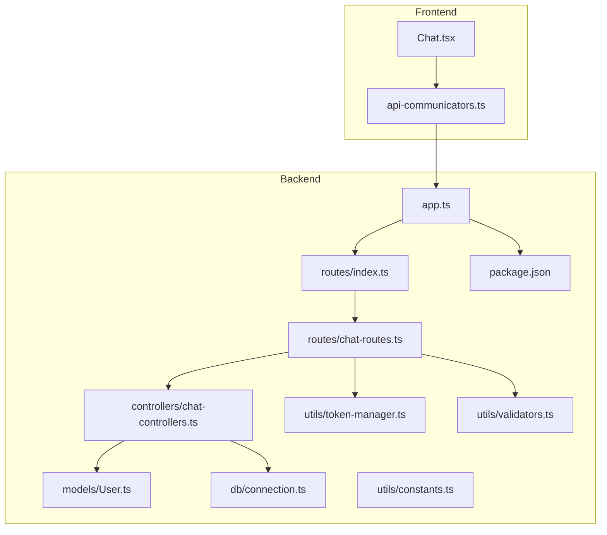
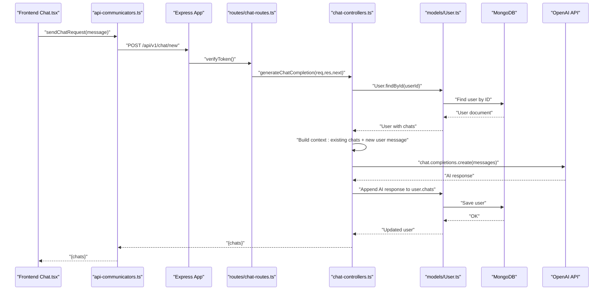
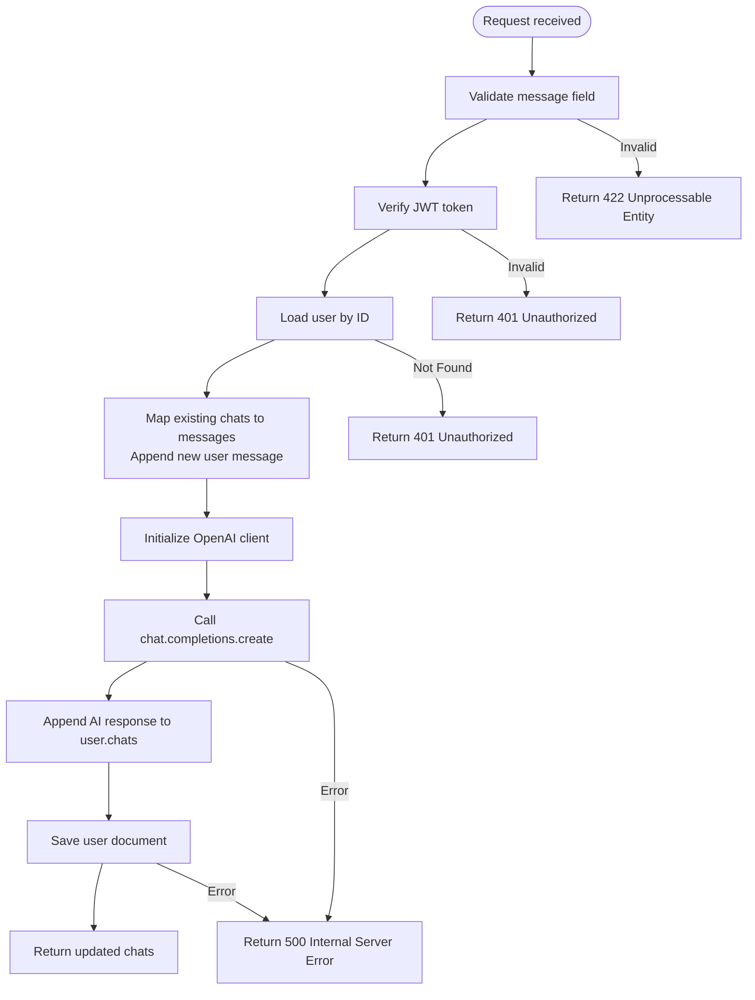
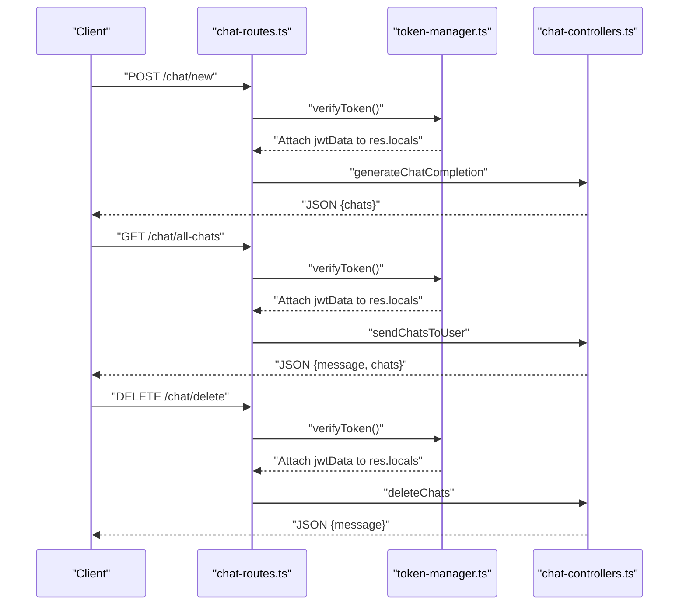
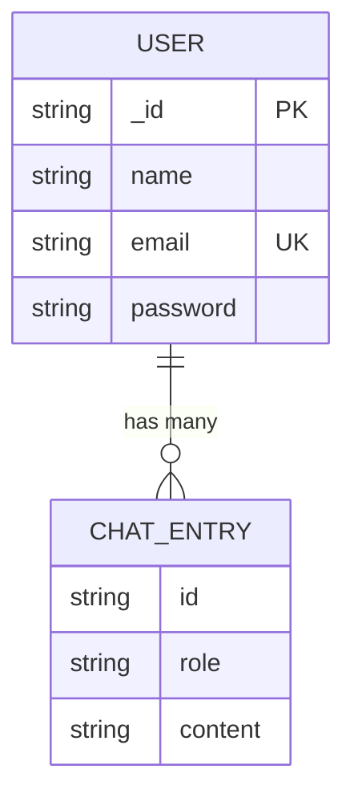
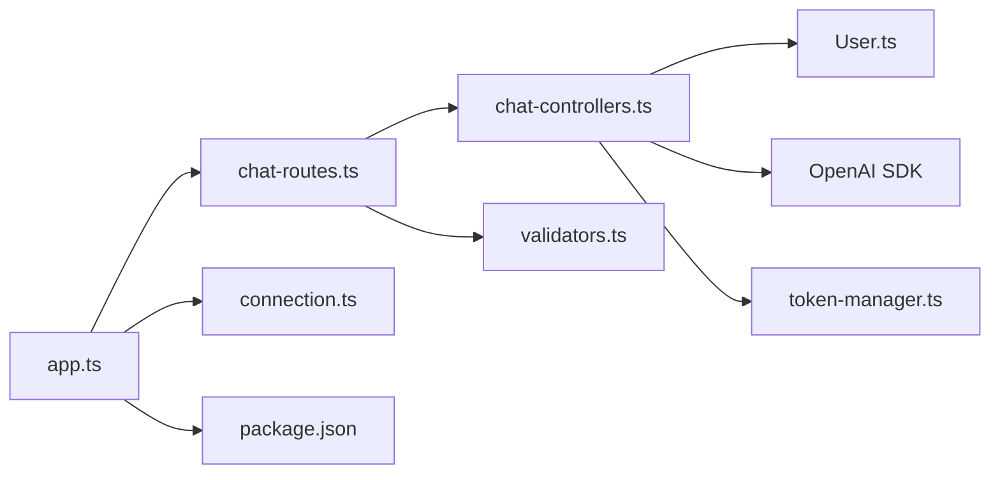

# Chat Controller

<cite>
**Referenced Files in This Document**
- [chat-controllers.ts](file://backend/src/controllers/chat-controllers.ts)
- [chat-routes.ts](file://backend/src/routes/chat-routes.ts)
- [index.ts](file://backend/src/index.ts)
- [app.ts](file://backend/src/app.ts)
- [connection.ts](file://backend/src/db/connection.ts)
- [User.ts](file://backend/src/models/User.ts)
- [token-manager.ts](file://backend/src/utils/token-manager.ts)
- [validators.ts](file://backend/src/utils/validators.ts)
- [constants.ts](file://backend/src/utils/constants.ts)
- [package.json](file://backend/package.json)
- [api-communicators.ts](file://frontend/src/helpers/api-communicators.ts)
- [Chat.tsx](file://frontend/src/pages/Chat.tsx)
</cite>

## Table of Contents
1. [Introduction](#introduction)
2. [Project Structure](#project-structure)
3. [Core Components](#core-components)
4. [Architecture Overview](#architecture-overview)
5. [Detailed Component Analysis](#detailed-component-analysis)
6. [Dependency Analysis](#dependency-analysis)
7. [Performance Considerations](#performance-considerations)
8. [Troubleshooting Guide](#troubleshooting-guide)
9. [Conclusion](#conclusion)

## Introduction
This document provides comprehensive documentation for the chat controller implementation, focusing on AI message processing business logic. It explains how chat messages are created, how conversation context is managed, how the OpenAI API is integrated, and how chat history operations are performed. The controller combines user messages with chat history to produce AI responses, manages conversation threads, and handles chat deletion operations. Error handling strategies for AI API failures, response formatting, and database operations for chat persistence are documented alongside concrete examples of controller method implementations and data transformation workflows.

## Project Structure
The chat functionality spans backend controllers, routes, models, utilities, and frontend components. The backend uses Express for HTTP handling, Mongoose for MongoDB persistence, and the OpenAI SDK for AI interactions. The frontend communicates with the backend via Axios-based helpers and renders chat conversations.

**Diagram sources**
- [app.ts:1-21](file://backend/src/app.ts#L1-L21)
- [chat-routes.ts:1-22](file://backend/src/routes/chat-routes.ts#L1-L22)
- [chat-controllers.ts:1-89](file://backend/src/controllers/chat-controllers.ts#L1-L89)
- [User.ts:1-35](file://backend/src/models/User.ts#L1-L35)
- [connection.ts:1-21](file://backend/src/db/connection.ts#L1-L21)
- [token-manager.ts:1-35](file://backend/src/utils/token-manager.ts#L1-L35)
- [validators.ts:1-36](file://backend/src/utils/validators.ts#L1-L36)
- [constants.ts:1-2](file://backend/src/utils/constants.ts#L1-L2)
- [package.json:1-40](file://backend/package.json#L1-L40)

**Section sources**
- [app.ts:1-21](file://backend/src/app.ts#L1-L21)
- [chat-routes.ts:1-22](file://backend/src/routes/chat-routes.ts#L1-L22)
- [chat-controllers.ts:1-89](file://backend/src/controllers/chat-controllers.ts#L1-L89)
- [User.ts:1-35](file://backend/src/models/User.ts#L1-L35)
- [connection.ts:1-21](file://backend/src/db/connection.ts#L1-L21)
- [token-manager.ts:1-35](file://backend/src/utils/token-manager.ts#L1-L35)
- [validators.ts:1-36](file://backend/src/utils/validators.ts#L1-L36)
- [constants.ts:1-2](file://backend/src/utils/constants.ts#L1-L2)
- [package.json:1-40](file://backend/package.json#L1-L40)

## Core Components
- Chat Controllers: Implements three primary operations:
  - Generate AI chat completion from user message
  - Retrieve all chats for the authenticated user
  - Delete all chats for the authenticated user
- Chat Routes: Defines protected endpoints for chat operations with middleware for token verification and input validation.
- User Model: Defines the chat history schema embedded within the user document.
- Token Manager: Verifies JWT tokens stored in signed cookies.
- Validators: Provides validation chains for incoming requests.
- Frontend Helpers: Communicate with backend endpoints for sending messages, loading chats, and deleting chats.

Key responsibilities:
- Authentication and authorization via JWT verification
- Context construction by combining existing chat history with the new user message
- OpenAI API integration for generating AI responses
- Persistence of chat history to MongoDB
- Error handling for API failures, validation errors, and database operations

**Section sources**
- [chat-controllers.ts:7-43](file://backend/src/controllers/chat-controllers.ts#L7-L43)
- [chat-controllers.ts:45-64](file://backend/src/controllers/chat-controllers.ts#L45-L64)
- [chat-controllers.ts:66-88](file://backend/src/controllers/chat-controllers.ts#L66-L88)
- [chat-routes.ts:10-21](file://backend/src/routes/chat-routes.ts#L10-L21)
- [User.ts:3-16](file://backend/src/models/User.ts#L3-L16)
- [token-manager.ts:13-34](file://backend/src/utils/token-manager.ts#L13-L34)
- [validators.ts:4-18](file://backend/src/utils/validators.ts#L4-L18)

## Architecture Overview
The chat flow integrates frontend, backend, and external AI services:

**Diagram sources**
- [Chat.tsx:23-33](file://frontend/src/pages/Chat.tsx#L23-L33)
- [api-communicators.ts:19-26](file://frontend/src/helpers/api-communicators.ts#L19-L26)
- [app.ts:18](file://backend/src/app.ts#L18)
- [chat-routes.ts:12-17](file://backend/src/routes/chat-routes.ts#L12-L17)
- [chat-controllers.ts:7-43](file://backend/src/controllers/chat-controllers.ts#L7-L43)
- [User.ts:1-35](file://backend/src/models/User.ts#L1-L35)
- [connection.ts:1-21](file://backend/src/db/connection.ts#L1-L21)

## Detailed Component Analysis

### Chat Completion Controller
Responsibilities:
- Validate request payload
- Verify JWT token and extract user identity
- Load user document and build conversation context
- Call OpenAI API with constructed messages
- Persist AI response to user’s chat history
- Return updated chat history

Processing logic:
- Extracts message from request body
- Retrieves user by ID from JWT claims
- Transforms existing chats to OpenAI-compatible message array
- Appends the new user message to both the context array and user’s chat history
- Initializes OpenAI client with environment variables
- Calls chat.completions.create with model and messages
- Appends AI response to user’s chat history
- Saves user document and returns updated chats

Error handling:
- Catches exceptions during OpenAI call or save operation
- Returns standardized error responses with appropriate status codes

**Diagram sources**
- [chat-controllers.ts:7-43](file://backend/src/controllers/chat-controllers.ts#L7-L43)
- [validators.ts:33-35](file://backend/src/utils/validators.ts#L33-L35)
- [token-manager.ts:13-34](file://backend/src/utils/token-manager.ts#L13-L34)

**Section sources**
- [chat-controllers.ts:7-43](file://backend/src/controllers/chat-controllers.ts#L7-L43)
- [validators.ts:33-35](file://backend/src/utils/validators.ts#L33-L35)
- [token-manager.ts:13-34](file://backend/src/utils/token-manager.ts#L13-L34)

### Send All Chats Controller
Responsibilities:
- Verify JWT token
- Load user document
- Return user’s chat history

Processing logic:
- Validates token and loads user
- Checks ownership by comparing user ID with JWT claims
- Returns chats in JSON response

Error handling:
- Returns 401 for missing/invalid token or mismatched permissions
- Returns standardized error response for unexpected issues

**Section sources**
- [chat-controllers.ts:45-64](file://backend/src/controllers/chat-controllers.ts#L45-L64)
- [token-manager.ts:13-34](file://backend/src/utils/token-manager.ts#L13-L34)

### Delete Chats Controller
Responsibilities:
- Verify JWT token
- Load user document
- Clear user’s chat history
- Persist empty chat history

Processing logic:
- Validates token and loads user
- Ensures ownership
- Sets user.chats to empty array
- Saves user document

Error handling:
- Returns 401 for missing/invalid token or mismatched permissions
- Returns standardized error response for unexpected issues

**Section sources**
- [chat-controllers.ts:66-88](file://backend/src/controllers/chat-controllers.ts#L66-L88)
- [token-manager.ts:13-34](file://backend/src/utils/token-manager.ts#L13-L34)

### Route Definitions and Middleware
Endpoints:
- POST /api/v1/chat/new: Generates AI chat completion
- GET /api/v1/chat/all-chats: Retrieves all chats
- DELETE /api/v1/chat/delete: Deletes all chats

Middleware:
- verifyToken: Ensures valid JWT token
- validate(chatCompletionValidator): Validates message presence

**Diagram sources**
- [chat-routes.ts:12-19](file://backend/src/routes/chat-routes.ts#L12-L19)
- [token-manager.ts:13-34](file://backend/src/utils/token-manager.ts#L13-L34)
- [chat-controllers.ts:7-43](file://backend/src/controllers/chat-controllers.ts#L7-L43)
- [chat-controllers.ts:45-64](file://backend/src/controllers/chat-controllers.ts#L45-L64)
- [chat-controllers.ts:66-88](file://backend/src/controllers/chat-controllers.ts#L66-L88)

**Section sources**
- [chat-routes.ts:10-21](file://backend/src/routes/chat-routes.ts#L10-L21)
- [token-manager.ts:13-34](file://backend/src/utils/token-manager.ts#L13-L34)
- [validators.ts:4-18](file://backend/src/utils/validators.ts#L4-L18)

### Data Model: User with Embedded Chat History
The User model embeds an array of chat entries. Each chat entry has:
- id: UUID string
- role: "user" or "assistant"
- content: message text

**Diagram sources**
- [User.ts:3-16](file://backend/src/models/User.ts#L3-L16)
- [User.ts:17-32](file://backend/src/models/User.ts#L17-L32)

**Section sources**
- [User.ts:1-35](file://backend/src/models/User.ts#L1-L35)

### Frontend Integration
Frontend components:
- Chat.tsx: Manages chat state, submits messages, loads chats, clears conversation
- api-communicators.ts: Encapsulates HTTP calls to backend endpoints

Workflow:
- On submit, frontend sends message to backend
- Backend responds with updated chat history
- Frontend updates local state with the returned chats

**Section sources**
- [Chat.tsx:23-33](file://frontend/src/pages/Chat.tsx#L23-L33)
- [api-communicators.ts:19-26](file://frontend/src/helpers/api-communicators.ts#L19-L26)

## Dependency Analysis
External dependencies:
- OpenAI SDK for AI completions
- Mongoose for MongoDB operations
- Express for HTTP routing and middleware
- jsonwebtoken for JWT verification
- express-validator for request validation
- dotenv for environment variables

Internal dependencies:
- Controllers depend on models for persistence
- Routes depend on controllers for business logic
- Controllers depend on token-manager for authentication
- Routes depend on validators for input validation

**Diagram sources**
- [chat-controllers.ts:1-89](file://backend/src/controllers/chat-controllers.ts#L1-L89)
- [User.ts:1-35](file://backend/src/models/User.ts#L1-L35)
- [token-manager.ts:1-35](file://backend/src/utils/token-manager.ts#L1-L35)
- [chat-routes.ts:1-22](file://backend/src/routes/chat-routes.ts#L1-L22)
- [validators.ts:1-36](file://backend/src/utils/validators.ts#L1-L36)
- [app.ts:1-21](file://backend/src/app.ts#L1-L21)
- [connection.ts:1-21](file://backend/src/db/connection.ts#L1-L21)
- [package.json:15-26](file://backend/package.json#L15-L26)

**Section sources**
- [package.json:15-26](file://backend/package.json#L15-L26)
- [chat-controllers.ts:1-89](file://backend/src/controllers/chat-controllers.ts#L1-L89)
- [chat-routes.ts:1-22](file://backend/src/routes/chat-routes.ts#L1-L22)
- [token-manager.ts:1-35](file://backend/src/utils/token-manager.ts#L1-35)
- [validators.ts:1-36](file://backend/src/utils/validators.ts#L1-L36)
- [app.ts:1-21](file://backend/src/app.ts#L1-L21)
- [connection.ts:1-21](file://backend/src/db/connection.ts#L1-L21)

## Performance Considerations
- Context size: As chat history grows, so does the prompt size sent to OpenAI. Consider limiting history length or summarizing older messages to keep costs and latency manageable.
- Batch operations: If frequent small writes occur, consider batching or periodic flushes to reduce database round-trips.
- Caching: For repeated identical prompts, implement caching at the application level to reduce redundant API calls.
- Streaming: OpenAI supports streaming responses; integrating streaming could improve perceived performance and UX.
- Environment configuration: Ensure OPENAI_API_KEY and MongoDB connection strings are configured appropriately for production environments.

## Troubleshooting Guide
Common issues and resolutions:
- Authentication failures:
  - Missing or invalid JWT token leads to 401 responses. Verify cookie configuration and token expiration.
  - Ownership mismatch occurs when user ID does not match JWT claims; ensure consistent user session handling.
- Validation errors:
  - Missing message field triggers 422 responses. Ensure frontend sends required fields.
- OpenAI API errors:
  - Network issues or quota limits cause failures. Implement retry logic with exponential backoff and fallback messaging.
- Database errors:
  - Connection failures or write conflicts lead to 500 responses. Ensure database connectivity and handle transient errors gracefully.
- Frontend synchronization:
  - Ensure frontend updates state only after receiving successful responses from backend to prevent inconsistent UI.

**Section sources**
- [chat-controllers.ts:38-42](file://backend/src/controllers/chat-controllers.ts#L38-L42)
- [chat-controllers.ts:50-63](file://backend/src/controllers/chat-controllers.ts#L50-L63)
- [chat-controllers.ts:71-87](file://backend/src/controllers/chat-controllers.ts#L71-L87)
- [token-manager.ts:18-33](file://backend/src/utils/token-manager.ts#L18-L33)
- [validators.ts:12-17](file://backend/src/utils/validators.ts#L12-L17)

## Conclusion
The chat controller implements a robust pipeline for AI-assisted conversations. It securely authenticates users, constructs conversation context from persisted chat history, integrates with the OpenAI API, and persists updated conversations. The design emphasizes separation of concerns through controllers, routes, models, and utilities, while the frontend provides a responsive interface for interacting with the backend. Proper error handling, validation, and database operations ensure reliability. Future enhancements can focus on context management, streaming, and performance optimization.