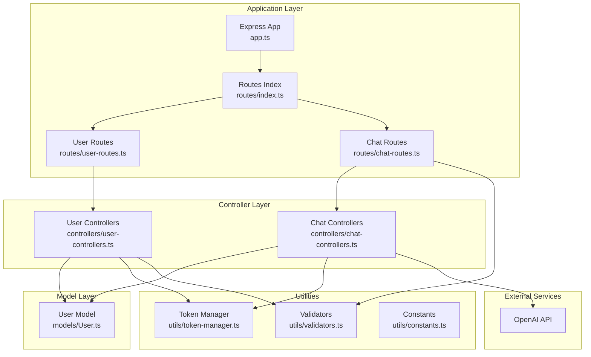
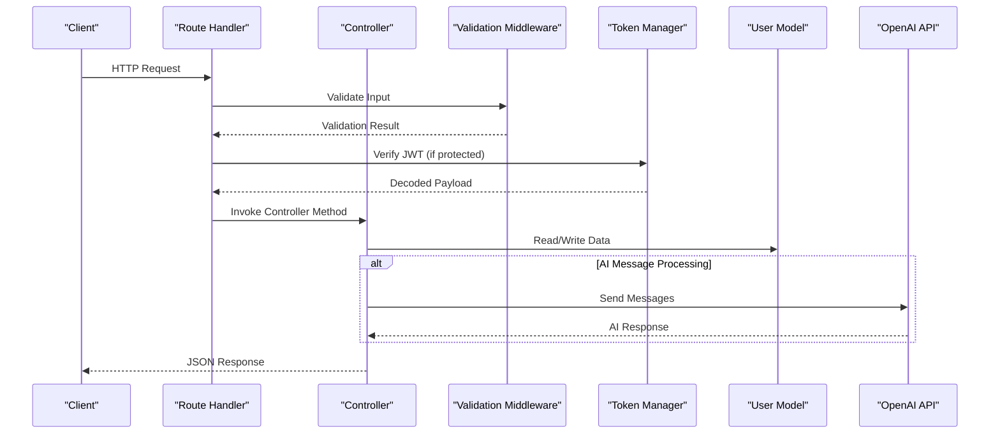
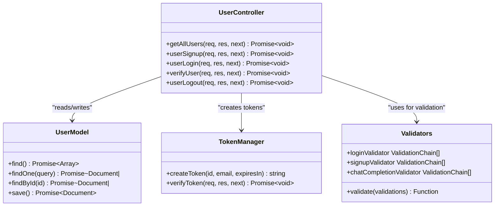
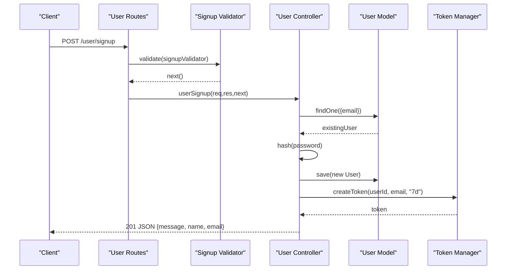
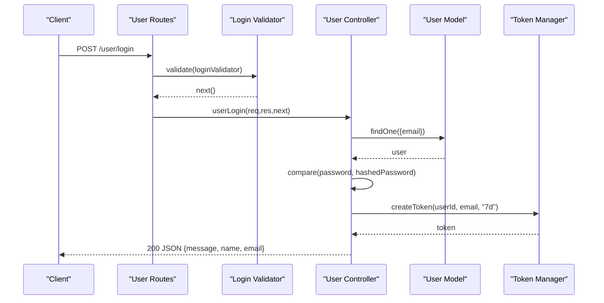
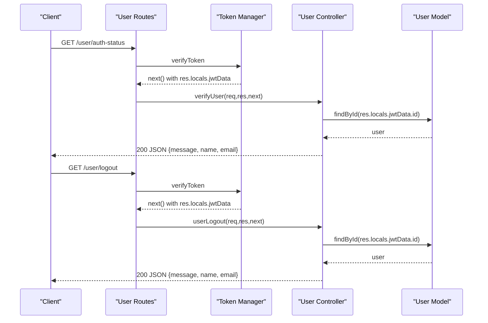
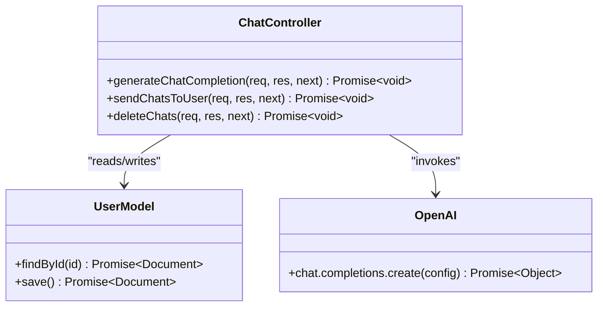
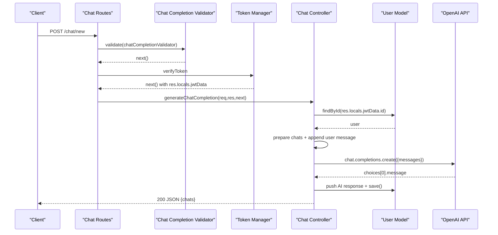
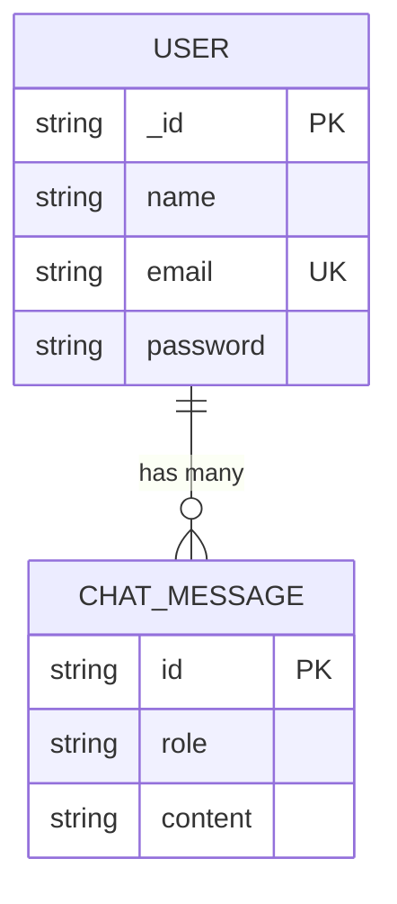
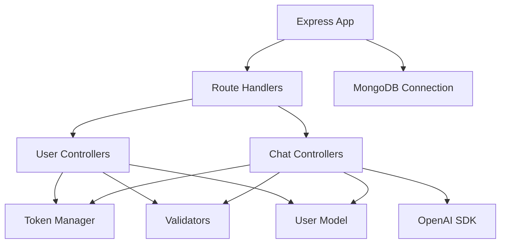

# Controller Layer

<cite>
**Referenced Files in This Document**
- [user-controllers.ts](file://backend/src/controllers/user-controllers.ts)
- [chat-controllers.ts](file://backend/src/controllers/chat-controllers.ts)
- [User.ts](file://backend/src/models/User.ts)
- [token-manager.ts](file://backend/src/utils/token-manager.ts)
- [validators.ts](file://backend/src/utils/validators.ts)
- [constants.ts](file://backend/src/utils/constants.ts)
- [user-routes.ts](file://backend/src/routes/user-routes.ts)
- [chat-routes.ts](file://backend/src/routes/chat-routes.ts)
- [index.ts](file://backend/src/routes/index.ts)
- [app.ts](file://backend/src/app.ts)
- [connection.ts](file://backend/src/db/connection.ts)
- [index.ts](file://backend/src/index.ts)
- [package.json](file://backend/package.json)
</cite>

## Table of Contents
1. [Introduction](#introduction)
2. [Project Structure](#project-structure)
3. [Core Components](#core-components)
4. [Architecture Overview](#architecture-overview)
5. [Detailed Component Analysis](#detailed-component-analysis)
6. [Dependency Analysis](#dependency-analysis)
7. [Performance Considerations](#performance-considerations)
8. [Troubleshooting Guide](#troubleshooting-guide)
9. [Conclusion](#conclusion)

## Introduction
This document provides comprehensive controller layer documentation for the SMAN-GPT business logic implementation. It focuses on two primary controller modules:
- User Controller: Handles authentication operations including user registration with password hashing, login validation with JWT token generation, session verification, and logout procedures.
- Chat Controller: Manages AI message processing, conversation management, and chat history operations integrated with the OpenAI API.

The documentation explains controller-to-model interaction patterns, error handling strategies, response formatting, and security implementations for password protection, token validation, and session management. It also outlines integration points with external services such as the OpenAI API and provides guidance on controller method signatures, parameter handling, and middleware usage.

## Project Structure
The backend follows a layered architecture with clear separation of concerns:
- Controllers: Handle HTTP requests and orchestrate business logic.
- Routes: Define API endpoints and apply middleware.
- Models: Define data schemas and interactions with MongoDB.
- Utilities: Provide reusable utilities for token management, validation, and constants.
- Application bootstrap: Initializes Express server, middleware, and database connections.

**Diagram sources**
- [app.ts:1-21](file://backend/src/app.ts#L1-L21)
- [index.ts:1-11](file://backend/src/routes/index.ts#L1-L11)
- [user-routes.ts:1-25](file://backend/src/routes/user-routes.ts#L1-L25)
- [chat-routes.ts:1-22](file://backend/src/routes/chat-routes.ts#L1-L22)
- [user-controllers.ts:1-163](file://backend/src/controllers/user-controllers.ts#L1-L163)
- [chat-controllers.ts:1-89](file://backend/src/controllers/chat-controllers.ts#L1-L89)
- [User.ts:1-35](file://backend/src/models/User.ts#L1-L35)
- [token-manager.ts:1-35](file://backend/src/utils/token-manager.ts#L1-L35)
- [validators.ts:1-36](file://backend/src/utils/validators.ts#L1-L36)
- [constants.ts:1-2](file://backend/src/utils/constants.ts#L1-L2)

**Section sources**
- [app.ts:1-21](file://backend/src/app.ts#L1-L21)
- [index.ts:1-11](file://backend/src/routes/index.ts#L1-L11)
- [user-routes.ts:1-25](file://backend/src/routes/user-routes.ts#L1-L25)
- [chat-routes.ts:1-22](file://backend/src/routes/chat-routes.ts#L1-L22)

## Core Components
This section documents the core controller functions and their responsibilities.

### User Controller Functions
The user controller implements four primary functions:
- Registration: Validates input, checks for existing users, hashes passwords, creates a JWT token, and stores it in a signed cookie.
- Login: Validates credentials, compares hashed passwords, generates a JWT token, and sets a signed cookie.
- Verify Session: Confirms the validity of the JWT token stored in the cookie and returns user profile information.
- Logout: Verifies the token, clears the signed cookie, and confirms successful logout.

Key implementation patterns:
- Parameter extraction from request bodies and cookies.
- Password hashing using bcrypt for secure storage.
- JWT token creation and verification using jsonwebtoken.
- Signed cookie management via cookie-parser with a secret.
- Response formatting with standardized message fields and status codes.

Security measures:
- Password hashing with bcrypt before persistence.
- JWT verification middleware to protect routes.
- Signed cookies to prevent tampering.
- Input validation using express-validator.

**Section sources**
- [user-controllers.ts:22-62](file://backend/src/controllers/user-controllers.ts#L22-L62)
- [user-controllers.ts:64-108](file://backend/src/controllers/user-controllers.ts#L64-L108)
- [user-controllers.ts:110-131](file://backend/src/controllers/user-controllers.ts#L110-L131)
- [user-controllers.ts:133-162](file://backend/src/controllers/user-controllers.ts#L133-L162)

### Chat Controller Functions
The chat controller manages AI message processing and conversation history:
- Generate Chat Completion: Validates message input, retrieves user context, prepares conversation history, sends messages to OpenAI API, updates user chat history, and returns the updated conversation.
- Send Chats to User: Retrieves user chat history and returns it to the client.
- Delete Chats: Clears user chat history and persists the change.

Integration patterns:
- Uses OpenAI SDK to communicate with the OpenAI API.
- Prepares chat history by mapping user chats to the expected message format.
- Persists updated chat history back to the user document.

**Section sources**
- [chat-controllers.ts:7-43](file://backend/src/controllers/chat-controllers.ts#L7-L43)
- [chat-controllers.ts:45-64](file://backend/src/controllers/chat-controllers.ts#L45-L64)
- [chat-controllers.ts:66-88](file://backend/src/controllers/chat-controllers.ts#L66-L88)

## Architecture Overview
The controller layer interacts with models, utilities, and external services as follows:

**Diagram sources**
- [user-routes.ts:18-22](file://backend/src/routes/user-routes.ts#L18-L22)
- [chat-routes.ts:12-19](file://backend/src/routes/chat-routes.ts#L12-L19)
- [validators.ts:4-18](file://backend/src/utils/validators.ts#L4-L18)
- [token-manager.ts:13-34](file://backend/src/utils/token-manager.ts#L13-L34)
- [user-controllers.ts:22-62](file://backend/src/controllers/user-controllers.ts#L22-L62)
- [chat-controllers.ts:7-43](file://backend/src/controllers/chat-controllers.ts#L7-L43)

## Detailed Component Analysis

### User Controller Analysis
The user controller implements four distinct functions with consistent error handling and response formatting.

**Diagram sources**
- [user-controllers.ts:7-163](file://backend/src/controllers/user-controllers.ts#L7-L163)
- [User.ts:17-32](file://backend/src/models/User.ts#L17-L32)
- [token-manager.ts:5-34](file://backend/src/utils/token-manager.ts#L5-L34)
- [validators.ts:4-35](file://backend/src/utils/validators.ts#L4-L35)

#### Authentication Flow: Registration

**Diagram sources**
- [user-routes.ts:19](file://backend/src/routes/user-routes.ts#L19)
- [validators.ts:28-31](file://backend/src/utils/validators.ts#L28-L31)
- [user-controllers.ts:22-62](file://backend/src/controllers/user-controllers.ts#L22-L62)
- [User.ts:17-32](file://backend/src/models/User.ts#L17-L32)
- [token-manager.ts:5-11](file://backend/src/utils/token-manager.ts#L5-L11)

#### Authentication Flow: Login

**Diagram sources**
- [user-routes.ts:20](file://backend/src/routes/user-routes.ts#L20)
- [validators.ts:20-26](file://backend/src/utils/validators.ts#L20-L26)
- [user-controllers.ts:64-108](file://backend/src/controllers/user-controllers.ts#L64-L108)
- [User.ts:17-32](file://backend/src/models/User.ts#L17-L32)
- [token-manager.ts:5-11](file://backend/src/utils/token-manager.ts#L5-L11)

#### Session Verification and Logout

**Diagram sources**
- [user-routes.ts:21-22](file://backend/src/routes/user-routes.ts#L21-L22)
- [token-manager.ts:13-34](file://backend/src/utils/token-manager.ts#L13-L34)
- [user-controllers.ts:110-162](file://backend/src/controllers/user-controllers.ts#L110-L162)
- [User.ts:17-32](file://backend/src/models/User.ts#L17-L32)

### Chat Controller Analysis
The chat controller orchestrates AI message processing and conversation management.

**Diagram sources**
- [chat-controllers.ts:7-89](file://backend/src/controllers/chat-controllers.ts#L7-L89)
- [User.ts:17-32](file://backend/src/models/User.ts#L17-L32)

#### AI Message Processing Flow

**Diagram sources**
- [chat-routes.ts:12-17](file://backend/src/routes/chat-routes.ts#L12-L17)
- [validators.ts:33-35](file://backend/src/utils/validators.ts#L33-L35)
- [token-manager.ts:13-34](file://backend/src/utils/token-manager.ts#L13-L34)
- [chat-controllers.ts:7-43](file://backend/src/controllers/chat-controllers.ts#L7-L43)
- [User.ts:17-32](file://backend/src/models/User.ts#L17-L32)

### Data Models and Schemas
The User model defines the structure for user profiles and chat histories.

**Diagram sources**
- [User.ts:3-32](file://backend/src/models/User.ts#L3-L32)

**Section sources**
- [User.ts:1-35](file://backend/src/models/User.ts#L1-L35)

## Dependency Analysis
The controller layer depends on several utilities and external services. The following diagram illustrates key dependencies:

**Diagram sources**
- [user-controllers.ts:1-6](file://backend/src/controllers/user-controllers.ts#L1-L6)
- [chat-controllers.ts:1-4](file://backend/src/controllers/chat-controllers.ts#L1-L4)
- [token-manager.ts:1-3](file://backend/src/utils/token-manager.ts#L1-L3)
- [validators.ts:1-2](file://backend/src/utils/validators.ts#L1-L2)
- [User.ts:1-2](file://backend/src/models/User.ts#L1-L2)
- [app.ts:1-21](file://backend/src/app.ts#L1-L21)
- [connection.ts:1-21](file://backend/src/db/connection.ts#L1-L21)

**Section sources**
- [package.json:15-27](file://backend/package.json#L15-L27)
- [app.ts:1-21](file://backend/src/app.ts#L1-L21)
- [connection.ts:1-21](file://backend/src/db/connection.ts#L1-L21)

## Performance Considerations
- Input validation reduces unnecessary controller logic and database calls by catching invalid requests early.
- JWT verification middleware ensures protected routes are only executed when a valid token is present, preventing unauthorized access.
- Chat history updates are performed atomically via model save operations to maintain consistency.
- OpenAI API calls are asynchronous; consider adding retry logic and timeouts for production deployments.
- Cookie settings (httpOnly, signed, domain, path) improve security and reduce overhead by delegating cookie handling to the server.

## Troubleshooting Guide
Common issues and resolutions:
- Token-related errors: Ensure the JWT_SECRET environment variable is set and consistent across the application. Verify that the client sends the signed cookie with the correct name.
- Database connectivity: Confirm MONGODB_URL is configured and reachable. Review connection logs for authentication or network errors.
- OpenAI API failures: Verify OPEN_AI_SECRET and OPENAI_ORGANIZATION_ID are set. Check rate limits and API availability.
- Validation errors: Review express-validator error responses for missing or malformed fields.
- CORS issues: Ensure the frontend origin matches the configured CORS settings.

**Section sources**
- [token-manager.ts:18-32](file://backend/src/utils/token-manager.ts#L18-L32)
- [connection.ts:2-9](file://backend/src/db/connection.ts#L2-L9)
- [chat-controllers.ts:20-29](file://backend/src/controllers/chat-controllers.ts#L20-L29)
- [validators.ts:12-16](file://backend/src/utils/validators.ts#L12-L16)
- [app.ts:11](file://backend/src/app.ts#L11)

## Conclusion
The SMAN-GPT controller layer implements robust authentication and chat management capabilities with clear separation of concerns and strong security practices. User authentication leverages bcrypt for password hashing, JWT for session tokens, and signed cookies for secure session storage. Chat operations integrate seamlessly with the OpenAI API while maintaining conversation history within the User model. The modular design, middleware-driven validation, and consistent error handling provide a solid foundation for scalable enhancements and maintenance.