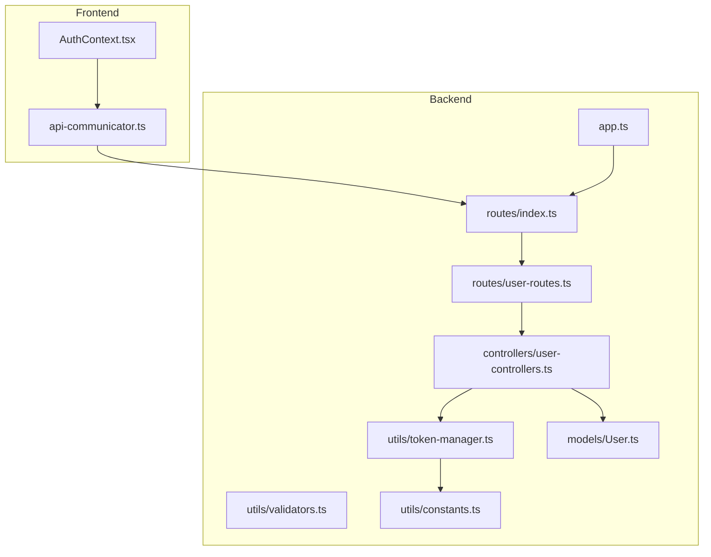
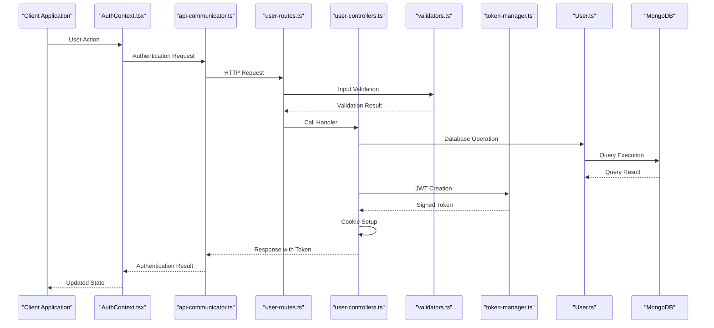
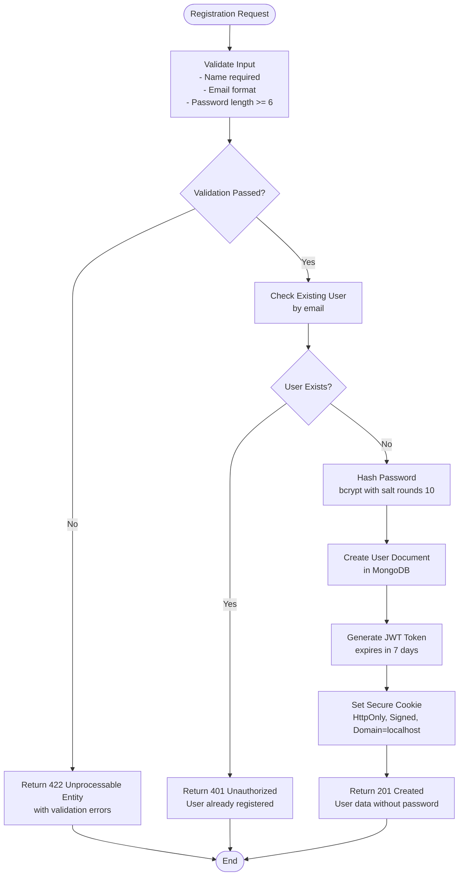
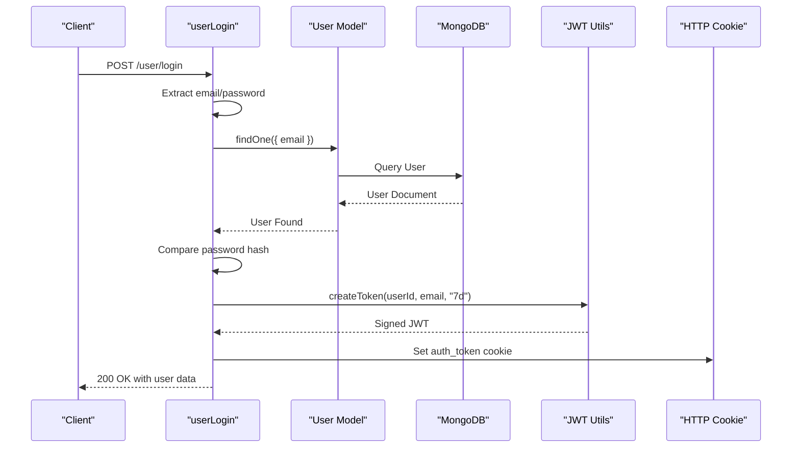
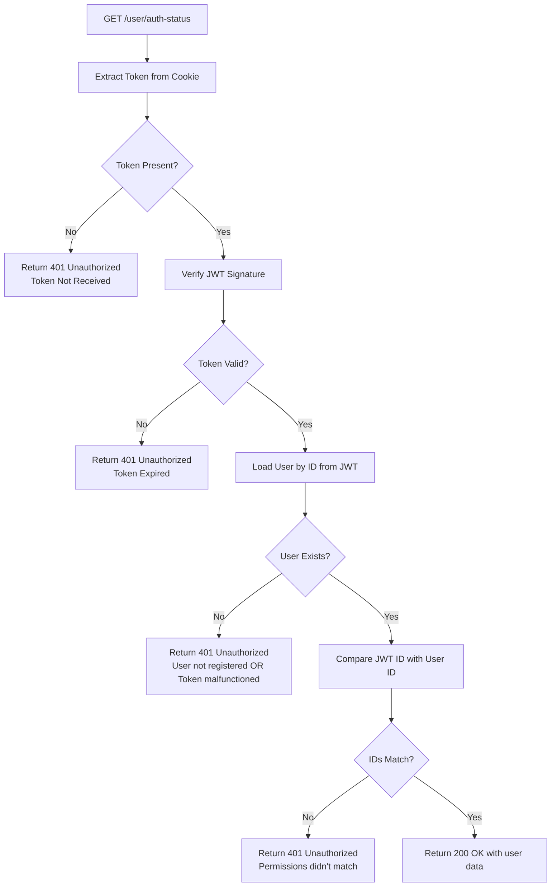
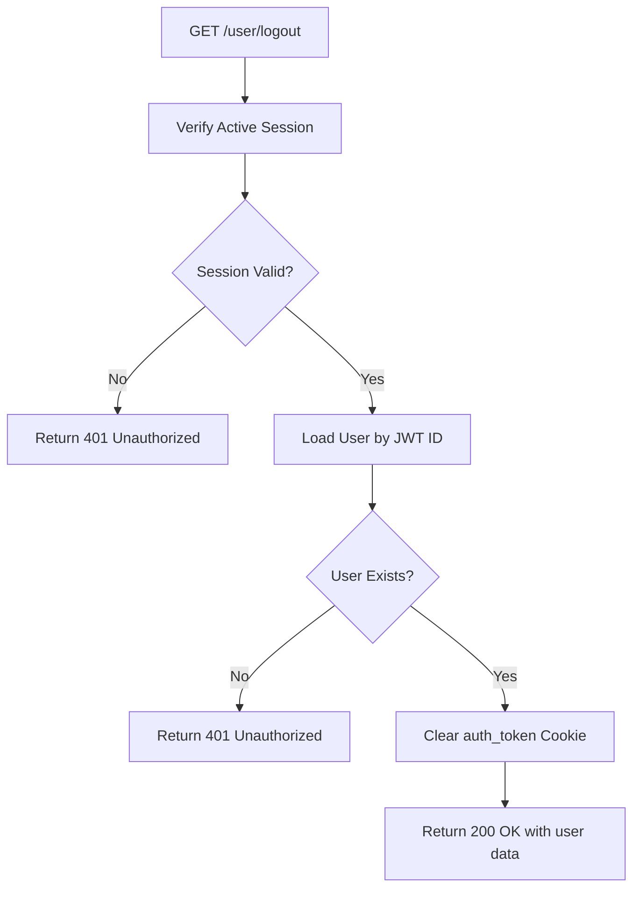
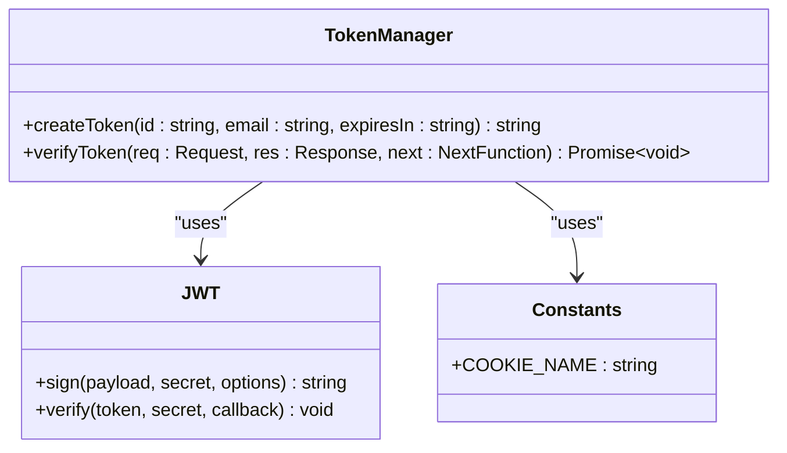
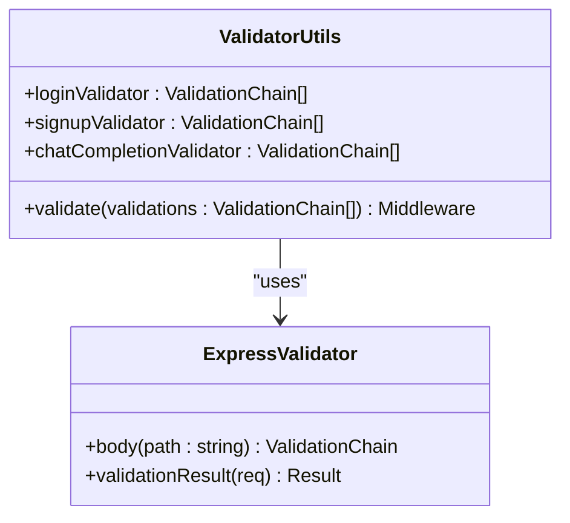
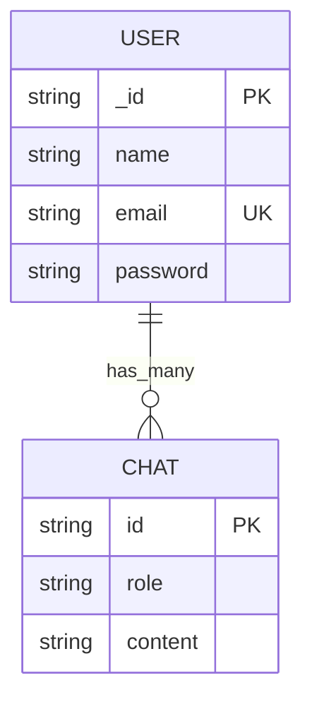
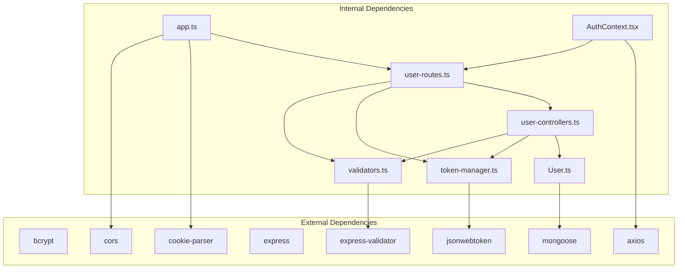

# User Controller

<cite>
**Referenced Files in This Document**
- [user-controllers.ts](file://backend/src/controllers/user-controllers.ts)
- [token-manager.ts](file://backend/src/utils/token-manager.ts)
- [validators.ts](file://backend/src/utils/validators.ts)
- [User.ts](file://backend/src/models/User.ts)
- [user-routes.ts](file://backend/src/routes/user-routes.ts)
- [constants.ts](file://backend/src/utils/constants.ts)
- [app.ts](file://backend/src/app.ts)
- [index.ts](file://backend/src/index.ts)
- [connection.ts](file://backend/src/db/connection.ts)
- [AuthContext.tsx](file://frontend/src/context/AuthContext.tsx)
- [api-communicator.ts](file://frontend/src/helpers/api-communicator.ts)
</cite>

## Table of Contents
1. [Introduction](#introduction)
2. [Project Structure](#project-structure)
3. [Core Components](#core-components)
4. [Architecture Overview](#architecture-overview)
5. [Detailed Component Analysis](#detailed-component-analysis)
6. [Dependency Analysis](#dependency-analysis)
7. [Performance Considerations](#performance-considerations)
8. [Troubleshooting Guide](#troubleshooting-guide)
9. [Conclusion](#conclusion)

## Introduction
This document provides comprehensive documentation for the user controller implementation, focusing on the complete authentication lifecycle. It covers user registration with password encryption, login validation with credential checking, JWT token generation and management, session verification, and logout procedures. The documentation explains the integration with token manager utilities for secure token handling and validators for input sanitization, along with error handling patterns, response formatting, and security considerations. Concrete examples of controller method implementations, parameter validation, and database interaction patterns are included to illustrate the complete authentication flow from user input validation through secure token issuance and session management.

## Project Structure
The authentication system spans backend controllers, utilities, models, and routes, with frontend integration through context and API communicators. The backend follows a layered architecture with clear separation of concerns:
- Controllers handle HTTP requests and orchestrate business logic
- Utilities provide token management and input validation
- Models define data structures and database interactions
- Routes define endpoint mappings and middleware application
- Frontend context manages authentication state and communicates with backend APIs

**Diagram sources**
- [app.ts:1-21](file://backend/src/app.ts#L1-L21)
- [index.ts:1-13](file://backend/src/index.ts#L1-L13)
- [routes/index.ts:1-11](file://backend/src/routes/index.ts#L1-L11)
- [routes/user-routes.ts:1-25](file://backend/src/routes/user-routes.ts#L1-L25)
- [controllers/user-controllers.ts:1-163](file://backend/src/controllers/user-controllers.ts#L1-L163)
- [utils/token-manager.ts:1-35](file://backend/src/utils/token-manager.ts#L1-L35)
- [utils/validators.ts:1-36](file://backend/src/utils/validators.ts#L1-L36)
- [models/User.ts:1-35](file://backend/src/models/User.ts#L1-L35)
- [utils/constants.ts:1-2](file://backend/src/utils/constants.ts#L1-L2)

**Section sources**
- [app.ts:1-21](file://backend/src/app.ts#L1-L21)
- [routes/index.ts:1-11](file://backend/src/routes/index.ts#L1-L11)
- [routes/user-routes.ts:1-25](file://backend/src/routes/user-routes.ts#L1-L25)

## Core Components
The user controller implements four primary authentication endpoints:
- Registration endpoint with password hashing and token issuance
- Login endpoint with credential validation and session establishment
- Verification endpoint for active session checks
- Logout endpoint for session termination

Each endpoint integrates with:
- Input validation using express-validator chains
- Database operations through Mongoose models
- JWT token creation and verification utilities
- Cookie-based session management with security headers

Key security features include:
- Password hashing with bcrypt
- JWT token signing with environment-secret keys
- HttpOnly and signed cookies for protection against XSS
- CORS configuration for frontend-origin access
- Input sanitization and validation middleware

**Section sources**
- [user-controllers.ts:22-163](file://backend/src/controllers/user-controllers.ts#L22-L163)
- [validators.ts:4-36](file://backend/src/utils/validators.ts#L4-L36)
- [token-manager.ts:5-35](file://backend/src/utils/token-manager.ts#L5-L35)
- [constants.ts:1-2](file://backend/src/utils/constants.ts#L1-L2)

## Architecture Overview
The authentication flow follows a secure, layered approach with explicit separation between presentation, business logic, and persistence layers.

**Diagram sources**
- [AuthContext.tsx:28-76](file://frontend/src/context/AuthContext.tsx#L28-L76)
- [api-communicator.ts:1-68](file://frontend/src/helpers/api-communicator.ts#L1-L68)
- [user-routes.ts:18-22](file://backend/src/routes/user-routes.ts#L18-L22)
- [user-controllers.ts:22-163](file://backend/src/controllers/user-controllers.ts#L22-L163)
- [validators.ts:4-18](file://backend/src/utils/validators.ts#L4-L18)
- [token-manager.ts:5-35](file://backend/src/utils/token-manager.ts#L5-L35)
- [User.ts:17-32](file://backend/src/models/User.ts#L17-L32)

## Detailed Component Analysis

### Registration Workflow
The registration process handles new user creation with comprehensive validation and security measures.

**Diagram sources**
- [user-controllers.ts:22-62](file://backend/src/controllers/user-controllers.ts#L22-L62)
- [validators.ts:28-31](file://backend/src/utils/validators.ts#L28-L31)
- [token-manager.ts:5-11](file://backend/src/utils/token-manager.ts#L5-L11)

Key implementation details:
- Input validation uses express-validator chains with trim and length constraints
- Password encryption employs bcrypt with configurable salt rounds
- Unique email constraint prevents duplicate registrations
- JWT token includes user ID and email in payload
- Cookie configuration prioritizes security with HttpOnly and signed flags

**Section sources**
- [user-controllers.ts:22-62](file://backend/src/controllers/user-controllers.ts#L22-L62)
- [validators.ts:28-31](file://backend/src/utils/validators.ts#L28-L31)
- [User.ts:17-32](file://backend/src/models/User.ts#L17-L32)

### Login Workflow
The login process validates user credentials and establishes authenticated sessions.

**Diagram sources**
- [user-controllers.ts:64-108](file://backend/src/controllers/user-controllers.ts#L64-L108)
- [token-manager.ts:5-11](file://backend/src/utils/token-manager.ts#L5-L11)

Security mechanisms implemented:
- Credential comparison using bcrypt.compare for timing attack resistance
- Immediate password hash verification before token issuance
- Session token expiration set to 7 days
- Comprehensive cookie security attributes

**Section sources**
- [user-controllers.ts:64-108](file://backend/src/controllers/user-controllers.ts#L64-L108)
- [token-manager.ts:5-11](file://backend/src/utils/token-manager.ts#L5-L11)

### Session Verification
The verification endpoint confirms active authentication status and user identity.

**Diagram sources**
- [user-controllers.ts:110-131](file://backend/src/controllers/user-controllers.ts#L110-L131)
- [token-manager.ts:13-35](file://backend/src/utils/token-manager.ts#L13-L35)

**Section sources**
- [user-controllers.ts:110-131](file://backend/src/controllers/user-controllers.ts#L110-L131)
- [token-manager.ts:13-35](file://backend/src/utils/token-manager.ts#L13-L35)

### Logout Procedure
The logout process terminates user sessions and clears authentication cookies.

**Diagram sources**
- [user-controllers.ts:133-162](file://backend/src/controllers/user-controllers.ts#L133-L162)

**Section sources**
- [user-controllers.ts:133-162](file://backend/src/controllers/user-controllers.ts#L133-L162)

### Token Management Utilities
The token manager provides centralized JWT handling with security validation.

**Diagram sources**
- [token-manager.ts:5-35](file://backend/src/utils/token-manager.ts#L5-L35)
- [constants.ts:1-2](file://backend/src/utils/constants.ts#L1-L2)

Key features:
- Centralized JWT creation with configurable expiration
- Middleware-based token verification with automatic error handling
- Consistent cookie naming convention
- Environment-variable secret management

**Section sources**
- [token-manager.ts:5-35](file://backend/src/utils/token-manager.ts#L5-L35)
- [constants.ts:1-2](file://backend/src/utils/constants.ts#L1-L2)

### Input Validation System
The validator utilities provide comprehensive request sanitization and validation.

**Diagram sources**
- [validators.ts:4-36](file://backend/src/utils/validators.ts#L4-L36)

Validation rules implemented:
- Email format validation with trim operation
- Password length requirements (minimum 6 characters)
- Name requirement for registration
- Message validation for chat completion

**Section sources**
- [validators.ts:4-36](file://backend/src/utils/validators.ts#L4-L36)

### Database Model Integration
The User model defines the data structure and relationships for authentication.

**Diagram sources**
- [User.ts:17-32](file://backend/src/models/User.ts#L17-L32)

Model characteristics:
- Unique email constraint prevents duplicates
- Password field stores hashed credentials
- Embedded chat schema supports conversation history
- Automatic UUID generation for chat identifiers

**Section sources**
- [User.ts:17-32](file://backend/src/models/User.ts#L17-L32)

## Dependency Analysis
The authentication system exhibits clean dependency relationships with clear separation of concerns.

**Diagram sources**
- [user-controllers.ts:1-6](file://backend/src/controllers/user-controllers.ts#L1-L6)
- [token-manager.ts:1-3](file://backend/src/utils/token-manager.ts#L1-L3)
- [validators.ts:1-2](file://backend/src/utils/validators.ts#L1-L2)
- [User.ts:1-2](file://backend/src/models/User.ts#L1-L2)
- [app.ts:1-7](file://backend/src/app.ts#L1-L7)

Key dependency patterns:
- Controllers depend on models and utilities for business logic
- Routes coordinate middleware application and endpoint mapping
- Utilities encapsulate cross-cutting concerns (security, validation)
- Frontend depends on backend APIs through standardized endpoints

**Section sources**
- [user-controllers.ts:1-6](file://backend/src/controllers/user-controllers.ts#L1-L6)
- [token-manager.ts:1-3](file://backend/src/utils/token-manager.ts#L1-L3)
- [validators.ts:1-2](file://backend/src/utils/validators.ts#L1-L2)
- [app.ts:1-7](file://backend/src/app.ts#L1-L7)

## Performance Considerations
Several optimization opportunities exist for production deployment:

### Database Optimization
- Add indexes on frequently queried fields (email)
- Implement connection pooling for MongoDB
- Use projection to limit returned fields in queries
- Consider read replicas for high-read scenarios

### Token Performance
- Implement token refresh mechanisms instead of frequent re-authentication
- Use shorter token lifespans with automatic renewal
- Cache frequently accessed user data
- Implement token blacklisting for immediate revocation

### Security Hardening
- Add rate limiting for authentication endpoints
- Implement account lockout policies after failed attempts
- Use HTTPS-only cookies in production environments
- Add CSRF protection for state-changing operations
- Implement audit logging for security events

## Troubleshooting Guide

### Common Authentication Issues
**Registration Failures**
- Validation errors: Check input format and required fields
- Duplicate email: Verify uniqueness constraint
- Database connection: Confirm MongoDB connectivity

**Login Problems**
- Invalid credentials: Verify password hashing and comparison
- Token verification failures: Check JWT secret and expiration
- Session corruption: Clear browser cookies and retry

**Session Management**
- Token expiration: Implement automatic refresh mechanisms
- Cross-origin issues: Verify CORS configuration
- Cookie security: Ensure HttpOnly and secure flags are set

### Error Response Patterns
The system returns standardized error responses:
- 401 Unauthorized: Authentication required or invalid token
- 403 Forbidden: Incorrect password or insufficient permissions
- 404 Not Found: Non-existent user or route
- 422 Unprocessable Entity: Validation errors
- 500 Internal Server Error: Unexpected server errors

### Debugging Strategies
- Enable Morgan logging for development
- Check environment variable configuration
- Monitor database connection health
- Validate JWT secret presence
- Test cookie configuration across browsers

**Section sources**
- [user-controllers.ts:12-20](file://backend/src/controllers/user-controllers.ts#L12-L20)
- [user-controllers.ts:58-62](file://backend/src/controllers/user-controllers.ts#L58-L62)
- [token-manager.ts:18-33](file://backend/src/utils/token-manager.ts#L18-L33)

## Conclusion
The user controller implementation demonstrates a robust, security-conscious approach to authentication with clear separation of concerns and comprehensive validation. The system successfully integrates bcrypt for password hashing, JWT for token management, and cookie-based session handling while maintaining clean architectural boundaries. Key strengths include comprehensive input validation, secure token handling, and consistent error responses. Areas for improvement include enhanced security measures for production deployment, performance optimizations for high-scale scenarios, and expanded monitoring capabilities. The modular design facilitates future enhancements while maintaining backward compatibility and clear documentation standards.