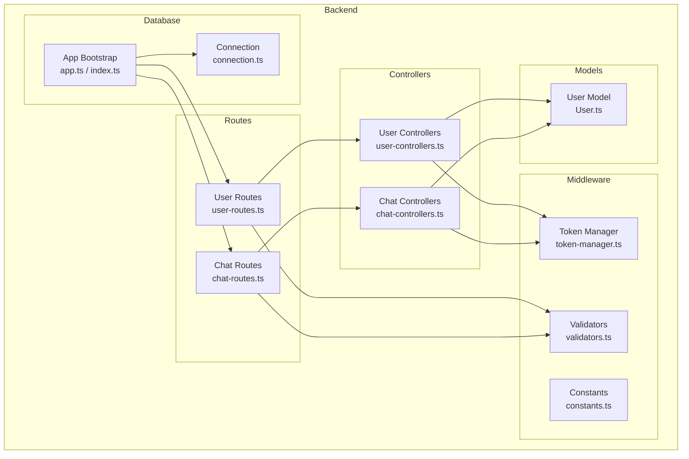
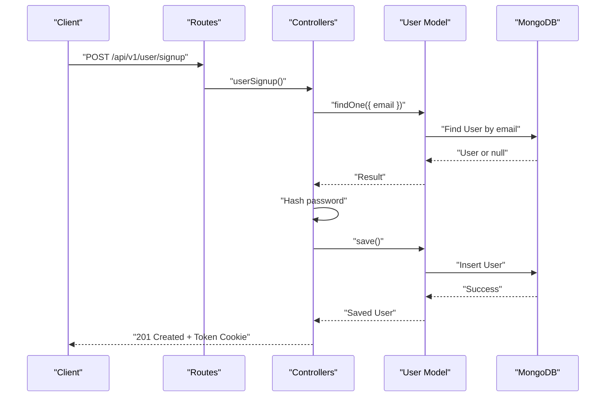
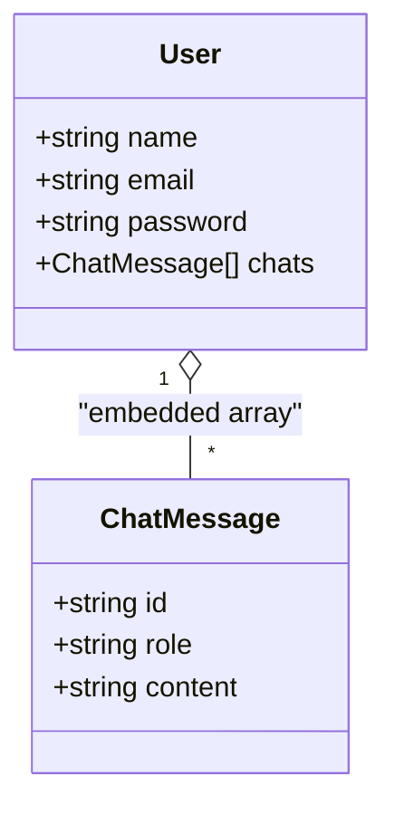
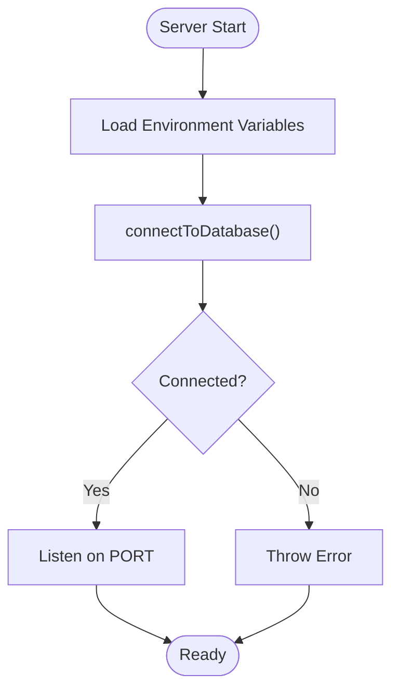
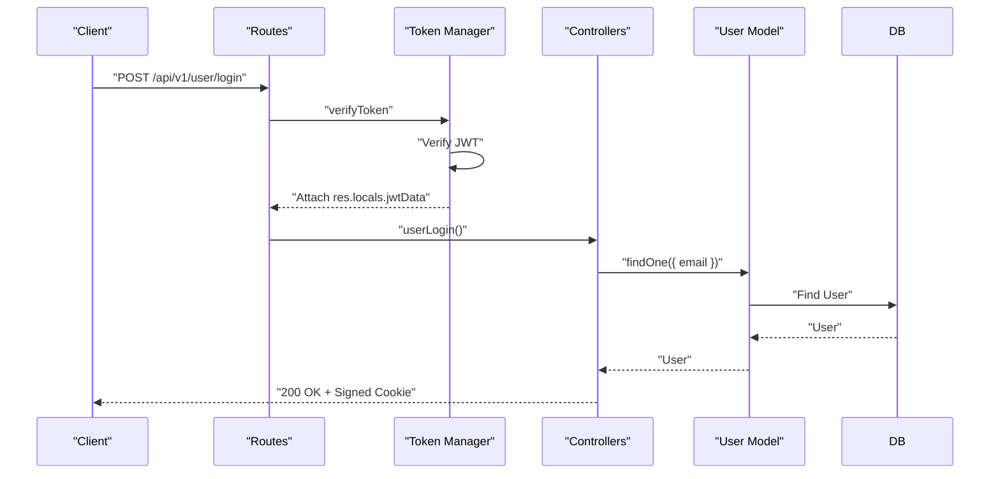
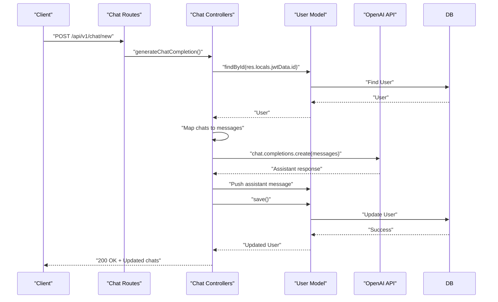
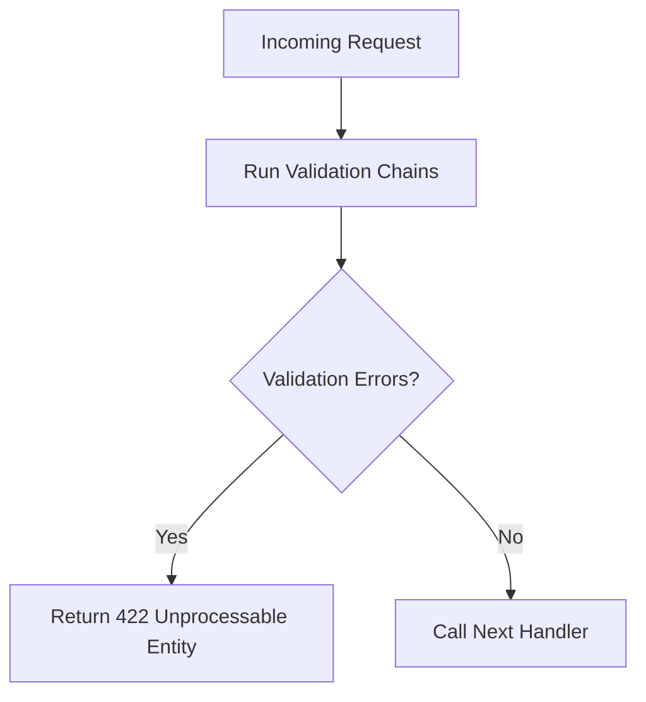
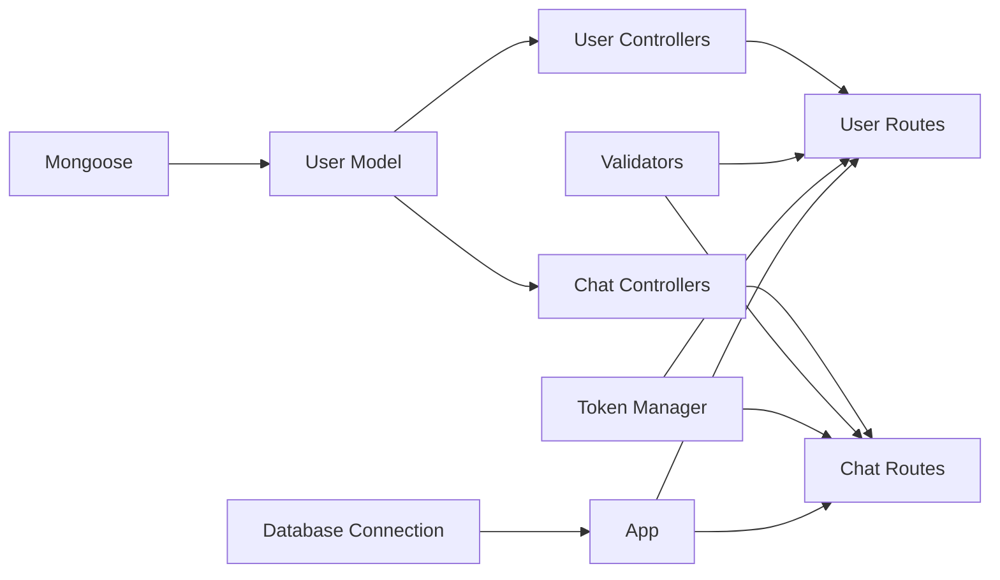

# Data Models

<cite>
**Referenced Files in This Document**
- [User.ts](file://backend/src/models/User.ts)
- [connection.ts](file://backend/src/db/connection.ts)
- [index.ts](file://backend/src/index.ts)
- [app.ts](file://backend/src/app.ts)
- [user-controllers.ts](file://backend/src/controllers/user-controllers.ts)
- [chat-controllers.ts](file://backend/src/controllers/chat-controllers.ts)
- [user-routes.ts](file://backend/src/routes/user-routes.ts)
- [chat-routes.ts](file://backend/src/routes/chat-routes.ts)
- [validators.ts](file://backend/src/utils/validators.ts)
- [token-manager.ts](file://backend/src/utils/token-manager.ts)
- [constants.ts](file://backend/src/utils/constants.ts)
</cite>

## Table of Contents
1. [Introduction](#introduction)
2. [Project Structure](#project-structure)
3. [Core Components](#core-components)
4. [Architecture Overview](#architecture-overview)
5. [Detailed Component Analysis](#detailed-component-analysis)
6. [Dependency Analysis](#dependency-analysis)
7. [Performance Considerations](#performance-considerations)
8. [Troubleshooting Guide](#troubleshooting-guide)
9. [Conclusion](#conclusion)

## Introduction
This document provides comprehensive data model documentation for the SMAN-GPT MongoDB schemas, focusing on the User model and its embedded chat collection. It explains field definitions, Mongoose schema design patterns, validation rules, and data type specifications. It also covers database connection management, model methods, query patterns, validation strategies, indexing considerations, performance characteristics, and practical usage examples integrated with controllers and routes.

## Project Structure
The data model resides in the backend under models and integrates with controllers, routes, middleware, and database connection utilities. The User model defines a top-level document with an embedded array of chat messages. Controllers orchestrate authentication, chat generation, and chat retrieval. Routes define protected endpoints that rely on JWT verification and input validation.

**Diagram sources**
- [User.ts:1-35](file://backend/src/models/User.ts#L1-L35)
- [user-controllers.ts:1-163](file://backend/src/controllers/user-controllers.ts#L1-L163)
- [chat-controllers.ts:1-89](file://backend/src/controllers/chat-controllers.ts#L1-L89)
- [user-routes.ts:1-25](file://backend/src/routes/user-routes.ts#L1-L25)
- [chat-routes.ts:1-22](file://backend/src/routes/chat-routes.ts#L1-L22)
- [token-manager.ts:1-35](file://backend/src/utils/token-manager.ts#L1-L35)
- [validators.ts:1-36](file://backend/src/utils/validators.ts#L1-L36)
- [connection.ts:1-21](file://backend/src/db/connection.ts#L1-L21)
- [app.ts:1-21](file://backend/src/app.ts#L1-L21)
- [index.ts:1-13](file://backend/src/index.ts#L1-L13)

**Section sources**
- [User.ts:1-35](file://backend/src/models/User.ts#L1-L35)
- [user-routes.ts:1-25](file://backend/src/routes/user-routes.ts#L1-L25)
- [chat-routes.ts:1-22](file://backend/src/routes/chat-routes.ts#L1-L22)
- [connection.ts:1-21](file://backend/src/db/connection.ts#L1-L21)
- [app.ts:1-21](file://backend/src/app.ts#L1-L21)
- [index.ts:1-13](file://backend/src/index.ts#L1-L13)

## Core Components
This section documents the User model and its embedded chat structure, including field definitions, data types, validation rules, and schema design patterns.

- User Model Fields
  - name: String, required
  - email: String, required, unique
  - password: String, required
  - chats: Array of embedded documents (see below)

- Embedded Chat Message Schema
  - id: String, default generated UUID
  - role: String, required ("system", "user", or "assistant")
  - content: String, required

- Schema Design Patterns
  - Embedded document array for chats to keep conversation history within the user document
  - UUID-based identifiers for individual chat entries
  - Required constraints enforced at schema level
  - Unique constraint on email to prevent duplicates

- Data Types and Validation
  - String fields for textual data
  - UUID default for chat id ensures uniqueness per message
  - Role and content are required for every chat message
  - Email is unique to enforce account uniqueness

- Indexing Strategies
  - email: unique index (enforced by schema)
  - No explicit additional indexes present in the model; consider adding compound indexes if querying by email and other fields becomes frequent

- Query Patterns
  - Find by email for login/signup
  - Find by ID for token-verified operations
  - Push to chats array for new messages
  - Replace chats array for deletion

- Model Methods and Usage
  - Authentication and session creation handled in controllers
  - Chat generation and retrieval handled in chat controllers
  - No custom static or instance methods defined in the model; operations rely on Mongoose defaults and controller logic

**Section sources**
- [User.ts:1-35](file://backend/src/models/User.ts#L1-L35)

## Architecture Overview
The data model sits at the center of the backend architecture, interacting with controllers, routes, middleware, and the database connection. The following diagram illustrates the flow from HTTP requests to database operations and responses.

**Diagram sources**
- [user-routes.ts:18-22](file://backend/src/routes/user-routes.ts#L18-L22)
- [user-controllers.ts:22-62](file://backend/src/controllers/user-controllers.ts#L22-L62)
- [User.ts:17-32](file://backend/src/models/User.ts#L17-L32)

## Detailed Component Analysis

### User Model Implementation
The User model defines the document structure and embedded chat array. It enforces required fields and uses a UUID default for chat ids.

**Diagram sources**
- [User.ts:3-16](file://backend/src/models/User.ts#L3-L16)
- [User.ts:17-32](file://backend/src/models/User.ts#L17-L32)

Key observations:
- Embedded array design keeps chat history within the user document
- UUID default ensures each chat message has a unique identifier
- Required fields enforce data integrity at the schema level

**Section sources**
- [User.ts:1-35](file://backend/src/models/User.ts#L1-L35)

### Database Connection Management
The application connects to MongoDB during startup and exposes disconnect utilities. Connection errors are caught and surfaced as errors.

**Diagram sources**
- [index.ts:5-12](file://backend/src/index.ts#L5-L12)
- [connection.ts:2-9](file://backend/src/db/connection.ts#L2-L9)

Operational details:
- Uses environment variable for MongoDB URL
- Throws a descriptive error on connection failure
- Provides disconnect function for cleanup

**Section sources**
- [connection.ts:1-21](file://backend/src/db/connection.ts#L1-L21)
- [index.ts:1-13](file://backend/src/index.ts#L1-L13)

### Authentication and Session Management
Authentication relies on JWT tokens stored in signed cookies. The token manager validates tokens and attaches decoded data to the request locals.

**Diagram sources**
- [user-routes.ts:20-22](file://backend/src/routes/user-routes.ts#L20-L22)
- [token-manager.ts:13-34](file://backend/src/utils/token-manager.ts#L13-L34)
- [user-controllers.ts:64-108](file://backend/src/controllers/user-controllers.ts#L64-L108)

Validation and middleware:
- Input validation via express-validator for login and signup
- Token verification middleware for protected routes
- Cookie configuration includes httpOnly, signed, and domain settings

**Section sources**
- [token-manager.ts:1-35](file://backend/src/utils/token-manager.ts#L1-L35)
- [validators.ts:1-36](file://backend/src/utils/validators.ts#L1-L36)
- [user-routes.ts:1-25](file://backend/src/routes/user-routes.ts#L1-L25)
- [constants.ts:1-2](file://backend/src/utils/constants.ts#L1-L2)

### Chat Generation and Retrieval
Chat operations leverage the embedded chats array. New user messages are appended, sent to OpenAI, and the assistant response is saved back to the user’s chats.

**Diagram sources**
- [chat-routes.ts:12-17](file://backend/src/routes/chat-routes.ts#L12-L17)
- [chat-controllers.ts:7-43](file://backend/src/controllers/chat-controllers.ts#L7-L43)
- [User.ts:3-16](file://backend/src/models/User.ts#L3-L16)

Additional operations:
- Send all chats to the user
- Delete all chats by resetting the array

**Section sources**
- [chat-controllers.ts:1-89](file://backend/src/controllers/chat-controllers.ts#L1-L89)
- [chat-routes.ts:18-19](file://backend/src/routes/chat-routes.ts#L18-L19)

### Data Validation and Input Sanitization
Input validation is performed using express-validator. Validation functions are composed into route handlers to ensure clean, well-formed requests.

- Login validation: email must be a valid email; password must be at least 6 characters
- Signup validation: requires name, plus login validation rules
- Chat completion validation: requires a non-empty message

**Diagram sources**
- [validators.ts:4-18](file://backend/src/utils/validators.ts#L4-L18)
- [user-routes.ts:19-22](file://backend/src/routes/user-routes.ts#L19-L22)
- [chat-routes.ts:12-17](file://backend/src/routes/chat-routes.ts#L12-L17)

**Section sources**
- [validators.ts:1-36](file://backend/src/utils/validators.ts#L1-L36)

## Dependency Analysis
The User model depends on Mongoose for schema definition and model registration. Controllers depend on the model and middleware utilities. Routes depend on controllers and validation/token middleware. The app initializes the database connection and mounts routers.

**Diagram sources**
- [User.ts:1-35](file://backend/src/models/User.ts#L1-L35)
- [user-controllers.ts:1-163](file://backend/src/controllers/user-controllers.ts#L1-L163)
- [chat-controllers.ts:1-89](file://backend/src/controllers/chat-controllers.ts#L1-L89)
- [user-routes.ts:1-25](file://backend/src/routes/user-routes.ts#L1-L25)
- [chat-routes.ts:1-22](file://backend/src/routes/chat-routes.ts#L1-L22)
- [validators.ts:1-36](file://backend/src/utils/validators.ts#L1-L36)
- [token-manager.ts:1-35](file://backend/src/utils/token-manager.ts#L1-L35)
- [connection.ts:1-21](file://backend/src/db/connection.ts#L1-L21)
- [app.ts:1-21](file://backend/src/app.ts#L1-L21)

**Section sources**
- [User.ts:1-35](file://backend/src/models/User.ts#L1-L35)
- [user-controllers.ts:1-163](file://backend/src/controllers/user-controllers.ts#L1-L163)
- [chat-controllers.ts:1-89](file://backend/src/controllers/chat-controllers.ts#L1-L89)
- [user-routes.ts:1-25](file://backend/src/routes/user-routes.ts#L1-L25)
- [chat-routes.ts:1-22](file://backend/src/routes/chat-routes.ts#L1-L22)
- [validators.ts:1-36](file://backend/src/utils/validators.ts#L1-L36)
- [token-manager.ts:1-35](file://backend/src/utils/token-manager.ts#L1-L35)
- [connection.ts:1-21](file://backend/src/db/connection.ts#L1-L21)
- [app.ts:1-21](file://backend/src/app.ts#L1-L21)

## Performance Considerations
- Embedded chats array: Keeps conversation history within the user document, reducing joins and simplifying reads. However, large chat histories can increase document size and impact write performance.
- Indexing: email is unique; consider adding compound indexes if queries frequently filter by email and other fields.
- Pagination: For long chat histories, consider pagination or archival strategies to limit document size.
- Validation overhead: express-validator adds minimal overhead; ensure validation runs before heavy operations.
- Connection pooling: Mongoose manages connection pooling; ensure environment variables are configured appropriately for production.
- Token verification: JWT verification is lightweight; ensure secret keys are strong and rotated periodically.

[No sources needed since this section provides general guidance]

## Troubleshooting Guide
Common issues and resolutions:
- Connection failures: Verify MONGODB_URL environment variable and network connectivity. The connection utility throws a descriptive error on failure.
- Authentication failures: Ensure JWT_SECRET is set and cookies are configured correctly. Check token expiration and signed cookie settings.
- Validation errors: Review validator messages for missing or invalid fields. Confirm client sends properly formatted JSON.
- Chat operations: Ensure user is authenticated before accessing chat endpoints. Verify that chats array updates persist after saving.

**Section sources**
- [connection.ts:1-21](file://backend/src/db/connection.ts#L1-L21)
- [token-manager.ts:1-35](file://backend/src/utils/token-manager.ts#L1-L35)
- [validators.ts:1-36](file://backend/src/utils/validators.ts#L1-L36)
- [chat-controllers.ts:1-89](file://backend/src/controllers/chat-controllers.ts#L1-L89)

## Conclusion
The SMAN-GPT data model centers on a robust User schema with an embedded chats array, leveraging Mongoose for schema enforcement and UUID defaults for message identity. The system integrates validation, JWT-based authentication, and OpenAI-powered chat generation while maintaining clear separation of concerns across models, controllers, routes, and middleware. For production, consider indexing strategies, document size limits, and connection tuning to optimize performance and reliability.