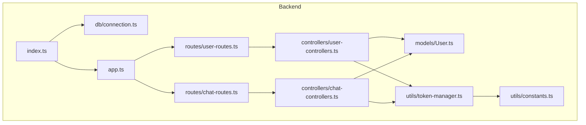
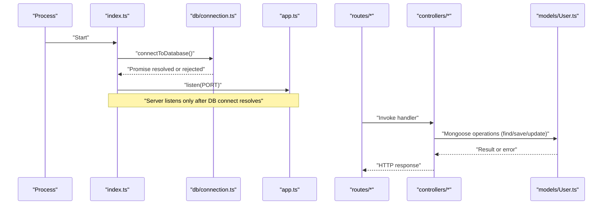
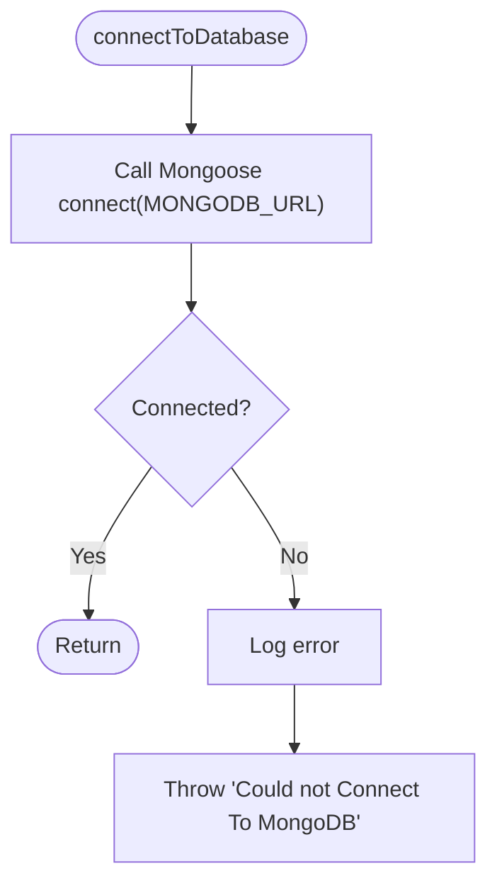
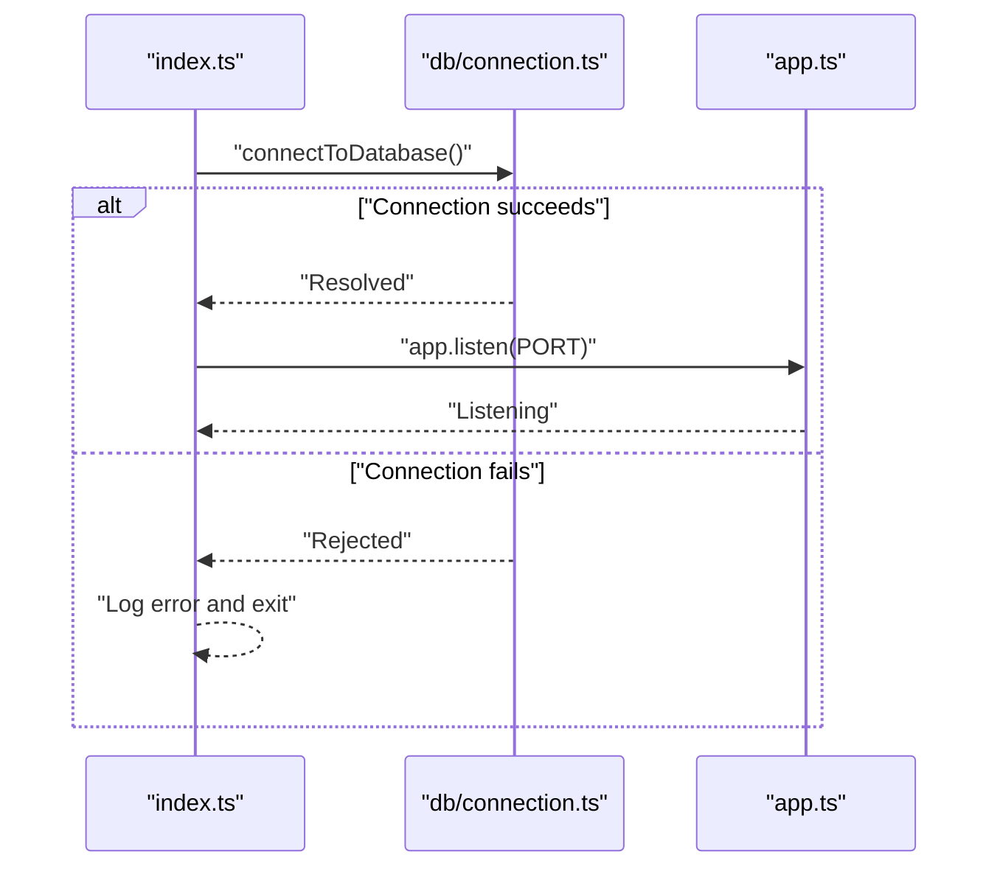
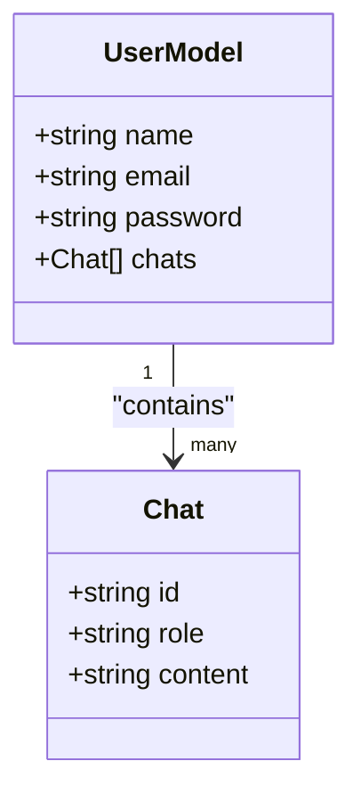
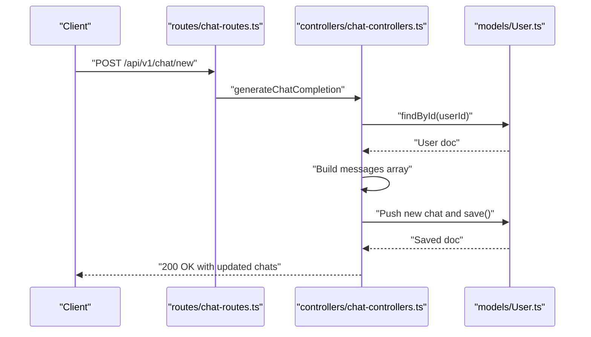
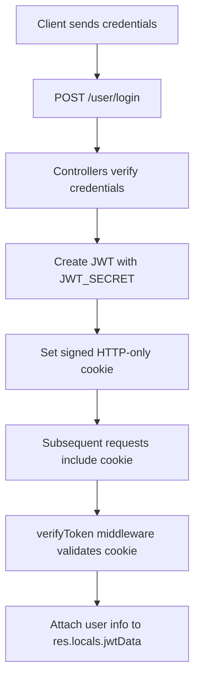
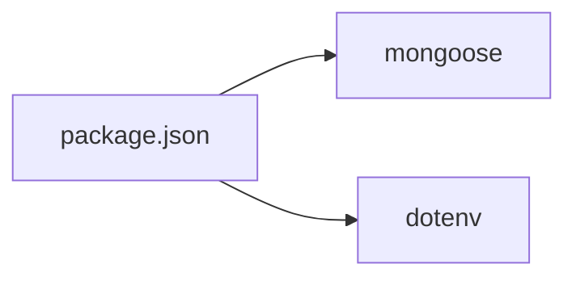

# Database Integration

<cite>
**Referenced Files in This Document**
- [connection.ts](file://backend/src/db/connection.ts)
- [index.ts](file://backend/src/index.ts)
- [app.ts](file://backend/src/app.ts)
- [User.ts](file://backend/src/models/User.ts)
- [user-controllers.ts](file://backend/src/controllers/user-controllers.ts)
- [chat-controllers.ts](file://backend/src/controllers/chat-controllers.ts)
- [user-routes.ts](file://backend/src/routes/user-routes.ts)
- [chat-routes.ts](file://backend/src/routes/chat-routes.ts)
- [token-manager.ts](file://backend/src/utils/token-manager.ts)
- [constants.ts](file://backend/src/utils/constants.ts)
- [package.json](file://backend/package.json)
- [README.md](file://README.md)
</cite>

## Table of Contents
1. [Introduction](#introduction)
2. [Project Structure](#project-structure)
3. [Core Components](#core-components)
4. [Architecture Overview](#architecture-overview)
5. [Detailed Component Analysis](#detailed-component-analysis)
6. [Dependency Analysis](#dependency-analysis)
7. [Performance Considerations](#performance-considerations)
8. [Troubleshooting Guide](#troubleshooting-guide)
9. [Conclusion](#conclusion)
10. [Appendices](#appendices)

## Introduction
This document explains the MongoDB database integration for SMAN-GPT, focusing on connection management, lifecycle, error handling, and operational best practices. The backend uses Mongoose to connect to MongoDB via a single connection established at application startup. Mongoose models define collections and documents, while controllers and routes orchestrate read/write operations. Security is enforced through environment variables and JWT-based session management.

## Project Structure
The backend organizes database integration across a small set of focused modules:
- Connection management: centralized in a dedicated module
- Application bootstrap: initializes the connection and starts the server
- Models: Mongoose models for domain entities
- Controllers and routes: expose protected endpoints that operate on models
- Utilities: JWT creation/verification and constants

**Diagram sources**
- [index.ts:1-13](file://backend/src/index.ts#L1-L13)
- [app.ts:1-21](file://backend/src/app.ts#L1-L21)
- [connection.ts:1-21](file://backend/src/db/connection.ts#L1-L21)
- [User.ts:1-35](file://backend/src/models/User.ts#L1-L35)
- [user-controllers.ts:1-163](file://backend/src/controllers/user-controllers.ts#L1-L163)
- [chat-controllers.ts:1-89](file://backend/src/controllers/chat-controllers.ts#L1-L89)
- [user-routes.ts:1-25](file://backend/src/routes/user-routes.ts#L1-L25)
- [chat-routes.ts:1-22](file://backend/src/routes/chat-routes.ts#L1-L22)
- [token-manager.ts:1-35](file://backend/src/utils/token-manager.ts#L1-L35)
- [constants.ts:1-2](file://backend/src/utils/constants.ts#L1-L2)

**Section sources**
- [index.ts:1-13](file://backend/src/index.ts#L1-L13)
- [app.ts:1-21](file://backend/src/app.ts#L1-L21)
- [connection.ts:1-21](file://backend/src/db/connection.ts#L1-L21)
- [User.ts:1-35](file://backend/src/models/User.ts#L1-L35)
- [user-controllers.ts:1-163](file://backend/src/controllers/user-controllers.ts#L1-L163)
- [chat-controllers.ts:1-89](file://backend/src/controllers/chat-controllers.ts#L1-L89)
- [user-routes.ts:1-25](file://backend/src/routes/user-routes.ts#L1-L25)
- [chat-routes.ts:1-22](file://backend/src/routes/chat-routes.ts#L1-L22)
- [token-manager.ts:1-35](file://backend/src/utils/token-manager.ts#L1-L35)
- [constants.ts:1-2](file://backend/src/utils/constants.ts#L1-L2)

## Core Components
- Database connection module
  - Establishes a single Mongoose connection at startup
  - Provides disconnect helper for graceful shutdown
  - Centralizes error handling during connect/disconnect
- Application bootstrap
  - Loads environment variables
  - Establishes the database connection before listening
  - Starts the HTTP server upon successful connection
- Mongoose model
  - Defines the User collection schema and nested chats array
  - Exports a Mongoose model for CRUD operations
- Controllers and routes
  - Routes are protected by JWT middleware
  - Controllers perform model operations (find, save, update)
- Utilities
  - JWT creation and verification
  - Cookie name constant

**Section sources**
- [connection.ts:1-21](file://backend/src/db/connection.ts#L1-L21)
- [index.ts:1-13](file://backend/src/index.ts#L1-L13)
- [User.ts:1-35](file://backend/src/models/User.ts#L1-L35)
- [user-controllers.ts:1-163](file://backend/src/controllers/user-controllers.ts#L1-L163)
- [chat-controllers.ts:1-89](file://backend/src/controllers/chat-controllers.ts#L1-L89)
- [user-routes.ts:1-25](file://backend/src/routes/user-routes.ts#L1-L25)
- [chat-routes.ts:1-22](file://backend/src/routes/chat-routes.ts#L1-L22)
- [token-manager.ts:1-35](file://backend/src/utils/token-manager.ts#L1-L35)
- [constants.ts:1-2](file://backend/src/utils/constants.ts#L1-L2)

## Architecture Overview
The runtime connection lifecycle is straightforward: the application connects to MongoDB at startup and keeps the connection alive for the process lifetime. Requests traverse routes to controllers, which use Mongoose models to read/write data.

**Diagram sources**
- [index.ts:1-13](file://backend/src/index.ts#L1-L13)
- [connection.ts:1-21](file://backend/src/db/connection.ts#L1-L21)
- [app.ts:1-21](file://backend/src/app.ts#L1-L21)
- [user-routes.ts:1-25](file://backend/src/routes/user-routes.ts#L1-L25)
- [chat-routes.ts:1-22](file://backend/src/routes/chat-routes.ts#L1-L22)
- [user-controllers.ts:1-163](file://backend/src/controllers/user-controllers.ts#L1-L163)
- [chat-controllers.ts:1-89](file://backend/src/controllers/chat-controllers.ts#L1-L89)
- [User.ts:1-35](file://backend/src/models/User.ts#L1-L35)

## Detailed Component Analysis

### Database Connection Module
- Purpose: centralize connection and disconnection logic
- Behavior:
  - Connects using the MONGODB_URL environment variable
  - Throws a unified error on failure
  - Provides a disconnect helper for graceful shutdown
- Current state: single global connection; no pooling configuration is applied

**Diagram sources**
- [connection.ts:1-21](file://backend/src/db/connection.ts#L1-L21)

**Section sources**
- [connection.ts:1-21](file://backend/src/db/connection.ts#L1-L21)

### Application Bootstrap and Lifecycle
- Loads environment variables early
- Establishes the database connection before starting the HTTP server
- Logs a success message upon server listen
- No explicit disconnect hook is present in the current implementation

**Diagram sources**
- [index.ts:1-13](file://backend/src/index.ts#L1-L13)
- [connection.ts:1-21](file://backend/src/db/connection.ts#L1-L21)
- [app.ts:1-21](file://backend/src/app.ts#L1-L21)

**Section sources**
- [index.ts:1-13](file://backend/src/index.ts#L1-L13)
- [app.ts:1-21](file://backend/src/app.ts#L1-L21)

### Mongoose Model: User
- Schema defines:
  - Name, email (unique), password
  - Nested chats array with role and content
- Exported as a Mongoose model for all operations
- Used by controllers for reads/writes

**Diagram sources**
- [User.ts:1-35](file://backend/src/models/User.ts#L1-L35)

**Section sources**
- [User.ts:1-35](file://backend/src/models/User.ts#L1-L35)

### Controllers and Routes: Database Operations
- Routes:
  - User routes: GET /, POST /signup, POST /login, GET /auth-status, GET /logout
  - Chat routes: POST /new, GET /all-chats, DELETE /delete
- Middleware:
  - JWT verification protects chat and user routes
- Controller operations:
  - Find all users, find by email, save new user, verify credentials
  - Load user by ID, append chat messages, persist updates
  - Clear cookies on logout

**Diagram sources**
- [chat-routes.ts:1-22](file://backend/src/routes/chat-routes.ts#L1-L22)
- [chat-controllers.ts:1-89](file://backend/src/controllers/chat-controllers.ts#L1-L89)
- [User.ts:1-35](file://backend/src/models/User.ts#L1-L35)

**Section sources**
- [user-routes.ts:1-25](file://backend/src/routes/user-routes.ts#L1-L25)
- [chat-routes.ts:1-22](file://backend/src/routes/chat-routes.ts#L1-L22)
- [user-controllers.ts:1-163](file://backend/src/controllers/user-controllers.ts#L1-L163)
- [chat-controllers.ts:1-89](file://backend/src/controllers/chat-controllers.ts#L1-L89)

### JWT-Based Session and Security
- Token creation uses a secret from environment variables
- Token verification middleware reads a signed cookie and attaches user data to request locals
- Routes protect access to user and chat endpoints

**Diagram sources**
- [token-manager.ts:1-35](file://backend/src/utils/token-manager.ts#L1-L35)
- [constants.ts:1-2](file://backend/src/utils/constants.ts#L1-L2)
- [user-routes.ts:1-25](file://backend/src/routes/user-routes.ts#L1-L25)
- [chat-routes.ts:1-22](file://backend/src/routes/chat-routes.ts#L1-L22)

**Section sources**
- [token-manager.ts:1-35](file://backend/src/utils/token-manager.ts#L1-L35)
- [constants.ts:1-2](file://backend/src/utils/constants.ts#L1-L2)
- [user-routes.ts:1-25](file://backend/src/routes/user-routes.ts#L1-L25)
- [chat-routes.ts:1-22](file://backend/src/routes/chat-routes.ts#L1-L22)

## Dependency Analysis
- External dependencies relevant to database integration:
  - Mongoose: ODM for MongoDB
  - dotenv: loads environment variables
- Internal dependencies:
  - index.ts depends on db/connection.ts
  - app.ts composes routes
  - routes depend on controllers
  - controllers depend on models and utilities

**Diagram sources**
- [package.json:15-27](file://backend/package.json#L15-L27)

**Section sources**
- [package.json:15-27](file://backend/package.json#L15-L27)

## Performance Considerations
- Connection pooling
  - The current implementation does not configure Mongoose connection options; defaults apply. For production, consider adding pooling parameters (e.g., maxPoolSize, minPoolSize, serverSelectionTimeoutMS) to optimize concurrency and resource usage.
- Connection limits
  - Tune maxPoolSize according to expected concurrent operations and database capacity.
- Operational overhead
  - Keep a single persistent connection for small to medium workloads; avoid frequent connect/disconnect cycles.
- Monitoring
  - Enable Mongoose event listeners for connection errors, timeouts, and reconnect attempts to detect issues proactively.
- Security
  - Store sensitive URIs and secrets in environment variables; avoid hardcoding.
  - Use TLS-enabled MongoDB connections in production.
- Error handling
  - Centralize error logging and consider retry/backoff strategies for transient failures.

[No sources needed since this section provides general guidance]

## Troubleshooting Guide
Common connectivity issues and remedies:
- Environment variables missing
  - Ensure MONGODB_URL is set; the connection module throws a clear error if connection fails.
- Network or DNS issues
  - Verify MongoDB host accessibility and firewall rules.
- Authentication failures
  - Confirm URI credentials and database user permissions.
- Timeout errors
  - Increase timeouts and enable retries; monitor pool exhaustion.
- Graceful shutdown
  - Add a disconnect hook to close the connection before process termination.

Operational checks:
- Confirm the server logs show the success message after connecting to the database.
- Validate that routes return expected responses after successful DB connection.

**Section sources**
- [connection.ts:1-21](file://backend/src/db/connection.ts#L1-L21)
- [index.ts:1-13](file://backend/src/index.ts#L1-L13)

## Conclusion
SMAN-GPT uses a minimal, robust pattern for MongoDB integration: a single Mongoose connection initialized at startup, with controllers leveraging Mongoose models for persistence. The design is simple and effective for development and small-scale deployments. For production, extend the connection module with pooling and timeout configurations, add monitoring hooks, and implement graceful shutdown and retry logic to improve reliability and performance.

[No sources needed since this section summarizes without analyzing specific files]

## Appendices

### Environment Variables and Setup
- Required variables for database and application:
  - MONGODB_URL: MongoDB connection string
  - JWT_SECRET: Secret for signing JWTs
  - OPENAI_API_KEY: OpenAI API key (used by chat controllers)
  - Optional: PORT, COOKIE_SECRET (referenced in app initialization)
- Example keys and values are documented in the project’s setup guide.

**Section sources**
- [README.md:73-79](file://README.md#L73-L79)
- [connection.ts:4](file://backend/src/db/connection.ts#L4)
- [token-manager.ts:7](file://backend/src/utils/token-manager.ts#L7)