# Fault Management System

<cite>
**Referenced Files in This Document**
- [server.js](file://backend/src/server.js)
- [faultController.js](file://backend/src/controllers/faultController.js)
- [Fault.js](file://backend/src/models/Fault.js)
- [faultRoutes.js](file://backend/src/routes/faultRoutes.js)
- [faultAnalysisAgent.js](file://backend/src/agents/faultAnalysisAgent.js)
- [priorityDecisionAgent.js](file://backend/src/agents/priorityDecisionAgent.js)
- [assignmentAgent.js](file://backend/src/agents/assignmentAgent.js)
- [reschedulerAgent.js](file://backend/src/agents/reschedulerAgent.js)
- [learningAgent.js](file://backend/src/agents/learningAgent.js)
- [notifier.js](file://backend/src/utils/notifier.js)
- [User.js](file://backend/src/models/User.js)
- [aiService.js](file://backend/src/services/aiService.js)
- [ReportFault.jsx](file://frontend/src/pages/ReportFault.jsx)
- [Dashboard.jsx](file://frontend/src/pages/Dashboard.jsx)
- [App.jsx](file://frontend/src/App.jsx)
- [docker-compose.yml](file://docker-compose.yml)
- [backend/package.json](file://backend/package.json)
- [frontend/package.json](file://frontend/package.json)
</cite>

## Table of Contents
1. [Introduction](#introduction)
2. [System Architecture](#system-architecture)
3. [Core Components](#core-components)
4. [AI Agents and Decision Making](#ai-agents-and-decision-making)
5. [Real-time Communication](#real-time-communication)
6. [Data Model](#data-model)
7. [Frontend Integration](#frontend-integration)
8. [Deployment Architecture](#deployment-architecture)
9. [Operational Workflows](#operational-workflows)
10. [Performance Considerations](#performance-considerations)
11. [Troubleshooting Guide](#troubleshooting-guide)
12. [Conclusion](#conclusion)

## Introduction

The Fault Management System is an intelligent, agentic AI-powered platform designed to streamline utility fault reporting, analysis, and resolution. Built with modern technologies including React, Node.js, MongoDB, and Socket.io, the system provides real-time fault tracking, automated priority assessment, intelligent technician assignment, and continuous learning capabilities.

The system operates on a multi-agent architecture where specialized AI agents handle different aspects of fault management, from initial analysis to ongoing optimization. It supports three distinct user roles: citizens who report faults, technicians who resolve them, and administrators who oversee operations.

## System Architecture

The Fault Management System follows a microservices-like architecture with clear separation of concerns across frontend, backend, AI services, and database layers.

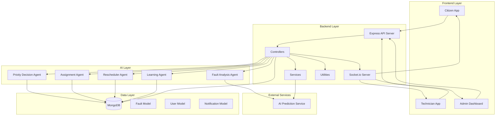

**Diagram sources**
- [server.js:1-74](file://backend/src/server.js#L1-L74)
- [faultController.js:1-449](file://backend/src/controllers/faultController.js#L1-L449)
- [docker-compose.yml:1-42](file://docker-compose.yml#L1-L42)

**Section sources**
- [server.js:1-74](file://backend/src/server.js#L1-L74)
- [docker-compose.yml:1-42](file://docker-compose.yml#L1-L42)

## Core Components

### Backend Server Infrastructure

The backend server serves as the central orchestrator, managing HTTP requests, WebSocket connections, and coordinating between different system components.

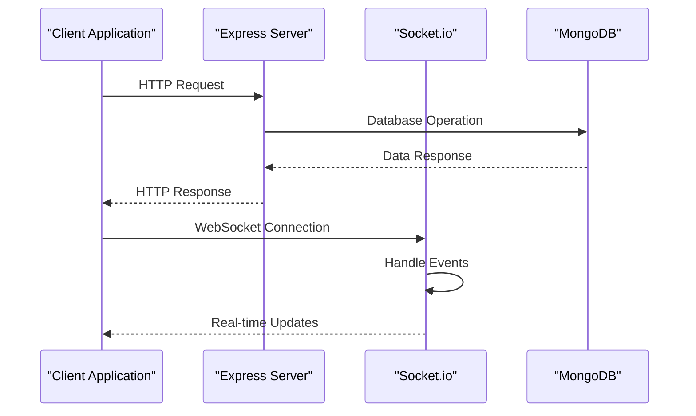

**Diagram sources**
- [server.js:17-74](file://backend/src/server.js#L17-L74)

### Controller Layer

The controller layer implements the primary business logic for fault management operations, coordinating between agents and database operations.

**Section sources**
- [server.js:1-74](file://backend/src/server.js#L1-L74)
- [faultController.js:1-449](file://backend/src/controllers/faultController.js#L1-L449)

## AI Agents and Decision Making

The system employs five specialized AI agents that work together to provide intelligent fault management capabilities.

### Fault Analysis Agent

The Fault Analysis Agent performs comprehensive analysis of reported faults using natural language processing and location-based intelligence.

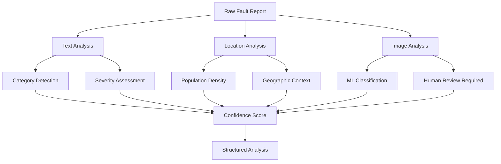

**Diagram sources**
- [faultAnalysisAgent.js:32-89](file://backend/src/agents/faultAnalysisAgent.js#L32-L89)

### Priority Decision Agent

The Priority Decision Agent calculates urgency scores based on multiple factors including severity, category, population density, and temporal factors.

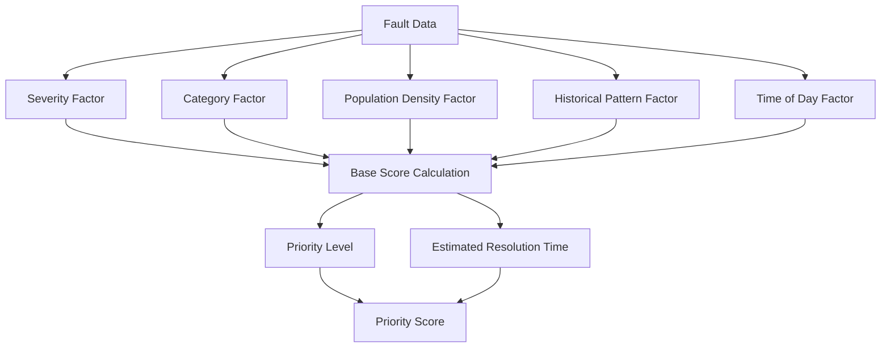

**Diagram sources**
- [priorityDecisionAgent.js:37-111](file://backend/src/agents/priorityDecisionAgent.js#L37-L111)

### Assignment Agent

The Assignment Agent intelligently matches technicians to faults based on proximity, skills, workload, and performance metrics.

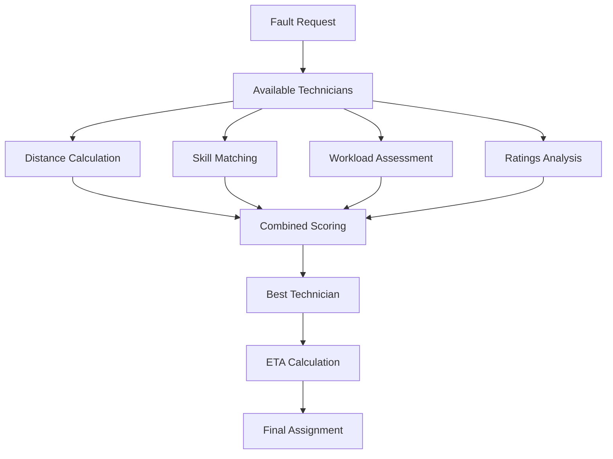

**Diagram sources**
- [assignmentAgent.js:127-190](file://backend/src/agents/assignmentAgent.js#L127-L190)

### Rescheduler Agent

The Rescheduler Agent handles dynamic reassignment scenarios including technician rejection, delays, and capacity constraints.

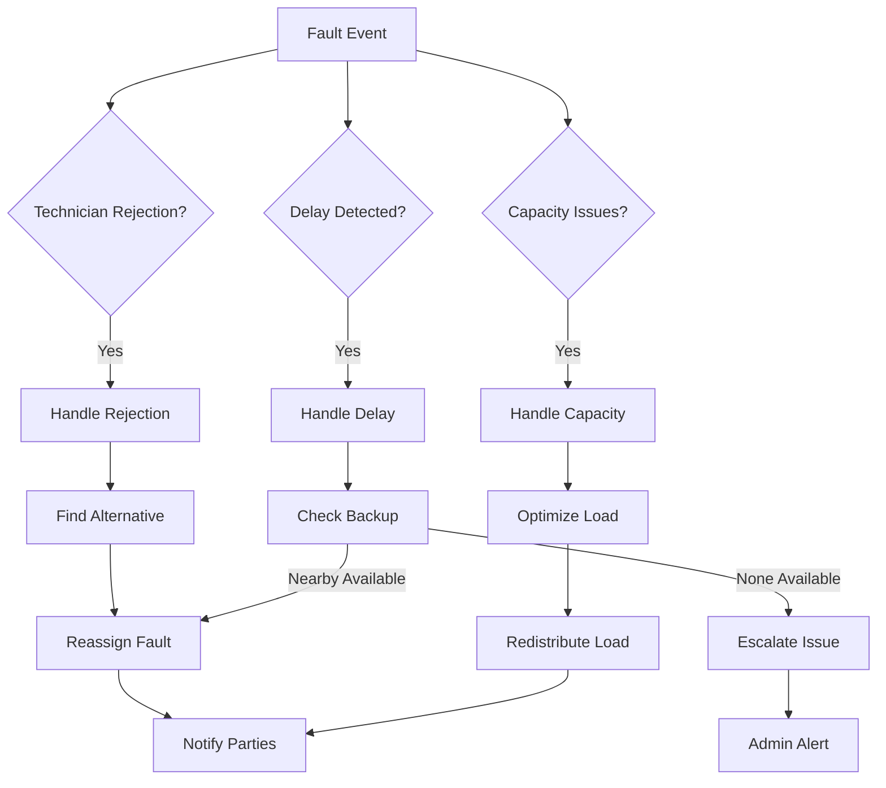

**Diagram sources**
- [reschedulerAgent.js:27-112](file://backend/src/agents/reschedulerAgent.js#L27-L112)

### Learning Agent

The Learning Agent continuously improves system performance through machine learning from historical data and operational insights.

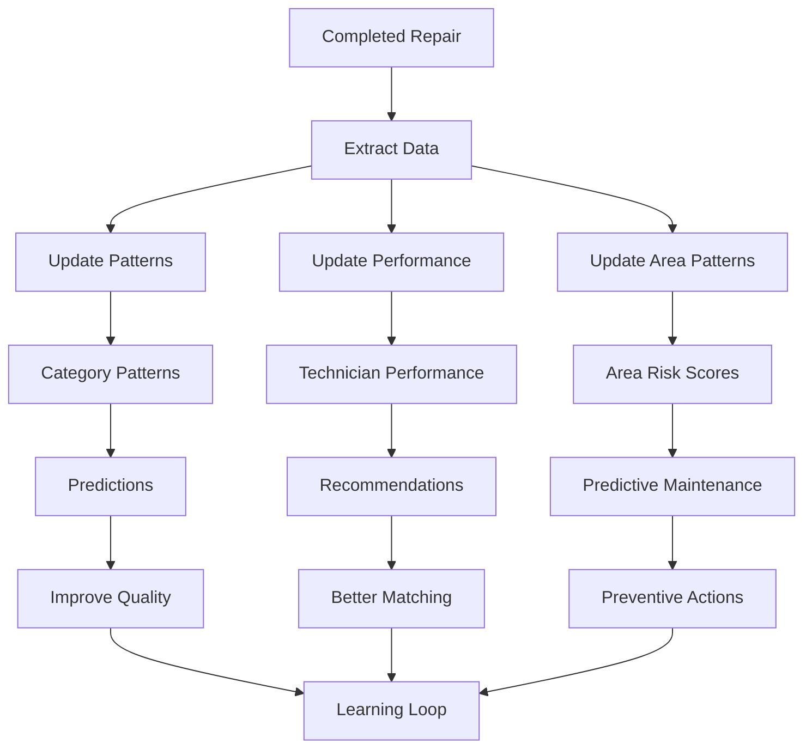

**Diagram sources**
- [learningAgent.js:26-59](file://backend/src/agents/learningAgent.js#L26-L59)

**Section sources**
- [faultAnalysisAgent.js:1-149](file://backend/src/agents/faultAnalysisAgent.js#L1-L149)
- [priorityDecisionAgent.js:1-177](file://backend/src/agents/priorityDecisionAgent.js#L1-L177)
- [assignmentAgent.js:1-258](file://backend/src/agents/assignmentAgent.js#L1-L258)
- [reschedulerAgent.js:1-304](file://backend/src/agents/reschedulerAgent.js#L1-L304)
- [learningAgent.js:1-396](file://backend/src/agents/learningAgent.js#L1-L396)

## Real-time Communication

The system utilizes Socket.io for real-time bidirectional communication between clients and the server.

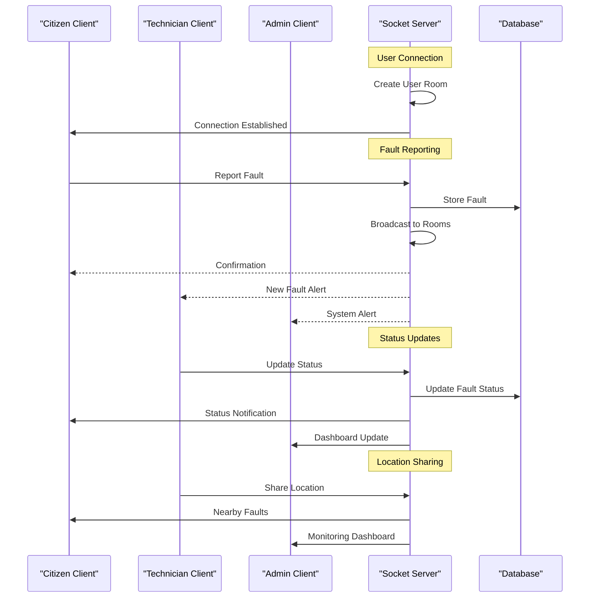

**Diagram sources**
- [server.js:27-44](file://backend/src/server.js#L27-L44)

**Section sources**
- [server.js:1-74](file://backend/src/server.js#L1-L74)

## Data Model

The system uses MongoDB with Mongoose for data persistence, implementing a comprehensive schema for fault management.

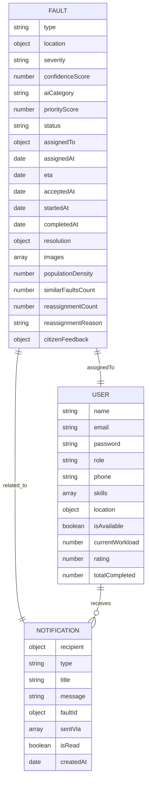

**Diagram sources**
- [Fault.js:3-75](file://backend/src/models/Fault.js#L3-L75)
- [User.js:4-37](file://backend/src/models/User.js#L4-L37)

**Section sources**
- [Fault.js:1-75](file://backend/src/models/Fault.js#L1-L75)
- [User.js:1-37](file://backend/src/models/User.js#L1-L37)

## Frontend Integration

The frontend application provides role-specific interfaces for citizens, technicians, and administrators.

### Citizen Interface

The citizen interface focuses on fault reporting with intuitive forms and location detection capabilities.

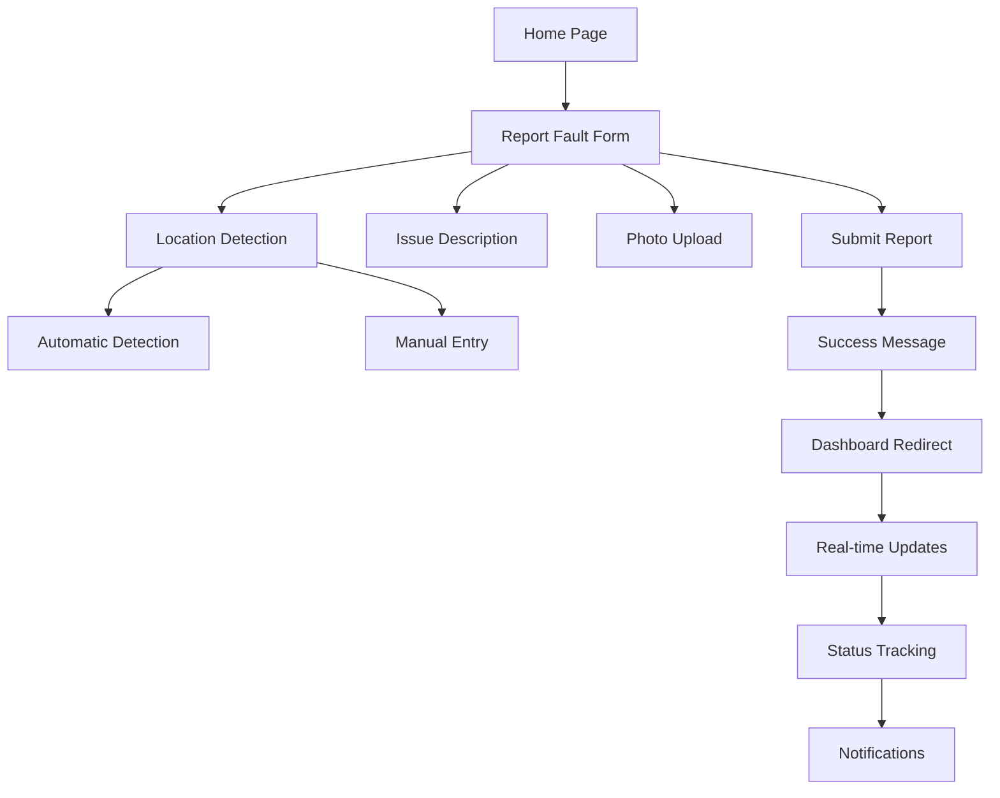

**Diagram sources**
- [ReportFault.jsx:16-86](file://frontend/src/pages/ReportFault.jsx#L16-L86)

### Technician Interface

The technician interface provides fault assignment management, acceptance/rejection workflows, and status updates.

### Admin Interface

The admin interface offers comprehensive oversight including system monitoring, user management, and performance analytics.

**Section sources**
- [ReportFault.jsx:1-309](file://frontend/src/pages/ReportFault.jsx#L1-L309)
- [Dashboard.jsx:1-133](file://frontend/src/pages/Dashboard.jsx#L1-L133)
- [App.jsx:1-170](file://frontend/src/App.jsx#L1-L170)

## Deployment Architecture

The system uses Docker Compose for containerized deployment, enabling easy scaling and management.

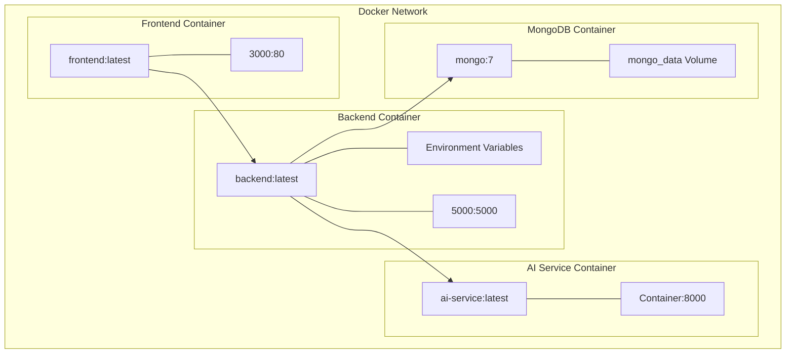

**Diagram sources**
- [docker-compose.yml:3-42](file://docker-compose.yml#L3-L42)

**Section sources**
- [docker-compose.yml:1-42](file://docker-compose.yml#L1-L42)

## Operational Workflows

### Fault Reporting Workflow

The fault reporting process integrates multiple AI agents and real-time communication systems.

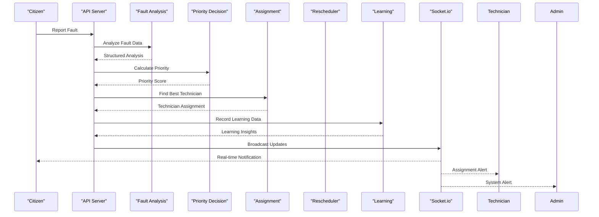

**Diagram sources**
- [faultController.js:15-125](file://backend/src/controllers/faultController.js#L15-L125)

### Technician Assignment Process

The assignment process considers multiple factors to optimize technician-fault matching.

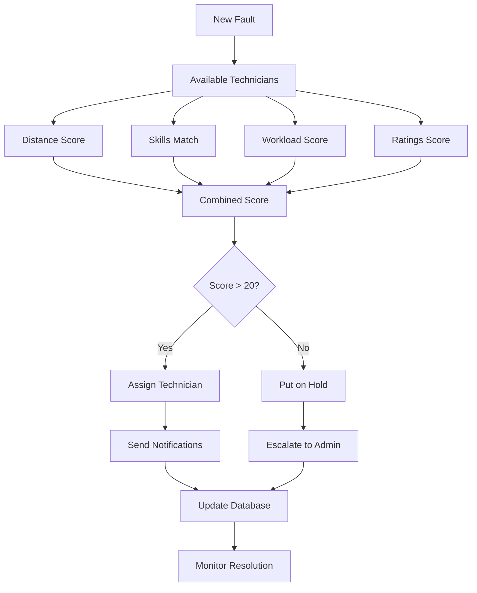

**Diagram sources**
- [assignmentAgent.js:127-190](file://backend/src/agents/assignmentAgent.js#L127-L190)

**Section sources**
- [faultController.js:1-449](file://backend/src/controllers/faultController.js#L1-L449)
- [assignmentAgent.js:1-258](file://backend/src/agents/assignmentAgent.js#L1-L258)

## Performance Considerations

### Database Optimization

The system implements strategic indexing and query optimization for optimal performance:

- **Compound Indexes**: Multi-field indexes for common query patterns
- **Geospatial Indexing**: 2dsphere index for location-based queries
- **Text Search**: Full-text search capabilities for fault descriptions
- **Caching Strategy**: In-memory caching for frequently accessed data

### Scalability Features

- **Horizontal Scaling**: Stateless architecture supporting load balancing
- **Connection Pooling**: Optimized database connection management
- **Message Queuing**: Asynchronous processing for heavy operations
- **CDN Integration**: Static asset delivery optimization

### Real-time Performance

- **WebSocket Optimization**: Efficient event broadcasting
- **Connection Management**: Automatic cleanup of inactive connections
- **Load Balancing**: Round-robin distribution across instances
- **Heartbeat Mechanisms**: Connection health monitoring

## Troubleshooting Guide

### Common Issues and Solutions

**Database Connection Problems**
- Verify MongoDB URI configuration
- Check network connectivity between containers
- Monitor connection pool exhaustion
- Validate authentication credentials

**AI Service Integration Issues**
- Confirm AI service availability on port 8000
- Check model loading and initialization
- Monitor prediction accuracy metrics
- Validate input data formatting

**Socket.io Connection Failures**
- Verify CORS configuration
- Check firewall settings for port 5000
- Monitor connection limits
- Validate client-side connection handling

**Performance Degradation**
- Analyze query performance with explain plans
- Monitor memory usage and garbage collection
- Check for blocking operations
- Review indexing effectiveness

### Monitoring and Logging

The system implements comprehensive logging for operational visibility:

- **Request Tracing**: End-to-end request tracking
- **Error Analytics**: Aggregated error reporting
- **Performance Metrics**: Response time and throughput monitoring
- **User Activity Logs**: Audit trails for compliance

**Section sources**
- [server.js:1-74](file://backend/src/server.js#L1-L74)
- [docker-compose.yml:1-42](file://docker-compose.yml#L1-L42)

## Conclusion

The Fault Management System represents a comprehensive solution for intelligent utility fault handling, combining modern web technologies with advanced AI capabilities. The system's modular architecture enables scalability, maintainability, and continuous improvement through machine learning.

Key strengths include:
- **Intelligent Automation**: Multi-agent AI system for autonomous decision making
- **Real-time Operations**: Live updates and notifications for all stakeholders
- **Continuous Learning**: Adaptive system that improves over time
- **Scalable Architecture**: Containerized deployment supporting growth
- **User-Centric Design**: Role-specific interfaces optimized for different user needs

The system provides a robust foundation for utility management operations, with clear pathways for extension and customization based on specific operational requirements.