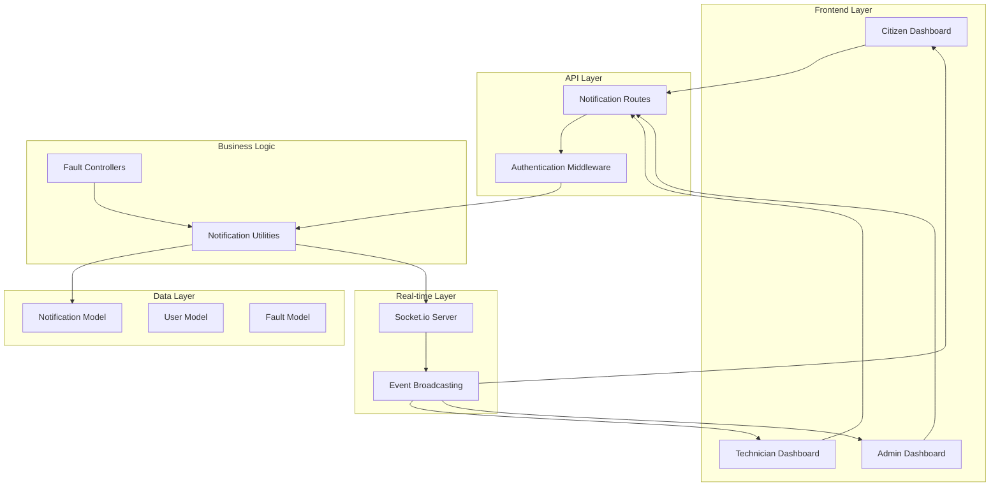
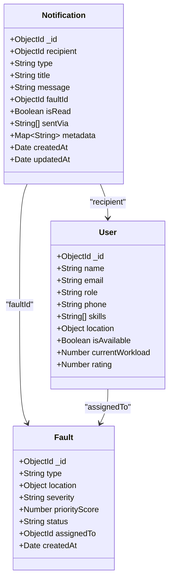
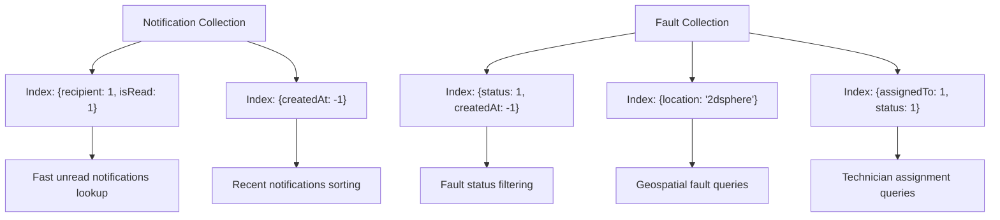
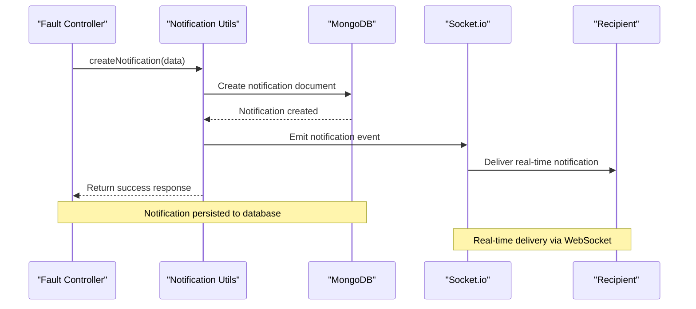
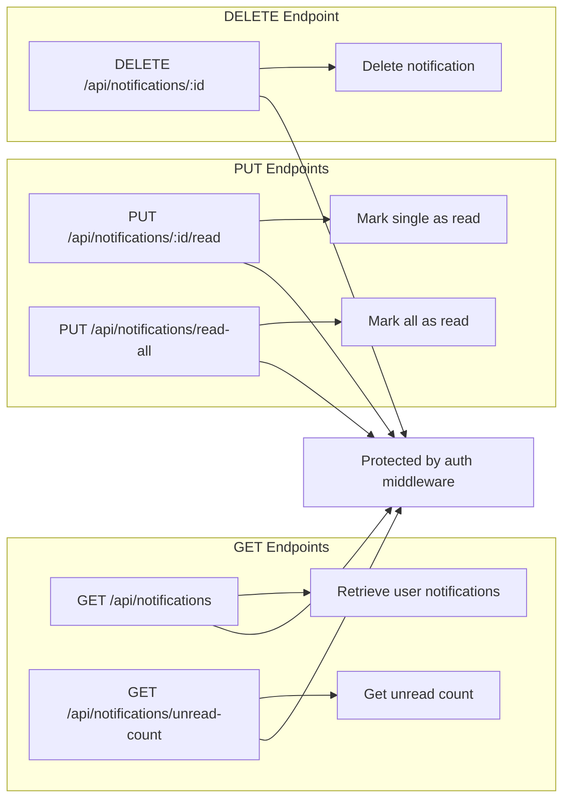
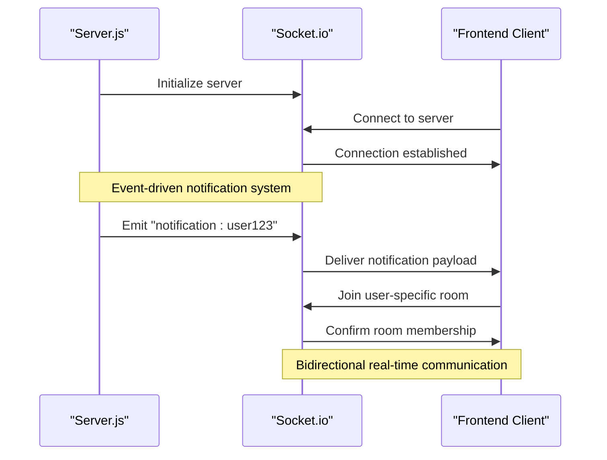
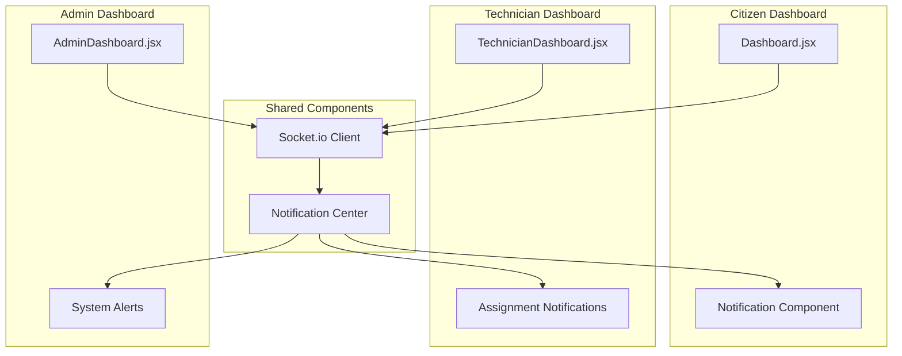
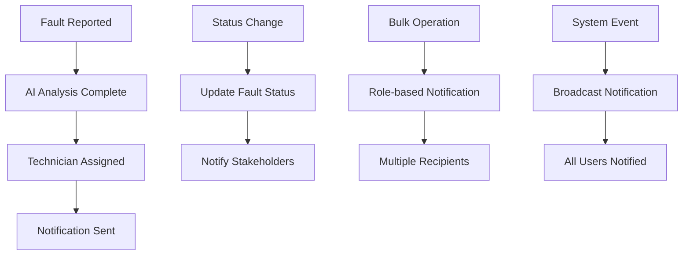

# Notification System

<cite>
**Referenced Files in This Document**
- [Notification.js](file://backend/src/models/Notification.js)
- [notifier.js](file://backend/src/utils/notifier.js)
- [notificationRoutes.js](file://backend/src/routes/notificationRoutes.js)
- [faultController.js](file://backend/src/controllers/faultController.js)
- [server.js](file://backend/src/server.js)
- [User.js](file://backend/src/models/User.js)
- [Fault.js](file://backend/src/models/Fault.js)
- [auth.js](file://backend/src/middleware/auth.js)
- [Dashboard.jsx](file://frontend/src/pages/Dashboard.jsx)
- [TechnicianDashboard.jsx](file://frontend/src/pages/TechnicianDashboard.jsx)
- [AdminDashboard.jsx](file://frontend/src/pages/AdminDashboard.jsx)
</cite>

## Table of Contents
1. [Introduction](#introduction)
2. [System Architecture](#system-architecture)
3. [Core Components](#core-components)
4. [Notification Model](#notification-model)
5. [Notification Utilities](#notification-utilities)
6. [API Endpoints](#api-endpoints)
7. [Real-time Integration](#real-time-integration)
8. [Frontend Implementation](#frontend-implementation)
9. [Usage Patterns](#usage-patterns)
10. [Performance Considerations](#performance-considerations)
11. [Troubleshooting Guide](#troubleshooting-guide)
12. [Conclusion](#conclusion)

## Introduction

The Notification System is a comprehensive real-time messaging infrastructure built for the Agentic AI Utility System. This system enables instant communication between citizens, technicians, and administrators through multiple channels including in-app notifications, email, and SMS. The system integrates seamlessly with the fault reporting and management workflow, providing timely updates on fault assignments, status changes, and system events.

The notification system leverages MongoDB for persistent storage, Socket.io for real-time communication, and follows RESTful API patterns for external integrations. It supports role-based notifications, bulk notifications, and comprehensive read/unread tracking mechanisms.

## System Architecture

The notification system follows a modular architecture with clear separation of concerns:

**Diagram sources**
- [server.js:20-44](file://backend/src/server.js#L20-L44)
- [notificationRoutes.js:1-95](file://backend/src/routes/notificationRoutes.js#L1-L95)
- [notifier.js:1-113](file://backend/src/utils/notifier.js#L1-L113)

## Core Components

### Notification Data Model

The notification system is built around a robust MongoDB schema that supports comprehensive notification tracking:

**Diagram sources**
- [Notification.js:3-22](file://backend/src/models/Notification.js#L3-L22)
- [User.js:4-24](file://backend/src/models/User.js#L4-L24)
- [Fault.js:3-67](file://backend/src/models/Fault.js#L3-L67)

**Section sources**
- [Notification.js:1-28](file://backend/src/models/Notification.js#L1-L28)
- [User.js:1-37](file://backend/src/models/User.js#L1-L37)
- [Fault.js:1-75](file://backend/src/models/Fault.js#L1-L75)

### Notification Types and Categories

The system supports multiple notification types designed for different scenarios:

| Notification Type | Description | Trigger Conditions |
|-------------------|-------------|-------------------|
| `fault_assigned` | New fault assignment to technician | Technician assigned to fault |
| `fault_accepted` | Technician acceptance of fault | Technician accepts fault assignment |
| `fault_completed` | Fault completion confirmation | Fault marked as completed |
| `fault_rejected` | Fault rejection by technician | Technician rejects fault assignment |
| `status_update` | General status change notification | Any fault status update |
| `system` | System-wide announcements | Administrative broadcasts |

**Section sources**
- [Notification.js:5-9](file://backend/src/models/Notification.js#L5-L9)
- [faultController.js:71-78](file://backend/src/controllers/faultController.js#L71-L78)
- [faultController.js:319-328](file://backend/src/controllers/faultController.js#L319-L328)

## Notification Model

### Schema Design and Validation

The notification model implements comprehensive schema validation with the following key features:

- **Recipient Reference**: Strong typing with ObjectId reference to User collection
- **Type Enumeration**: Controlled vocabulary ensuring consistent notification categorization
- **Multi-channel Support**: Flexible sentVia array supporting in-app, email, and SMS delivery
- **Metadata Storage**: Flexible Map structure for additional contextual information
- **Index Optimization**: Strategic indexing for performance on common query patterns

### Database Indexes

The system implements optimized indexes for efficient querying:

**Diagram sources**
- [Notification.js:24-25](file://backend/src/models/Notification.js#L24-L25)
- [Fault.js:69-72](file://backend/src/models/Fault.js#L69-L72)

**Section sources**
- [Notification.js:24-25](file://backend/src/models/Notification.js#L24-L25)
- [Fault.js:69-72](file://backend/src/models/Fault.js#L69-L72)

## Notification Utilities

### Core Notification Functions

The notification utility module provides essential functions for notification management:

**Diagram sources**
- [notifier.js:7-43](file://backend/src/utils/notifier.js#L7-L43)
- [faultController.js:71-78](file://backend/src/controllers/faultController.js#L71-L78)

### Bulk Notification Processing

The system supports efficient bulk notification operations:

| Function | Purpose | Performance Characteristics |
|----------|---------|---------------------------|
| `sendBulkNotifications` | Batch notifications to multiple recipients | Sequential processing with individual error handling |
| `notifyByRole` | Role-based broadcasting | Dynamic user lookup with batch creation |
| `markAsRead` | Single notification read marking | Direct database update |
| `getUnreadNotifications` | User-specific unread retrieval | Indexed query with population |

**Section sources**
- [notifier.js:48-58](file://backend/src/utils/notifier.js#L48-L58)
- [notifier.js:94-99](file://backend/src/utils/notifier.js#L94-L99)
- [notifier.js:63-70](file://backend/src/utils/notifier.js#L63-L70)
- [notifier.js:75-89](file://backend/src/utils/notifier.js#L75-L89)

## API Endpoints

### Notification Management Endpoints

The notification system exposes RESTful endpoints for comprehensive management:

**Diagram sources**
- [notificationRoutes.js:12-92](file://backend/src/routes/notificationRoutes.js#L12-L92)

### Endpoint Specifications

| Endpoint | Method | Authentication | Description |
|----------|--------|----------------|-------------|
| `/api/notifications` | GET | Required | Retrieve user's notifications with optional filters |
| `/api/notifications/:id/read` | PUT | Required | Mark specific notification as read |
| `/api/notifications/read-all` | PUT | Required | Mark all user notifications as read |
| `/api/notifications/unread-count` | GET | Required | Get count of unread notifications |
| `/api/notifications/:id` | DELETE | Required | Delete specific notification |

**Section sources**
- [notificationRoutes.js:12-92](file://backend/src/routes/notificationRoutes.js#L12-L92)
- [auth.js:3-15](file://backend/src/middleware/auth.js#L3-L15)

## Real-time Integration

### Socket.io Implementation

The notification system integrates with Socket.io for real-time communication:

**Diagram sources**
- [server.js:20-44](file://backend/src/server.js#L20-L44)
- [notifier.js:22-34](file://backend/src/utils/notifier.js#L22-L34)

### Real-time Event Flow

The system handles various real-time events:

1. **Notification Delivery**: Immediate delivery of new notifications
2. **User Room Management**: User-specific room joining for targeted messaging
3. **Broadcast Events**: System-wide announcements to all users
4. **Location Updates**: Technician location sharing for collaborative work

**Section sources**
- [server.js:20-44](file://backend/src/server.js#L20-L44)
- [notifier.js:22-34](file://backend/src/utils/notifier.js#L22-L34)

## Frontend Implementation

### Dashboard Integration

The notification system integrates seamlessly with all frontend dashboards:

**Diagram sources**
- [Dashboard.jsx:35-42](file://frontend/src/pages/Dashboard.jsx#L35-L42)
- [TechnicianDashboard.jsx:66-76](file://frontend/src/pages/TechnicianDashboard.jsx#L66-L76)
- [AdminDashboard.jsx:66-77](file://frontend/src/pages/AdminDashboard.jsx#L66-L77)

### Real-time Notification Handling

Each dashboard implements real-time notification reception:

- **Citizen Dashboard**: Receives fault status updates and system announcements
- **Technician Dashboard**: Gets fault assignments, status changes, and system alerts
- **Admin Dashboard**: Monitors all system activities and receives comprehensive notifications

**Section sources**
- [Dashboard.jsx:35-42](file://frontend/src/pages/Dashboard.jsx#L35-L42)
- [TechnicianDashboard.jsx:66-76](file://frontend/src/pages/TechnicianDashboard.jsx#L66-L76)
- [AdminDashboard.jsx:66-77](file://frontend/src/pages/AdminDashboard.jsx#L66-L77)

## Usage Patterns

### Common Notification Scenarios

The system handles various notification patterns:

### Notification Lifecycle

1. **Creation**: Notification generated from business logic
2. **Storage**: Persisted to MongoDB with proper indexing
3. **Delivery**: Real-time delivery via Socket.io
4. **Tracking**: Read/unread status maintained
5. **Retrieval**: User can access notification history

**Section sources**
- [faultController.js:71-78](file://backend/src/controllers/faultController.js#L71-L78)
- [faultController.js:275-284](file://backend/src/controllers/faultController.js#L275-L284)
- [notifier.js:7-43](file://backend/src/utils/notifier.js#L7-L43)

## Performance Considerations

### Database Optimization

The notification system implements several performance optimizations:

- **Indexed Queries**: Strategic indexing on frequently queried fields
- **Efficient Population**: Selective field population to minimize query overhead
- **Pagination Support**: Built-in limit parameters for large notification histories
- **Memory Management**: Proper cleanup of unused notification references

### Scalability Features

- **Connection Pooling**: Efficient database connection management
- **Real-time Scaling**: Socket.io cluster support for horizontal scaling
- **Load Distribution**: Even distribution of notification loads across system components
- **Caching Opportunities**: Potential for Redis caching of frequently accessed notification data

## Troubleshooting Guide

### Common Issues and Solutions

| Issue | Symptoms | Solution |
|-------|----------|----------|
| Notifications not received | Real-time delivery fails | Check Socket.io connection and user room membership |
| Database performance slow | Slow notification queries | Verify index usage and optimize query patterns |
| Authentication failures | 401 errors on notification endpoints | Validate JWT tokens and middleware configuration |
| Bulk notification failures | Partial notification delivery | Implement retry mechanisms and error logging |

### Debugging Tools

The system includes comprehensive logging for troubleshooting:

- **Console Logging**: Detailed error messages and operation traces
- **Database Index Verification**: Tools for checking index effectiveness
- **Socket.io Event Monitoring**: Real-time event flow tracking
- **Performance Metrics**: Query execution times and memory usage monitoring

**Section sources**
- [notifier.js:39-42](file://backend/src/utils/notifier.js#L39-L42)
- [server.js:27-43](file://backend/src/server.js#L27-L43)

## Conclusion

The Notification System provides a robust, scalable foundation for real-time communication within the Agentic AI Utility System. Its modular architecture, comprehensive feature set, and real-time capabilities make it an essential component for coordinating between citizens, technicians, and administrators.

Key strengths include:
- **Real-time Communication**: Instant notification delivery via Socket.io
- **Flexible Delivery Channels**: Support for multiple notification channels
- **Role-based Targeting**: Precise audience targeting based on user roles
- **Performance Optimization**: Strategic indexing and query optimization
- **Comprehensive Tracking**: Full lifecycle management from creation to archival

The system successfully integrates with the broader fault management workflow, enhancing user experience through timely, relevant communications while maintaining high performance and scalability standards.