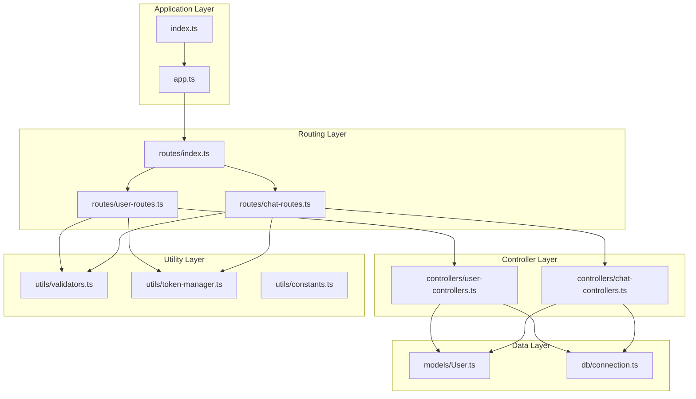
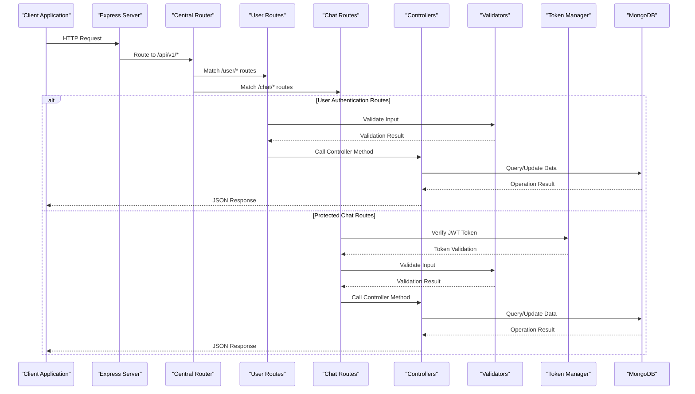
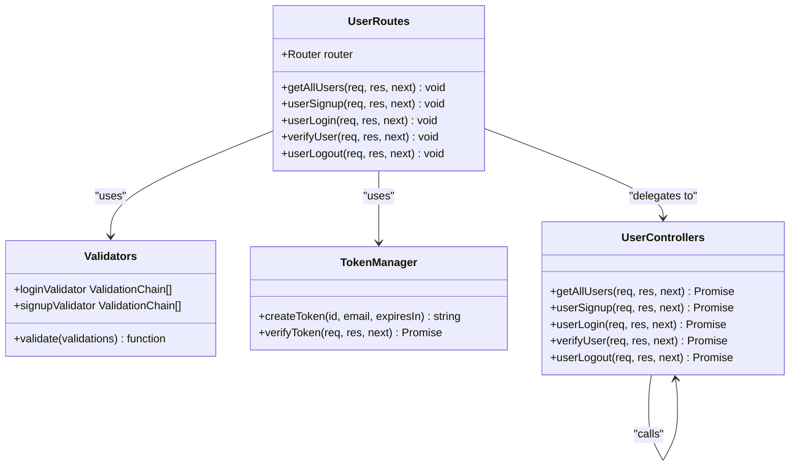
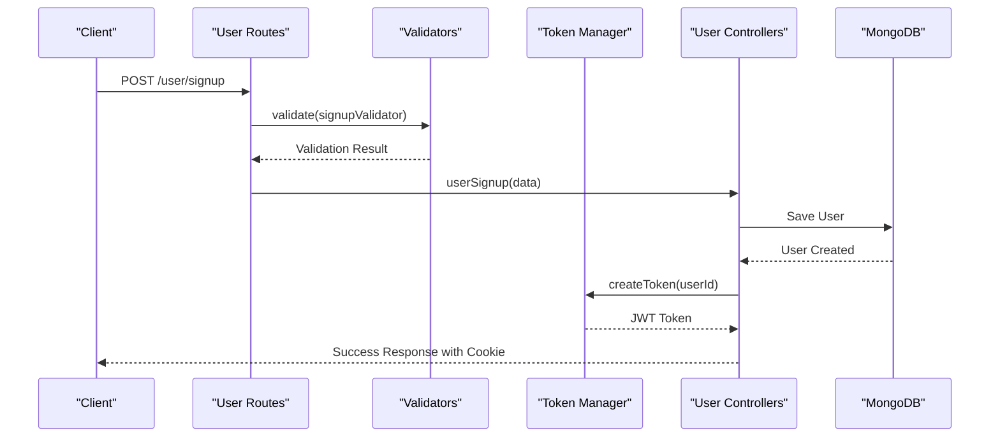
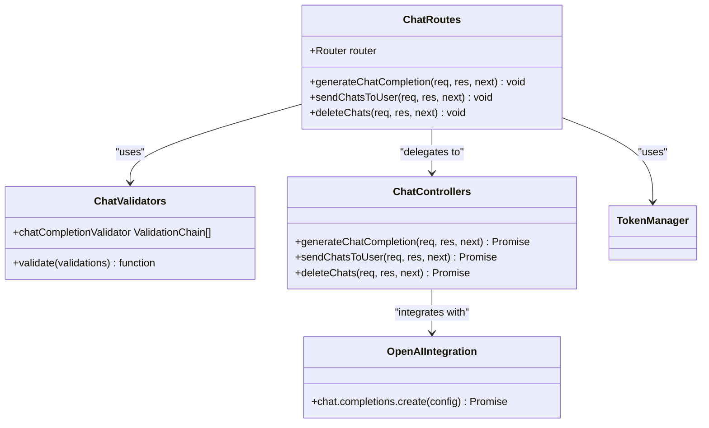
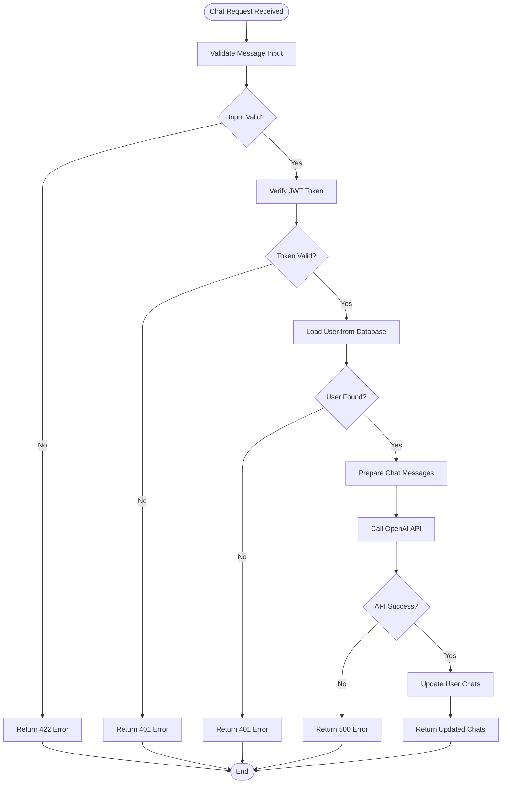
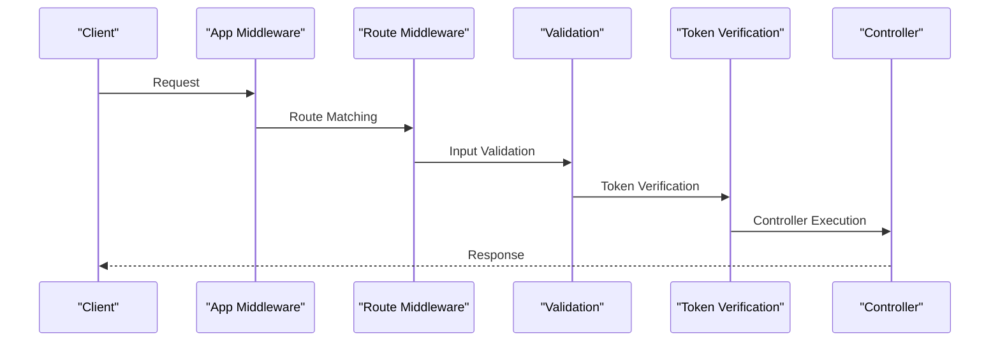
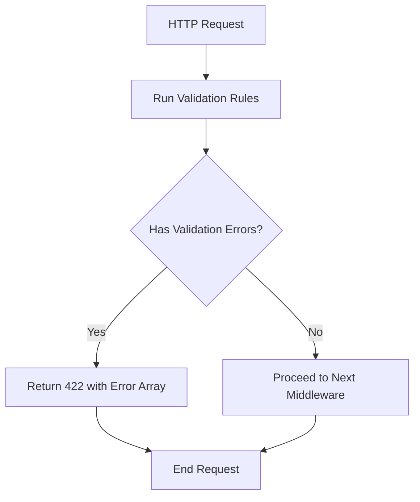

# Routing Architecture

<cite>
**Referenced Files in This Document**
- [index.ts](file://backend/src/routes/index.ts)
- [user-routes.ts](file://backend/src/routes/user-routes.ts)
- [chat-routes.ts](file://backend/src/routes/chat-routes.ts)
- [user-controllers.ts](file://backend/src/controllers/user-controllers.ts)
- [chat-controllers.ts](file://backend/src/controllers/chat-controllers.ts)
- [validators.ts](file://backend/src/utils/validators.ts)
- [token-manager.ts](file://backend/src/utils/token-manager.ts)
- [app.ts](file://backend/src/app.ts)
- [index.ts](file://backend/src/index.ts)
- [constants.ts](file://backend/src/utils/constants.ts)
- [connection.ts](file://backend/src/db/connection.ts)
- [User.ts](file://backend/src/models/User.ts)
</cite>

## Table of Contents
1. [Introduction](#introduction)
2. [Project Structure](#project-structure)
3. [Core Components](#core-components)
4. [Architecture Overview](#architecture-overview)
5. [Detailed Component Analysis](#detailed-component-analysis)
6. [Route Organization Pattern](#route-organization-pattern)
7. [Middleware Chain Analysis](#middleware-chain-analysis)
8. [Parameter Validation Strategy](#parameter-validation-strategy)
9. [Error Handling and Propagation](#error-handling-and-propagation)
10. [Testing Strategies](#testing-strategies)
11. [Performance Considerations](#performance-considerations)
12. [Troubleshooting Guide](#troubleshooting-guide)
13. [Conclusion](#conclusion)

## Introduction

The SMAN-GPT API follows a modular routing architecture built on Express.js that organizes endpoints into logical groups under the `/api/v1` prefix. The system implements a centralized router pattern where individual route modules are imported and mounted, creating a clean separation of concerns between user authentication operations and chat message handling.

The routing system emphasizes security through JWT token verification, comprehensive input validation, and structured middleware chaining. This architecture supports both public endpoints (like user signup and login) and protected endpoints requiring authentication tokens.

## Project Structure

The routing architecture is organized around a clear file structure that promotes maintainability and scalability:



**Diagram sources**
- [app.ts:1-21](file://backend/src/app.ts#L1-L21)
- [index.ts:1-13](file://backend/src/index.ts#L1-L13)
- [routes/index.ts:1-11](file://backend/src/routes/index.ts#L1-L11)

**Section sources**
- [app.ts:1-21](file://backend/src/app.ts#L1-L21)
- [routes/index.ts:1-11](file://backend/src/routes/index.ts#L1-L11)

## Core Components

The routing architecture consists of several interconnected components that work together to provide a robust API infrastructure:

### Centralized Router Import System
The application uses a centralized router pattern where all route modules are imported and mounted in a single location. This approach provides several benefits:

- **Single Point of Control**: All routes are managed from one central location
- **Modular Organization**: Routes are grouped by functionality (user, chat)
- **Easy Maintenance**: Changes to routing logic can be made in one place
- **Scalable Design**: New route groups can be easily added

### Route Grouping Strategy
Routes are organized into logical groups that correspond to their functional domains:

- **User Routes**: Authentication operations (signup, login, auth status, logout)
- **Chat Routes**: Message handling operations (new chat, get all chats, delete chat)

### Middleware Integration
The system integrates multiple middleware layers that handle cross-cutting concerns:

- **CORS Configuration**: Enables communication with the frontend
- **JSON Parsing**: Handles request body parsing
- **Cookie Management**: Manages authentication cookies
- **Token Verification**: Secures protected endpoints

**Section sources**
- [routes/index.ts:1-11](file://backend/src/routes/index.ts#L1-L11)
- [app.ts:10-18](file://backend/src/app.ts#L10-L18)

## Architecture Overview

The routing architecture follows a layered approach that separates concerns and provides clear boundaries between different functional areas:



**Diagram sources**
- [app.ts:18](file://backend/src/app.ts#L18)
- [routes/index.ts:7-8](file://backend/src/routes/index.ts#L7-L8)
- [user-routes.ts:19-22](file://backend/src/routes/user-routes.ts#L19-L22)
- [chat-routes.ts:12-19](file://backend/src/routes/chat-routes.ts#L12-L19)

## Detailed Component Analysis

### User Routes Module

The user routes module handles all authentication-related operations with comprehensive validation and security measures:



**Diagram sources**
- [user-routes.ts:1-25](file://backend/src/routes/user-routes.ts#L1-L25)
- [user-controllers.ts:1-163](file://backend/src/controllers/user-controllers.ts#L1-L163)
- [validators.ts:4-18](file://backend/src/utils/validators.ts#L4-L18)
- [token-manager.ts:13-34](file://backend/src/utils/token-manager.ts#L13-L34)

#### Route Registration Pattern
The user routes module demonstrates a consistent pattern for route registration:

- **GET /user/**: Retrieves all users (public operation)
- **POST /user/signup**: Creates new user accounts with validation
- **POST /user/login**: Authenticates existing users with validation
- **GET /user/auth-status**: Verifies JWT token validity
- **GET /user/logout**: Removes authentication cookies

#### Authentication Flow
The authentication flow follows a secure pattern that validates input, verifies credentials, and manages session tokens:



**Diagram sources**
- [user-routes.ts:19](file://backend/src/routes/user-routes.ts#L19)
- [user-controllers.ts:22-62](file://backend/src/controllers/user-controllers.ts#L22-L62)
- [validators.ts:28-31](file://backend/src/utils/validators.ts#L28-L31)
- [token-manager.ts:5-11](file://backend/src/utils/token-manager.ts#L5-L11)

**Section sources**
- [user-routes.ts:1-25](file://backend/src/routes/user-routes.ts#L1-L25)
- [user-controllers.ts:1-163](file://backend/src/controllers/user-controllers.ts#L1-L163)

### Chat Routes Module

The chat routes module handles all message-related operations with comprehensive security and validation:



**Diagram sources**
- [chat-routes.ts:1-22](file://backend/src/routes/chat-routes.ts#L1-L22)
- [chat-controllers.ts:1-89](file://backend/src/controllers/chat-controllers.ts#L1-L89)
- [validators.ts:33-35](file://backend/src/utils/validators.ts#L33-L35)

#### Protected Route Pattern
All chat routes implement a consistent security pattern:

- **POST /chat/new**: Creates new chat completions with message validation
- **GET /chat/all-chats**: Retrieves user's chat history
- **DELETE /chat/delete**: Clears user's chat history

#### Chat Completion Workflow
The chat completion process involves multiple steps including validation, authentication, OpenAI integration, and data persistence:



**Diagram sources**
- [chat-routes.ts:12-17](file://backend/src/routes/chat-routes.ts#L12-L17)
- [chat-controllers.ts:7-43](file://backend/src/controllers/chat-controllers.ts#L7-L43)

**Section sources**
- [chat-routes.ts:1-22](file://backend/src/routes/chat-routes.ts#L1-L22)
- [chat-controllers.ts:1-89](file://backend/src/controllers/chat-controllers.ts#L1-L89)

## Route Organization Pattern

The routing system follows a well-defined organization pattern that promotes maintainability and scalability:

### Centralized Router Imports
The central router (`routes/index.ts`) serves as the single entry point for all route modules:

```typescript
// routes/index.ts
import { Router } from "express";
import userRoutes from "./user-routes.js";
import chatRoutes from "./chat-routes.js";

const appRouter = Router();

appRouter.use("/user", userRoutes); // domain/api/v1/user
appRouter.use("/chat", chatRoutes); // domain/api/v1/chat

export default appRouter;
```

### Modular Endpoint Grouping
Each route group maintains its own logical separation:

- **User Routes**: `/api/v1/user/*` - Authentication and user management
- **Chat Routes**: `/api/v1/chat/*` - Message handling and chat operations

### URL Pattern Conventions
The system maintains consistent URL patterns:

- **Resource-based Naming**: `/resource/action` structure
- **Pluralization**: Collections use plural forms (users, chats)
- **Action-based Paths**: Specific operations use descriptive paths (signup, login, auth-status)

**Section sources**
- [routes/index.ts:1-11](file://backend/src/routes/index.ts#L1-L11)
- [user-routes.ts:18-22](file://backend/src/routes/user-routes.ts#L18-L22)
- [chat-routes.ts:12-19](file://backend/src/routes/chat-routes.ts#L12-L19)

## Middleware Chain Analysis

The routing architecture implements a sophisticated middleware chain that handles various cross-cutting concerns:

### Application-Level Middleware
The main application (`app.ts`) configures essential middleware:

```typescript
// app.ts middleware configuration
app.use(cors({ origin: "http://localhost:5173", credentials: true }));
app.use(express.json());
app.use(cookieParser(process.env.COOKIE_SECRET));
app.use(morgan("dev"));
app.use("/api/v1", appRouter);
```

### Route-Specific Middleware
Individual routes implement targeted middleware chains:

#### User Route Middleware Chain
```typescript
// Example: POST /user/signup
userRoutes.post("/signup", validate(signupValidator), userSignup);

// Middleware order: Validation -> Controller
```

#### Chat Route Middleware Chain
```typescript
// Example: POST /chat/new
chatRoutes.post(
  "/new",
  validate(chatCompletionValidator),
  verifyToken,
  generateChatCompletion
);

// Middleware order: Validation -> Token Verification -> Controller
```

### Middleware Execution Flow
The middleware chain executes in a predictable sequence:



**Diagram sources**
- [app.ts:10-18](file://backend/src/app.ts#L10-L18)
- [user-routes.ts:19](file://backend/src/routes/user-routes.ts#L19)
- [chat-routes.ts:12-17](file://backend/src/routes/chat-routes.ts#L12-L17)

**Section sources**
- [app.ts:10-18](file://backend/src/app.ts#L10-L18)
- [user-routes.ts:19](file://backend/src/routes/user-routes.ts#L19)
- [chat-routes.ts:12-17](file://backend/src/routes/chat-routes.ts#L12-L17)

## Parameter Validation Strategy

The system implements comprehensive input validation using express-validator:

### Validation Functions
The validation system provides reusable validation logic:

```typescript
// validators.ts
export const validate = (validations: ValidationChain[]) => {
  return async (req: Request, res: Response, next: NextFunction) => {
    for (let validation of validations) {
      const result = await validation.run(req);
      if (!result.isEmpty()) {
        break;
      }
    }
    const errors = validationResult(req);
    if (errors.isEmpty()) {
      return next();
    }
    return res.status(422).json({ errors: errors.array() });
  };
};
```

### Validation Rules
Different validation rules apply to different endpoints:

#### Login Validation
- Email: Required, must be valid email format
- Password: Required, minimum 6 characters

#### Signup Validation
- Name: Required
- Email: Required, must be valid email format
- Password: Required, minimum 6 characters

#### Chat Completion Validation
- Message: Required, cannot be empty

### Validation Error Handling
Validation errors return standardized 422 responses with detailed error arrays:



**Diagram sources**
- [validators.ts:4-18](file://backend/src/utils/validators.ts#L4-L18)
- [validators.ts:20-35](file://backend/src/utils/validators.ts#L20-L35)

**Section sources**
- [validators.ts:1-36](file://backend/src/utils/validators.ts#L1-L36)

## Error Handling and Propagation

The routing system implements comprehensive error handling at multiple levels:

### Controller-Level Error Handling
Controllers implement try-catch blocks to handle database and business logic errors:

```typescript
// Example pattern from user controllers
export const userSignup = async (req: Request, res: Response, next: NextFunction) => {
  try {
    // Business logic
    return res.status(201).json({ message: "OK", user });
  } catch (error) {
    console.log(error);
    return res.status(200).json({ message: "ERROR", cause: error.message });
  }
};
```

### Middleware-Level Error Propagation
Middleware functions propagate errors through the chain:

```typescript
// Token verification error handling
return jwt.verify(token, process.env.JWT_SECRET, (err, success) => {
  if (err) {
    reject(err.message);
    return res.status(401).json({ message: "Token Expired" });
  }
  // Continue with successful verification
});
```

### Standardized Error Responses
The system maintains consistent error response formats:

- **Validation Errors**: 422 status with error array
- **Authentication Errors**: 401 status with token-related messages
- **Business Logic Errors**: 200 status with "ERROR" message and cause
- **System Errors**: 500 status with generic error messages

**Section sources**
- [user-controllers.ts:12-20](file://backend/src/controllers/user-controllers.ts#L12-L20)
- [token-manager.ts:22-33](file://backend/src/utils/token-manager.ts#L22-L33)
- [chat-controllers.ts:38-42](file://backend/src/controllers/chat-controllers.ts#L38-L42)

## Testing Strategies

The modular routing architecture supports comprehensive testing strategies:

### Unit Testing Approach
Individual route modules can be tested independently:

#### Route Registration Testing
Test that routes are properly registered and mounted:

```typescript
// Test route registration
describe('Route Registration', () => {
  it('should mount user routes at /api/v1/user', () => {
    // Test mounting logic
  });
  
  it('should mount chat routes at /api/v1/chat', () => {
    // Test mounting logic
  });
});
```

#### Middleware Chain Testing
Test the execution order and behavior of middleware chains:

```typescript
// Test middleware execution order
describe('Middleware Chain', () => {
  it('should validate input before controller execution', () => {
    // Test validation middleware
  });
  
  it('should verify token for protected routes', () => {
    // Test token verification
  });
});
```

### Integration Testing Strategy
Test the complete request-response cycle:

#### Authentication Flow Testing
```typescript
describe('Authentication Flow', () => {
  it('should validate signup input and create user', async () => {
    // Test signup validation and user creation
  });
  
  it('should verify login credentials and set cookies', async () => {
    // Test login validation and token creation
  });
});
```

#### Chat Operations Testing
```typescript
describe('Chat Operations', () => {
  it('should validate chat messages and integrate with OpenAI', async () => {
    // Test chat completion with OpenAI integration
  });
  
  it('should retrieve user chat history', async () => {
    // Test chat retrieval functionality
  });
});
```

### Mock Testing for External Dependencies
```typescript
describe('External Dependencies', () => {
  beforeEach(() => {
    // Mock OpenAI API
    jest.spyOn(openai, 'chat.completions.create');
    
    // Mock database operations
    jest.spyOn(User, 'findOne');
    jest.spyOn(User, 'findById');
  });
  
  afterEach(() => {
    jest.restoreAllMocks();
  });
});
```

## Performance Considerations

The routing architecture incorporates several performance optimization strategies:

### Middleware Efficiency
- **Early Validation**: Input validation occurs before database operations
- **Token Caching**: JWT verification results could be cached for repeated requests
- **Database Connection Pooling**: Mongoose handles connection pooling automatically

### Request Processing Optimization
- **Minimal Middleware Overhead**: Only necessary middleware is applied to each route
- **Efficient Error Handling**: Errors are caught and handled early to prevent unnecessary processing
- **Streaming Responses**: Large responses are handled efficiently without blocking

### Scalability Factors
- **Modular Design**: Easy to add new route groups without affecting existing functionality
- **Separation of Concerns**: Clear boundaries between validation, authentication, and business logic
- **Database Indexing**: User email field is indexed for efficient lookups

## Troubleshooting Guide

Common issues and their solutions in the routing architecture:

### Authentication Issues
**Problem**: Users unable to login despite correct credentials
**Solution**: Check JWT secret configuration and token expiration settings

**Problem**: Token verification failing intermittently
**Solution**: Verify cookie configuration and ensure consistent domain settings

### Validation Errors
**Problem**: Validation errors not returning expected format
**Solution**: Check express-validator installation and validation chain configuration

### Database Connection Issues
**Problem**: Routes failing with database connection errors
**Solution**: Verify MongoDB connection string and network connectivity

### CORS Configuration Problems
**Problem**: Frontend unable to communicate with API
**Solution**: Ensure CORS origin matches frontend URL and credentials are enabled

**Section sources**
- [token-manager.ts:18-33](file://backend/src/utils/token-manager.ts#L18-L33)
- [validators.ts:12-17](file://backend/src/utils/validators.ts#L12-L17)
- [connection.ts:1-21](file://backend/src/db/connection.ts#L1-L21)

## Conclusion

The SMAN-GPT routing architecture demonstrates a well-structured, scalable approach to API design that emphasizes modularity, security, and maintainability. The centralized router pattern, combined with comprehensive middleware chains and validation strategies, creates a robust foundation for both authentication and chat operations.

Key strengths of the architecture include:

- **Clear Separation of Concerns**: Logical grouping of routes by functionality
- **Consistent Security Model**: Uniform authentication and authorization patterns
- **Comprehensive Validation**: Multi-layered input validation with standardized error handling
- **Extensible Design**: Easy addition of new route groups and endpoints
- **Robust Error Handling**: Comprehensive error propagation and standardized responses

The architecture successfully balances developer productivity with system reliability, providing a solid foundation for future enhancements and scaling requirements.