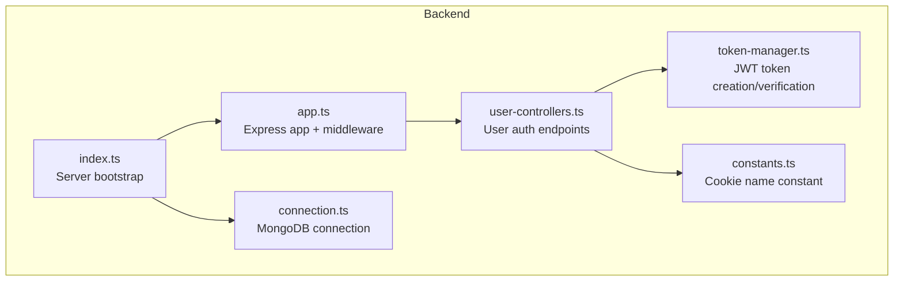
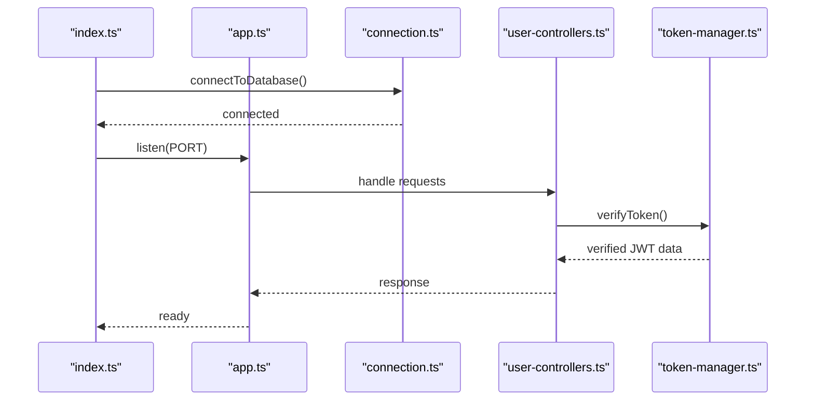
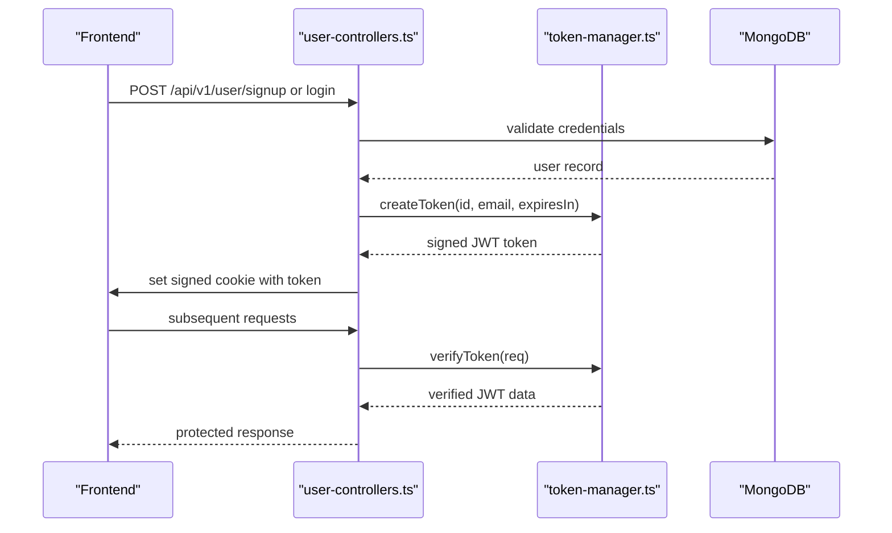
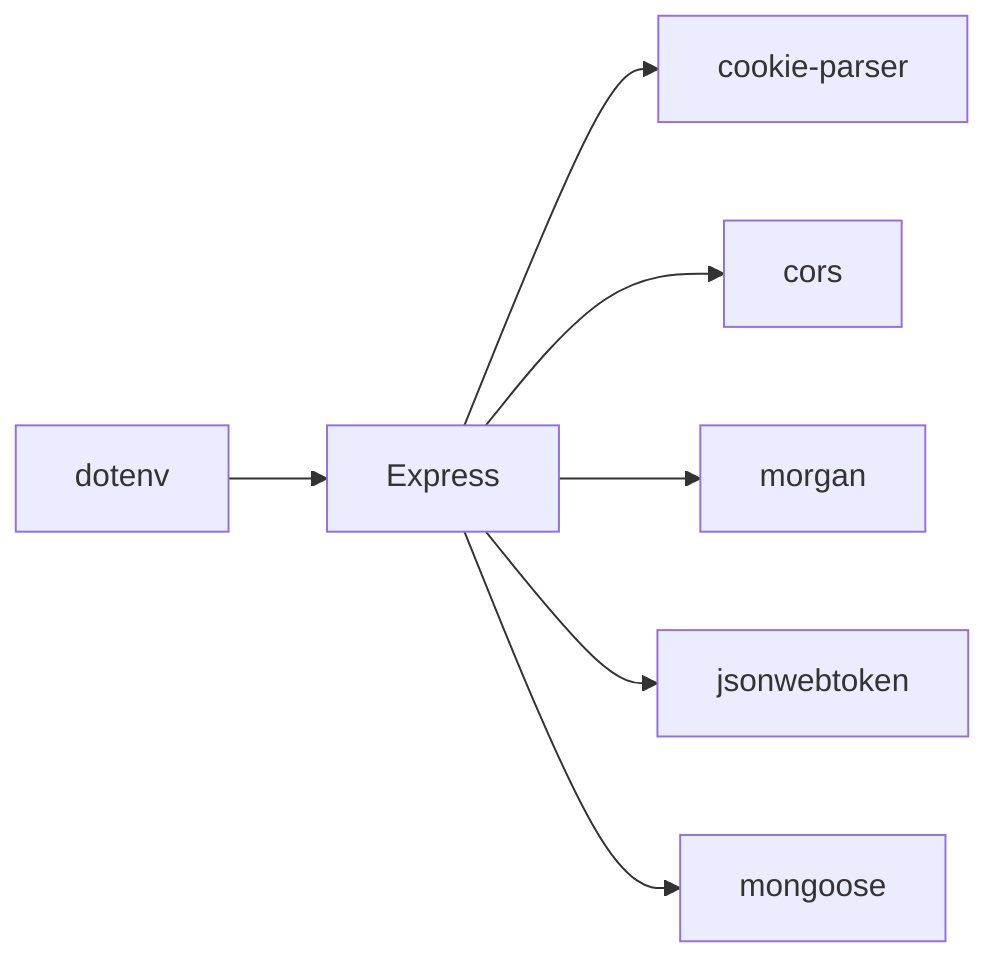

# Server Configuration

<cite>
**Referenced Files in This Document**
- [index.ts](file://backend/src/index.ts)
- [app.ts](file://backend/src/app.ts)
- [connection.ts](file://backend/src/db/connection.ts)
- [constants.ts](file://backend/src/utils/constants.ts)
- [token-manager.ts](file://backend/src/utils/token-manager.ts)
- [user-controllers.ts](file://backend/src/controllers/user-controllers.ts)
- [package.json](file://backend/package.json)
- [README.md](file://backend/README.md)
</cite>

## Table of Contents
1. [Introduction](#introduction)
2. [Project Structure](#project-structure)
3. [Core Components](#core-components)
4. [Architecture Overview](#architecture-overview)
5. [Detailed Component Analysis](#detailed-component-analysis)
6. [Dependency Analysis](#dependency-analysis)
7. [Performance Considerations](#performance-considerations)
8. [Troubleshooting Guide](#troubleshooting-guide)
9. [Conclusion](#conclusion)
10. [Appendices](#appendices)

## Introduction
This document provides comprehensive server configuration documentation for the SMAN-GPT backend server. It focuses on the Express.js server setup, middleware configuration, CORS policy, cookie parsing, development logging, server initialization, port configuration, environment variable loading, and security considerations. It also covers deployment configurations and operational guidance for both development and production environments.

## Project Structure
The backend server is organized around a modular Express application with clear separation of concerns:
- Application bootstrap and server lifecycle in the entry file
- Express app definition and middleware stack
- Database connection utilities
- Utility modules for tokens and constants
- Controllers for user and chat operations
- Package scripts for development and production builds

**Diagram sources**
- [index.ts:1-13](file://backend/src/index.ts#L1-L13)
- [app.ts:1-21](file://backend/src/app.ts#L1-L21)
- [connection.ts:1-21](file://backend/src/db/connection.ts#L1-L21)
- [constants.ts:1-2](file://backend/src/utils/constants.ts#L1-L2)
- [token-manager.ts:1-35](file://backend/src/utils/token-manager.ts#L1-L35)
- [user-controllers.ts:1-163](file://backend/src/controllers/user-controllers.ts#L1-L163)

**Section sources**
- [index.ts:1-13](file://backend/src/index.ts#L1-L13)
- [app.ts:1-21](file://backend/src/app.ts#L1-L21)
- [README.md:1-12](file://backend/README.md#L1-L12)

## Core Components
- Express application with middleware stack
- CORS configuration for frontend origin
- JSON body parsing and cookie parsing with secret key
- Morgan development logging middleware
- Environment variable loading via dotenv
- Database connection management
- Cookie-based authentication with JWT tokens

Key configuration points:
- Port binding: defaults to an environment variable or falls back to a fixed port
- CORS origin: configured for local development
- Cookie parser secret: loaded from environment
- Logging: development mode only middleware
- Routes: mounted under a base path

**Section sources**
- [index.ts:5-12](file://backend/src/index.ts#L5-L12)
- [app.ts:11-16](file://backend/src/app.ts#L11-L16)
- [connection.ts:4](file://backend/src/db/connection.ts#L4)

## Architecture Overview
The server initializes the Express app, loads environment variables, applies middleware, connects to the database, and starts listening on the configured port. Authentication relies on signed cookies containing JWT tokens, validated by a middleware that verifies the token against the secret.

**Diagram sources**
- [index.ts:6-11](file://backend/src/index.ts#L6-L11)
- [app.ts:18](file://backend/src/app.ts#L18)
- [connection.ts:2-8](file://backend/src/db/connection.ts#L2-L8)
- [user-controllers.ts:110-131](file://backend/src/controllers/user-controllers.ts#L110-L131)
- [token-manager.ts:13-34](file://backend/src/utils/token-manager.ts#L13-L34)

## Detailed Component Analysis

### Express App and Middleware Stack
The Express app is configured with:
- CORS for the frontend origin with credentials enabled
- JSON body parsing for request payloads
- Cookie parsing using a secret key from environment variables
- Development logging via Morgan
- Route mounting under a base path

Security and behavior implications:
- CORS origin is set to a specific localhost port for development
- Cookie parser requires a secret key for signed cookies
- Morgan logging is present only in development mode
- Routes are grouped under a base path for API versioning

**Section sources**
- [app.ts:11-16](file://backend/src/app.ts#L11-L16)
- [app.ts:18](file://backend/src/app.ts#L18)

### Server Initialization and Port Configuration
The server listens on a configurable port:
- Uses an environment variable for the port
- Falls back to a default port if not set
- Starts the server only after successful database connection

Error handling:
- Database connection errors are logged
- Startup errors are handled with a catch block

**Section sources**
- [index.ts:5](file://backend/src/index.ts#L5)
- [index.ts:8-12](file://backend/src/index.ts#L8-L12)
- [connection.ts:5-8](file://backend/src/db/connection.ts#L5-L8)

### Environment Variables and dotenv
Environment variables are loaded at startup:
- dotenv is initialized at the top of the app module
- Database URL and secrets are accessed via environment variables
- Cookie secret and JWT secret are used for cookie signing and token verification

Recommended variables:
- Database URL for MongoDB connection
- Cookie secret for signed cookies
- JWT secret for token signing and verification

**Section sources**
- [app.ts:7](file://backend/src/app.ts#L7)
- [connection.ts:4](file://backend/src/db/connection.ts#L4)
- [token-manager.ts:7](file://backend/src/utils/token-manager.ts#L7)
- [user-controllers.ts:47](file://backend/src/controllers/user-controllers.ts#L47)

### Cookie-Based Authentication Flow
Authentication uses signed cookies containing JWT tokens:
- Token creation uses a secret key and expiration
- Cookies are set with httpOnly, signed, and domain/path attributes
- Token verification middleware reads signed cookies and validates JWT
- Logout clears the signed cookie

Security considerations:
- httpOnly flag prevents client-side script access
- Signed cookies require a secret key for tamper protection
- Domain and path should be scoped appropriately for production
- Expiration controls session lifetime

**Diagram sources**
- [user-controllers.ts:22-62](file://backend/src/controllers/user-controllers.ts#L22-L62)
- [user-controllers.ts:64-108](file://backend/src/controllers/user-controllers.ts#L64-L108)
- [token-manager.ts:5-11](file://backend/src/utils/token-manager.ts#L5-L11)
- [token-manager.ts:13-34](file://backend/src/utils/token-manager.ts#L13-L34)

**Section sources**
- [constants.ts:1](file://backend/src/utils/constants.ts#L1)
- [user-controllers.ts:37-53](file://backend/src/controllers/user-controllers.ts#L37-L53)
- [user-controllers.ts:83-99](file://backend/src/controllers/user-controllers.ts#L83-L99)
- [user-controllers.ts:138-153](file://backend/src/controllers/user-controllers.ts#L138-L153)
- [token-manager.ts:18](file://backend/src/utils/token-manager.ts#L18)
- [token-manager.ts:22-33](file://backend/src/utils/token-manager.ts#L22-L33)

### CORS Policy and Frontend Communication
CORS is configured for development:
- Origin is set to the frontend’s development server
- Credentials are enabled to support cookie-based authentication
- Production deployments should adjust origin to match the production frontend domain

Impact:
- Enables cross-origin requests with credentials
- Facilitates seamless frontend-backend communication during development

**Section sources**
- [app.ts:11](file://backend/src/app.ts#L11)

### Development Logging with Morgan
Morgan is included for development:
- Logs HTTP requests in a development-friendly format
- Should be removed or replaced in production environments

Operational note:
- Ensure logging does not expose sensitive data in production

**Section sources**
- [app.ts:15-16](file://backend/src/app.ts#L15-L16)

### Database Connection Management
The server connects to MongoDB:
- Uses environment variables for the database URL
- Wraps connection in try/catch blocks
- Throws explicit errors on failure

Best practices:
- Validate environment variables before connecting
- Consider retry logic and graceful shutdown hooks

**Section sources**
- [connection.ts:2-8](file://backend/src/db/connection.ts#L2-L8)

### Deployment Scripts and Build Process
Package scripts support development and production:
- Development: TypeScript watch and nodemon for hot reload
- Build: TypeScript compilation
- Start: Node runtime serving compiled code

Build pipeline:
- TypeScript compiles TS to JS
- Nodemon watches compiled output for development
- Production runs the compiled server

**Section sources**
- [package.json:8-10](file://backend/package.json#L8-L10)

## Dependency Analysis
The server depends on several key libraries:
- Express for HTTP routing and middleware
- dotenv for environment variable loading
- morgan for development logging
- cookie-parser for signed cookie parsing
- cors for cross-origin resource sharing
- mongoose for MongoDB connectivity
- jsonwebtoken for JWT token management

**Diagram sources**
- [app.ts:1-6](file://backend/src/app.ts#L1-L6)
- [package.json:15-26](file://backend/package.json#L15-L26)

**Section sources**
- [package.json:15-26](file://backend/package.json#L15-L26)

## Performance Considerations
- Middleware order matters: place static assets and caching before heavy middleware
- Limit CORS origins to trusted domains in production
- Use production-grade logging and avoid verbose development logs in production
- Monitor database connection pool and timeouts
- Consider rate limiting and input validation for API endpoints

## Troubleshooting Guide
Common issues and resolutions:
- Database connection failures: verify the MongoDB URL environment variable and network connectivity
- CORS errors: ensure the frontend origin matches the configured CORS origin and credentials are enabled
- Cookie parsing errors: confirm the cookie secret environment variable is set and consistent
- JWT verification failures: verify the JWT secret environment variable and token expiration
- Port conflicts: change the port environment variable or stop conflicting services

Startup and runtime checks:
- Confirm environment variables are loaded before server start
- Verify database connectivity before accepting requests
- Review logs for detailed error messages

**Section sources**
- [connection.ts:5-8](file://backend/src/db/connection.ts#L5-L8)
- [app.ts:11](file://backend/src/app.ts#L11)
- [token-manager.ts:22-26](file://backend/src/utils/token-manager.ts#L22-L26)

## Conclusion
The SMAN-GPT backend server is configured with a clear middleware stack, environment-driven settings, and cookie-based authentication using JWT tokens. Development logging and CORS are tailored for local development, while production deployments should adjust CORS origins, remove development logging, and harden security configurations. The modular structure supports maintainability and scalability.

## Appendices

### Security Considerations
- CORS origin should be restricted to production frontend domains
- Use HTTPS in production and configure secure cookie attributes
- Rotate secrets regularly and manage them securely
- Sanitize logs to avoid exposing sensitive data
- Implement rate limiting and input validation

### Development vs Production Differences
- Development: CORS origin for local frontend, Morgan logging, default port fallback
- Production: Restrict CORS, disable development logging, use production secrets, enforce HTTPS

### Example Startup Commands
- Development: run the development scripts defined in the backend package
- Production: build the project and start the compiled server

**Section sources**
- [package.json:8-10](file://backend/package.json#L8-L10)