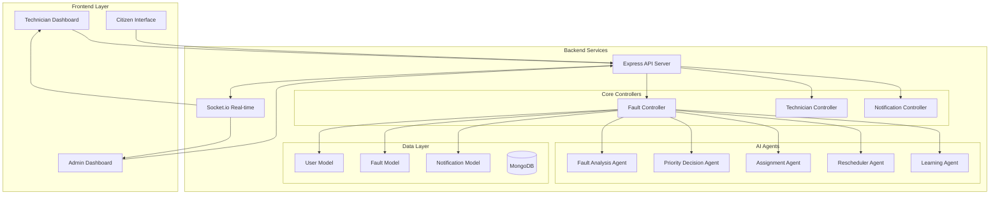
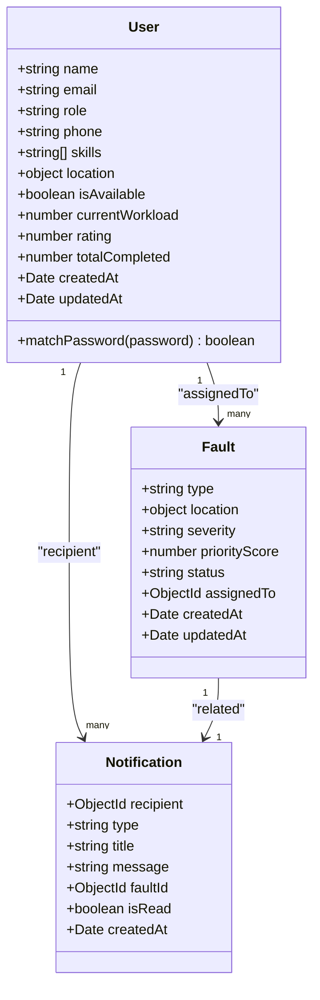
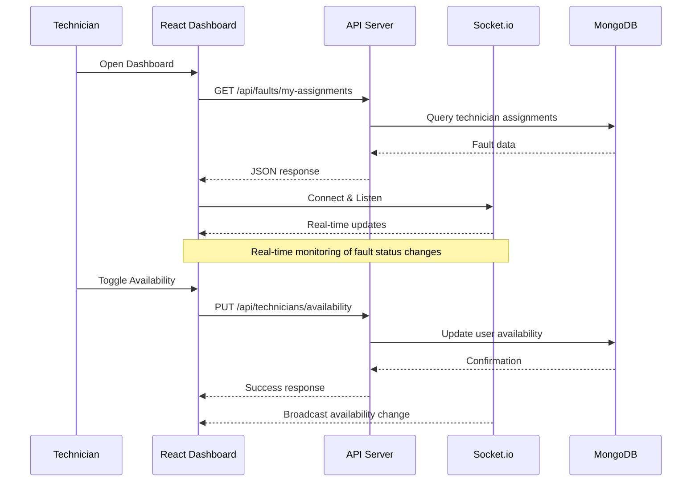
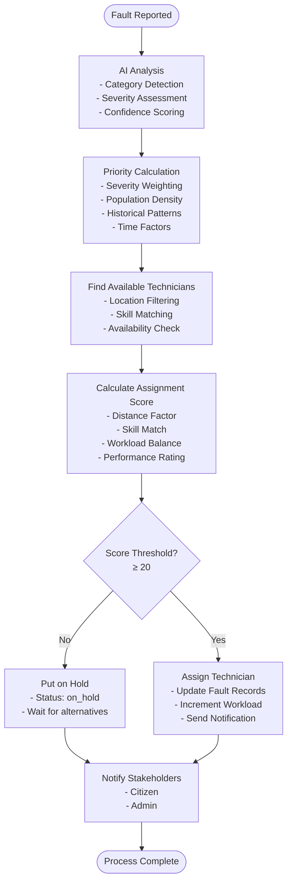
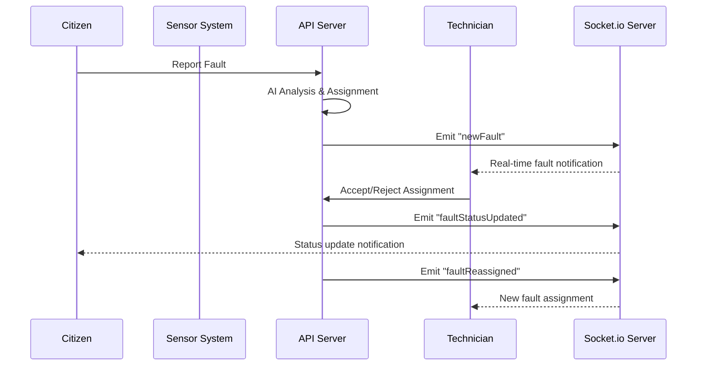
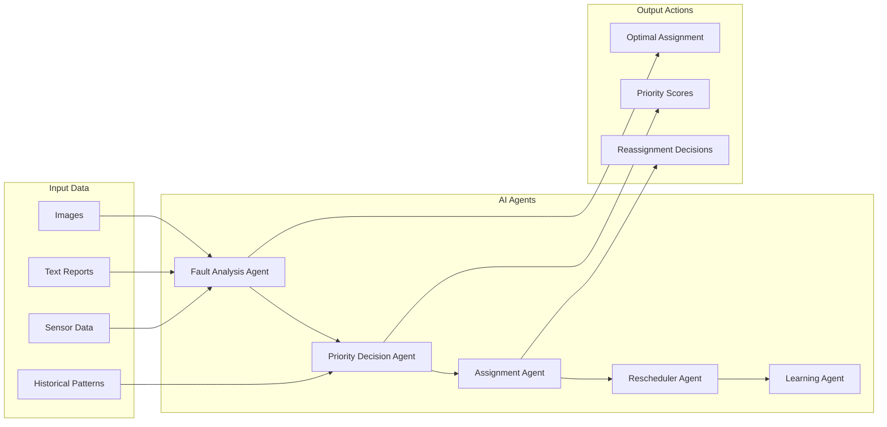
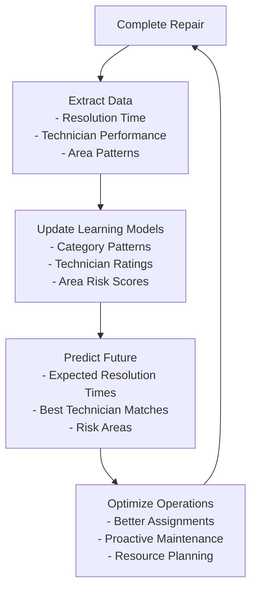

# Technician Management

<cite>
**Referenced Files in This Document**
- [technicianRoutes.js](file://backend/src/routes/technicianRoutes.js)
- [User.js](file://backend/src/models/User.js)
- [TechnicianDashboard.jsx](file://frontend/src/pages/TechnicianDashboard.jsx)
- [faultController.js](file://backend/src/controllers/faultController.js)
- [Fault.js](file://backend/src/models/Fault.js)
- [assignmentAgent.js](file://backend/src/agents/assignmentAgent.js)
- [priorityDecisionAgent.js](file://backend/src/agents/priorityDecisionAgent.js)
- [faultAnalysisAgent.js](file://backend/src/agents/faultAnalysisAgent.js)
- [reschedulerAgent.js](file://backend/src/agents/reschedulerAgent.js)
- [learningAgent.js](file://backend/src/agents/learningAgent.js)
- [notifier.js](file://backend/src/utils/notifier.js)
- [server.js](file://backend/src/server.js)
- [aiService.js](file://backend/src/services/aiService.js)
- [faultRoutes.js](file://backend/src/routes/faultRoutes.js)
</cite>

## Table of Contents
1. [Introduction](#introduction)
2. [System Architecture](#system-architecture)
3. [Technician Management Core Components](#technician-management-core-components)
4. [Assignment and Scheduling System](#assignment-and-scheduling-system)
5. [Real-Time Communication](#real-time-communication)
6. [AI-Powered Decision Making](#ai-powered-decision-making)
7. [Performance and Scalability](#performance-and-scalability)
8. [Troubleshooting Guide](#troubleshooting-guide)
9. [Conclusion](#conclusion)

## Introduction

The Technician Management system is a comprehensive solution for managing utility workers (technicians) in an urban infrastructure maintenance platform. Built with a modern MERN stack architecture, this system automates fault assignment, real-time tracking, and intelligent scheduling using AI-powered agents.

The system serves three primary user roles: citizens who report infrastructure issues, technicians who resolve them, and administrators who oversee operations. The core functionality revolves around efficient technician allocation, real-time communication, and continuous learning from operational data.

## System Architecture

The system follows a microservices-like architecture with clear separation of concerns:

**Diagram sources**
- [server.js:1-74](file://backend/src/server.js#L1-L74)
- [technicianRoutes.js:1-176](file://backend/src/routes/technicianRoutes.js#L1-L176)
- [faultController.js:1-449](file://backend/src/controllers/faultController.js#L1-L449)

**Section sources**
- [server.js:1-74](file://backend/src/server.js#L1-L74)
- [technicianRoutes.js:1-176](file://backend/src/routes/technicianRoutes.js#L1-L176)

## Technician Management Core Components

### Technician Data Model

The system manages technicians through a unified User model with specialized fields for technical workers:

**Diagram sources**
- [User.js:1-37](file://backend/src/models/User.js#L1-L37)
- [Fault.js:1-75](file://backend/src/models/Fault.js#L1-L75)
- [Notification.js:1-28](file://backend/src/models/Notification.js#L1-L28)

### Technician Dashboard Interface

The frontend provides a comprehensive dashboard for technicians with real-time updates and interactive controls:

**Diagram sources**
- [TechnicianDashboard.jsx:1-425](file://frontend/src/pages/TechnicianDashboard.jsx#L1-L425)
- [technicianRoutes.js:57-81](file://backend/src/routes/technicianRoutes.js#L57-L81)

**Section sources**
- [User.js:1-37](file://backend/src/models/User.js#L1-L37)
- [TechnicianDashboard.jsx:1-425](file://frontend/src/pages/TechnicianDashboard.jsx#L1-L425)

## Assignment and Scheduling System

### Intelligent Technician Assignment

The system employs sophisticated algorithms to match technicians with faults based on multiple criteria:

**Diagram sources**
- [assignmentAgent.js:127-190](file://backend/src/agents/assignmentAgent.js#L127-L190)
- [priorityDecisionAgent.js:37-111](file://backend/src/agents/priorityDecisionAgent.js#L37-L111)
- [faultAnalysisAgent.js:32-89](file://backend/src/agents/faultAnalysisAgent.js#L32-L89)

### Assignment Scoring Algorithm

The assignment system calculates comprehensive scores considering multiple factors:

| Factor | Weight | Calculation Method | Impact |
|--------|--------|-------------------|---------|
| **Distance** | Up to 40 points | 40 - (distance × 2) km | Closer technicians score higher |
| **Skill Match** | Up to 30 points | Based on keyword matching | Relevant skills increase score |
| **Workload** | Up to 20 points | 1/(1+0.18×workload) | Lower workload preferred |
| **Rating** | Up to 10 points | (rating/5) × 10 | Higher-rated technicians preferred |

**Section sources**
- [assignmentAgent.js:82-119](file://backend/src/agents/assignmentAgent.js#L82-L119)
- [assignmentAgent.js:127-190](file://backend/src/agents/assignmentAgent.js#L127-L190)

## Real-Time Communication

### Socket.io Implementation

The system provides real-time updates through WebSocket connections:

**Diagram sources**
- [server.js:27-44](file://backend/src/server.js#L27-L44)
- [faultController.js:83-89](file://backend/src/controllers/faultController.js#L83-L89)
- [reschedulerAgent.js:94-99](file://backend/src/agents/reschedulerAgent.js#L94-L99)

### Real-Time Features

The system supports several real-time capabilities:

- **Live Fault Notifications**: Instant alerts when new faults are assigned
- **Status Updates**: Real-time synchronization of fault progress
- **Location Tracking**: Live technician position updates
- **Reassignment Alerts**: Immediate notifications for fault transfers
- **Availability Monitoring**: Real-time visibility of technician availability

**Section sources**
- [server.js:20-44](file://backend/src/server.js#L20-L44)
- [technicianRoutes.js:100-112](file://backend/src/routes/technicianRoutes.js#L100-L112)

## AI-Powered Decision Making

### Multi-Agent System Architecture

The system employs specialized AI agents working together to optimize operations:

**Diagram sources**
- [faultAnalysisAgent.js:32-89](file://backend/src/agents/faultAnalysisAgent.js#L32-L89)
- [priorityDecisionAgent.js:37-111](file://backend/src/agents/priorityDecisionAgent.js#L37-L111)
- [assignmentAgent.js:127-190](file://backend/src/agents/assignmentAgent.js#L127-L190)
- [reschedulerAgent.js:27-112](file://backend/src/agents/reschedulerAgent.js#L27-L112)
- [learningAgent.js:26-59](file://backend/src/agents/learningAgent.js#L26-L59)

### Continuous Learning System

The Learning Agent continuously improves system performance:

**Diagram sources**
- [learningAgent.js:26-59](file://backend/src/agents/learningAgent.js#L26-L59)
- [learningAgent.js:374-386](file://backend/src/agents/learningAgent.js#L374-L386)

**Section sources**
- [faultAnalysisAgent.js:1-149](file://backend/src/agents/faultAnalysisAgent.js#L1-L149)
- [priorityDecisionAgent.js:1-177](file://backend/src/agents/priorityDecisionAgent.js#L1-L177)
- [learningAgent.js:1-396](file://backend/src/agents/learningAgent.js#L1-L396)

## Performance and Scalability

### Database Design Optimizations

The system implements several database optimizations:

- **Indexing Strategy**: Strategic indexes on frequently queried fields
- **Geospatial Queries**: 2dsphere index for location-based searches
- **Query Optimization**: Aggregation pipelines for analytics
- **Connection Pooling**: Efficient database connection management

### Load Balancing and Scaling

The architecture supports horizontal scaling through:

- **Microservice Separation**: Clear boundaries between components
- **Caching Opportunities**: Potential for Redis caching layers
- **Database Sharding**: Geographic partitioning for large deployments
- **Message Queues**: Asynchronous processing for heavy operations

**Section sources**
- [Fault.js:69-75](file://backend/src/models/Fault.js#L69-L75)
- [User.js:1-37](file://backend/src/models/User.js#L1-L37)

## Troubleshooting Guide

### Common Issues and Solutions

| Issue | Symptoms | Solution |
|-------|----------|----------|
| **Assignment Failures** | No technicians found for faults | Check technician availability and skill matching |
| **Real-time Updates Not Working** | Dashboard not updating live | Verify Socket.io connection and event listeners |
| **Location Tracking Issues** | Missing technician positions | Ensure location update endpoint is called regularly |
| **Performance Degradation** | Slow response times | Review database indexes and query optimization |
| **AI Analysis Errors** | Incorrect fault categorization | Validate AI service endpoints and model accuracy |

### Debugging Tools

The system provides built-in debugging capabilities:

- **Console Logging**: Comprehensive error logging throughout the system
- **Health Checks**: Endpoint monitoring and system status reporting
- **Performance Metrics**: Built-in analytics for system performance
- **Error Tracking**: Centralized error handling and reporting

**Section sources**
- [server.js:57-63](file://backend/src/server.js#L57-L63)
- [technicianRoutes.js:24-26](file://backend/src/routes/technicianRoutes.js#L24-L26)

## Conclusion

The Technician Management system represents a comprehensive solution for modern urban infrastructure maintenance. By combining AI-powered decision making with real-time communication and continuous learning, the system achieves significant improvements in operational efficiency and service quality.

Key strengths of the system include:

- **Intelligent Automation**: AI agents handle complex decision-making processes
- **Real-time Visibility**: Comprehensive monitoring and notification systems
- **Continuous Improvement**: Machine learning enables self-optimization
- **Scalable Architecture**: Modern microservices design supports growth
- **User-Centric Design**: Intuitive interfaces for all stakeholder types

The system provides a solid foundation for managing technician operations while offering extensive opportunities for customization and enhancement based on specific deployment requirements.