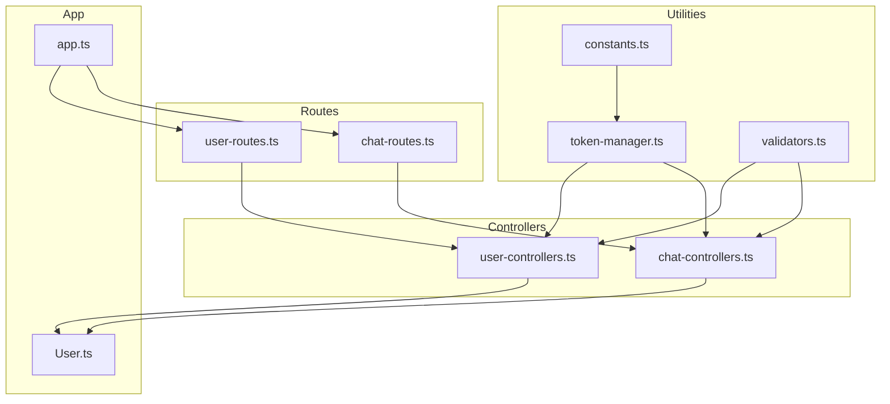
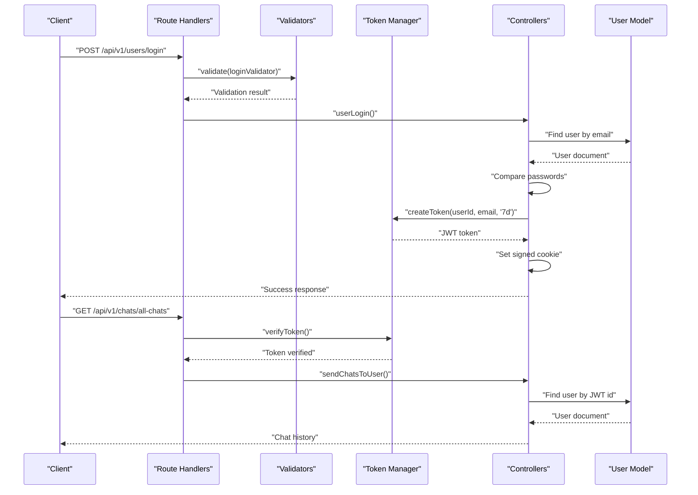
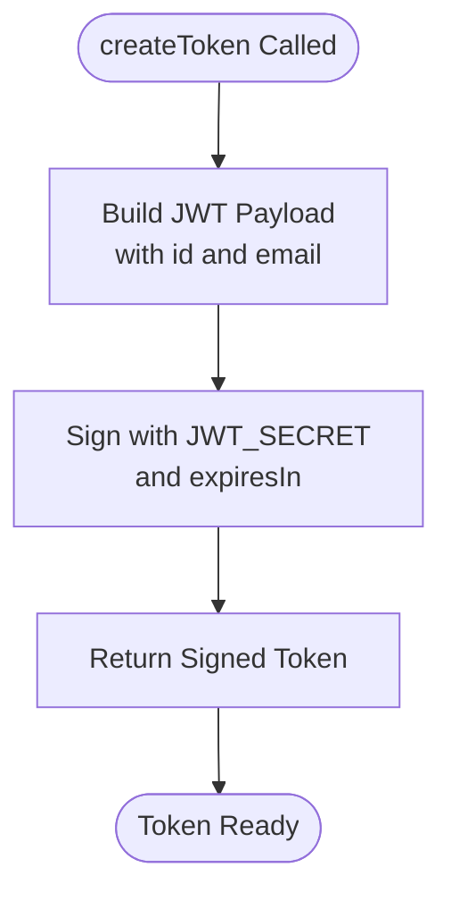
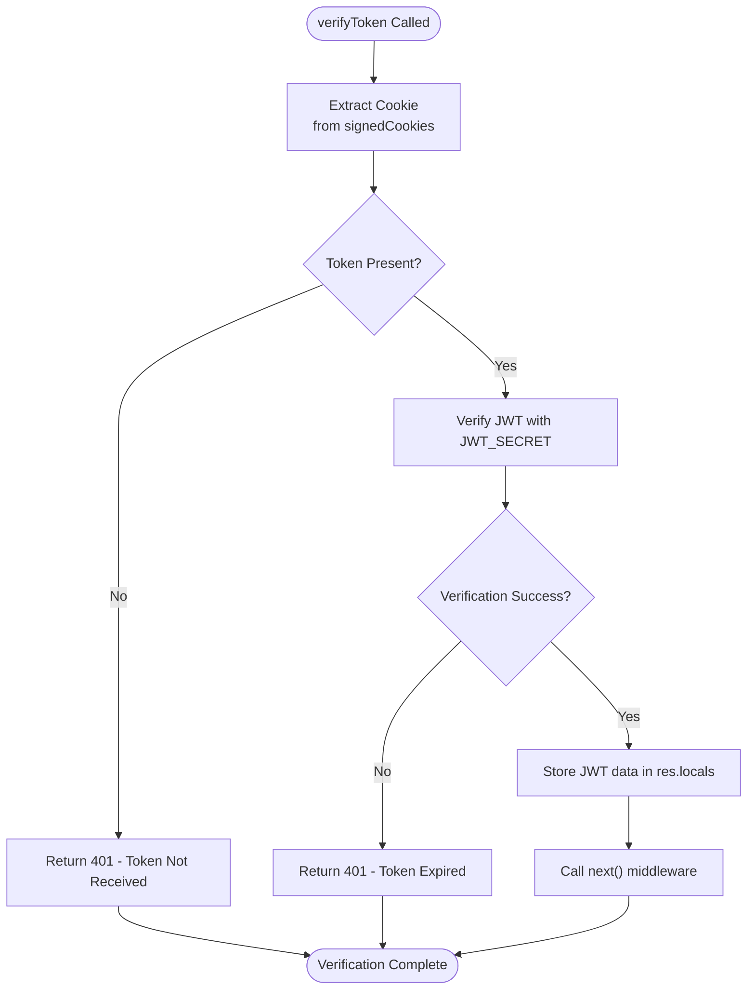
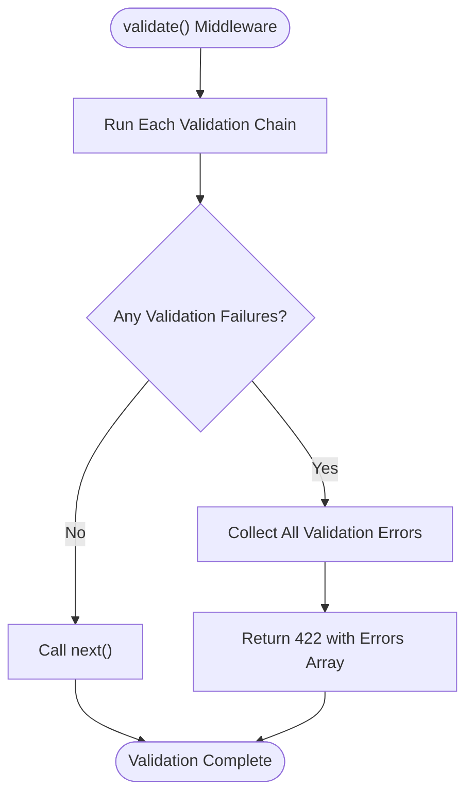
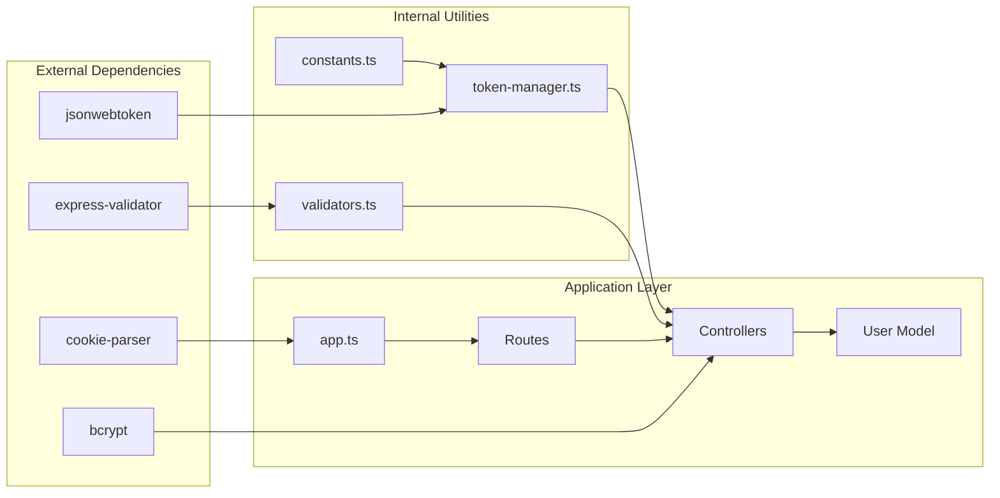

# Utility Services

<cite>
**Referenced Files in This Document**
- [constants.ts](file://backend/src/utils/constants.ts)
- [token-manager.ts](file://backend/src/utils/token-manager.ts)
- [validators.ts](file://backend/src/utils/validators.ts)
- [user-controllers.ts](file://backend/src/controllers/user-controllers.ts)
- [chat-controllers.ts](file://backend/src/controllers/chat-controllers.ts)
- [user-routes.ts](file://backend/src/routes/user-routes.ts)
- [chat-routes.ts](file://backend/src/routes/chat-routes.ts)
- [app.ts](file://backend/src/app.ts)
- [User.ts](file://backend/src/models/User.ts)
- [package.json](file://backend/package.json)
</cite>

## Table of Contents
1. [Introduction](#introduction)
2. [Project Structure](#project-structure)
3. [Core Components](#core-components)
4. [Architecture Overview](#architecture-overview)
5. [Detailed Component Analysis](#detailed-component-analysis)
6. [Dependency Analysis](#dependency-analysis)
7. [Performance Considerations](#performance-considerations)
8. [Security Best Practices](#security-best-practices)
9. [Troubleshooting Guide](#troubleshooting-guide)
10. [Conclusion](#conclusion)

## Introduction
This document provides comprehensive documentation for the SMAN-GPT backend utility services, focusing on token management, input validation, and configuration constants. These utilities form the foundation for secure authentication, data integrity, and consistent API behavior across the application. The documentation covers implementation patterns, integration points, error handling strategies, and security best practices derived from the actual codebase.

## Project Structure
The utility services are organized under the `backend/src/utils/` directory and integrate with controllers, routes, and middleware layers. The structure follows a clean separation of concerns:
- Constants define reusable configuration values
- Token manager handles JWT lifecycle and verification
- Validators enforce input constraints and sanitize requests
- Controllers orchestrate business logic and utilize utilities
- Routes define protected endpoints and apply middleware
- Application bootstrap configures middleware and environment

**Diagram sources**
- [constants.ts:1-2](file://backend/src/utils/constants.ts#L1-L2)
- [token-manager.ts:1-35](file://backend/src/utils/token-manager.ts#L1-L35)
- [validators.ts:1-36](file://backend/src/utils/validators.ts#L1-L36)
- [user-controllers.ts:1-163](file://backend/src/controllers/user-controllers.ts#L1-L163)
- [chat-controllers.ts:1-89](file://backend/src/controllers/chat-controllers.ts#L1-L89)
- [user-routes.ts:1-25](file://backend/src/routes/user-routes.ts#L1-L25)
- [chat-routes.ts:1-22](file://backend/src/routes/chat-routes.ts#L1-L22)
- [app.ts:1-21](file://backend/src/app.ts#L1-L21)
- [User.ts:1-35](file://backend/src/models/User.ts#L1-L35)

**Section sources**
- [constants.ts:1-2](file://backend/src/utils/constants.ts#L1-L2)
- [token-manager.ts:1-35](file://backend/src/utils/token-manager.ts#L1-L35)
- [validators.ts:1-36](file://backend/src/utils/validators.ts#L1-L36)
- [user-controllers.ts:1-163](file://backend/src/controllers/user-controllers.ts#L1-L163)
- [chat-controllers.ts:1-89](file://backend/src/controllers/chat-controllers.ts#L1-L89)
- [user-routes.ts:1-25](file://backend/src/routes/user-routes.ts#L1-L25)
- [chat-routes.ts:1-22](file://backend/src/routes/chat-routes.ts#L1-L22)
- [app.ts:1-21](file://backend/src/app.ts#L1-L21)
- [User.ts:1-35](file://backend/src/models/User.ts#L1-L35)

## Core Components
This section documents the three primary utility modules and their roles in the system.

### Constants
The constants module defines a single, reusable cookie name used across authentication flows. This ensures consistency in cookie handling and reduces the risk of mismatches.

Key characteristics:
- Single exported constant for cookie name
- Used by token manager and controllers for cookie operations
- Centralized configuration for cookie identity

**Section sources**
- [constants.ts:1-2](file://backend/src/utils/constants.ts#L1-L2)

### Token Manager
The token manager provides JWT-based authentication utilities with the following capabilities:
- Token creation with configurable expiration
- Token verification middleware with error handling
- Integration with Express request-response cycle
- Cookie-based token storage and retrieval

Implementation highlights:
- Uses JSON Web Token library for signing and verification
- Leverages environment variables for secret keys
- Implements asynchronous verification with promise-based error handling
- Stores tokens in signed cookies with security flags

**Section sources**
- [token-manager.ts:1-35](file://backend/src/utils/token-manager.ts#L1-L35)

### Validators
The validators module implements input validation using express-validator with:
- Generic validation wrapper for consistent error handling
- Predefined validators for login, signup, and chat completion
- Integration with Express middleware pipeline
- Standardized error responses for validation failures

Validation patterns:
- Email validation with trimming and format checking
- Password length requirements with trimming
- Non-empty field validation for required inputs
- Combined validators for composite scenarios

**Section sources**
- [validators.ts:1-36](file://backend/src/utils/validators.ts#L1-L36)

## Architecture Overview
The utility services integrate with the application through middleware and controller layers, forming a cohesive authentication and validation pipeline.

**Diagram sources**
- [user-routes.ts:18-22](file://backend/src/routes/user-routes.ts#L18-L22)
- [chat-routes.ts:10-21](file://backend/src/routes/chat-routes.ts#L10-L21)
- [validators.ts:20-35](file://backend/src/utils/validators.ts#L20-L35)
- [token-manager.ts:5-34](file://backend/src/utils/token-manager.ts#L5-L34)
- [user-controllers.ts:64-108](file://backend/src/controllers/user-controllers.ts#L64-L108)
- [chat-controllers.ts:45-88](file://backend/src/controllers/chat-controllers.ts#L45-L88)
- [User.ts:17-32](file://backend/src/models/User.ts#L17-L32)

## Detailed Component Analysis

### Token Manager Implementation
The token manager implements a robust JWT-based authentication system with comprehensive error handling and security considerations.

#### Token Creation Process

**Diagram sources**
- [token-manager.ts:5-11](file://backend/src/utils/token-manager.ts#L5-L11)

#### Token Verification Flow

**Diagram sources**
- [token-manager.ts:13-34](file://backend/src/utils/token-manager.ts#L13-L34)

#### Integration Patterns
The token manager integrates with controllers through middleware:
- Applied as route middleware in protected endpoints
- Stores decoded JWT data in response locals for downstream use
- Handles both synchronous and asynchronous verification flows
- Provides standardized error responses for authentication failures

**Section sources**
- [token-manager.ts:1-35](file://backend/src/utils/token-manager.ts#L1-L35)
- [user-routes.ts:21-22](file://backend/src/routes/user-routes.ts#L21-L22)
- [chat-routes.ts:12-19](file://backend/src/routes/chat-routes.ts#L12-L19)

### Validator Functions Analysis
The validator system provides structured input validation with consistent error handling across the application.

#### Validation Pipeline

**Diagram sources**
- [validators.ts:4-18](file://backend/src/utils/validators.ts#L4-L18)

#### Predefined Validators
The system includes specialized validators for different use cases:
- Login validator: email trimming, format validation, password length requirements
- Signup validator: extends login validator with name requirement
- Chat completion validator: message presence validation

Integration patterns:
- Used as route middleware before controller execution
- Provide immediate feedback for malformed requests
- Support combined validation chains for complex scenarios

**Section sources**
- [validators.ts:1-36](file://backend/src/utils/validators.ts#L1-L36)
- [user-routes.ts:19-20](file://backend/src/routes/user-routes.ts#L19-L20)
- [chat-routes.ts:12-17](file://backend/src/routes/chat-routes.ts#L12-L17)

### Constants Configuration
The constants module centralizes configuration values for consistent behavior across the application.

Current implementation:
- Cookie name definition for authentication tokens
- Single-purpose export for maintainable configuration management

Usage patterns:
- Referenced by token manager for cookie operations
- Used by controllers for consistent cookie handling
- Supports environment-based configuration through process variables

**Section sources**
- [constants.ts:1-2](file://backend/src/utils/constants.ts#L1-L2)
- [token-manager.ts](file://backend/src/utils/token-manager.ts#L3)
- [user-controllers.ts:37-53](file://backend/src/controllers/user-controllers.ts#L37-L53)

## Dependency Analysis
The utility services demonstrate clear separation of concerns with minimal coupling between modules.

**Diagram sources**
- [package.json:15-26](file://backend/package.json#L15-L26)
- [constants.ts:1-2](file://backend/src/utils/constants.ts#L1-L2)
- [token-manager.ts:1-3](file://backend/src/utils/token-manager.ts#L1-L3)
- [validators.ts:1-2](file://backend/src/utils/validators.ts#L1-L2)
- [app.ts:1-13](file://backend/src/app.ts#L1-L13)
- [user-controllers.ts:1-5](file://backend/src/controllers/user-controllers.ts#L1-L5)
- [chat-controllers.ts:1-4](file://backend/src/controllers/chat-controllers.ts#L1-L4)

Key dependency characteristics:
- Minimal external dependencies for core utilities
- Clear import boundaries between modules
- Environment variable reliance for secrets and configuration
- Type-safe integration with Express framework

**Section sources**
- [package.json:15-26](file://backend/package.json#L15-L26)
- [app.ts:1-13](file://backend/src/app.ts#L1-L13)

## Performance Considerations
The utility services are designed for efficiency and scalability:

### Token Management Performance
- JWT verification occurs synchronously within middleware
- Cookie-based token storage minimizes database queries
- Expiration handling prevents token accumulation
- Asynchronous verification pattern supports error propagation

### Validation Performance
- Early exit on first validation failure reduces unnecessary processing
- Express-validator caching improves repeated validation performance
- Middleware execution order optimizes request flow

### Security Considerations
- HTTPS enforcement recommended for production deployment
- Secure cookie flags (HttpOnly, Signed) prevent XSS attacks
- Environment variable isolation protects sensitive configuration
- Password hashing with bcrypt provides strong credential protection

## Security Best Practices

### Token Management Security
- Use HTTPS in production to protect token transmission
- Implement short-lived tokens with refresh mechanisms
- Store tokens in HttpOnly cookies to prevent client-side access
- Regularly rotate JWT secrets and invalidate compromised tokens
- Implement rate limiting for authentication endpoints

### Password Hashing Considerations
- bcrypt cost factor of 10 provides good security-performance balance
- Salt generation is handled automatically by bcrypt
- Never store plaintext passwords or weak hashes
- Implement password strength policies at registration

### Input Validation Strategies
- Combine server-side validation with client-side UX improvements
- Use specific validation messages for better user experience
- Implement comprehensive error reporting for debugging
- Sanitize input data to prevent injection attacks

### Integration Security Patterns
- Apply token verification middleware to all protected routes
- Validate all incoming request data before processing
- Implement proper error handling without exposing sensitive information
- Use environment-specific configurations for different deployment stages

## Troubleshooting Guide

### Common Authentication Issues
- **Token Not Received**: Verify cookie configuration and CORS settings
- **Token Expired**: Check JWT expiration settings and client clock synchronization
- **Invalid Signature**: Confirm JWT_SECRET consistency across deployments
- **Cookie Not Set**: Review HttpOnly and Signed cookie flags

### Validation Error Resolution
- **422 Unprocessable Entity**: Review validation chain definitions and request format
- **Missing Fields**: Ensure all required fields are present in request body
- **Format Errors**: Validate data types and format compliance

### Environment Configuration
- **Missing Environment Variables**: Verify .env file contains JWT_SECRET and COOKIE_SECRET
- **CORS Issues**: Check allowed origins and credentials configuration
- **Database Connectivity**: Confirm MongoDB connection string and credentials

**Section sources**
- [token-manager.ts:18-33](file://backend/src/utils/token-manager.ts#L18-L33)
- [validators.ts:12-16](file://backend/src/utils/validators.ts#L12-L16)
- [app.ts:11-13](file://backend/src/app.ts#L11-L13)

## Conclusion
The SMAN-GPT utility services provide a solid foundation for authentication, validation, and configuration management. The token manager offers robust JWT-based authentication with comprehensive error handling, while the validator system ensures data integrity through structured input validation. The constants module enables centralized configuration management. Together, these utilities support secure, maintainable, and scalable backend operations. The implementation demonstrates clear separation of concerns, proper error handling, and adherence to security best practices, making it suitable for production deployment with appropriate environment hardening and monitoring.