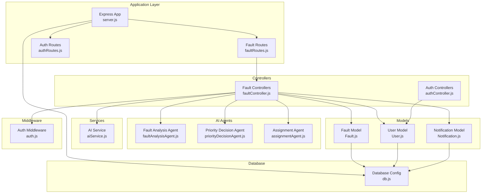
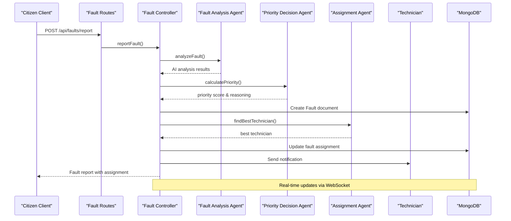
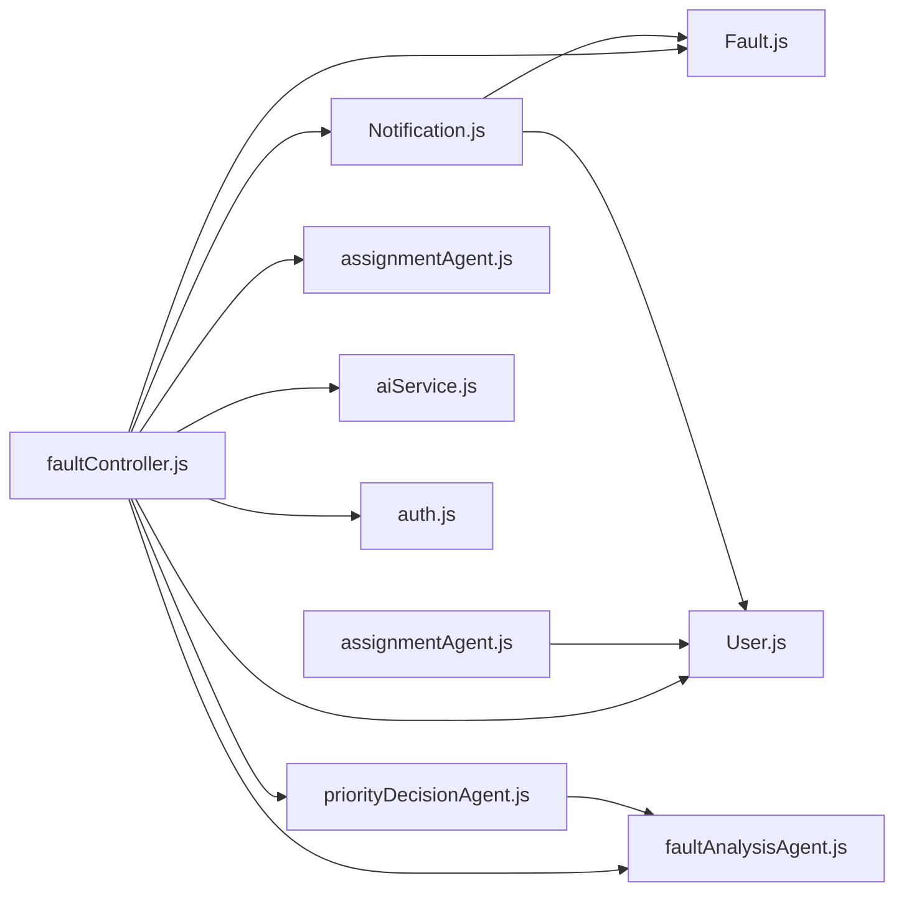

# Data Models and Schema Design

<cite>
**Referenced Files in This Document**
- [User.js](file://backend/src/models/User.js)
- [Fault.js](file://backend/src/models/Fault.js)
- [Notification.js](file://backend/src/models/Notification.js)
- [db.js](file://backend/src/config/db.js)
- [faultController.js](file://backend/src/controllers/faultController.js)
- [faultRoutes.js](file://backend/src/routes/faultRoutes.js)
- [faultAnalysisAgent.js](file://backend/src/agents/faultAnalysisAgent.js)
- [priorityDecisionAgent.js](file://backend/src/agents/priorityDecisionAgent.js)
- [assignmentAgent.js](file://backend/src/agents/assignmentAgent.js)
- [aiService.js](file://backend/src/services/aiService.js)
- [auth.js](file://backend/src/middleware/auth.js)
</cite>

## Update Summary
**Changes Made**
- Added comprehensive Fault model documentation with AI analysis capabilities
- Documented priority scoring system and assignment tracking mechanisms
- Included resolution data fields and citizen feedback integration
- Added notification system for fault lifecycle events
- Updated architecture overview to include AI-powered fault management workflow

## Table of Contents
1. [Introduction](#introduction)
2. [Project Structure](#project-structure)
3. [Core Components](#core-components)
4. [Architecture Overview](#architecture-overview)
5. [Detailed Component Analysis](#detailed-component-analysis)
6. [Dependency Analysis](#dependency-analysis)
7. [Performance Considerations](#performance-considerations)
8. [Troubleshooting Guide](#troubleshooting-guide)
9. [Conclusion](#conclusion)

## Introduction
This document provides comprehensive data model documentation for the SMAN-GPT AI Chat Application's MongoDB schemas. It focuses on both the existing User model and the newly enhanced Fault model, including embedded chat message arrays, AI-powered fault analysis, priority scoring, assignment tracking, and resolution data. The documentation covers Mongoose schema design patterns, validation rules, business constraints, and the complete fault management workflow powered by AI agents.

## Project Structure
The backend follows a layered architecture with clear separation of concerns, now expanded to include comprehensive fault management capabilities:
- Models define Mongoose schemas for MongoDB collections including User, Fault, and Notification entities
- Controllers handle HTTP requests and orchestrate AI-powered fault operations
- Routes define protected endpoints for fault reporting, assignment, and analytics
- Agents implement AI algorithms for fault analysis, priority calculation, and technician assignment
- Services integrate with external AI systems for sensor data analysis
- Middleware provides authentication and authorization for protected endpoints

**Diagram sources**
- [faultRoutes.js:1-31](file://backend/src/routes/faultRoutes.js#L1-L31)
- [faultController.js:1-449](file://backend/src/controllers/faultController.js#L1-L449)
- [faultAnalysisAgent.js:1-149](file://backend/src/agents/faultAnalysisAgent.js#L1-L149)
- [priorityDecisionAgent.js:1-177](file://backend/src/agents/priorityDecisionAgent.js#L1-L177)
- [assignmentAgent.js:1-258](file://backend/src/agents/assignmentAgent.js#L1-L258)
- [aiService.js:1-9](file://backend/src/services/aiService.js#L1-L9)
- [User.js:1-37](file://backend/src/models/User.js#L1-L37)
- [Fault.js:1-75](file://backend/src/models/Fault.js#L1-L75)
- [Notification.js:1-28](file://backend/src/models/Notification.js#L1-L28)
- [auth.js:1-200](file://backend/src/middleware/auth.js#L1-L200)
- [db.js:1-50](file://backend/src/config/db.js#L1-L50)

**Section sources**
- [faultRoutes.js:1-31](file://backend/src/routes/faultRoutes.js#L1-L31)
- [faultController.js:1-449](file://backend/src/controllers/faultController.js#L1-L449)
- [User.js:1-37](file://backend/src/models/User.js#L1-L37)
- [Fault.js:1-75](file://backend/src/models/Fault.js#L1-L75)
- [Notification.js:1-28](file://backend/src/models/Notification.js#L1-L28)
- [db.js:1-50](file://backend/src/config/db.js#L1-L50)

## Core Components
This section documents the primary data models and related components, now including the comprehensive Fault model.

### User Model
- Purpose: Stores user identity, authentication credentials, and professional information for technicians
- Key Fields
  - name: String, required
  - email: String, required, unique
  - password: String, required (hashed)
  - role: Enum ["citizen", "technician", "admin"], default "citizen"
  - phone: String
  - skills: Array of strings (for technicians)
  - location: Object with lat/lng coordinates
  - isAvailable: Boolean, default true (for technicians)
  - currentWorkload: Number, default 0 (for technicians)
  - rating: Number, default 5.0 (for technicians)
  - totalCompleted: Number, default 0 (for technicians)

### Fault Model (NEW)
- Purpose: Comprehensive fault management system with AI-powered analysis and assignment
- AI Analysis Fields
  - type: String (fault category)
  - location: Object with lat/lng coordinates and optional address
  - severity: Enum ["low", "medium", "high", "critical"], default "medium"
  - confidenceScore: Number, default 0
  - aiCategory: String
  - populationDensity: Number, default 0
- Priority and Assignment Fields
  - priorityScore: Number, default 0
  - status: Enum ["reported", "analyzing", "assigned", "in_progress", "on_hold", "completed", "cancelled"], default "reported"
- Assignment Tracking
  - assignedTo: ObjectId reference to User model
  - assignedAt: Date
  - eta: Date (estimated time of arrival)
- Timeline Tracking
  - acceptedAt: Date
  - startedAt: Date
  - completedAt: Date
- Resolution Data
  - resolution: Object containing notes, proofImage, cost, and partsUsed array
- Image Management
  - images: Array of objects with url and uploadedAt timestamp
- Historical Tracking
  - similarFaultsCount: Number, default 0
  - reassignmentCount: Number, default 0
  - reassignmentReason: String
- Citizen Feedback
  - citizenFeedback: Object with rating, comment, and submittedAt

### Notification Model
- Purpose: Manages system notifications for fault lifecycle events
- Fields
  - recipient: ObjectId reference to User model
  - type: Enum ["fault_assigned", "fault_accepted", "fault_completed", "fault_rejected", "status_update", "system"]
  - title: String, required
  - message: String, required
  - faultId: ObjectId reference to Fault model
  - isRead: Boolean, default false
  - sentVia: Array of ["in_app", "email", "sms"]
  - metadata: Map of additional data

### Database Connection Management
- Centralized connection configuration with environment-specific settings
- Support for development, testing, and production environments

### Access Control and Security
- JWT-based authentication middleware for protected endpoints
- Role-based access control (citizen, technician, admin)
- Input validation for all API endpoints

**Section sources**
- [User.js:1-37](file://backend/src/models/User.js#L1-L37)
- [Fault.js:1-75](file://backend/src/models/Fault.js#L1-L75)
- [Notification.js:1-28](file://backend/src/models/Notification.js#L1-L28)
- [db.js:1-50](file://backend/src/config/db.js#L1-L50)
- [auth.js:1-200](file://backend/src/middleware/auth.js#L1-L200)

## Architecture Overview
The system now includes a comprehensive AI-powered fault management workflow that integrates multiple agents and services for intelligent fault detection, analysis, prioritization, and assignment.

**Diagram sources**
- [faultRoutes.js:21](file://backend/src/routes/faultRoutes.js#L21)
- [faultController.js:15-125](file://backend/src/controllers/faultController.js#L15-L125)
- [faultAnalysisAgent.js:32-89](file://backend/src/agents/faultAnalysisAgent.js#L32-L89)
- [priorityDecisionAgent.js:37-111](file://backend/src/agents/priorityDecisionAgent.js#L37-L111)
- [assignmentAgent.js:127-180](file://backend/src/agents/assignmentAgent.js#L127-L180)

## Detailed Component Analysis

### Fault Model Entity Relationships and Field Definitions
The Fault model represents a comprehensive fault management system with extensive AI-powered capabilities:

#### AI Analysis Components
- **Severity Classification**: Automated severity assessment using text analysis and location-based population density
- **Confidence Scoring**: Machine learning confidence scores for AI predictions
- **Category Detection**: Automatic fault categorization using keyword matching and ML analysis
- **Population Density Integration**: Location-based population density for priority calculations

#### Priority and Assignment System
- **Dynamic Priority Calculation**: Multi-factor scoring system considering severity, category, population density, and historical patterns
- **Real-time Assignment**: Intelligent technician matching based on distance, skills, workload, and ratings
- **ETC Estimation**: Estimated time of arrival calculations for technician dispatch

#### Comprehensive Tracking Fields
- **Lifecycle Management**: Complete status tracking from reported to completed/cancelled
- **Timeline Logging**: Timestamps for all major lifecycle events
- **Resolution Documentation**: Structured resolution data with costs and materials
- **Image Evidence**: Multi-image support with upload timestamps

#### Advanced Features
- **Historical Analytics**: Similar fault tracking and trend analysis
- **Reassignment Tracking**: Complete reassignment history and reasons
- **Citizen Feedback**: Post-resolution rating and comments system
- **Notification Integration**: Real-time notifications for all status changes

**Section sources**
- [Fault.js:3-75](file://backend/src/models/Fault.js#L3-L75)

### User Model Enhancements
The User model has been enhanced to support the technician role with comprehensive professional tracking:

#### Professional Attributes
- **Skill Categories**: Specialized skills for different fault types (electrical, plumbing, road maintenance, etc.)
- **Location Tracking**: GPS coordinates for real-time technician positioning
- **Availability Status**: Real-time availability for dynamic assignment
- **Performance Metrics**: Rating system and completion statistics

#### Role-Based Functionality
- **Multi-role Support**: Citizen, technician, and admin role differentiation
- **Workload Management**: Current workload tracking for fair assignment distribution
- **Professional Development**: Rating and completion tracking for performance monitoring

**Section sources**
- [User.js:4-24](file://backend/src/models/User.js#L4-L24)

### AI Agent Integration
The fault management system leverages specialized AI agents for intelligent processing:

#### Fault Analysis Agent
- **Text Processing**: Natural language understanding for fault descriptions
- **Keyword Matching**: Category detection using predefined keyword dictionaries
- **Severity Assessment**: Context-aware severity determination
- **Location Intelligence**: Population density estimation for priority weighting

#### Priority Decision Agent
- **Multi-factor Scoring**: Weighted combination of severity, category, density, and temporal factors
- **Historical Analysis**: Pattern recognition from similar past faults
- **SLA Prediction**: Estimated resolution times based on priority levels
- **Batch Processing**: Efficient batch prioritization for multiple faults

#### Assignment Agent
- **Geospatial Calculations**: Haversine formula for precise distance calculations
- **Skill Matching**: Algorithmic skill-category alignment
- **Workload Balancing**: Fair distribution across available technicians
- **Rating Integration**: Performance-based assignment preferences

**Section sources**
- [faultAnalysisAgent.js:1-149](file://backend/src/agents/faultAnalysisAgent.js#L1-L149)
- [priorityDecisionAgent.js:1-177](file://backend/src/agents/priorityDecisionAgent.js#L1-L177)
- [assignmentAgent.js:1-258](file://backend/src/agents/assignmentAgent.js#L1-L258)

### Database Connection Management
Enhanced connection management supports the expanded data model requirements:

#### Connection Configuration
- **Environment-Specific Settings**: Separate configurations for development, testing, and production
- **Connection Pooling**: Optimized connection handling for concurrent operations
- **Error Handling**: Comprehensive error logging and recovery mechanisms

#### Index Strategy
- **Performance Optimization**: Strategic indexing for frequently queried fields
- **Geospatial Support**: 2dsphere indexing for location-based queries
- **Query Efficiency**: Composite indexes for complex filtering scenarios

**Section sources**
- [db.js:1-50](file://backend/src/config/db.js#L1-L50)

### Access Control and Security
Comprehensive security measures protect the enhanced fault management system:

#### Authentication Framework
- **JWT Token Management**: Secure token-based authentication for all endpoints
- **Role-Based Authorization**: Fine-grained access control based on user roles
- **Session Management**: Secure cookie-based session handling

#### Endpoint Protection
- **Protected Routes**: All fault management endpoints require authentication
- **Authorization Checks**: Role-specific access validation for sensitive operations
- **Input Sanitization**: Comprehensive validation and sanitization of all inputs

**Section sources**
- [auth.js:1-200](file://backend/src/middleware/auth.js#L1-L200)
- [faultRoutes.js:13-31](file://backend/src/routes/faultRoutes.js#L13-L31)

### Data Access Patterns and Business Workflows
The enhanced system supports sophisticated fault management workflows:

#### Fault Lifecycle Management
- **Intelligent Reporting**: AI-powered fault analysis during initial reporting
- **Automated Assignment**: Dynamic technician assignment based on multiple criteria
- **Real-time Tracking**: Live status updates and progress notifications
- **Resolution Documentation**: Structured completion tracking with evidence

#### Analytics and Insights
- **Performance Metrics**: Comprehensive analytics on fault resolution times
- **Trend Analysis**: Historical pattern recognition for predictive insights
- **Resource Optimization**: Data-driven decisions for technician deployment

#### Integration Points
- **External AI Services**: Sensor data analysis integration for automated fault detection
- **Real-time Communication**: WebSocket integration for live updates
- **Notification System**: Multi-channel notification delivery

**Section sources**
- [faultController.js:1-449](file://backend/src/controllers/faultController.js#L1-L449)
- [aiService.js:1-9](file://backend/src/services/aiService.js#L1-L9)

### Data Queries and Aggregation Pipelines
The system implements sophisticated querying for fault analytics:

#### Complex Filtering
- **Multi-criteria Queries**: Combined filtering by status, severity, type, and assignment
- **Geospatial Queries**: Location-based fault searches with radius filtering
- **Temporal Queries**: Time-based filtering for analytics and reporting

#### Analytics Aggregation
- **Status Distribution**: Real-time status breakdown for operational dashboards
- **Performance Metrics**: Average resolution times and completion rates
- **Severity Analysis**: Trend analysis by fault severity categories

#### Advanced Analytics
- **Predictive Modeling**: Historical data analysis for future fault prediction
- **Resource Planning**: Demand forecasting based on temporal and spatial patterns
- **Quality Metrics**: Technician performance evaluation and optimization

**Section sources**
- [faultController.js:398-448](file://backend/src/controllers/faultController.js#L398-L448)

### Indexing Strategies and Performance Considerations
Strategic indexing supports the complex fault management queries:

#### Primary Indexes
- **Status Optimization**: Compound index for status-based filtering
- **Geospatial Queries**: 2dsphere index for location-based searches
- **Assignment Tracking**: Index for technician assignment queries

#### Performance Optimization
- **Query Patterns**: Indexes designed around common query scenarios
- **Write Performance**: Balanced indexing for high-write fault reporting scenarios
- **Memory Usage**: Efficient index sizing for large-scale deployments

#### Scaling Considerations
- **Sharding Strategy**: Potential sharding by geographic regions
- **Caching Layers**: Redis caching for frequently accessed fault data
- **Read Replicas**: Database replica configuration for analytical queries

**Section sources**
- [Fault.js:69-75](file://backend/src/models/Fault.js#L69-L75)

### Schema Migrations and Data Lifecycle Policies
Comprehensive data management strategies ensure system longevity:

#### Migration Strategy
- **Backward Compatibility**: Gradual schema evolution without breaking changes
- **Data Transformation**: Automated migration scripts for existing fault records
- **Validation Rules**: Progressive introduction of new validation constraints

#### Data Lifecycle Management
- **Archival Strategy**: Long-term storage optimization for historical fault data
- **Retention Policies**: Automated cleanup of resolved faults beyond retention periods
- **Analytics Data**: Separate storage strategy for analytical datasets

#### Quality Assurance
- **Data Integrity**: Validation rules ensuring consistent fault data quality
- **Audit Trails**: Complete tracking of all fault state changes
- **Backup Strategy**: Comprehensive backup and disaster recovery procedures

**Section sources**
- [Fault.js:1-75](file://backend/src/models/Fault.js#L1-L75)

## Dependency Analysis
The enhanced system maintains clear dependency relationships across all components:

**Diagram sources**
- [faultController.js:1-10](file://backend/src/controllers/faultController.js#L1-L10)
- [Fault.js:1-75](file://backend/src/models/Fault.js#L1-L75)
- [User.js:1-37](file://backend/src/models/User.js#L1-L37)
- [Notification.js:1-28](file://backend/src/models/Notification.js#L1-L28)
- [faultAnalysisAgent.js:1-10](file://backend/src/agents/faultAnalysisAgent.js#L1-L10)
- [priorityDecisionAgent.js:1-10](file://backend/src/agents/priorityDecisionAgent.js#L1-L10)
- [assignmentAgent.js:1-12](file://backend/src/agents/assignmentAgent.js#L1-L12)
- [aiService.js:1-9](file://backend/src/services/aiService.js#L1-L9)
- [auth.js:1-200](file://backend/src/middleware/auth.js#L1-L200)

**Section sources**
- [faultController.js:1-10](file://backend/src/controllers/faultController.js#L1-L10)
- [assignmentAgent.js:11-11](file://backend/src/agents/assignmentAgent.js#L11-L11)

## Performance Considerations
The enhanced system requires careful performance optimization:

### Scalability Architecture
- **Microservices Pattern**: AI agents and controllers designed for independent scaling
- **Load Distribution**: Geographic clustering for fault assignment optimization
- **Caching Strategy**: Multi-level caching for frequently accessed fault data

### AI Processing Optimization
- **Batch Processing**: Concurrent AI analysis for multiple fault reports
- **Model Optimization**: Efficient ML model inference with GPU acceleration
- **Result Caching**: Cached AI analysis for similar fault patterns

### Database Performance
- **Index Optimization**: Strategic indexing for complex fault queries
- **Connection Pooling**: Optimized database connections for high-concurrency scenarios
- **Query Optimization**: Aggregation pipeline optimization for analytics

### Real-time Performance
- **WebSocket Optimization**: Efficient real-time communication for fault updates
- **Notification Batching**: Optimized notification delivery for high-volume scenarios
- **Mobile Optimization**: Lightweight APIs for mobile client performance

## Troubleshooting Guide
Enhanced troubleshooting for the comprehensive fault management system:

### AI System Issues
- **Analysis Failures**: Monitor AI service availability and response times
- **Priority Calculation Errors**: Validate agent configurations and input data
- **Assignment Failures**: Check technician availability and skill matching algorithms

### Database Connectivity
- **Connection Pool Exhaustion**: Monitor connection pool usage and optimize configuration
- **Index Performance**: Regular index maintenance and optimization
- **Query Performance**: Monitor slow query logs and optimize problematic queries

### System Integration
- **AI Service Connectivity**: Monitor external service availability and response times
- **Notification Delivery**: Track notification delivery failures and retry mechanisms
- **Real-time Updates**: Monitor WebSocket connections and fallback mechanisms

### Performance Monitoring
- **Response Time**: Monitor API response times across all endpoints
- **Throughput**: Track concurrent fault processing capacity
- **Error Rates**: Monitor system error rates and failure patterns

**Section sources**
- [faultController.js:121-125](file://backend/src/controllers/faultController.js#L121-L125)
- [assignmentAgent.js:182-189](file://backend/src/agents/assignmentAgent.js#L182-L189)
- [aiService.js:3-8](file://backend/src/services/aiService.js#L3-L8)

## Conclusion
The SMAN-GPT application has evolved into a comprehensive AI-powered fault management system with sophisticated data models and intelligent automation. The enhanced Fault model, combined with AI agents for analysis, priority calculation, and assignment, creates a robust platform for utility fault management. The system maintains strong security practices, comprehensive analytics capabilities, and scalable architecture suitable for enterprise deployment. The integration of real-time notifications, geospatial processing, and performance optimization ensures reliable operation under high-load conditions while maintaining excellent user experience for both citizens reporting faults and technicians managing assignments.