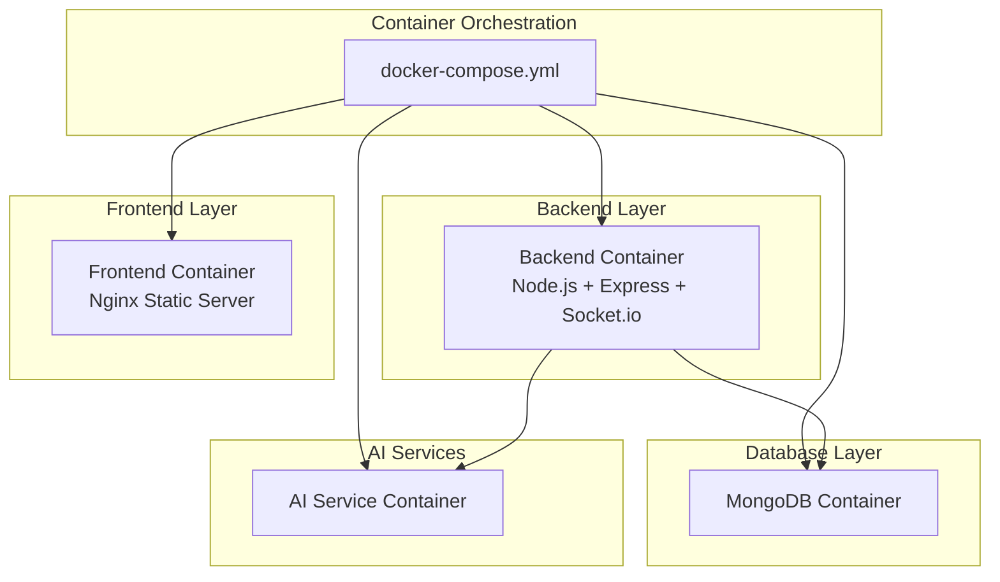
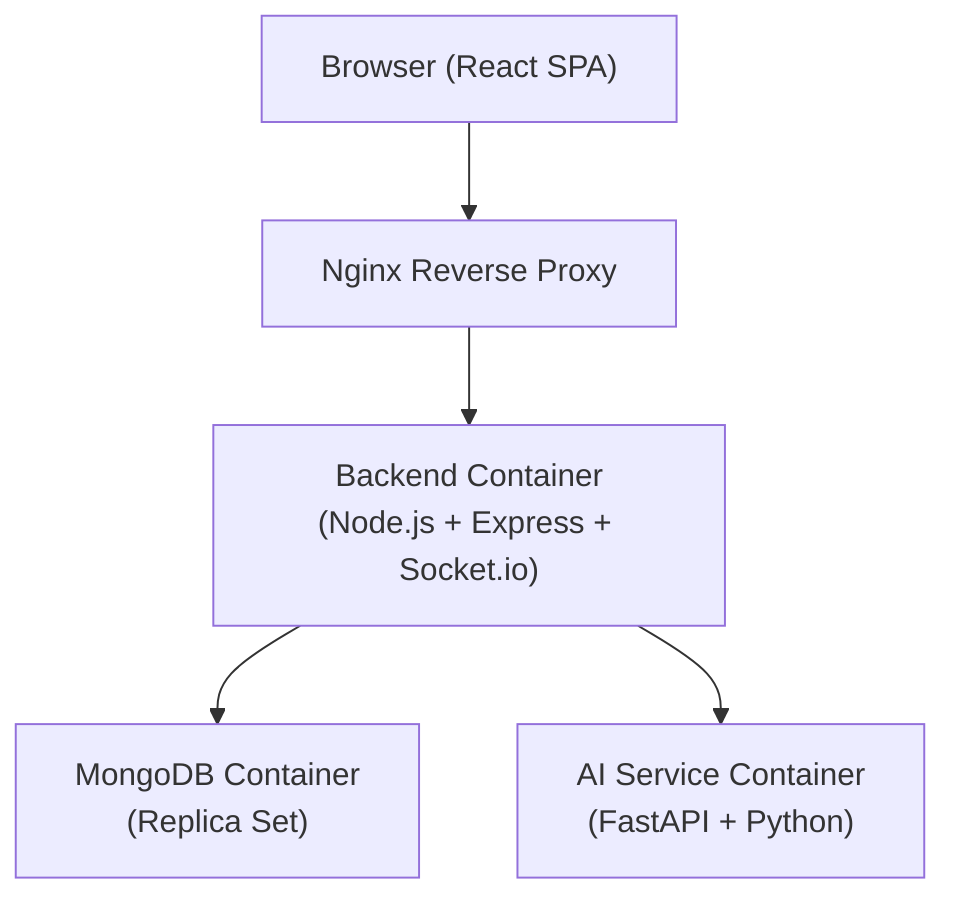

# Deployment Guide

<cite>
**Referenced Files in This Document**
- [README.md](file://README.md)
- [docker-compose.yml](file://docker-compose.yml)
- [backend/Dockerfile](file://backend/Dockerfile)
- [frontend/Dockerfile](file://frontend/Dockerfile)
- [ai-service/Dockerfile](file://ai-service/Dockerfile)
- [backend/src/server.js](file://backend/src/server.js)
- [backend/src/config/db.js](file://backend/src/config/db.js)
- [ai-service/main.py](file://ai-service/main.py)
- [backend/package.json](file://backend/package.json)
- [frontend/package.json](file://frontend/package.json)
- [ai-service/requirements.txt](file://ai-service/requirements.txt)
</cite>

## Update Summary
**Changes Made**
- Added comprehensive Docker-based deployment section covering docker-compose orchestration
- Updated architecture overview to include AI service container
- Enhanced deployment strategies with containerization best practices
- Added Dockerfile configurations for all services
- Updated environment configuration management for containerized deployment

## Table of Contents
1. [Introduction](#introduction)
2. [Project Structure](#project-structure)
3. [Core Components](#core-components)
4. [Architecture Overview](#architecture-overview)
5. [Docker-Based Deployment](#docker-based-deployment)
6. [Detailed Component Analysis](#detailed-component-analysis)
7. [Dependency Analysis](#dependency-analysis)
8. [Performance Considerations](#performance-considerations)
9. [Troubleshooting Guide](#troubleshooting-guide)
10. [Conclusion](#conclusion)
11. [Appendices](#appendices)

## Introduction
This guide provides end-to-end deployment instructions for the SMAN-GPT AI Chat Application. It covers production environment preparation for Node.js and MongoDB, OpenAI API configuration, build optimization for the React/Vite frontend, and comprehensive deployment strategies using Docker and docker-compose orchestration. The guide includes containerized deployment across all services (backend, frontend, AI service, MongoDB), environment configuration management, SSL and domain setup, performance optimization, monitoring/logging, backup and disaster recovery, and troubleshooting.

## Project Structure
The repository follows a modern microservices architecture with containerized deployment:
- Backend: Node.js + Express with TypeScript, MongoDB via Mongoose, Socket.io for real-time communication, and AI service integration
- Frontend: React + Vite with TypeScript, Material UI, and Axios-based API communication
- AI Service: Python FastAPI service with machine learning capabilities for anomaly detection and image analysis
- Database: MongoDB with replica set support and connection pooling



**Diagram sources**
- [docker-compose.yml:1-42](file://docker-compose.yml#L1-L42)

**Section sources**
- [README.md:1-127](file://README.md#L1-L127)
- [docker-compose.yml:1-42](file://docker-compose.yml#L1-L42)

## Core Components
- **Backend Server**: Express.js application with Socket.io for real-time notifications, MongoDB integration, and AI service communication
- **AI Service**: FastAPI Python service with anomaly detection, image analysis, and severity prediction capabilities
- **Frontend**: React SPA served via Nginx with Vite build optimization
- **Database**: MongoDB with replica set support and connection pooling
- **Container Orchestration**: docker-compose for multi-service deployment coordination

Key production considerations:
- Environment variables for secrets and service URLs
- Container networking and service discovery
- Volume management for persistent data
- Health checks and service dependencies
- Resource allocation and scaling considerations

**Section sources**
- [backend/src/server.js:1-74](file://backend/src/server.js#L1-L74)
- [ai-service/main.py:1-209](file://ai-service/main.py#L1-L209)
- [backend/src/config/db.js:1-14](file://backend/src/config/db.js#L1-L14)

## Architecture Overview
High-level runtime architecture for production deployment using Docker containers:



**Diagram sources**
- [docker-compose.yml:3-42](file://docker-compose.yml#L3-L42)
- [backend/src/server.js:20-44](file://backend/src/server.js#L20-L44)

## Docker-Based Deployment

### Container Architecture
The application uses a multi-container architecture orchestrated by docker-compose:

#### MongoDB Container
- **Image**: mongo:7
- **Port Mapping**: 27017:27017
- **Volume**: mongo_data for persistent storage
- **Purpose**: Primary database for user data, faults, notifications, and application state

#### AI Service Container
- **Image**: Custom Python 3.11 slim image
- **Port Mapping**: 8000:8000
- **Command**: uvicorn main:app --host 0.0.0.0 --port 8000 --reload
- **Purpose**: Machine learning inference for anomaly detection and image analysis

#### Backend Container
- **Image**: Node.js 20 Alpine
- **Port Mapping**: 5000:5000
- **Environment**: MONGO_URI=mongodb://mongo:27017/agentic-ai
- **Dependencies**: mongo, ai-service containers
- **Purpose**: REST API, WebSocket connections, business logic

#### Frontend Container
- **Image**: Multi-stage build (Node.js + Nginx Alpine)
- **Port Mapping**: 3000:80
- **Dependencies**: backend container
- **Purpose**: Static React application delivery

### Docker Compose Configuration
The docker-compose.yml orchestrates service dependencies and networking:

```yaml
version: "3.8"
services:
  mongo:
    image: mongo:7
    container_name: mongo
    ports:
      - "27017:27017"
    volumes:
      - mongo_data:/data/db

  ai-service:
    build: ./ai-service
    container_name: ai-service
    ports:
      - "8000:8000"
    command: uvicorn main:app --host 0.0.0.0 --port 8000 --reload

  backend:
    build: ./backend
    container_name: backend
    ports:
      - "5000:5000"
    env_file:
      - ./backend/.env
    environment:
      - MONGO_URI=mongodb://mongo:27017/agentic-ai
    depends_on:
      - mongo
      - ai-service

  frontend:
    build: ./frontend
    container_name: frontend
    ports:
      - "3000:80"
    depends_on:
      - backend

volumes:
  mongo_data:
```

### Multi-Stage Frontend Build
The frontend Dockerfile implements a two-stage build process:
1. **Build Stage**: Node.js 20 Alpine with npm install and Vite build
2. **Runtime Stage**: Nginx Alpine serving built assets

### Environment Configuration
Containerized deployment requires environment management:
- **Backend**: Uses .env file via env_file directive
- **Database**: MONGO_URI configured for internal container networking
- **Service Discovery**: Containers communicate via service names (mongo, ai-service)

**Section sources**
- [docker-compose.yml:1-42](file://docker-compose.yml#L1-L42)
- [backend/Dockerfile:1-8](file://backend/Dockerfile#L1-L8)
- [frontend/Dockerfile:1-11](file://frontend/Dockerfile#L1-L11)
- [ai-service/Dockerfile:1-7](file://ai-service/Dockerfile#L1-L7)

## Detailed Component Analysis

### Backend Server and Environment
- **Socket.io Integration**: Real-time notifications and technician location updates
- **REST API Endpoints**: Authentication, fault management, technician coordination, notifications, simulation
- **Health Check Endpoint**: Root endpoint with service status and agent information
- **Learning Agent Initialization**: Historical data processing for intelligent scheduling

Production hardening checklist:
- Set production-ready CORS origin for Socket.io
- Configure HTTPS and trusted proxy headers
- Add health check endpoints for container orchestration
- Implement graceful shutdown for Socket.io connections

**Section sources**
- [backend/src/server.js:1-74](file://backend/src/server.js#L1-L74)

### AI Service Capabilities
The AI service provides multiple machine learning endpoints:
- **Anomaly Detection**: Isolation Forest model for sensor data analysis
- **Image Analysis**: Placeholder for infrastructure image classification
- **Severity Prediction**: Multi-factor fault severity assessment
- **Batch Processing**: Efficient bulk sensor value analysis

**Section sources**
- [ai-service/main.py:1-209](file://ai-service/main.py#L1-L209)

### Database Connectivity
- **Connection Management**: Centralized MongoDB connection with error handling
- **Environment Configuration**: MONGO_URI for container networking
- **Replica Set Support**: Production-ready database clustering

**Section sources**
- [backend/src/config/db.js:1-14](file://backend/src/config/db.js#L1-L14)

### Frontend Build and Runtime
- **Multi-stage Build**: Optimized production build with Nginx serving
- **Static Asset Delivery**: High-performance Nginx configuration
- **Development vs Production**: Separate build processes for different environments

**Section sources**
- [frontend/Dockerfile:1-11](file://frontend/Dockerfile#L1-L11)
- [frontend/package.json:1-32](file://frontend/package.json#L1-L32)

## Dependency Analysis
Runtime dependencies and their roles in containerized deployment:

```mermaid
graph LR
subgraph "Backend Container"
NODE["Node.js 20 Alpine"]
EXP["Express + Socket.io"]
MONGO["MongoDB Driver"]
DOT["dotenv"]
END
subgraph "AI Service Container"
PY["Python 3.11 Slim"]
FAST["FastAPI"]
SKLEARN["scikit-learn"]
UVICORN["uvicorn"]
END
subgraph "Frontend Container"
VITE["Vite Build"]
NGINX["Nginx Alpine"]
REACT["React + Socket.io Client"]
END
subgraph "Database Container"
MONGOIMG["MongoDB 7"]
END
NODE --> EXP
EXP --> MONGO
EXP --> DOT
PY --> FAST
PY --> SKLEARN
PY --> UVICORN
VITE --> NGINX
NGINX --> REACT
```

**Diagram sources**
- [backend/package.json:10-19](file://backend/package.json#L10-L19)
- [ai-service/requirements.txt:1-7](file://ai-service/requirements.txt#L1-7)
- [frontend/package.json:12-19](file://frontend/package.json#L12-L19)

**Section sources**
- [backend/package.json:1-24](file://backend/package.json#L1-L24)
- [frontend/package.json:1-32](file://frontend/package.json#L1-L32)
- [ai-service/requirements.txt:1-7](file://ai-service/requirements.txt#L1-L7)

## Performance Considerations
- **Container Optimization**
  - Use Alpine Linux base images for reduced footprint
  - Implement multi-stage builds for frontend optimization
  - Configure resource limits and restart policies
- **Backend Performance**
  - Enable gzip compression and static asset serving
  - Use Socket.io with connection pooling for real-time features
  - Implement request timeouts and circuit breakers for AI service calls
- **Database Performance**
  - Use connection pooling and replica sets for high availability
  - Implement proper indexing for frequently queried collections
- **AI Service Optimization**
  - Model caching and efficient inference pipelines
  - Batch processing for multiple sensor values
  - Memory management for machine learning models

## Troubleshooting Guide
Common deployment issues and resolutions:

### Container Networking Issues
- **Service Discovery Failures**: Verify container names match MONGO_URI and AI service endpoints
- **Port Conflicts**: Check for conflicting port mappings in docker-compose.yml
- **Volume Permissions**: Ensure proper permissions for mongo_data volume

### Database Connectivity
- **MongoDB Connection Errors**: Verify MONGO_URI format and container network accessibility
- **Authentication Failures**: Check MongoDB credentials and authentication configuration
- **Connection Pool Exhaustion**: Monitor connection limits and implement proper cleanup

### AI Service Integration
- **Model Loading Failures**: Verify Python dependencies and model initialization
- **Inference Errors**: Check input data formats and model compatibility
- **Memory Issues**: Monitor container memory limits and optimize model usage

### Frontend Build Issues
- **Build Failures**: Verify Node.js version compatibility and dependency installation
- **Asset Serving**: Check Nginx configuration and static file paths
- **Hot Reload Problems**: Ensure development mode configuration for frontend container

**Section sources**
- [docker-compose.yml:24-29](file://docker-compose.yml#L24-L29)
- [backend/src/config/db.js:3-10](file://backend/src/config/db.js#L3-L10)
- [ai-service/main.py:24-28](file://ai-service/main.py#L24-L28)

## Conclusion
This guide outlined comprehensive production-grade deployment practices for SMAN-GPT using Docker and docker-compose orchestration. The multi-container architecture provides scalability, maintainability, and operational excellence across all services. By following the recommendations here, you can achieve a secure, observable, and highly available deployment that leverages containerization benefits while maintaining application functionality and performance.

## Appendices

### A. Production Environment Preparation

- **Node.js and Express**
  - Use reverse proxy for HTTPS and load balancing
  - Set NODE_ENV=production and configure logging accordingly
  - Implement graceful shutdown for Socket.io connections
- **MongoDB**
  - Use managed cluster or replica set for high availability
  - Enable authentication and TLS
  - Configure connection pooling and retry policies
- **AI Service**
  - Optimize Python dependencies and virtual environment
  - Implement model caching and efficient inference
  - Monitor memory usage and resource constraints
- **Container Orchestration**
  - Use docker-compose for service coordination
  - Implement health checks and restart policies
  - Configure resource limits and monitoring

**Section sources**
- [docker-compose.yml:1-42](file://docker-compose.yml#L1-L42)
- [backend/src/server.js:68-74](file://backend/src/server.js#L68-L74)
- [backend/src/config/db.js:3-10](file://backend/src/config/db.js#L3-L10)

### B. Build Optimization for React/Vite

- **Multi-stage Docker Build**
  - Separate build and runtime containers
  - Optimize for production deployment
  - Reduce final image size
- **Vite Configuration**
  - Build commands and scripts
  - Bundle analysis and optimization strategies
  - Environment injection for production builds
- **Nginx Optimization**
  - Static asset serving configuration
  - Compression and caching headers
  - Security headers and performance tuning

**Section sources**
- [frontend/Dockerfile:1-11](file://frontend/Dockerfile#L1-L11)
- [frontend/package.json:6-11](file://frontend/package.json#L6-L11)

### C. Docker Deployment Strategies

- **Containerization Best Practices**
  - Multi-stage builds for optimal performance
  - Alpine Linux base images for reduced footprint
  - Proper environment variable management
- **Service Orchestration**
  - docker-compose for multi-service deployment
  - Service dependencies and startup ordering
  - Volume management for persistent data
- **Scaling and Load Balancing**
  - Horizontal scaling of backend containers
  - Database clustering and replication
  - AI service load distribution

**Section sources**
- [docker-compose.yml:1-42](file://docker-compose.yml#L1-L42)
- [backend/Dockerfile:1-8](file://backend/Dockerfile#L1-L8)
- [ai-service/Dockerfile:1-7](file://ai-service/Dockerfile#L1-L7)

### D. Environment Configuration Management

- **Required Variables**
  - Database URL, JWT secrets, AI service endpoints
  - Socket.io configuration and CORS settings
  - Container-specific environment variables
- **Secret Management**
  - Platform-specific secret stores and rotation policies
  - Environment file management for development
  - Production secret injection via orchestration
- **Service Discovery**
  - Internal container networking
  - DNS resolution within compose network
  - Health check endpoint configuration

**Section sources**
- [docker-compose.yml:24-29](file://docker-compose.yml#L24-L29)
- [backend/src/config/db.js:5-5](file://backend/src/config/db.js#L5-L5)
- [backend/src/server.js:21-23](file://backend/src/server.js#L21-L23)

### E. SSL Certificate Setup and Domain Configuration

- **TLS Termination**
  - Nginx or reverse proxy for HTTPS termination
  - ACME automation or manual certificate installation
  - SSL certificate management and renewal
- **Domain Configuration**
  - DNS records and load balancer configuration
  - Subdomain routing for frontend and API
  - Redirect policies and security headers

**Section sources**
- [docker-compose.yml:32-38](file://docker-compose.yml#L32-L38)
- [frontend/Dockerfile:8-11](file://frontend/Dockerfile#L8-L11)

### F. Monitoring and Logging

- **Container Monitoring**
  - Docker stats and resource utilization
  - Log aggregation and centralized logging
  - Health check endpoint monitoring
- **Application Monitoring**
  - Backend metrics and error tracking
  - AI service performance monitoring
  - Database connection and query performance
- **Real-time Monitoring**
  - Socket.io connection monitoring
  - Frontend performance metrics
  - User activity and engagement tracking

**Section sources**
- [backend/src/server.js:56-63](file://backend/src/server.js#L56-L63)
- [ai-service/main.py:34-40](file://ai-service/main.py#L34-L40)

### G. Backup and Disaster Recovery

- **Database Backups**
  - Automated MongoDB snapshot configuration
  - Point-in-time recovery procedures
  - Cross-region backup strategies
- **Container Data Management**
  - Volume backup and restore procedures
  - Configuration file management
  - Stateful service data preservation
- **Disaster Recovery Planning**
  - Multi-region deployment and failover
  - Service restoration procedures
  - DR testing cadence and validation

**Section sources**
- [docker-compose.yml:40-42](file://docker-compose.yml#L40-L42)
- [backend/src/config/db.js:3-10](file://backend/src/config/db.js#L3-L10)

### H. Advanced Deployment Scenarios

- **Cloud Platform Deployment**
  - AWS ECS with Fargate for container orchestration
  - Kubernetes deployment with pod specifications
  - Heroku container registry for simple deployment
- **CI/CD Pipeline Integration**
  - Automated testing and building
  - Canary deployments and rollback strategies
  - Multi-environment deployment pipelines
- **Performance Scaling**
  - Auto-scaling based on load metrics
  - Database read replicas and sharding
  - AI service horizontal scaling

**Section sources**
- [docker-compose.yml:1-42](file://docker-compose.yml#L1-L42)
- [backend/package.json:6-8](file://backend/package.json#L6-L8)
- [ai-service/Dockerfile:1-7](file://ai-service/Dockerfile#L1-L7)