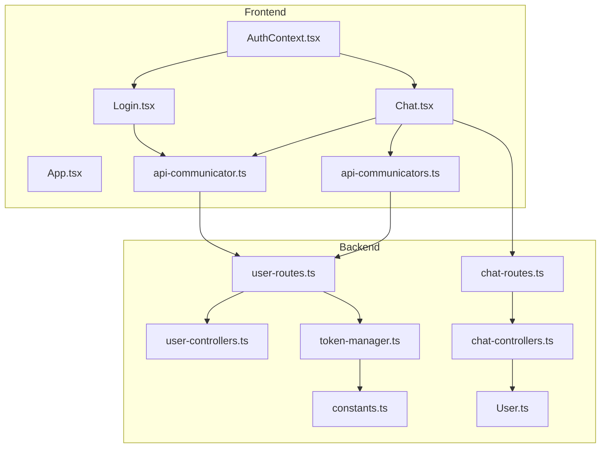
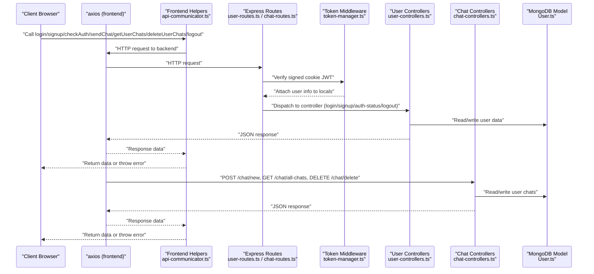
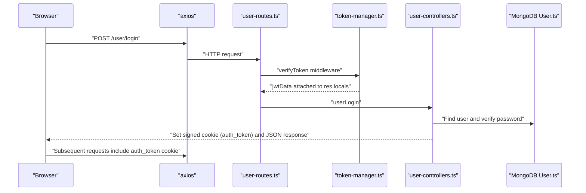
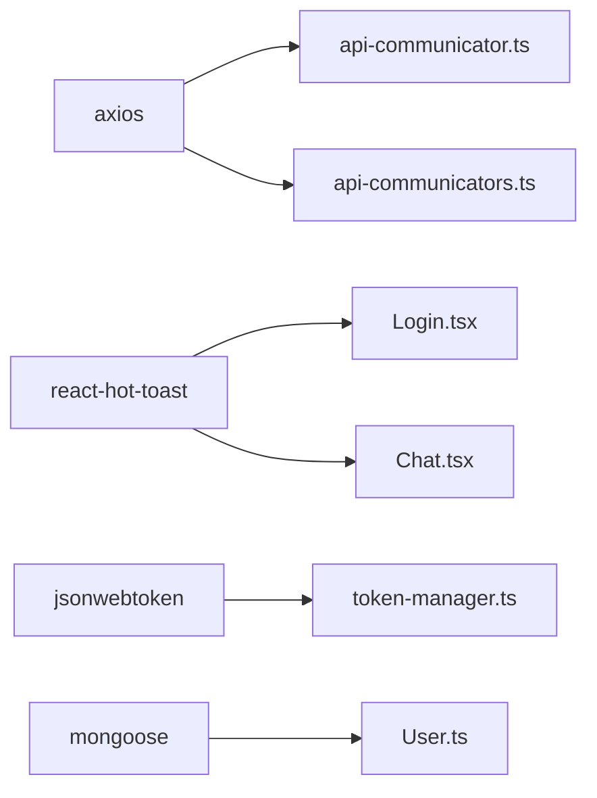

# API Communication

<cite>
**Referenced Files in This Document**
- [api-communicator.ts](file://frontend/src/helpers/api-communicator.ts)
- [api-communicators.ts](file://frontend/src/helpers/api-communicators.ts)
- [AuthContext.tsx](file://frontend/src/context/AuthContext.tsx)
- [App.tsx](file://frontend/src/App.tsx)
- [Chat.tsx](file://frontend/src/pages/Chat.tsx)
- [Login.tsx](file://frontend/src/pages/Login.tsx)
- [user-controllers.ts](file://backend/src/controllers/user-controllers.ts)
- [chat-controllers.ts](file://backend/src/controllers/chat-controllers.ts)
- [token-manager.ts](file://backend/src/utils/token-manager.ts)
- [user-routes.ts](file://backend/src/routes/user-routes.ts)
- [chat-routes.ts](file://backend/src/routes/chat-routes.ts)
- [constants.ts](file://backend/src/utils/constants.ts)
- [User.ts](file://backend/src/models/User.ts)
- [package.json](file://frontend/package.json)
- [vite.config.ts](file://frontend/vite.config.ts)
</cite>

## Table of Contents
1. [Introduction](#introduction)
2. [Project Structure](#project-structure)
3. [Core Components](#core-components)
4. [Architecture Overview](#architecture-overview)
5. [Detailed Component Analysis](#detailed-component-analysis)
6. [Dependency Analysis](#dependency-analysis)
7. [Performance Considerations](#performance-considerations)
8. [Troubleshooting Guide](#troubleshooting-guide)
9. [Conclusion](#conclusion)
10. [Appendices](#appendices)

## Introduction
This document explains the API communication patterns and HTTP client configuration used in the frontend application. It focuses on how the frontend invokes backend endpoints, handles requests and responses, manages errors, integrates authentication tokens via cookies, and orchestrates chat-related workflows. It also outlines extension guidelines, security considerations, rate limiting, and performance optimization strategies.

## Project Structure
The frontend exposes helper modules that encapsulate HTTP calls to the backend. Authentication state is managed via a React context provider. The backend implements Express routes and controllers that enforce token verification and manage user and chat resources.

**Diagram sources**
- [AuthContext.tsx:1-76](file://frontend/src/context/AuthContext.tsx#L1-L76)
- [App.tsx:1-30](file://frontend/src/App.tsx#L1-L30)
- [Login.tsx:1-97](file://frontend/src/pages/Login.tsx#L1-L97)
- [Chat.tsx:1-202](file://frontend/src/pages/Chat.tsx#L1-L202)
- [api-communicator.ts:1-68](file://frontend/src/helpers/api-communicator.ts#L1-L68)
- [api-communicators.ts:1-26](file://frontend/src/helpers/api-communicators.ts#L1-L26)
- [user-routes.ts:1-25](file://backend/src/routes/user-routes.ts#L1-L25)
- [chat-routes.ts:1-22](file://backend/src/routes/chat-routes.ts#L1-L22)
- [user-controllers.ts:1-163](file://backend/src/controllers/user-controllers.ts#L1-L163)
- [chat-controllers.ts:1-89](file://backend/src/controllers/chat-controllers.ts#L1-L89)
- [token-manager.ts:1-35](file://backend/src/utils/token-manager.ts#L1-L35)
- [constants.ts:1-2](file://backend/src/utils/constants.ts#L1-L2)
- [User.ts:1-35](file://backend/src/models/User.ts#L1-L35)

**Section sources**
- [api-communicator.ts:1-68](file://frontend/src/helpers/api-communicator.ts#L1-L68)
- [api-communicators.ts:1-26](file://frontend/src/helpers/api-communicators.ts#L1-L26)
- [AuthContext.tsx:1-76](file://frontend/src/context/AuthContext.tsx#L1-L76)
- [App.tsx:1-30](file://frontend/src/App.tsx#L1-L30)
- [Chat.tsx:1-202](file://frontend/src/pages/Chat.tsx#L1-L202)
- [Login.tsx:1-97](file://frontend/src/pages/Login.tsx#L1-L97)
- [user-routes.ts:1-25](file://backend/src/routes/user-routes.ts#L1-L25)
- [chat-routes.ts:1-22](file://backend/src/routes/chat-routes.ts#L1-L22)
- [user-controllers.ts:1-163](file://backend/src/controllers/user-controllers.ts#L1-L163)
- [chat-controllers.ts:1-89](file://backend/src/controllers/chat-controllers.ts#L1-L89)
- [token-manager.ts:1-35](file://backend/src/utils/token-manager.ts#L1-L35)
- [constants.ts:1-2](file://backend/src/utils/constants.ts#L1-L2)
- [User.ts:1-35](file://backend/src/models/User.ts#L1-L35)

## Core Components
- Frontend HTTP helpers:
  - api-communicator.ts: Provides user and chat operations using axios for GET, POST, DELETE, and status checks.
  - api-communicators.ts: Alternative set of user operations with similar patterns.
- Authentication context:
  - AuthContext.tsx: Centralizes login, signup, logout, and auth status checks; maintains user session state.
- Backend routes and controllers:
  - user-routes.ts and chat-routes.ts: Define protected endpoints and attach token verification middleware.
  - user-controllers.ts and chat-controllers.ts: Implement business logic for user actions and chat generation.
  - token-manager.ts: Creates and verifies JWT tokens stored in signed cookies.
  - constants.ts: Defines cookie name used for authentication.
  - User.ts: Mongoose model representing users and their chat histories.

Key behaviors:
- Authentication relies on signed cookies carrying JWTs verified server-side.
- Frontend helpers throw errors when HTTP status indicates failure; callers handle errors with toasts and navigation.
- Chat endpoints are protected and require a valid token.

**Section sources**
- [api-communicator.ts:1-68](file://frontend/src/helpers/api-communicator.ts#L1-L68)
- [api-communicators.ts:1-26](file://frontend/src/helpers/api-communicators.ts#L1-L26)
- [AuthContext.tsx:1-76](file://frontend/src/context/AuthContext.tsx#L1-L76)
- [user-routes.ts:1-25](file://backend/src/routes/user-routes.ts#L1-L25)
- [chat-routes.ts:1-22](file://backend/src/routes/chat-routes.ts#L1-L22)
- [user-controllers.ts:1-163](file://backend/src/controllers/user-controllers.ts#L1-L163)
- [chat-controllers.ts:1-89](file://backend/src/controllers/chat-controllers.ts#L1-L89)
- [token-manager.ts:1-35](file://backend/src/utils/token-manager.ts#L1-L35)
- [constants.ts:1-2](file://backend/src/utils/constants.ts#L1-L2)
- [User.ts:1-35](file://backend/src/models/User.ts#L1-L35)

## Architecture Overview
The frontend communicates with the backend through axios-based helpers. Authentication is enforced by a middleware that validates a signed JWT cookie. Protected endpoints manage user sessions and chat history.

**Diagram sources**
- [api-communicator.ts:1-68](file://frontend/src/helpers/api-communicator.ts#L1-L68)
- [user-routes.ts:1-25](file://backend/src/routes/user-routes.ts#L1-L25)
- [chat-routes.ts:1-22](file://backend/src/routes/chat-routes.ts#L1-L22)
- [token-manager.ts:1-35](file://backend/src/utils/token-manager.ts#L1-L35)
- [user-controllers.ts:1-163](file://backend/src/controllers/user-controllers.ts#L1-L163)
- [chat-controllers.ts:1-89](file://backend/src/controllers/chat-controllers.ts#L1-L89)
- [User.ts:1-35](file://backend/src/models/User.ts#L1-L35)

## Detailed Component Analysis

### Frontend HTTP Helpers: api-communicator.ts
Responsibilities:
- Encapsulate axios calls for user and chat operations.
- Validate HTTP status and throw descriptive errors on failure.
- Return parsed data for successful responses.

Patterns:
- Each exported function performs an axios HTTP operation against a backend endpoint.
- Status checks are performed immediately after receiving the response; non-success statuses trigger an error.
- Data extraction is awaited to ensure proper resolution of the response body.

Error handling:
- On non-2xx responses, a generic error is thrown with a descriptive message.
- Callers should wrap invocations in try/catch blocks to present user-friendly feedback.

Authentication integration:
- No explicit Authorization header is set in these helpers.
- Authentication relies on browser-managed signed cookies automatically included by axios for same-origin requests.

Extensibility:
- Add new endpoints by exporting a new async function that calls axios with the appropriate method and path.
- Maintain consistent status checks and error throwing patterns.

**Section sources**
- [api-communicator.ts:1-68](file://frontend/src/helpers/api-communicator.ts#L1-L68)

### Frontend HTTP Helpers: api-communicators.ts
Responsibilities:
- Provide a subset of user operations (login and auth status) using axios.
- Mirror the pattern of status validation and error throwing.

Usage:
- Used by components that primarily need user authentication checks and login flows.

**Section sources**
- [api-communicators.ts:1-26](file://frontend/src/helpers/api-communicators.ts#L1-L26)

### Authentication Context: AuthContext.tsx
Responsibilities:
- Manage user session state (isLoggedIn, user).
- Provide login, signup, logout, and auth status checking capabilities.
- Initialize session by checking server-side auth status on mount.

Integration with helpers:
- Uses checkAuthStatus, loginUser, signupUser, and logoutUser from api-communicator.ts.
- Updates local state upon successful operations and navigates appropriately.

Lifecycle:
- On mount, checks current auth status and sets state accordingly.
- On logout, clears local state and reloads the page to reset client state.

**Section sources**
- [AuthContext.tsx:1-76](file://frontend/src/context/AuthContext.tsx#L1-L76)
- [api-communicator.ts:1-68](file://frontend/src/helpers/api-communicator.ts#L1-L68)

### Frontend Pages: Login.tsx and Chat.tsx
Login.tsx:
- Collects credentials from a form.
- Calls auth.login(email, password) which internally uses loginUser from api-communicator.ts.
- Displays loading and success/error notifications using toast.

Chat.tsx:
- Loads user chats on mount using getUserChats.
- Sends new chat messages using sendChatRequest and updates the UI with returned chat history.
- Clears conversations using deleteUserChats.

Error handling:
- Both pages wrap API calls in try/catch blocks and show toast notifications for success/failure.

**Section sources**
- [Login.tsx:1-97](file://frontend/src/pages/Login.tsx#L1-L97)
- [Chat.tsx:1-202](file://frontend/src/pages/Chat.tsx#L1-L202)
- [api-communicator.ts:1-68](file://frontend/src/helpers/api-communicator.ts#L1-L68)

### Backend Routes and Controllers: User and Chat
User routes:
- GET /: returns all users.
- POST /signup: validates input, hashes password, creates token, sets signed cookie, returns user info.
- POST /login: validates credentials, creates token, sets signed cookie, returns user info.
- GET /auth-status: protected route verifying token and returning user info.
- GET /logout: protected route clearing the cookie and returning user info.

Chat routes:
- POST /chat/new: protected route generating a chat completion via OpenAI, saving updated chats, returning chats.
- GET /chat/all-chats: protected route returning user’s chat history.
- DELETE /chat/delete: protected route clearing user’s chat history.

Token middleware:
- Extracts signed cookie, verifies JWT, attaches decoded payload to res.locals, and proceeds to next handler.

Model:
- User schema includes name, email, password, and an array of chat entries with role and content.

**Section sources**
- [user-routes.ts:1-25](file://backend/src/routes/user-routes.ts#L1-L25)
- [chat-routes.ts:1-22](file://backend/src/routes/chat-routes.ts#L1-L22)
- [user-controllers.ts:1-163](file://backend/src/controllers/user-controllers.ts#L1-L163)
- [chat-controllers.ts:1-89](file://backend/src/controllers/chat-controllers.ts#L1-L89)
- [token-manager.ts:1-35](file://backend/src/utils/token-manager.ts#L1-L35)
- [constants.ts:1-2](file://backend/src/utils/constants.ts#L1-L2)
- [User.ts:1-35](file://backend/src/models/User.ts#L1-L35)

### Authentication Token Flow

**Diagram sources**
- [user-routes.ts:1-25](file://backend/src/routes/user-routes.ts#L1-L25)
- [token-manager.ts:1-35](file://backend/src/utils/token-manager.ts#L1-L35)
- [user-controllers.ts:1-163](file://backend/src/controllers/user-controllers.ts#L1-L163)
- [constants.ts:1-2](file://backend/src/utils/constants.ts#L1-L2)
- [User.ts:1-35](file://backend/src/models/User.ts#L1-L35)

## Dependency Analysis
External libraries:
- axios: HTTP client used by frontend helpers.
- react-hot-toast: Notification library for user feedback.
- @emotion/material and @mui/material: UI framework.
- jsonwebtoken: JWT creation and verification on the backend.
- mongoose: MongoDB ODM for user and chat persistence.

Frontend dependencies:
- package.json lists axios and toast among runtime dependencies.

Vite configuration:
- vite.config.ts enables React plugin for development.

**Diagram sources**
- [package.json:1-39](file://frontend/package.json#L1-L39)
- [vite.config.ts:1-9](file://frontend/vite.config.ts#L1-L9)
- [api-communicator.ts:1-68](file://frontend/src/helpers/api-communicator.ts#L1-L68)
- [api-communicators.ts:1-26](file://frontend/src/helpers/api-communicators.ts#L1-L26)
- [Login.tsx:1-97](file://frontend/src/pages/Login.tsx#L1-L97)
- [Chat.tsx:1-202](file://frontend/src/pages/Chat.tsx#L1-L202)
- [token-manager.ts:1-35](file://backend/src/utils/token-manager.ts#L1-L35)
- [User.ts:1-35](file://backend/src/models/User.ts#L1-L35)

**Section sources**
- [package.json:1-39](file://frontend/package.json#L1-L39)
- [vite.config.ts:1-9](file://frontend/vite.config.ts#L1-L9)
- [api-communicator.ts:1-68](file://frontend/src/helpers/api-communicator.ts#L1-L68)
- [api-communicators.ts:1-26](file://frontend/src/helpers/api-communicators.ts#L1-L26)
- [Login.tsx:1-97](file://frontend/src/pages/Login.tsx#L1-L97)
- [Chat.tsx:1-202](file://frontend/src/pages/Chat.tsx#L1-L202)
- [token-manager.ts:1-35](file://backend/src/utils/token-manager.ts#L1-L35)
- [User.ts:1-35](file://backend/src/models/User.ts#L1-L35)

## Performance Considerations
- Network efficiency:
  - Minimize redundant requests by caching recent chat histories in component state and invalidating on delete.
  - Debounce input submission to reduce bursty network traffic during rapid typing.
- UI responsiveness:
  - Use optimistic updates for chat submission: append user message immediately, then reconcile with server response.
  - Show skeleton loaders while fetching initial chats.
- Backend throughput:
  - Offload heavy operations (e.g., OpenAI calls) to background tasks if latency becomes a concern.
  - Consider pagination for long chat histories.
- Resource cleanup:
  - Cancel in-flight requests on unmount to prevent memory leaks and unnecessary work.

[No sources needed since this section provides general guidance]

## Troubleshooting Guide
Common issues and resolutions:
- Authentication failures:
  - Symptom: Redirect to login or inability to access protected routes.
  - Cause: Missing or expired signed cookie.
  - Resolution: Ensure server sets the cookie on login/signup; verify cookie domain/path; confirm client sends cookies for same-origin requests.
- Non-2xx responses:
  - Symptom: Generic error thrown by helpers.
  - Cause: Backend validation errors or internal failures.
  - Resolution: Inspect server logs; adjust client-side error handling to surface actionable messages.
- CORS and proxy:
  - Symptom: Requests blocked due to CORS.
  - Resolution: Configure Vite proxy to forward API requests to backend during development; ensure backend responds with appropriate headers in production.
- Rate limiting:
  - Symptom: 429 responses from backend or upstream providers.
  - Resolution: Implement client-side throttling and exponential backoff; add user feedback when retries occur.
- Timeout configuration:
  - Symptom: Slow or hanging requests.
  - Resolution: Set axios timeout in a shared client configuration to fail fast and improve UX.

**Section sources**
- [api-communicator.ts:1-68](file://frontend/src/helpers/api-communicator.ts#L1-L68)
- [user-controllers.ts:1-163](file://backend/src/controllers/user-controllers.ts#L1-L163)
- [chat-controllers.ts:1-89](file://backend/src/controllers/chat-controllers.ts#L1-L89)

## Conclusion
The frontend API communication is centered around straightforward axios-based helpers that validate responses and propagate errors to callers. Authentication is handled server-side via signed JWT cookies, ensuring secure and stateless session management. The backend enforces protection on chat endpoints and persists user data with a simple chat history model. Extending functionality involves adding new helpers, integrating them into context or pages, and implementing robust error handling and optimistic updates.

[No sources needed since this section summarizes without analyzing specific files]

## Appendices

### API Endpoint Reference
- User
  - POST /user/login: Authenticate user and set signed cookie.
  - POST /user/signup: Register user, hash password, set signed cookie.
  - GET /user/auth-status: Verify token and return user info.
  - GET /user/logout: Clear signed cookie and return user info.
- Chat
  - POST /chat/new: Generate chat completion via OpenAI, save updated chats.
  - GET /chat/all-chats: Retrieve user’s chat history.
  - DELETE /chat/delete: Clear user’s chat history.

**Section sources**
- [user-routes.ts:1-25](file://backend/src/routes/user-routes.ts#L1-L25)
- [chat-routes.ts:1-22](file://backend/src/routes/chat-routes.ts#L1-L22)

### Adding New Endpoints: Step-by-Step
- Define helper function:
  - Export an async function in api-communicator.ts or api-communicators.ts using axios.
  - Validate response status and throw descriptive errors.
- Integrate into UI:
  - Consume the helper in a page or context hook.
  - Wrap calls in try/catch and provide user feedback via toast.
- Backend support:
  - Add route in user-routes.ts or chat-routes.ts.
  - Implement controller logic and attach token middleware where required.
  - Update model if new fields are needed.
- Security:
  - Enforce token verification for protected endpoints.
  - Sanitize and validate inputs on the backend.

**Section sources**
- [api-communicator.ts:1-68](file://frontend/src/helpers/api-communicator.ts#L1-L68)
- [user-routes.ts:1-25](file://backend/src/routes/user-routes.ts#L1-L25)
- [chat-routes.ts:1-22](file://backend/src/routes/chat-routes.ts#L1-L22)
- [token-manager.ts:1-35](file://backend/src/utils/token-manager.ts#L1-L35)
- [User.ts:1-35](file://backend/src/models/User.ts#L1-L35)

### Optimistic Updates Pattern
- Trigger:
  - On submit, immediately update component state with the new message.
- Resolve:
  - On success, merge server response into state.
  - On failure, rollback optimistic change and surface error.

**Section sources**
- [Chat.tsx:1-202](file://frontend/src/pages/Chat.tsx#L1-L202)

### Retry Logic and Backoff
- Implement exponential backoff for transient failures.
- Limit total retries and surface user-visible feedback.
- Respect server-side rate limits and throttle requests.

[No sources needed since this section provides general guidance]