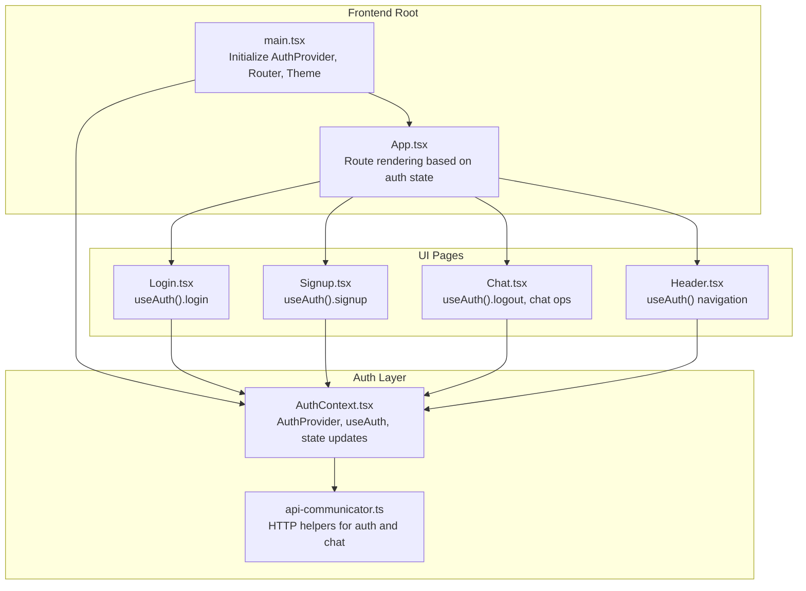
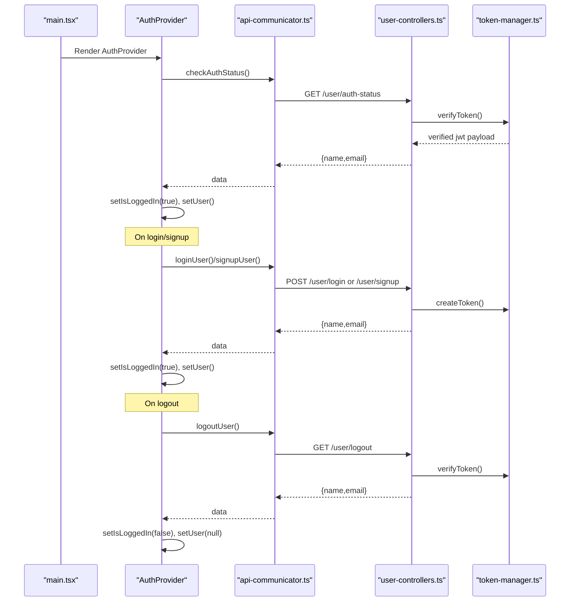
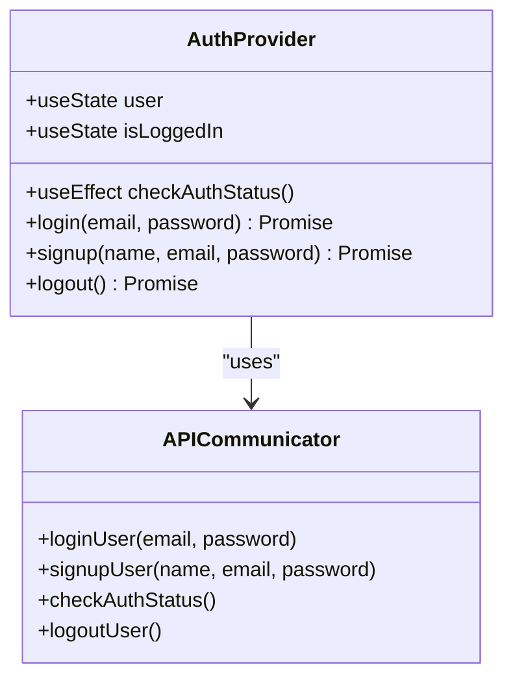
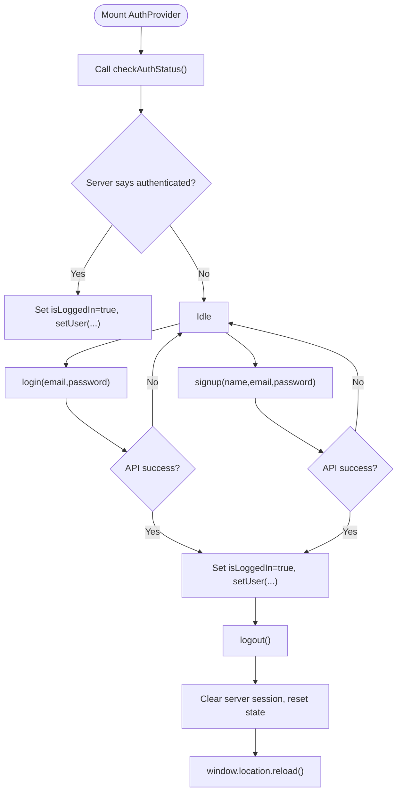
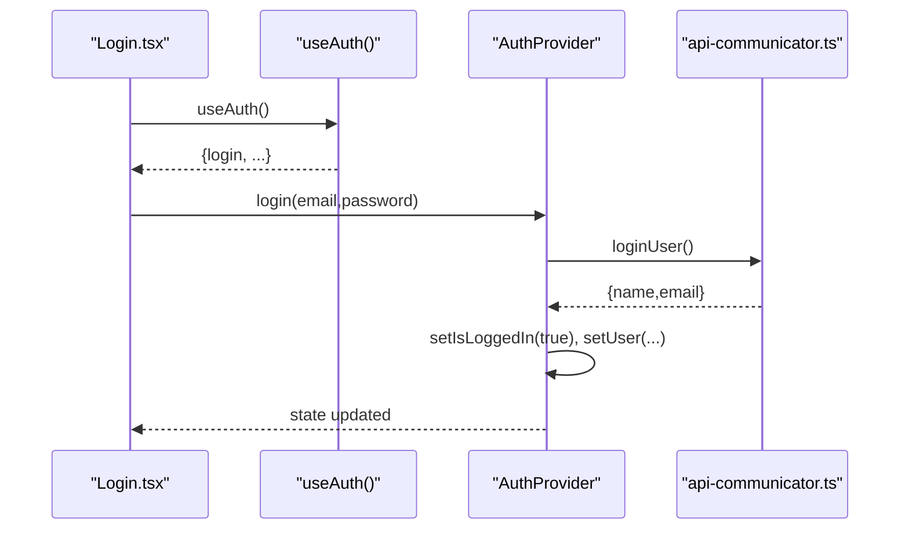
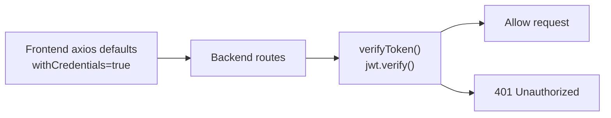
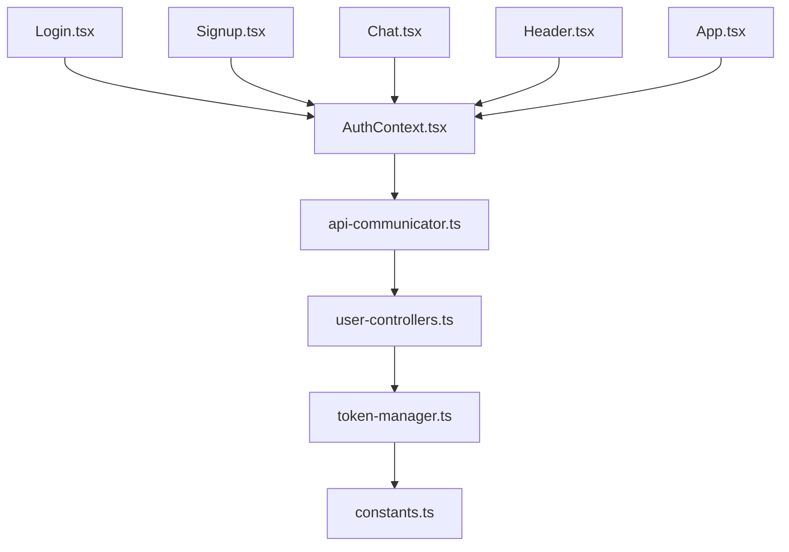

# Context and State Management

<cite>
**Referenced Files in This Document**
- [AuthContext.tsx](file://frontend/src/context/AuthContext.tsx)
- [App.tsx](file://frontend/src/App.tsx)
- [main.tsx](file://frontend/src/main.tsx)
- [Login.tsx](file://frontend/src/pages/Login.tsx)
- [Signup.tsx](file://frontend/src/pages/Signup.tsx)
- [Chat.tsx](file://frontend/src/pages/Chat.tsx)
- [Header.tsx](file://frontend/src/components/Header.tsx)
- [api-communicator.ts](file://frontend/src/helpers/api-communicator.ts)
- [api-communicators.ts](file://frontend/src/helpers/api-communicators.ts)
- [user-controllers.ts](file://backend/src/controllers/user-controllers.ts)
- [token-manager.ts](file://backend/src/utils/token-manager.ts)
- [constants.ts](file://backend/src/utils/constants.ts)
</cite>

## Table of Contents
1. [Introduction](#introduction)
2. [Project Structure](#project-structure)
3. [Core Components](#core-components)
4. [Architecture Overview](#architecture-overview)
5. [Detailed Component Analysis](#detailed-component-analysis)
6. [Dependency Analysis](#dependency-analysis)
7. [Performance Considerations](#performance-considerations)
8. [Troubleshooting Guide](#troubleshooting-guide)
9. [Conclusion](#conclusion)

## Introduction
This document explains the React Context API implementation and global state management for authentication in the application. It focuses on the AuthContext provider, authentication state flow, user session management, and how components consume context data. It also covers authentication state transitions, user data persistence, secure state management practices, examples of context usage, best practices for state normalization, performance considerations, and patterns for extending context functionality.

## Project Structure
The frontend uses a single AuthContext provider to manage authentication state across the application. Providers are initialized at the root of the app, and components consume the context via a custom hook. Authentication relies on backend APIs for login, signup, logout, and session verification, with cookies carrying JWT tokens.

**Diagram sources**
- [main.tsx:18-29](file://frontend/src/main.tsx#L18-L29)
- [App.tsx:10-27](file://frontend/src/App.tsx#L10-L27)
- [AuthContext.tsx:28-76](file://frontend/src/context/AuthContext.tsx#L28-L76)
- [Login.tsx:10-24](file://frontend/src/pages/Login.tsx#L10-L24)
- [Signup.tsx:10-25](file://frontend/src/pages/Signup.tsx#L10-L25)
- [Chat.tsx:21-63](file://frontend/src/pages/Chat.tsx#L21-L63)
- [Header.tsx:9-31](file://frontend/src/components/Header.tsx#L9-L31)
- [api-communicator.ts:1-68](file://frontend/src/helpers/api-communicator.ts#L1-L68)

**Section sources**
- [main.tsx:18-29](file://frontend/src/main.tsx#L18-L29)
- [App.tsx:10-27](file://frontend/src/App.tsx#L10-L27)
- [AuthContext.tsx:28-76](file://frontend/src/context/AuthContext.tsx#L28-L76)

## Core Components
- AuthProvider: Creates and manages authentication state, initializes from server session, and exposes login, signup, and logout actions.
- useAuth: Custom hook returning the current authentication context value.
- API helpers: Encapsulate HTTP requests for authentication and chat operations.
- UI pages: Login, Signup, Chat, and Header consume useAuth to drive UI behavior and navigation.

Key responsibilities:
- Initialize authentication state on mount by checking server-side session.
- Update state upon successful login/signup and reset on logout.
- Gate protected routes and UI elements based on authentication state.
- Persist user identity and login status across sessions using cookies.

**Section sources**
- [AuthContext.tsx:15-26](file://frontend/src/context/AuthContext.tsx#L15-L26)
- [AuthContext.tsx:28-76](file://frontend/src/context/AuthContext.tsx#L28-L76)
- [api-communicator.ts:1-68](file://frontend/src/helpers/api-communicator.ts#L1-L68)

## Architecture Overview
The authentication flow spans frontend context and backend controllers. On app initialization, the provider checks the server’s auth status using a dedicated endpoint. Successful login/signup sets the user and logged-in flags and persists a signed cookie with a JWT. Logout clears the cookie and resets local state.

**Diagram sources**
- [main.tsx:18-29](file://frontend/src/main.tsx#L18-L29)
- [AuthContext.tsx:32-43](file://frontend/src/context/AuthContext.tsx#L32-L43)
- [AuthContext.tsx:44-63](file://frontend/src/context/AuthContext.tsx#L44-L63)
- [api-communicator.ts:24-31](file://frontend/src/helpers/api-communicator.ts#L24-L31)
- [api-communicator.ts:2-22](file://frontend/src/helpers/api-communicator.ts#L2-L22)
- [api-communicator.ts:60-67](file://frontend/src/helpers/api-communicator.ts#L60-L67)
- [user-controllers.ts:110-131](file://backend/src/controllers/user-controllers.ts#L110-L131)
- [token-manager.ts:13-34](file://backend/src/utils/token-manager.ts#L13-L34)

## Detailed Component Analysis

### AuthContext Implementation
- State shape: user (nullable), isLoggedIn (boolean).
- Initialization: On mount, checks server auth status and hydrates state if authenticated.
- Actions:
  - login: Calls login API, sets user and isLoggedIn on success.
  - signup: Calls signup API, sets user and isLoggedIn on success.
  - logout: Clears server session, resets local state, and reloads to ensure clean state.
- Provider pattern: Exposes value containing state and actions to descendants.

**Diagram sources**
- [AuthContext.tsx:28-76](file://frontend/src/context/AuthContext.tsx#L28-L76)
- [api-communicator.ts:1-68](file://frontend/src/helpers/api-communicator.ts#L1-L68)

**Section sources**
- [AuthContext.tsx:28-76](file://frontend/src/context/AuthContext.tsx#L28-L76)

### Authentication State Flow and Transitions
- Initial hydration: On mount, provider calls checkAuthStatus. If server confirms session, state becomes authenticated.
- Login: Submit credentials, receive user data, set state to authenticated.
- Signup: Submit registration, receive user data, set state to authenticated.
- Logout: Clear server session, reset state, reload to ensure no stale state remains.

**Diagram sources**
- [AuthContext.tsx:32-43](file://frontend/src/context/AuthContext.tsx#L32-L43)
- [AuthContext.tsx:44-63](file://frontend/src/context/AuthContext.tsx#L44-L63)

**Section sources**
- [AuthContext.tsx:32-43](file://frontend/src/context/AuthContext.tsx#L32-L43)
- [AuthContext.tsx:44-63](file://frontend/src/context/AuthContext.tsx#L44-L63)

### Context Hooks and Consumer Usage
- useAuth(): Returns the current context value. Components call this to access user, isLoggedIn, and action methods.
- App routing: Conditional route rendering depends on auth.isLoggedIn and presence of user.
- Login/Signup pages: Submit forms, call auth.login or auth.signup, and redirect on success.
- Header: Shows different navigation depending on auth.isLoggedIn and invokes auth.logout.
- Chat page: Uses auth to guard access and load user chat history.

**Diagram sources**
- [Login.tsx:10-24](file://frontend/src/pages/Login.tsx#L10-L24)
- [AuthContext.tsx:44-50](file://frontend/src/context/AuthContext.tsx#L44-L50)
- [api-communicator.ts:2-9](file://frontend/src/helpers/api-communicator.ts#L2-L9)

**Section sources**
- [App.tsx:20-22](file://frontend/src/App.tsx#L20-L22)
- [Login.tsx:10-24](file://frontend/src/pages/Login.tsx#L10-L24)
- [Signup.tsx:10-25](file://frontend/src/pages/Signup.tsx#L10-L25)
- [Header.tsx:9-31](file://frontend/src/components/Header.tsx#L9-L31)
- [Chat.tsx:21-63](file://frontend/src/pages/Chat.tsx#L21-L63)

### Secure State Management Practices
- Cookie-based session: Backend signs and stores JWT in a cookie with httpOnly and domain/path constraints.
- Token verification middleware: Ensures requests carry a valid token before allowing protected operations.
- Session cleanup on logout: Clears the cookie and returns a success response.
- Strict defaults: Frontend axios configured with credentials and base URL for cross-origin cookie handling.

**Diagram sources**
- [main.tsx:9-11](file://frontend/src/main.tsx#L9-L11)
- [user-controllers.ts:133-162](file://backend/src/controllers/user-controllers.ts#L133-L162)
- [token-manager.ts:13-34](file://backend/src/utils/token-manager.ts#L13-L34)

**Section sources**
- [main.tsx:9-11](file://frontend/src/main.tsx#L9-L11)
- [user-controllers.ts:133-162](file://backend/src/controllers/user-controllers.ts#L133-L162)
- [token-manager.ts:13-34](file://backend/src/utils/token-manager.ts#L13-L34)

### Examples of Context Usage Throughout the Application
- App routing: Conditionally renders protected routes when authenticated.
- Login page: Submits credentials and calls auth.login; redirects to chat on success.
- Signup page: Submits registration and calls auth.signup; redirects to chat on success.
- Header: Shows login/signup links when unauthenticated; shows chat and logout when authenticated.
- Chat page: Guards access and loads chat history using auth state.

**Section sources**
- [App.tsx:20-22](file://frontend/src/App.tsx#L20-L22)
- [Login.tsx:10-29](file://frontend/src/pages/Login.tsx#L10-L29)
- [Signup.tsx:10-30](file://frontend/src/pages/Signup.tsx#L10-L30)
- [Header.tsx:17-31](file://frontend/src/components/Header.tsx#L17-L31)
- [Chat.tsx:45-63](file://frontend/src/pages/Chat.tsx#L45-L63)

### Best Practices for State Normalization and Extension
- Normalize user data: Keep user as a minimal object with essential fields (e.g., name, email).
- Separate concerns: Keep auth state distinct from UI state (e.g., chat messages). The Chat page maintains its own messages state while relying on auth for gating and identity.
- Provider boundaries: Place AuthProvider near the root to minimize re-renders and ensure availability across routes.
- Action composition: Group related operations (e.g., login/signup) into cohesive functions that update state consistently.
- Extending context: Add new actions (e.g., refresh session) or state slices (e.g., loading/error flags) while preserving backward compatibility.

**Section sources**
- [AuthContext.tsx:15-26](file://frontend/src/context/AuthContext.tsx#L15-L26)
- [Chat.tsx:22](file://frontend/src/pages/Chat.tsx#L22)

## Dependency Analysis
- AuthProvider depends on:
  - API helpers for login, signup, auth status, and logout.
  - React hooks for state and lifecycle.
- UI pages depend on:
  - useAuth for authentication state and actions.
  - Router for navigation.
- Backend controllers depend on:
  - Token manager for signing and verifying JWTs.
  - Constants for cookie name.

**Diagram sources**
- [AuthContext.tsx:28-76](file://frontend/src/context/AuthContext.tsx#L28-L76)
- [Login.tsx:6-10](file://frontend/src/pages/Login.tsx#L6-L10)
- [Signup.tsx:6-10](file://frontend/src/pages/Signup.tsx#L6-L10)
- [Chat.tsx:4-21](file://frontend/src/pages/Chat.tsx#L4-L21)
- [Header.tsx:5-9](file://frontend/src/components/Header.tsx#L5-L9)
- [App.tsx:8](file://frontend/src/App.tsx#L8)
- [api-communicator.ts:8-13](file://frontend/src/helpers/api-communicator.ts#L8-L13)
- [user-controllers.ts:1-6](file://backend/src/controllers/user-controllers.ts#L1-L6)
- [token-manager.ts:1-3](file://backend/src/utils/token-manager.ts#L1-L3)
- [constants.ts:1](file://backend/src/utils/constants.ts#L1)

**Section sources**
- [AuthContext.tsx:28-76](file://frontend/src/context/AuthContext.tsx#L28-L76)
- [api-communicator.ts:8-13](file://frontend/src/helpers/api-communicator.ts#L8-L13)
- [user-controllers.ts:1-6](file://backend/src/controllers/user-controllers.ts#L1-L6)
- [token-manager.ts:1-3](file://backend/src/utils/token-manager.ts#L1-L3)
- [constants.ts:1](file://backend/src/utils/constants.ts#L1)

## Performance Considerations
- Minimize re-renders:
  - Keep the provider near the root so only necessary subtrees subscribe to auth changes.
  - Avoid spreading large objects into context; pass only required fields.
- Lazy initialization:
  - Auth hydration runs once on mount; avoid redundant checks.
- Action batching:
  - Group state updates within a single action to reduce intermediate renders.
- Avoid unnecessary reloads:
  - The current logout triggers a hard reload; consider state-only cleanup if the app can tolerate it.

[No sources needed since this section provides general guidance]

## Troubleshooting Guide
Common issues and resolutions:
- Auth state not persisting across refresh:
  - Verify axios defaults include credentials and base URL.
  - Ensure backend sets a signed, httpOnly cookie on login/signup.
- Protected routes still accessible when not authenticated:
  - Confirm conditional route rendering uses auth.isLoggedIn and auth.user.
- Login/signup failing silently:
  - Check API helpers return errors and that components handle exceptions.
- Logout does not clear UI state:
  - Ensure logout resets state and triggers navigation; consider a hard reload to clear caches.

**Section sources**
- [main.tsx:9-11](file://frontend/src/main.tsx#L9-L11)
- [App.tsx:20-22](file://frontend/src/App.tsx#L20-L22)
- [api-communicator.ts:2-9](file://frontend/src/helpers/api-communicator.ts#L2-L9)
- [AuthContext.tsx:58-63](file://frontend/src/context/AuthContext.tsx#L58-L63)

## Conclusion
The application implements a focused, secure, and predictable authentication flow using React Context. The AuthProvider encapsulates state and actions, while the backend enforces token verification and cookie-based session management. Components consume context via a simple hook, enabling consistent behavior across pages. Following the outlined best practices ensures maintainability, performance, and security as the application evolves.