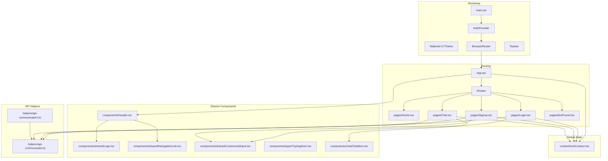
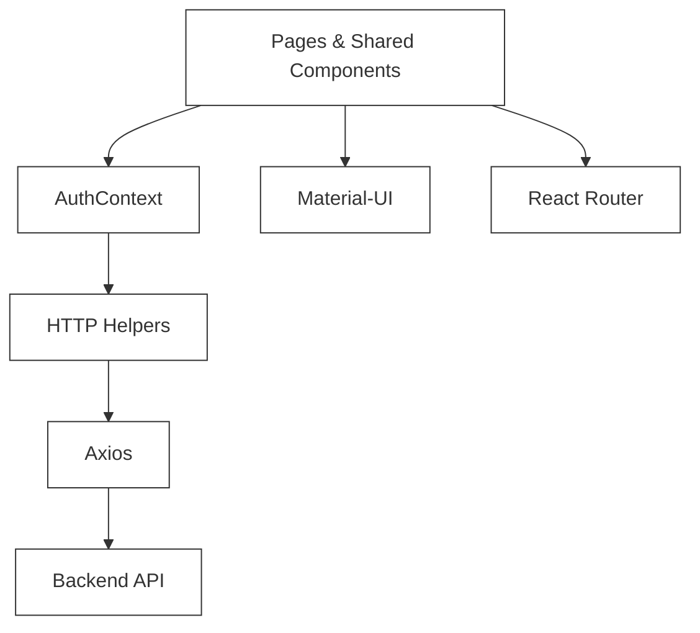
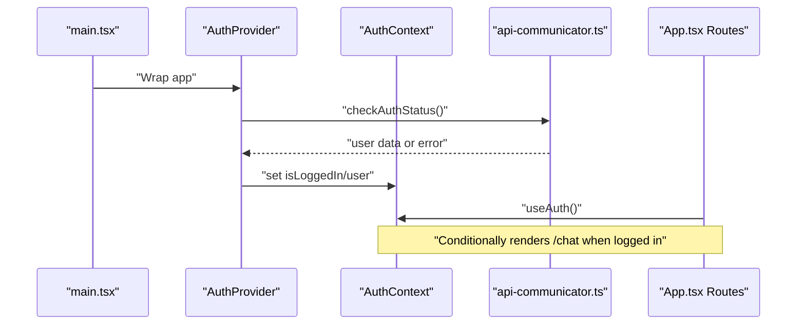
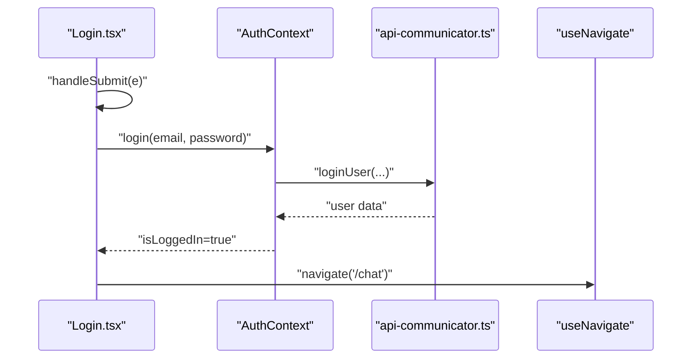
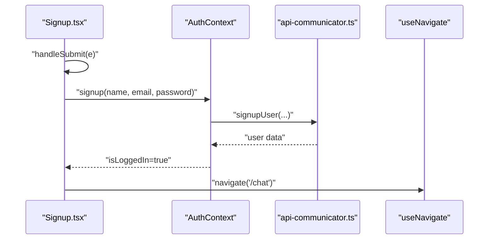
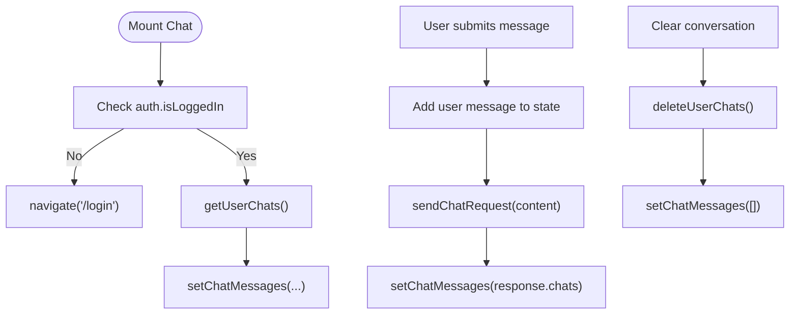
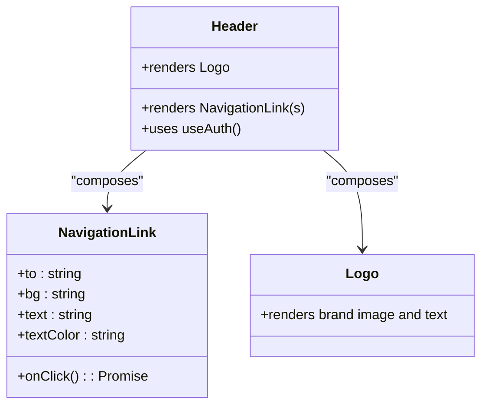
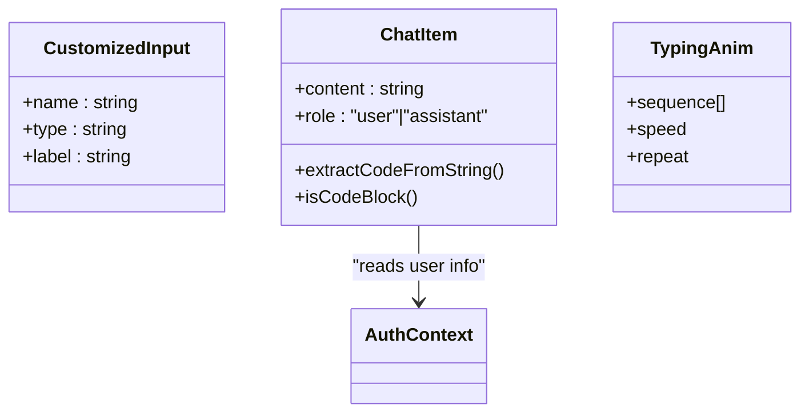
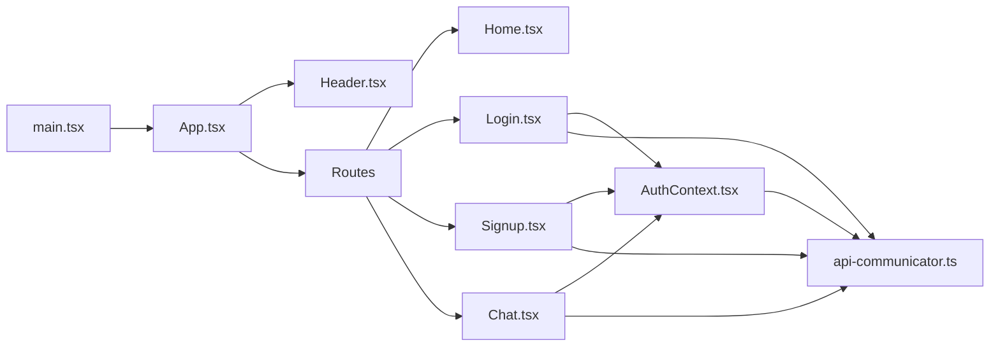

# Frontend Development

<cite>
**Referenced Files in This Document**
- [main.tsx](file://frontend/src/main.tsx)
- [App.tsx](file://frontend/src/App.tsx)
- [AuthContext.tsx](file://frontend/src/context/AuthContext.tsx)
- [api-communicator.ts](file://frontend/src/helpers/api-communicator.ts)
- [api-communicators.ts](file://frontend/src/helpers/api-communicators.ts)
- [Home.tsx](file://frontend/src/pages/Home.tsx)
- [Login.tsx](file://frontend/src/pages/Login.tsx)
- [Signup.tsx](file://frontend/src/pages/Signup.tsx)
- [Chat.tsx](file://frontend/src/pages/Chat.tsx)
- [Header.tsx](file://frontend/src/components/Header.tsx)
- [CustomizedInput.tsx](file://frontend/src/components/shared/CustomizedInput.tsx)
- [Logo.tsx](file://frontend/src/components/shared/Logo.tsx)
- [NavigationLink.tsx](file://frontend/src/components/shared/NavigationLink.tsx)
- [ChatItem.tsx](file://frontend/src/components/chat/ChatItem.tsx)
- [TypingAnim.tsx](file://frontend/src/components/typer/TypingAnim.tsx)
</cite>

## Table of Contents
1. [Introduction](#introduction)
2. [Project Structure](#project-structure)
3. [Core Components](#core-components)
4. [Architecture Overview](#architecture-overview)
5. [Detailed Component Analysis](#detailed-component-analysis)
6. [Dependency Analysis](#dependency-analysis)
7. [Performance Considerations](#performance-considerations)
8. [Troubleshooting Guide](#troubleshooting-guide)
9. [Conclusion](#conclusion)
10. [Appendices](#appendices)

## Introduction
This document provides comprehensive frontend development guidance for the SMAN-GPT AI Chat Application. It covers the React application structure, routing configuration, global state management via Context API, reusable UI components built with Material-UI, responsive design patterns, page components (chat interface, authentication forms, navigation), API communication patterns, HTTP client configuration, and error handling strategies. It also outlines extension guidelines and best practices for maintaining consistency across the codebase.

## Project Structure
The frontend is organized into feature-based directories under src:
- pages: Top-level route components (Home, Login, Signup, Chat, NotFound)
- components: Reusable UI building blocks grouped by domain (shared, chat, footer, typer)
- context: Global state provider (AuthContext)
- helpers: HTTP client wrappers for API communication
- public: Static assets (images, favicons)
- Root bootstrap: main.tsx initializes providers, theme, router, and global toast

**Diagram sources**
- [main.tsx:1-30](file://frontend/src/main.tsx#L1-L30)
- [App.tsx:1-30](file://frontend/src/App.tsx#L1-L30)
- [AuthContext.tsx:1-76](file://frontend/src/context/AuthContext.tsx#L1-L76)
- [api-communicator.ts:1-68](file://frontend/src/helpers/api-communicator.ts#L1-L68)
- [api-communicators.ts:1-26](file://frontend/src/helpers/api-communicators.ts#L1-L26)
- [Home.tsx:1-68](file://frontend/src/pages/Home.tsx#L1-L68)
- [Login.tsx:1-97](file://frontend/src/pages/Login.tsx#L1-L97)
- [Signup.tsx:1-99](file://frontend/src/pages/Signup.tsx#L1-L99)
- [Chat.tsx:1-202](file://frontend/src/pages/Chat.tsx#L1-L202)
- [Header.tsx:1-56](file://frontend/src/components/Header.tsx#L1-L56)
- [CustomizedInput.tsx:1-29](file://frontend/src/components/shared/CustomizedInput.tsx#L1-L29)
- [Logo.tsx:1-37](file://frontend/src/components/shared/Logo.tsx#L1-L37)
- [NavigationLink.tsx:1-24](file://frontend/src/components/shared/NavigationLink.tsx#L1-L24)
- [ChatItem.tsx:1-104](file://frontend/src/components/chat/ChatItem.tsx#L1-L104)
- [TypingAnim.tsx:1-28](file://frontend/src/components/typer/TypingAnim.tsx#L1-L28)

**Section sources**
- [main.tsx:1-30](file://frontend/src/main.tsx#L1-L30)
- [App.tsx:1-30](file://frontend/src/App.tsx#L1-L30)

## Core Components
- Bootstrap and Providers
  - Axios defaults configured with base URL and credentials policy for cross-origin cookie handling.
  - Theme provider with typography and color overrides.
  - Router and global toast notifications initialized at root.
- Routing
  - Routes define top-level pages and conditionally render the chat route when authenticated.
- Authentication Context
  - Provides login, signup, logout, and persisted auth status checks.
  - Exposes a hook to consume auth state across components.
- API Communication
  - Centralized HTTP helpers encapsulate requests for user actions and chat operations.
  - Alternative helpers module exists with overlapping functions.

Key implementation references:
- Bootstrap and providers: [main.tsx:1-30](file://frontend/src/main.tsx#L1-L30)
- Routing and conditional rendering: [App.tsx:1-30](file://frontend/src/App.tsx#L1-L30)
- Auth context and lifecycle: [AuthContext.tsx:1-76](file://frontend/src/context/AuthContext.tsx#L1-L76)
- API helpers: [api-communicator.ts:1-68](file://frontend/src/helpers/api-communicator.ts#L1-L68), [api-communicators.ts:1-26](file://frontend/src/helpers/api-communicators.ts#L1-L26)

**Section sources**
- [main.tsx:1-30](file://frontend/src/main.tsx#L1-L30)
- [App.tsx:1-30](file://frontend/src/App.tsx#L1-L30)
- [AuthContext.tsx:1-76](file://frontend/src/context/AuthContext.tsx#L1-L76)
- [api-communicator.ts:1-68](file://frontend/src/helpers/api-communicator.ts#L1-L68)
- [api-communicators.ts:1-26](file://frontend/src/helpers/api-communicators.ts#L1-L26)

## Architecture Overview
The frontend follows a layered architecture:
- Presentation Layer: Pages and Shared Components
- State Management: Context API (AuthContext)
- Data Access: HTTP helpers wrapping axios
- Styling: Material-UI with a centralized theme
- Routing: React Router DOM

**Diagram sources**
- [main.tsx:1-30](file://frontend/src/main.tsx#L1-L30)
- [App.tsx:1-30](file://frontend/src/App.tsx#L1-L30)
- [AuthContext.tsx:1-76](file://frontend/src/context/AuthContext.tsx#L1-L76)
- [api-communicator.ts:1-68](file://frontend/src/helpers/api-communicator.ts#L1-L68)

## Detailed Component Analysis

### Authentication State Flow
The AuthContext manages authentication state and exposes methods to mutate it. On mount, it checks the current auth status and hydrates state accordingly. Login and signup delegate to API helpers and update state upon success. Logout triggers a server logout and resets local state.

**Diagram sources**
- [main.tsx:1-30](file://frontend/src/main.tsx#L1-L30)
- [AuthContext.tsx:1-76](file://frontend/src/context/AuthContext.tsx#L1-L76)
- [api-communicator.ts:1-68](file://frontend/src/helpers/api-communicator.ts#L1-L68)
- [App.tsx:1-30](file://frontend/src/App.tsx#L1-L30)

**Section sources**
- [AuthContext.tsx:1-76](file://frontend/src/context/AuthContext.tsx#L1-L76)
- [api-communicator.ts:1-68](file://frontend/src/helpers/api-communicator.ts#L1-L68)

### Login Page
- Captures form data, invokes auth.login, and shows toast feedback.
- Redirects to chat when already authenticated.
- Uses Material-UI form controls and styled layout.

**Diagram sources**
- [Login.tsx:1-97](file://frontend/src/pages/Login.tsx#L1-L97)
- [AuthContext.tsx:1-76](file://frontend/src/context/AuthContext.tsx#L1-L76)
- [api-communicator.ts:1-68](file://frontend/src/helpers/api-communicator.ts#L1-L68)

**Section sources**
- [Login.tsx:1-97](file://frontend/src/pages/Login.tsx#L1-L97)

### Signup Page
- Similar to Login but calls auth.signup and redirects after success.
- Uses Material-UI form controls and styled layout.

**Diagram sources**
- [Signup.tsx:1-99](file://frontend/src/pages/Signup.tsx#L1-L99)
- [AuthContext.tsx:1-76](file://frontend/src/context/AuthContext.tsx#L1-L76)
- [api-communicator.ts:1-68](file://frontend/src/helpers/api-communicator.ts#L1-L68)

**Section sources**
- [Signup.tsx:1-99](file://frontend/src/pages/Signup.tsx#L1-L99)

### Chat Page
- Manages an array of messages with user and assistant roles.
- Submits new user messages, fetches updated chat history, and clears conversations.
- Fetches initial chats on mount and enforces authentication guard.

**Diagram sources**
- [Chat.tsx:1-202](file://frontend/src/pages/Chat.tsx#L1-L202)
- [api-communicator.ts:1-68](file://frontend/src/helpers/api-communicator.ts#L1-L68)

**Section sources**
- [Chat.tsx:1-202](file://frontend/src/pages/Chat.tsx#L1-L202)

### Navigation and Header
- Header displays logo and conditional navigation links based on auth state.
- NavigationLink is a reusable styled link component.

**Diagram sources**
- [Header.tsx:1-56](file://frontend/src/components/Header.tsx#L1-L56)
- [NavigationLink.tsx:1-24](file://frontend/src/components/shared/NavigationLink.tsx#L1-L24)
- [Logo.tsx:1-37](file://frontend/src/components/shared/Logo.tsx#L1-L37)

**Section sources**
- [Header.tsx:1-56](file://frontend/src/components/Header.tsx#L1-L56)
- [NavigationLink.tsx:1-24](file://frontend/src/components/shared/NavigationLink.tsx#L1-L24)
- [Logo.tsx:1-37](file://frontend/src/components/shared/Logo.tsx#L1-L37)

### Reusable UI Components
- CustomizedInput: Material-UI TextField wrapper with consistent styling and sizing.
- ChatItem: Renders assistant or user messages with optional syntax-highlighted code blocks.
- TypingAnim: Animated typing effect for hero text.

**Diagram sources**
- [CustomizedInput.tsx:1-29](file://frontend/src/components/shared/CustomizedInput.tsx#L1-L29)
- [ChatItem.tsx:1-104](file://frontend/src/components/chat/ChatItem.tsx#L1-L104)
- [TypingAnim.tsx:1-28](file://frontend/src/components/typer/TypingAnim.tsx#L1-L28)

**Section sources**
- [CustomizedInput.tsx:1-29](file://frontend/src/components/shared/CustomizedInput.tsx#L1-L29)
- [ChatItem.tsx:1-104](file://frontend/src/components/chat/ChatItem.tsx#L1-L104)
- [TypingAnim.tsx:1-28](file://frontend/src/components/typer/TypingAnim.tsx#L1-L28)

### Responsive Design Patterns
- Material-UI breakpoints and sx props drive responsive layouts.
- Flexbox and grid-like spacing ensure consistent alignment across screen sizes.
- Conditional rendering of side panels and input areas based on viewport.

Examples:
- Home page uses responsive flexDirection and image sizing.
- Chat page hides side panel on small screens and adjusts input layout.

**Section sources**
- [Home.tsx:1-68](file://frontend/src/pages/Home.tsx#L1-L68)
- [Chat.tsx:1-202](file://frontend/src/pages/Chat.tsx#L1-L202)

## Dependency Analysis
- Bootstrap depends on React, ReactDOM, ThemeProvider, BrowserRouter, AuthProvider, Toaster, and axios.
- App composes Header and Routes, conditionally rendering Chat based on auth state.
- Pages depend on shared components and API helpers.
- AuthContext depends on API helpers for user operations.
- API helpers depend on axios.

**Diagram sources**
- [main.tsx:1-30](file://frontend/src/main.tsx#L1-L30)
- [App.tsx:1-30](file://frontend/src/App.tsx#L1-L30)
- [AuthContext.tsx:1-76](file://frontend/src/context/AuthContext.tsx#L1-L76)
- [api-communicator.ts:1-68](file://frontend/src/helpers/api-communicator.ts#L1-L68)
- [Login.tsx:1-97](file://frontend/src/pages/Login.tsx#L1-L97)
- [Signup.tsx:1-99](file://frontend/src/pages/Signup.tsx#L1-L99)
- [Chat.tsx:1-202](file://frontend/src/pages/Chat.tsx#L1-L202)

**Section sources**
- [main.tsx:1-30](file://frontend/src/main.tsx#L1-L30)
- [App.tsx:1-30](file://frontend/src/App.tsx#L1-L30)
- [AuthContext.tsx:1-76](file://frontend/src/context/AuthContext.tsx#L1-L76)
- [api-communicator.ts:1-68](file://frontend/src/helpers/api-communicator.ts#L1-L68)

## Performance Considerations
- Minimize re-renders by keeping auth state in a dedicated context and passing only necessary props down.
- Memoize derived data (e.g., chat messages) and avoid unnecessary deep updates.
- Lazy-load heavy components like syntax highlighting only when needed.
- Debounce or throttle input events in chat input to reduce frequent re-renders.
- Use virtualized lists for very long chat histories to improve scrolling performance.
- Keep axios defaults minimal and centralized to avoid redundant configuration overhead.

## Troubleshooting Guide
Common issues and resolutions:
- Authentication state not persisting
  - Ensure cookies are accepted and SameSite/CORS policies allow credentials.
  - Verify axios defaults include credentials and base URL matches backend.
  - Confirm AuthContext checks auth status on mount and sets state accordingly.
- Toast notifications not appearing
  - Ensure Toaster is rendered at the root level.
- API errors
  - Inspect thrown errors from API helpers and surface user-friendly messages.
  - Validate HTTP status checks and handle non-2xx responses gracefully.
- Chat not loading or clearing
  - Confirm getUserChats and deleteUserChats are called with proper guards.
  - Verify that chat messages are reset after deletion.

**Section sources**
- [main.tsx:1-30](file://frontend/src/main.tsx#L1-L30)
- [AuthContext.tsx:1-76](file://frontend/src/context/AuthContext.tsx#L1-L76)
- [api-communicator.ts:1-68](file://frontend/src/helpers/api-communicator.ts#L1-L68)
- [Chat.tsx:1-202](file://frontend/src/pages/Chat.tsx#L1-L202)

## Conclusion
The SMAN-GPT frontend leverages React Router for navigation, Material-UI for consistent UI, and a Context-based auth state for global state management. API communication is centralized via axios-backed helpers. The codebase is structured to support responsive design, reusable components, and straightforward extension pathways. Following the outlined patterns ensures maintainable and scalable enhancements.

## Appendices

### API Communication Patterns
- HTTP client configuration
  - Base URL and credentials are configured globally for cross-origin cookie handling.
- Error handling strategy
  - Helpers throw descriptive errors on non-success statuses; callers should catch and notify users.
- Request/response contracts
  - Login/signup returns user data; chat endpoints return updated chat arrays.

References:
- [main.tsx:1-30](file://frontend/src/main.tsx#L1-L30)
- [api-communicator.ts:1-68](file://frontend/src/helpers/api-communicator.ts#L1-L68)

### Extending Functionality Guidelines
- Add new pages under pages/ and register routes in App.tsx.
- Create reusable components under components/shared or domain-specific folders.
- Introduce new API endpoints in helpers/api-communicator.ts and call them from pages or hooks.
- Update AuthContext if new auth-related flows are needed.
- Maintain consistent styling with Material-UI sx props and the centralized theme.

[No sources needed since this section provides general guidance]