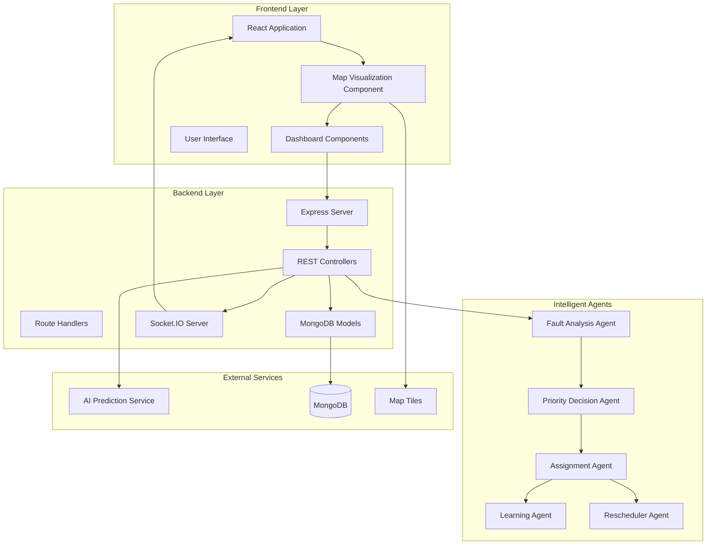
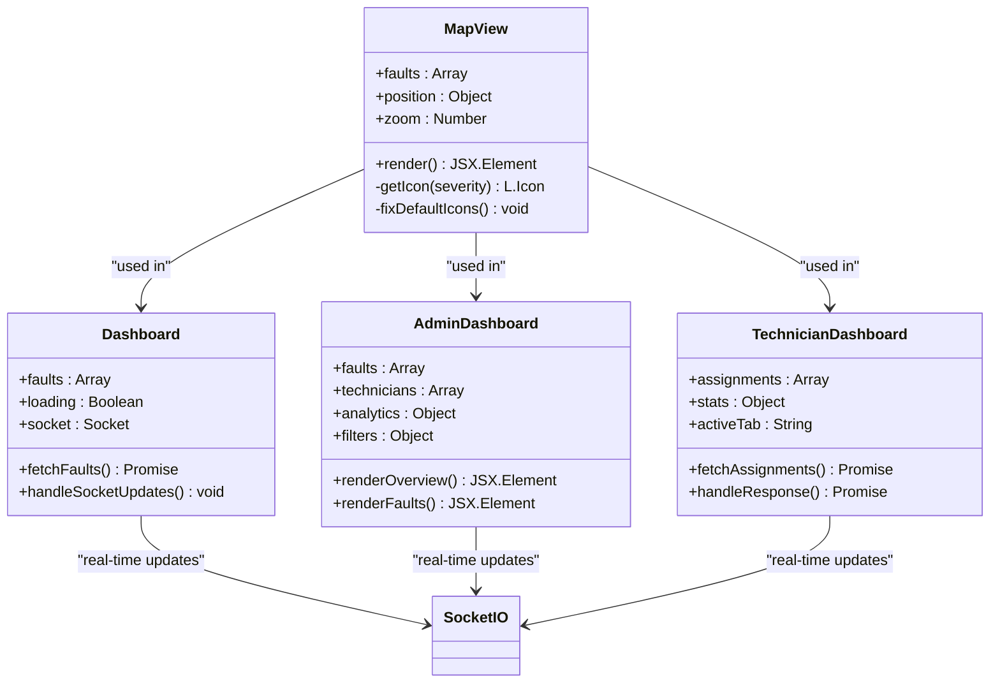
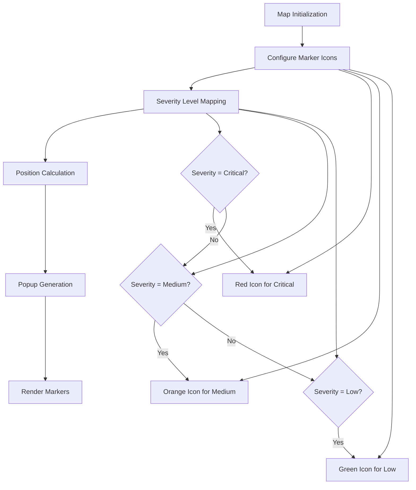
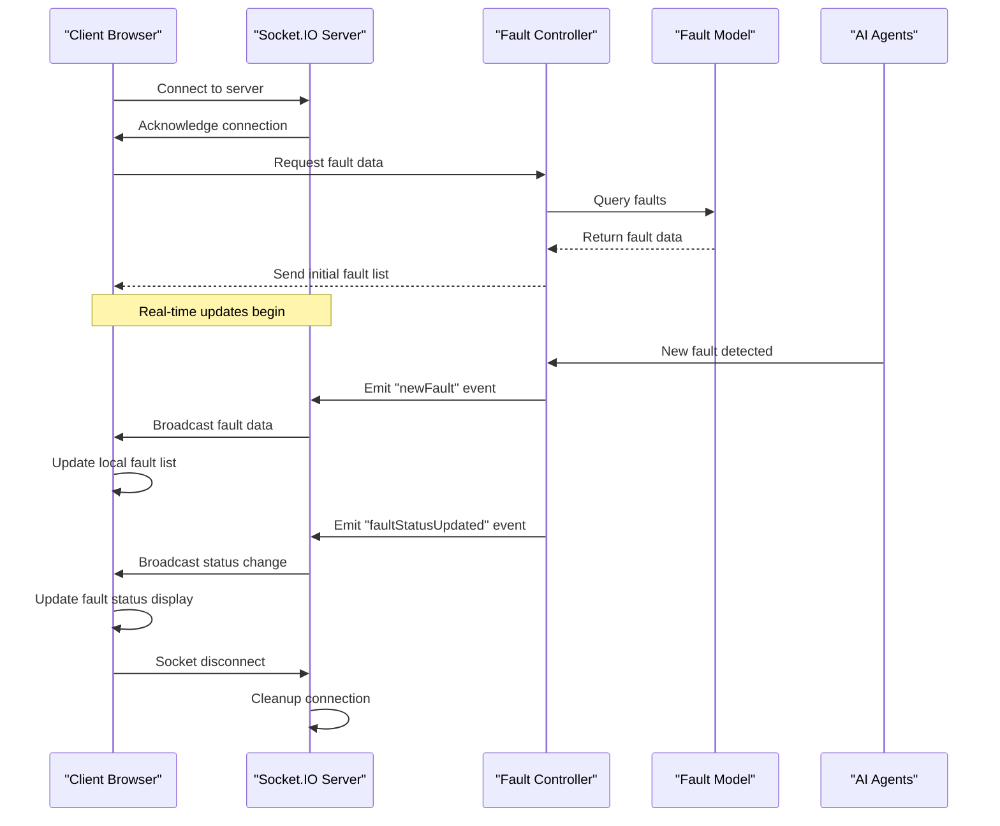
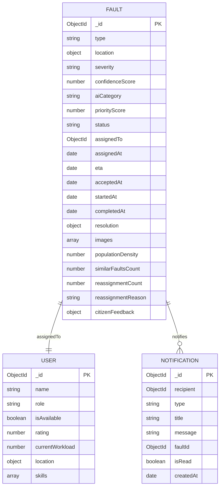
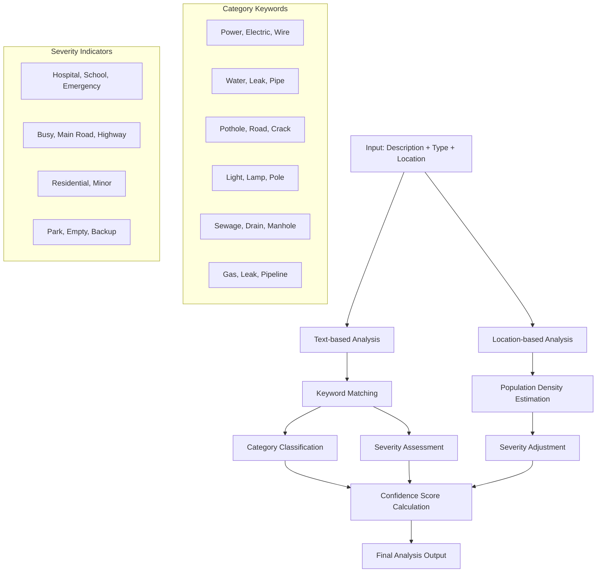
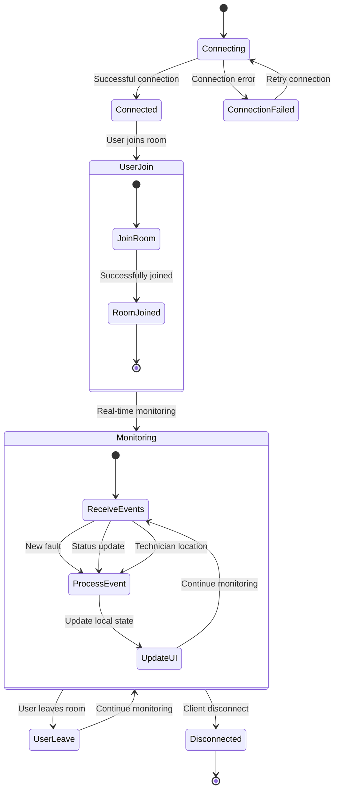
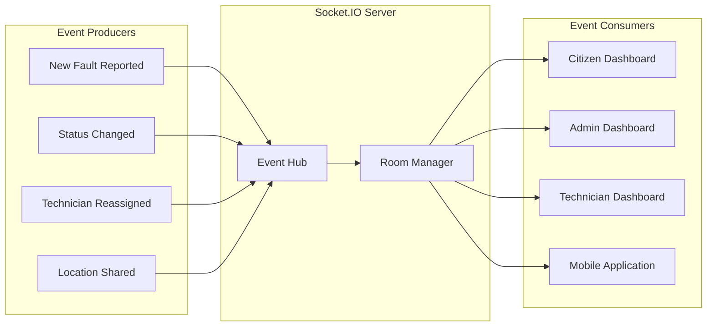

# Map Visualization System

<cite>
**Referenced Files in This Document**
- [MapView.jsx](file://frontend/src/components/MapView.jsx)
- [Dashboard.jsx](file://frontend/src/pages/Dashboard.jsx)
- [AdminDashboard.jsx](file://frontend/src/pages/AdminDashboard.jsx)
- [TechnicianDashboard.jsx](file://frontend/src/pages/TechnicianDashboard.jsx)
- [App.jsx](file://frontend/src/App.jsx)
- [main.jsx](file://frontend/src/main.jsx)
- [faultController.js](file://backend/src/controllers/faultController.js)
- [Fault.js](file://backend/src/models/Fault.js)
- [faultRoutes.js](file://backend/src/routes/faultRoutes.js)
- [server.js](file://backend/src/server.js)
- [faultAnalysisAgent.js](file://backend/src/agents/faultAnalysisAgent.js)
- [assignmentAgent.js](file://backend/src/agents/assignmentAgent.js)
- [priorityDecisionAgent.js](file://backend/src/agents/priorityDecisionAgent.js)
- [aiService.js](file://backend/src/services/aiService.js)
</cite>

## Table of Contents
1. [Introduction](#introduction)
2. [System Architecture](#system-architecture)
3. [Map Visualization Components](#map-visualization-components)
4. [Real-Time Data Flow](#real-time-data-flow)
5. [Fault Management Integration](#fault-management-integration)
6. [Agent-Based Intelligence](#agent-based-intelligence)
7. [Socket.IO Communication](#socket-io-communication)
8. [Performance Considerations](#performance-considerations)
9. [Troubleshooting Guide](#troubleshooting-guide)
10. [Conclusion](#conclusion)

## Introduction

The Map Visualization System is a comprehensive real-time fault monitoring and management platform built with React, Node.js, and MongoDB. This system provides interactive map-based visualization of utility faults across a geographic area, enabling citizens, technicians, and administrators to monitor and manage infrastructure issues effectively.

The system integrates advanced AI-powered fault analysis, intelligent assignment algorithms, and real-time communication to deliver a seamless experience for utility management. The map visualization serves as the central hub for displaying fault locations, severity levels, and status information in an intuitive geographic context.

## System Architecture

The Map Visualization System follows a modern microservice architecture with clear separation of concerns between frontend visualization, backend APIs, and intelligent agent systems.

**Diagram sources**
- [server.js:17-74](file://backend/src/server.js#L17-L74)
- [faultController.js:1-449](file://backend/src/controllers/faultController.js#L1-L449)
- [MapView.jsx:1-56](file://frontend/src/components/MapView.jsx#L1-L56)

**Section sources**
- [server.js:1-74](file://backend/src/server.js#L1-L74)
- [App.jsx:1-170](file://frontend/src/App.jsx#L1-L170)

## Map Visualization Components

The map visualization system is built around several key components that work together to provide comprehensive fault monitoring capabilities.

### Core Map Component Architecture

**Diagram sources**
- [MapView.jsx:32-56](file://frontend/src/components/MapView.jsx#L32-L56)
- [Dashboard.jsx:14-133](file://frontend/src/pages/Dashboard.jsx#L14-L133)
- [AdminDashboard.jsx:25-603](file://frontend/src/pages/AdminDashboard.jsx#L25-L603)
- [TechnicianDashboard.jsx:21-425](file://frontend/src/pages/TechnicianDashboard.jsx#L21-L425)

### Map Configuration and Styling

The system uses Leaflet.js for map rendering with customized marker icons and responsive design:

**Diagram sources**
- [MapView.jsx:13-30](file://frontend/src/components/MapView.jsx#L13-L30)

**Section sources**
- [MapView.jsx:1-56](file://frontend/src/components/MapView.jsx#L1-L56)
- [Dashboard.jsx:14-133](file://frontend/src/pages/Dashboard.jsx#L14-L133)
- [AdminDashboard.jsx:25-603](file://frontend/src/pages/AdminDashboard.jsx#L25-L603)
- [TechnicianDashboard.jsx:21-425](file://frontend/src/pages/TechnicianDashboard.jsx#L21-L425)

## Real-Time Data Flow

The system implements a sophisticated real-time data flow using Socket.IO to provide live updates of fault status changes and new incidents.

**Diagram sources**
- [server.js:27-44](file://backend/src/server.js#L27-L44)
- [faultController.js:84-89](file://backend/src/controllers/faultController.js#L84-L89)
- [Dashboard.jsx:35-42](file://frontend/src/pages/Dashboard.jsx#L35-L42)

### Socket.IO Event Management

The system handles multiple types of real-time events for different user roles:

| Event Type | Purpose | Recipients | Data Payload |
|------------|---------|------------|--------------|
| `newFault` | New fault report | All clients | `{ fault, priority, technician, prediction }` |
| `faultStatusUpdated` | Status change | All clients | `{ fault }` |
| `faultReassigned` | Technician change | All clients | `{ fault }` |
| `notification:user:id` | Personal notifications | Specific user | `{ notification }` |
| `technicianLocationUpdate` | Location sharing | All clients | `{ technicianId, location }` |

**Section sources**
- [server.js:27-44](file://backend/src/server.js#L27-L44)
- [faultController.js:84-89](file://backend/src/controllers/faultController.js#L84-L89)
- [Dashboard.jsx:35-42](file://frontend/src/pages/Dashboard.jsx#L35-L42)

## Fault Management Integration

The map visualization is deeply integrated with the fault management system, providing comprehensive visibility into all aspects of utility fault handling.

### Fault Data Structure

**Diagram sources**
- [Fault.js:3-75](file://backend/src/models/Fault.js#L3-L75)

### Dashboard Integration Patterns

Each dashboard type integrates the map visualization differently based on user needs:

| Dashboard Type | Map Usage | Filtering | Real-time Updates |
|----------------|-----------|-----------|-------------------|
| Citizen Dashboard | Full map with all faults | Basic severity filters | Live incident updates |
| Admin Dashboard | Comprehensive fault map | Advanced multi-criteria filters | All system events |
| Technician Dashboard | Assignment-focused map | Active/in-progress filters | Personal assignment updates |

**Section sources**
- [Fault.js:1-75](file://backend/src/models/Fault.js#L1-L75)
- [AdminDashboard.jsx:135-139](file://frontend/src/pages/AdminDashboard.jsx#L135-L139)
- [Dashboard.jsx:77-80](file://frontend/src/pages/Dashboard.jsx#L77-L80)

## Agent-Based Intelligence

The system incorporates multiple specialized AI agents that provide intelligent analysis and decision-making capabilities for fault management.

### Fault Analysis Pipeline

**Diagram sources**
- [faultAnalysisAgent.js:32-89](file://backend/src/agents/faultAnalysisAgent.js#L32-L89)

### Priority Decision System

The priority decision agent calculates urgency scores based on multiple factors:

| Factor | Weight | Impact | Examples |
|--------|--------|--------|----------|
| Severity | 10-40 points | Direct impact | Critical: 40, High: 30, Medium: 20, Low: 10 |
| Category Multiplier | 0.8-1.4x | Service type importance | Gas: 1.4, Electricity: 1.3, Road: 1.0 |
| Population Density | 0-15 points | Area impact | >10000: 15, >5000: 10, >1000: 5 |
| Historical Patterns | 0-10 points | Recurrence likelihood | Similar faults in area |
| Time Factors | 0-15 points | Optimal response timing | Nighttime critical issues |

**Section sources**
- [faultAnalysisAgent.js:32-89](file://backend/src/agents/faultAnalysisAgent.js#L32-L89)
- [priorityDecisionAgent.js:37-111](file://backend/src/agents/priorityDecisionAgent.js#L37-L111)

## Socket.IO Communication

The real-time communication layer uses Socket.IO to provide instant updates across all client applications.

### Connection Management

**Diagram sources**
- [server.js:27-44](file://backend/src/server.js#L27-L44)

### Event Broadcasting Pattern

The system implements a publish-subscribe pattern for efficient event distribution:

**Diagram sources**
- [server.js:27-44](file://backend/src/server.js#L27-L44)

**Section sources**
- [server.js:27-44](file://backend/src/server.js#L27-L44)

## Performance Considerations

The system is designed with several performance optimization strategies to handle real-time data efficiently.

### Frontend Performance Optimizations

- **Lazy Loading**: Map components are loaded only when needed
- **Virtual Scrolling**: Large fault lists use virtualization for smooth scrolling
- **Debounced Updates**: Real-time updates are debounced to prevent excessive re-renders
- **Efficient State Management**: Fault data is cached locally to minimize API calls

### Backend Performance Strategies

- **Database Indexing**: Strategic indexes on frequently queried fields
- **Query Optimization**: Aggregation pipelines for analytics data
- **Connection Pooling**: Efficient database connection management
- **Caching Layers**: Redis caching for frequently accessed data

### Network Optimization

- **WebSocket Efficiency**: Single persistent connection for all real-time updates
- **Event Compression**: Binary protocol for compact event transmission
- **Selective Updates**: Clients receive only relevant event streams
- **Connection Keep-Alive**: Automatic reconnection with exponential backoff

## Troubleshooting Guide

Common issues and their solutions for the Map Visualization System:

### Map Display Issues

**Problem**: Map tiles not loading properly
- **Solution**: Verify internet connectivity and OpenStreetMap accessibility
- **Check**: Network connectivity to tile servers
- **Alternative**: Configure custom tile providers

**Problem**: Markers not appearing on map
- **Solution**: Check fault data structure and location coordinates
- **Verify**: Latitude and longitude values are valid numbers
- **Debug**: Console logs for coordinate extraction errors

### Real-Time Updates Not Working

**Problem**: No live fault updates
- **Solution**: Verify Socket.IO connection status
- **Check**: Server logs for connection errors
- **Test**: Manual event emission from backend

**Problem**: Specific user not receiving notifications
- **Solution**: Verify user room membership
- **Check**: Socket ID association with user ID
- **Debug**: Notification event logging

### Performance Issues

**Problem**: Slow map rendering with many faults
- **Solution**: Implement clustering for high-density areas
- **Optimize**: Reduce marker count or use heatmap visualization
- **Monitor**: Memory usage and DOM element count

**Problem**: Frequent API timeouts
- **Solution**: Implement request batching and caching
- **Check**: Database query performance and indexes
- **Scale**: Add database read replicas for analytics queries

**Section sources**
- [MapView.jsx:1-56](file://frontend/src/components/MapView.jsx#L1-L56)
- [server.js:27-44](file://backend/src/server.js#L27-L44)

## Conclusion

The Map Visualization System represents a comprehensive solution for real-time utility fault monitoring and management. By combining advanced AI-powered analysis, intelligent assignment algorithms, and real-time communication, the system provides unprecedented visibility into infrastructure issues while maintaining excellent performance and user experience.

The modular architecture ensures scalability and maintainability, while the agent-based intelligence provides sophisticated decision-making capabilities. The real-time communication layer enables seamless collaboration between citizens, technicians, and administrators, ultimately leading to more efficient utility management and improved service delivery.

Key strengths of the system include its responsive design, comprehensive filtering capabilities, real-time updates, and robust error handling. The integration of multiple AI agents ensures intelligent fault categorization, priority assignment, and predictive analytics, positioning the system as a leader in smart utility management technology.