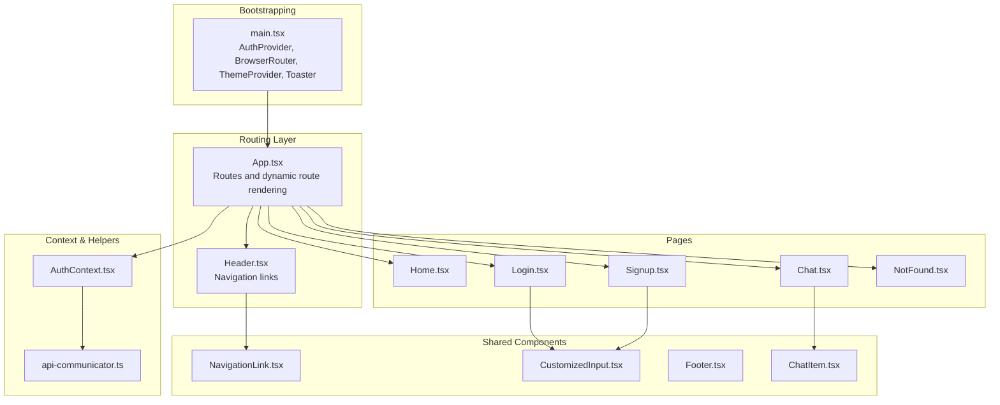
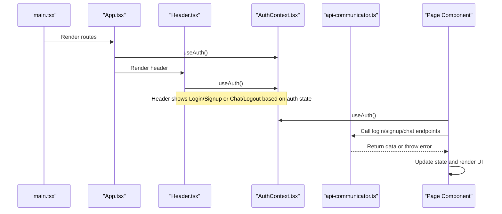
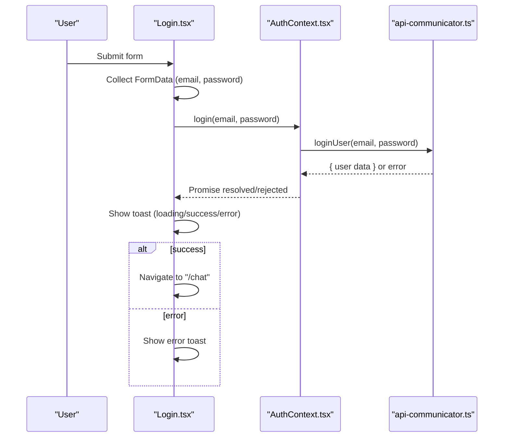
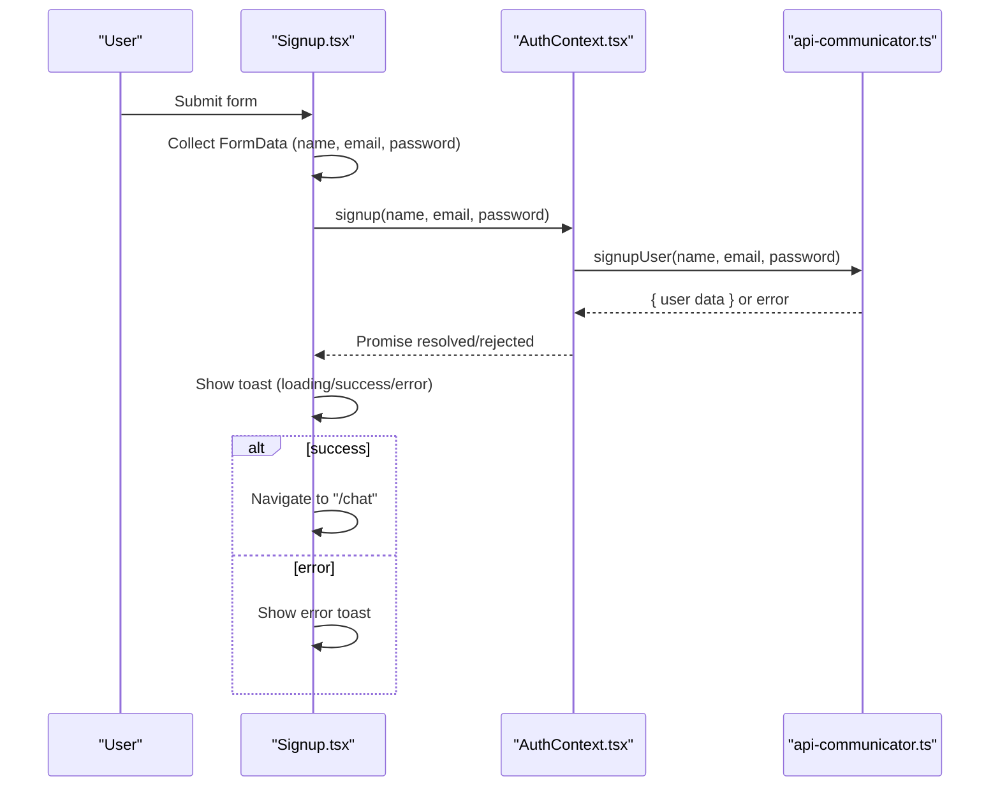
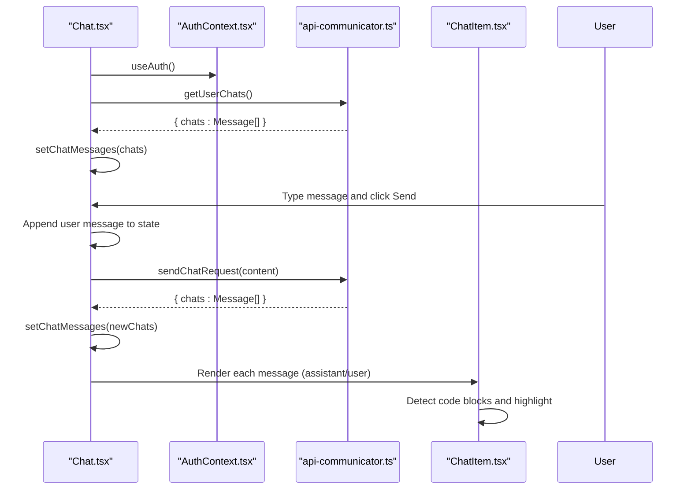
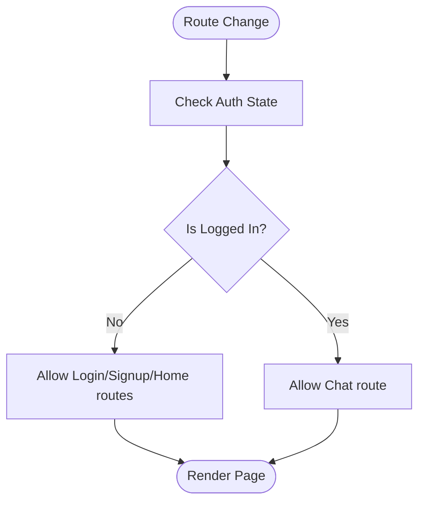
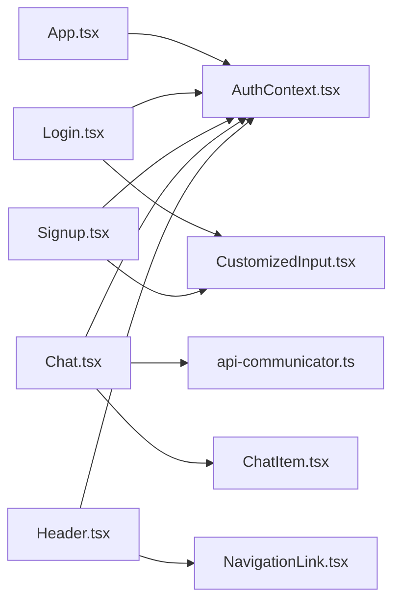

# Page Components

<cite>
**Referenced Files in This Document**
- [App.tsx](file://frontend/src/App.tsx)
- [main.tsx](file://frontend/src/main.tsx)
- [AuthContext.tsx](file://frontend/src/context/AuthContext.tsx)
- [api-communicator.ts](file://frontend/src/helpers/api-communicator.ts)
- [api-communicators.ts](file://frontend/src/helpers/api-communicators.ts)
- [Login.tsx](file://frontend/src/pages/Login.tsx)
- [Signup.tsx](file://frontend/src/pages/Signup.tsx)
- [Chat.tsx](file://frontend/src/pages/Chat.tsx)
- [Home.tsx](file://frontend/src/pages/Home.tsx)
- [NotFound.tsx](file://frontend/src/pages/NotFound.tsx)
- [Header.tsx](file://frontend/src/components/Header.tsx)
- [NavigationLink.tsx](file://frontend/src/components/shared/NavigationLink.tsx)
- [CustomizedInput.tsx](file://frontend/src/components/shared/CustomizedInput.tsx)
- [ChatItem.tsx](file://frontend/src/components/chat/ChatItem.tsx)
- [Footer.tsx](file://frontend/src/components/footer/Footer.tsx)
</cite>

## Table of Contents
1. [Introduction](#introduction)
2. [Project Structure](#project-structure)
3. [Core Components](#core-components)
4. [Architecture Overview](#architecture-overview)
5. [Detailed Component Analysis](#detailed-component-analysis)
6. [Dependency Analysis](#dependency-analysis)
7. [Performance Considerations](#performance-considerations)
8. [Troubleshooting Guide](#troubleshooting-guide)
9. [Conclusion](#conclusion)
10. [Appendices](#appendices)

## Introduction
This document explains the page components and route-based views of the frontend application. It covers the implementation of the Chat, Home, Login, Signup, and NotFound pages, detailing their functionality, data-fetching patterns, and integration with the authentication context provider. It also documents form handling in authentication pages, the chat interface, navigation patterns, lifecycle management, error handling, loading states, and performance optimization techniques for page transitions and data management. Finally, it provides guidelines for organizing page components, protecting routes, and SEO considerations.

## Project Structure
The frontend is organized around route-based pages under the pages directory, with shared components, context providers, and helpers. Routing is handled via react-router-dom, and the application is bootstrapped with ThemeProvider, AuthProvider, and Toaster for global UI theming, authentication state, and toast notifications respectively.

**Diagram sources**
- [main.tsx:18-29](file://frontend/src/main.tsx#L18-L29)
- [App.tsx:10-27](file://frontend/src/App.tsx#L10-L27)
- [Header.tsx:8-53](file://frontend/src/components/Header.tsx#L8-L53)
- [Home.tsx:6-65](file://frontend/src/pages/Home.tsx#L6-L65)
- [Login.tsx:8-94](file://frontend/src/pages/Login.tsx#L8-L94)
- [Signup.tsx:8-96](file://frontend/src/pages/Signup.tsx#L8-L96)
- [Chat.tsx:18-199](file://frontend/src/pages/Chat.tsx#L18-L199)
- [NotFound.tsx:3-5](file://frontend/src/pages/NotFound.tsx#L3-L5)
- [NavigationLink.tsx:10-21](file://frontend/src/components/shared/NavigationLink.tsx#L10-L21)
- [CustomizedInput.tsx:8-26](file://frontend/src/components/shared/CustomizedInput.tsx#L8-L26)
- [Footer.tsx:4-31](file://frontend/src/components/footer/Footer.tsx#L4-L31)
- [ChatItem.tsx:29-101](file://frontend/src/components/chat/ChatItem.tsx#L29-L101)
- [AuthContext.tsx:28-73](file://frontend/src/context/AuthContext.tsx#L28-L73)
- [api-communicator.ts:1-68](file://frontend/src/helpers/api-communicator.ts#L1-L68)

**Section sources**
- [main.tsx:18-29](file://frontend/src/main.tsx#L18-L29)
- [App.tsx:10-27](file://frontend/src/App.tsx#L10-L27)

## Core Components
- Authentication Provider and Context
  - Provides user state, login, signup, and logout actions.
  - Performs initial auth status check on mount.
  - Exposes a hook for consuming authentication state.
- API Communicators
  - Centralized HTTP client functions for user and chat endpoints.
  - Enforces response status checks and throws errors on failure.
- Shared UI Components
  - CustomizedInput: Reusable form input with consistent styling.
  - NavigationLink: Styled router link for navigation.
  - ChatItem: Renders assistant or user messages, including code block detection and syntax highlighting.

**Section sources**
- [AuthContext.tsx:28-73](file://frontend/src/context/AuthContext.tsx#L28-L73)
- [api-communicator.ts:1-68](file://frontend/src/helpers/api-communicator.ts#L1-L68)
- [CustomizedInput.tsx:8-26](file://frontend/src/components/shared/CustomizedInput.tsx#L8-L26)
- [NavigationLink.tsx:10-21](file://frontend/src/components/shared/NavigationLink.tsx#L10-L21)
- [ChatItem.tsx:29-101](file://frontend/src/components/chat/ChatItem.tsx#L29-L101)

## Architecture Overview
The application renders pages conditionally based on authentication state. The header adapts to show login/signup or chat/logout links. Pages integrate with the AuthContext for navigation guards and user data. Data fetching for chat messages and authentication status is performed via helper functions.

**Diagram sources**
- [main.tsx:18-29](file://frontend/src/main.tsx#L18-L29)
- [App.tsx:10-27](file://frontend/src/App.tsx#L10-L27)
- [Header.tsx:8-53](file://frontend/src/components/Header.tsx#L8-L53)
- [AuthContext.tsx:28-73](file://frontend/src/context/AuthContext.tsx#L28-L73)
- [api-communicator.ts:1-68](file://frontend/src/helpers/api-communicator.ts#L1-L68)

## Detailed Component Analysis

### Home Page
- Purpose: Landing page showcasing branding and introductory content.
- Features:
  - Responsive layout using MUI theme and media queries.
  - Integrated Footer component.
  - Typing animation component for visual appeal.
- Lifecycle: Stateless functional component; renders immediately upon route match.

**Section sources**
- [Home.tsx:6-65](file://frontend/src/pages/Home.tsx#L6-L65)
- [Footer.tsx:4-31](file://frontend/src/components/footer/Footer.tsx#L4-L31)

### Login Page
- Purpose: Authenticate existing users.
- Form Handling:
  - Uses HTML form submission with FormData to collect email and password.
  - Prevents default submission and triggers auth.login via AuthContext.
  - Displays loading and success/error toasts during the process.
- Navigation Guard:
  - Redirects to /chat if the user is already logged in.
- Styling:
  - Uses CustomizedInput for email and password fields.
  - Styled submit button with icon.

**Diagram sources**
- [Login.tsx:11-24](file://frontend/src/pages/Login.tsx#L11-L24)
- [AuthContext.tsx:44-50](file://frontend/src/context/AuthContext.tsx#L44-L50)
- [api-communicator.ts:2-9](file://frontend/src/helpers/api-communicator.ts#L2-L9)

**Section sources**
- [Login.tsx:8-94](file://frontend/src/pages/Login.tsx#L8-L94)
- [CustomizedInput.tsx:8-26](file://frontend/src/components/shared/CustomizedInput.tsx#L8-L26)
- [AuthContext.tsx:28-73](file://frontend/src/context/AuthContext.tsx#L28-L73)
- [api-communicator.ts:2-9](file://frontend/src/helpers/api-communicator.ts#L2-L9)

### Signup Page
- Purpose: Register new users.
- Form Handling:
  - Captures name, email, and password via FormData.
  - Calls auth.signup and displays toasts for feedback.
- Navigation Guard:
  - Redirects to /chat if the user is already logged in.
- Styling:
  - Reuses CustomizedInput for consistent UX.

**Diagram sources**
- [Signup.tsx:11-25](file://frontend/src/pages/Signup.tsx#L11-L25)
- [AuthContext.tsx:51-57](file://frontend/src/context/AuthContext.tsx#L51-L57)
- [api-communicator.ts:11-22](file://frontend/src/helpers/api-communicator.ts#L11-L22)

**Section sources**
- [Signup.tsx:8-96](file://frontend/src/pages/Signup.tsx#L8-L96)
- [CustomizedInput.tsx:8-26](file://frontend/src/components/shared/CustomizedInput.tsx#L8-L26)
- [AuthContext.tsx:28-73](file://frontend/src/context/AuthContext.tsx#L28-L73)
- [api-communicator.ts:11-22](file://frontend/src/helpers/api-communicator.ts#L11-L22)

### Chat Page
- Purpose: Interactive chat interface powered by backend.
- Data Fetching:
  - On mount, loads existing chats if authenticated.
  - Sends new messages and updates the chat list.
  - Clears conversations with a dedicated endpoint.
- State Management:
  - Maintains an array of messages with role and content.
  - Uses refs for input field manipulation.
- Navigation Guard:
  - Redirects to /login if not authenticated.
- UI:
  - Left sidebar shows user avatar and assistant info.
  - Chat history rendered via ChatItem components.
  - Input area with send button.

**Diagram sources**
- [Chat.tsx:45-63](file://frontend/src/pages/Chat.tsx#L45-L63)
- [Chat.tsx:23-33](file://frontend/src/pages/Chat.tsx#L23-L33)
- [Chat.tsx:34-44](file://frontend/src/pages/Chat.tsx#L34-L44)
- [AuthContext.tsx:28-73](file://frontend/src/context/AuthContext.tsx#L28-L73)
- [api-communicator.ts:33-49](file://frontend/src/helpers/api-communicator.ts#L33-L49)
- [ChatItem.tsx:29-101](file://frontend/src/components/chat/ChatItem.tsx#L29-L101)

**Section sources**
- [Chat.tsx:18-199](file://frontend/src/pages/Chat.tsx#L18-L199)
- [api-communicator.ts:33-58](file://frontend/src/helpers/api-communicator.ts#L33-L58)
- [ChatItem.tsx:29-101](file://frontend/src/components/chat/ChatItem.tsx#L29-L101)

### NotFound Page
- Purpose: Fallback route for unmatched paths.
- Behavior: Minimal component returning a placeholder element.

**Section sources**
- [NotFound.tsx:3-5](file://frontend/src/pages/NotFound.tsx#L3-L5)

### Route Protection and Navigation Patterns
- Dynamic Route Rendering:
  - The Chat route is conditionally rendered only when the user is authenticated.
- Navigation Guards:
  - Login and Signup pages redirect to /chat if already authenticated.
  - Chat page redirects to /login if not authenticated.
- Header Navigation:
  - Shows Login/Signup when unauthenticated; otherwise shows Chat/Logout links.

**Diagram sources**
- [App.tsx:20-22](file://frontend/src/App.tsx#L20-L22)
- [Login.tsx:25-29](file://frontend/src/pages/Login.tsx#L25-L29)
- [Signup.tsx:26-30](file://frontend/src/pages/Signup.tsx#L26-L30)
- [Chat.tsx:59-63](file://frontend/src/pages/Chat.tsx#L59-L63)

**Section sources**
- [App.tsx:16-23](file://frontend/src/App.tsx#L16-L23)
- [Header.tsx:17-32](file://frontend/src/components/Header.tsx#L17-L32)

## Dependency Analysis
- App depends on AuthContext for conditional rendering of protected routes.
- Pages depend on AuthContext for navigation guards and user data.
- Pages call api-communicator functions for authentication and chat operations.
- Shared components (CustomizedInput, NavigationLink, ChatItem) are reused across pages.

**Diagram sources**
- [App.tsx:10-27](file://frontend/src/App.tsx#L10-L27)
- [Login.tsx:8-94](file://frontend/src/pages/Login.tsx#L8-L94)
- [Signup.tsx:8-96](file://frontend/src/pages/Signup.tsx#L8-L96)
- [Chat.tsx:18-199](file://frontend/src/pages/Chat.tsx#L18-L199)
- [AuthContext.tsx:28-73](file://frontend/src/context/AuthContext.tsx#L28-L73)
- [api-communicator.ts:1-68](file://frontend/src/helpers/api-communicator.ts#L1-L68)
- [CustomizedInput.tsx:8-26](file://frontend/src/components/shared/CustomizedInput.tsx#L8-L26)
- [NavigationLink.tsx:10-21](file://frontend/src/components/shared/NavigationLink.tsx#L10-L21)
- [ChatItem.tsx:29-101](file://frontend/src/components/chat/ChatItem.tsx#L29-L101)

**Section sources**
- [App.tsx:10-27](file://frontend/src/App.tsx#L10-L27)
- [AuthContext.tsx:28-73](file://frontend/src/context/AuthContext.tsx#L28-L73)
- [api-communicator.ts:1-68](file://frontend/src/helpers/api-communicator.ts#L1-L68)

## Performance Considerations
- Minimize re-renders:
  - Keep pages as pure functional components where possible.
  - Use shallow comparisons for props and memoization for heavy child components.
- Efficient data fetching:
  - Debounce or throttle chat input submissions.
  - Cache recent chat lists and invalidate on mutation.
- Virtualization:
  - For long chat histories, consider virtualizing the message list to reduce DOM nodes.
- Lazy loading:
  - Dynamically import heavy components only when needed.
- Toast usage:
  - Reuse toast ids to update messages instead of stacking toasts.
- CSS and assets:
  - Preload critical images and defer non-critical ones.
- Bundle size:
  - Tree-shake unused exports and avoid importing large libraries globally.

## Troubleshooting Guide
- Authentication failures:
  - Verify axios defaults for baseURL and credentials.
  - Ensure backend sets appropriate cookies and CORS headers.
- Toast errors:
  - Confirm Toaster is mounted in the root and ids are unique per operation.
- Navigation loops:
  - Check AuthContext initialization and useEffect dependency arrays.
- Chat not loading:
  - Validate getUserChats endpoint and network connectivity.
- Form submission issues:
  - Ensure FormData keys match backend expectations and preventDefault is called.

**Section sources**
- [main.tsx:9-11](file://frontend/src/main.tsx#L9-L11)
- [AuthContext.tsx:32-43](file://frontend/src/context/AuthContext.tsx#L32-L43)
- [api-communicator.ts:24-31](file://frontend/src/helpers/api-communicator.ts#L24-L31)
- [Chat.tsx:45-58](file://frontend/src/pages/Chat.tsx#L45-L58)

## Conclusion
The page components are structured around route-based views with clear separation of concerns. Authentication state drives route protection and UI adaptation. Data fetching is centralized via helper functions, and shared components promote consistency. By following the outlined patterns for lifecycle management, error handling, loading states, and performance, the application remains maintainable and scalable.

## Appendices

### Page Component Organization Guidelines
- Group related pages under a single directory (already followed).
- Keep pages stateless unless necessary; move complex logic to hooks or context.
- Reuse shared components for forms, inputs, and navigation.
- Export default components and keep imports explicit.

### SEO Considerations
- Add meta tags and title updates per page in App shell if needed.
- Ensure semantic HTML and alt attributes for images.
- Avoid client-side redirects for critical resources; pre-render or SSR if search visibility is important.

### API Definitions (Reference)
- Authentication
  - POST /user/login: { email, password } → { user data }
  - POST /user/signup: { name, email, password } → { user data }
  - GET /user/auth-status: → { email, name }
  - GET /user/logout: → { message }
- Chat
  - POST /chat/new: { message } → { chats: Message[] }
  - GET /chat/all-chats: → { chats: Message[] }
  - DELETE /chat/delete: → { message }

**Section sources**
- [api-communicator.ts:2-67](file://frontend/src/helpers/api-communicator.ts#L2-L67)