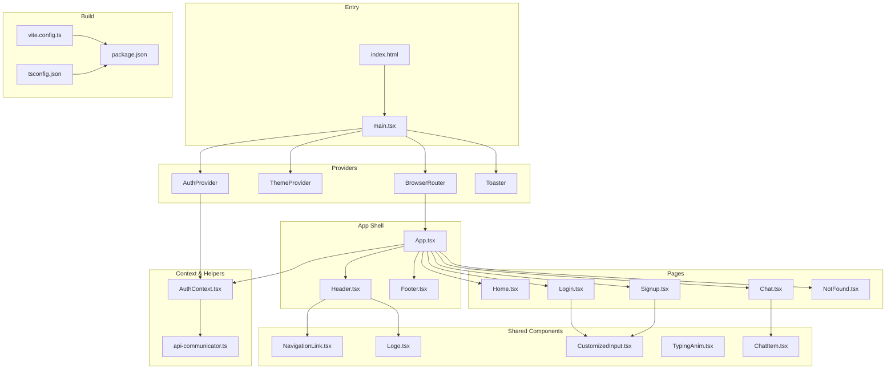
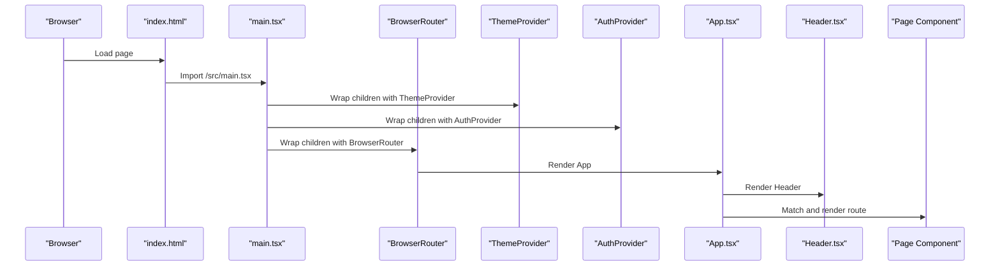
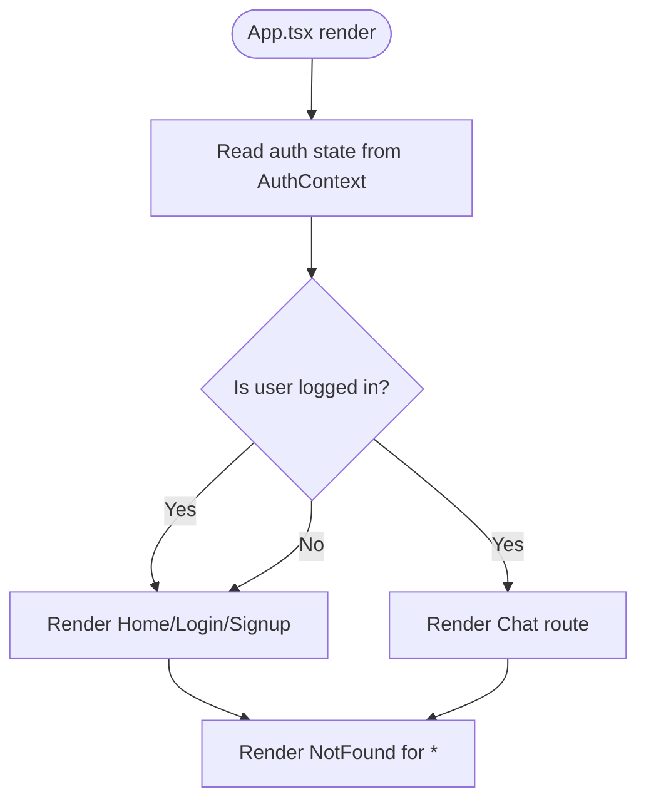
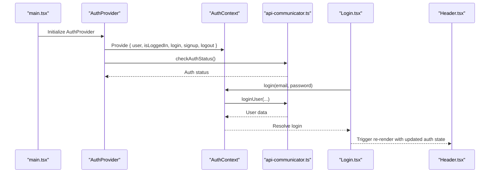
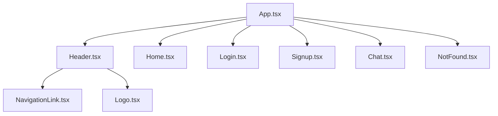
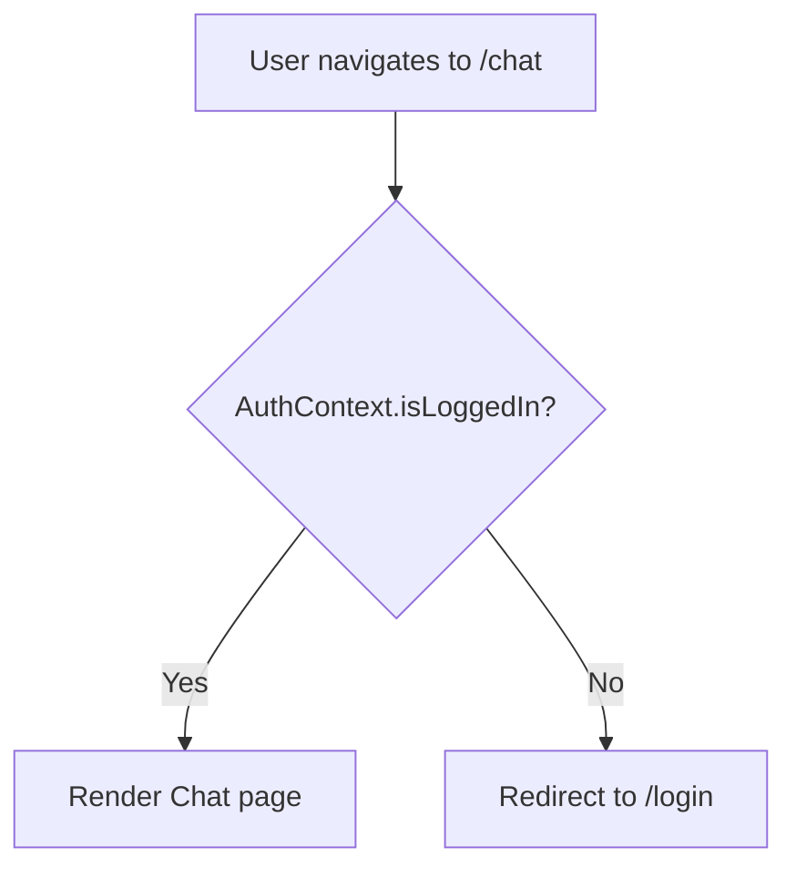
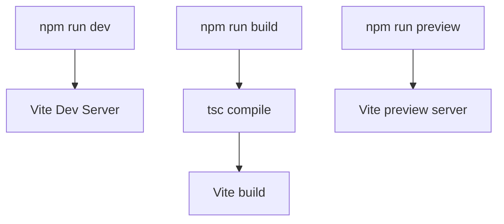
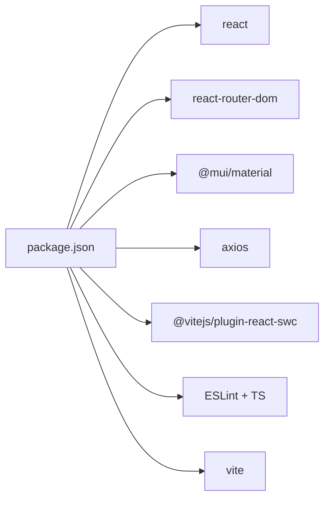

# React Application Structure

<cite>
**Referenced Files in This Document**
- [frontend/src/main.tsx](file://frontend/src/main.tsx)
- [frontend/src/App.tsx](file://frontend/src/App.tsx)
- [frontend/vite.config.ts](file://frontend/vite.config.ts)
- [frontend/package.json](file://frontend/package.json)
- [frontend/src/context/AuthContext.tsx](file://frontend/src/context/AuthContext.tsx)
- [frontend/src/helpers/api-communicator.ts](file://frontend/src/helpers/api-communicator.ts)
- [frontend/src/components/Header.tsx](file://frontend/src/components/Header.tsx)
- [frontend/src/pages/Home.tsx](file://frontend/src/pages/Home.tsx)
- [frontend/src/pages/Login.tsx](file://frontend/src/pages/Login.tsx)
- [frontend/src/pages/Signup.tsx](file://frontend/src/pages/Signup.tsx)
- [frontend/src/pages/Chat.tsx](file://frontend/src/pages/Chat.tsx)
- [frontend/src/pages/NotFound.tsx](file://frontend/src/pages/NotFound.tsx)
- [frontend/index.html](file://frontend/index.html)
- [frontend/tsconfig.json](file://frontend/tsconfig.json)
</cite>

## Table of Contents
1. [Introduction](#introduction)
2. [Project Structure](#project-structure)
3. [Core Components](#core-components)
4. [Architecture Overview](#architecture-overview)
5. [Detailed Component Analysis](#detailed-component-analysis)
6. [Dependency Analysis](#dependency-analysis)
7. [Performance Considerations](#performance-considerations)
8. [Troubleshooting Guide](#troubleshooting-guide)
9. [Conclusion](#conclusion)
10. [Appendices](#appendices)

## Introduction
This document explains the React application structure and configuration for the frontend. It covers the main entry point, the App component, routing with react-router-dom, authentication via a context provider, and Vite build integration. It also documents the component hierarchy, dynamic route rendering based on authentication state, fallback routes, and provides guidelines for extending the application with new routes and components while maintaining a consistent structure.

## Project Structure
The frontend follows a feature-based organization under src/. Key areas:
- Entry point and providers: main.tsx initializes React, theme, routing, and context providers.
- Application shell: App.tsx defines top-level routes and renders header/footer.
- Pages: Feature-specific screens such as Home, Login, Signup, Chat, and NotFound.
- Shared components: Reusable UI pieces like Header, Footer, Logo, NavigationLink, and CustomizedInput.
- Context and helpers: Authentication context and API communication utilities.
- Build and configuration: Vite config, TypeScript config, and package scripts.

**Diagram sources**
- [frontend/src/main.tsx:1-30](file://frontend/src/main.tsx#L1-L30)
- [frontend/src/App.tsx:1-30](file://frontend/src/App.tsx#L1-L30)
- [frontend/vite.config.ts:1-9](file://frontend/vite.config.ts#L1-L9)
- [frontend/package.json:1-39](file://frontend/package.json#L1-L39)
- [frontend/src/context/AuthContext.tsx:1-76](file://frontend/src/context/AuthContext.tsx#L1-L76)
- [frontend/src/helpers/api-communicator.ts:1-68](file://frontend/src/helpers/api-communicator.ts#L1-L68)
- [frontend/src/components/Header.tsx:1-56](file://frontend/src/components/Header.tsx#L1-L56)
- [frontend/src/pages/Home.tsx:1-68](file://frontend/src/pages/Home.tsx#L1-L68)
- [frontend/src/pages/Login.tsx:1-97](file://frontend/src/pages/Login.tsx#L1-L97)
- [frontend/src/pages/Signup.tsx:1-99](file://frontend/src/pages/Signup.tsx#L1-L99)
- [frontend/src/pages/Chat.tsx:1-202](file://frontend/src/pages/Chat.tsx#L1-L202)
- [frontend/src/pages/NotFound.tsx:1-8](file://frontend/src/pages/NotFound.tsx#L1-L8)
- [frontend/index.html:1-14](file://frontend/index.html#L1-L14)
- [frontend/tsconfig.json:1-26](file://frontend/tsconfig.json#L1-L26)

**Section sources**
- [frontend/src/main.tsx:1-30](file://frontend/src/main.tsx#L1-L30)
- [frontend/src/App.tsx:1-30](file://frontend/src/App.tsx#L1-L30)
- [frontend/vite.config.ts:1-9](file://frontend/vite.config.ts#L1-L9)
- [frontend/package.json:1-39](file://frontend/package.json#L1-L39)
- [frontend/index.html:1-14](file://frontend/index.html#L1-L14)
- [frontend/tsconfig.json:1-26](file://frontend/tsconfig.json#L1-L26)

## Core Components
- Entry point and providers: main.tsx sets up StrictMode, ThemeProvider, Toaster, BrowserRouter, and AuthProvider around the App component. It also configures axios defaults for backend integration.
- App shell: App.tsx renders Header and defines top-level routes. It conditionally renders the chat route only when the user is authenticated via the AuthContext hook.
- Authentication context: AuthContext manages login, signup, logout, and checks the current auth status on mount. It exposes a simple contract for consumers to manage user state.
- API helpers: api-communicator.ts centralizes HTTP calls to the backend for authentication and chat operations.
- Pages: Home, Login, Signup, Chat, and NotFound represent the primary application views.
- Shared components: Header composes navigation links and logo, and adapts depending on authentication state.

Key responsibilities and interactions:
- main.tsx orchestrates providers and mounts the app.
- App.tsx controls routing visibility based on auth state.
- AuthContext persists and synchronizes user session state.
- API helpers encapsulate backend endpoints and error handling.
- Pages consume context and helpers to implement user actions and data fetching.

**Section sources**
- [frontend/src/main.tsx:1-30](file://frontend/src/main.tsx#L1-L30)
- [frontend/src/App.tsx:1-30](file://frontend/src/App.tsx#L1-L30)
- [frontend/src/context/AuthContext.tsx:1-76](file://frontend/src/context/AuthContext.tsx#L1-L76)
- [frontend/src/helpers/api-communicator.ts:1-68](file://frontend/src/helpers/api-communicator.ts#L1-L68)
- [frontend/src/components/Header.tsx:1-56](file://frontend/src/components/Header.tsx#L1-L56)

## Architecture Overview
The runtime architecture ties together providers, routing, context, and pages:

**Diagram sources**
- [frontend/index.html:1-14](file://frontend/index.html#L1-L14)
- [frontend/src/main.tsx:1-30](file://frontend/src/main.tsx#L1-L30)
- [frontend/src/App.tsx:1-30](file://frontend/src/App.tsx#L1-L30)
- [frontend/src/components/Header.tsx:1-56](file://frontend/src/components/Header.tsx#L1-L56)

## Detailed Component Analysis

### Routing and Dynamic Rendering
The routing system is defined in App.tsx:
- Public routes: Home, Login, Signup.
- Protected route: Chat, rendered only when the user is authenticated.
- Fallback route: NotFound for unmatched paths.

Dynamic rendering is controlled by the AuthContext hook. When the user logs in, the context updates state, enabling the chat route to render. The Chat page also enforces client-side protection by redirecting unauthenticated users to the login page.

**Diagram sources**
- [frontend/src/App.tsx:10-27](file://frontend/src/App.tsx#L10-L27)
- [frontend/src/context/AuthContext.tsx:28-73](file://frontend/src/context/AuthContext.tsx#L28-L73)
- [frontend/src/pages/Chat.tsx:59-63](file://frontend/src/pages/Chat.tsx#L59-L63)

**Section sources**
- [frontend/src/App.tsx:10-27](file://frontend/src/App.tsx#L10-L27)
- [frontend/src/pages/Chat.tsx:59-63](file://frontend/src/pages/Chat.tsx#L59-L63)

### Authentication Flow
Authentication state is initialized on mount and exposed via a context provider. The Login and Signup pages submit forms and delegate to the context to update state. The Header component displays different navigation items depending on auth state.

**Diagram sources**
- [frontend/src/main.tsx:18-29](file://frontend/src/main.tsx#L18-L29)
- [frontend/src/context/AuthContext.tsx:28-73](file://frontend/src/context/AuthContext.tsx#L28-L73)
- [frontend/src/helpers/api-communicator.ts:1-68](file://frontend/src/helpers/api-communicator.ts#L1-L68)
- [frontend/src/pages/Login.tsx:8-29](file://frontend/src/pages/Login.tsx#L8-L29)
- [frontend/src/components/Header.tsx:8-53](file://frontend/src/components/Header.tsx#L8-L53)

**Section sources**
- [frontend/src/context/AuthContext.tsx:15-76](file://frontend/src/context/AuthContext.tsx#L15-L76)
- [frontend/src/helpers/api-communicator.ts:1-68](file://frontend/src/helpers/api-communicator.ts#L1-L68)
- [frontend/src/pages/Login.tsx:8-29](file://frontend/src/pages/Login.tsx#L8-L29)
- [frontend/src/pages/Signup.tsx:8-31](file://frontend/src/pages/Signup.tsx#L8-L31)
- [frontend/src/components/Header.tsx:8-53](file://frontend/src/components/Header.tsx#L8-L53)

### Component Hierarchy Starting from App.tsx
The hierarchy begins at App.tsx, which renders the Header and defines routes. The Header composes shared components like Logo and NavigationLink. Pages such as Home, Login, Signup, Chat, and NotFound are mounted according to the current route.

**Diagram sources**
- [frontend/src/App.tsx:1-30](file://frontend/src/App.tsx#L1-L30)
- [frontend/src/components/Header.tsx:1-56](file://frontend/src/components/Header.tsx#L1-L56)
- [frontend/src/pages/Home.tsx:1-68](file://frontend/src/pages/Home.tsx#L1-L68)
- [frontend/src/pages/Login.tsx:1-97](file://frontend/src/pages/Login.tsx#L1-L97)
- [frontend/src/pages/Signup.tsx:1-99](file://frontend/src/pages/Signup.tsx#L1-L99)
- [frontend/src/pages/Chat.tsx:1-202](file://frontend/src/pages/Chat.tsx#L1-L202)
- [frontend/src/pages/NotFound.tsx:1-8](file://frontend/src/pages/NotFound.tsx#L1-L8)

**Section sources**
- [frontend/src/App.tsx:1-30](file://frontend/src/App.tsx#L1-L30)
- [frontend/src/components/Header.tsx:1-56](file://frontend/src/components/Header.tsx#L1-L56)

### Protected Routes and Redirects
Protected routes are implemented by:
- Conditionally rendering the Chat route only when the user is authenticated.
- Enforcing client-side redirects in the Chat page when the user state becomes invalid.

**Diagram sources**
- [frontend/src/App.tsx:20-22](file://frontend/src/App.tsx#L20-L22)
- [frontend/src/pages/Chat.tsx:59-63](file://frontend/src/pages/Chat.tsx#L59-L63)

**Section sources**
- [frontend/src/App.tsx:20-22](file://frontend/src/App.tsx#L20-L22)
- [frontend/src/pages/Chat.tsx:59-63](file://frontend/src/pages/Chat.tsx#L59-L63)

### Vite Build System Integration
Vite is configured to use @vitejs/plugin-react-swc and targets React JSX. Scripts in package.json define dev, build, lint, and preview commands. The build pipeline compiles TypeScript first, then bundles with Vite.

**Diagram sources**
- [frontend/vite.config.ts:1-9](file://frontend/vite.config.ts#L1-L9)
- [frontend/package.json:6-11](file://frontend/package.json#L6-L11)

**Section sources**
- [frontend/vite.config.ts:1-9](file://frontend/vite.config.ts#L1-L9)
- [frontend/package.json:6-11](file://frontend/package.json#L6-L11)

### Environment Variables and Asset Management
- Backend base URL and credentials are configured in main.tsx for axios.
- Assets referenced in pages (e.g., images) are served from the public directory or bundled as imports. The index.html declares the root div and script entry.

Guidelines:
- Keep environment variables in main.tsx for now; consider moving to Vite env prefixes for production builds.
- Place static assets in the public folder and reference them via absolute paths from index.html or relative paths from src.

**Section sources**
- [frontend/src/main.tsx:10-11](file://frontend/src/main.tsx#L10-L11)
- [frontend/index.html:1-14](file://frontend/index.html#L1-L14)

### Adding New Routes and Components
Steps to add a new feature:
1. Create a new page component under src/pages/.
2. Add a route in App.tsx. For protected routes, wrap the Route element with the auth check.
3. Optionally add a navigation link in Header.tsx.
4. Import and use shared components from src/components/shared/ or feature-specific components from src/components/<feature>/.
5. If the feature requires state, extend the AuthContext or introduce a dedicated context.
6. For API calls, add or reuse functions in src/helpers/api-communicator.ts.

Best practices:
- Keep pages under src/pages/ and shared components under src/components/.
- Group feature-specific components under src/components/<feature>/.
- Centralize HTTP calls in helpers/api-communicator.ts.
- Use MUI components consistently for UI.

**Section sources**
- [frontend/src/App.tsx:16-24](file://frontend/src/App.tsx#L16-L24)
- [frontend/src/components/Header.tsx:17-48](file://frontend/src/components/Header.tsx#L17-L48)
- [frontend/src/helpers/api-communicator.ts:1-68](file://frontend/src/helpers/api-communicator.ts#L1-L68)

## Dependency Analysis
External libraries and their roles:
- react-router-dom: Routing and navigation.
- @mui/material: Theming and UI components.
- react-hot-toast: Notifications.
- axios: HTTP client for backend communication.
- @vitejs/plugin-react-swc: React fast transform for Vite.
- TypeScript and ESLint: Type checking and linting.

**Diagram sources**
- [frontend/package.json:12-37](file://frontend/package.json#L12-L37)

**Section sources**
- [frontend/package.json:12-37](file://frontend/package.json#L12-L37)

## Performance Considerations
- Keep axios defaults minimal and centralized.
- Avoid unnecessary re-renders by memoizing heavy computations and using React.useMemo/useCallback where appropriate.
- Lazy-load non-critical components if the bundle grows large.
- Use MUI’s styled utilities efficiently to minimize style recalculations.
- Prefer bundler module resolution and tree-shaking enabled by Vite and TypeScript.

## Troubleshooting Guide
Common issues and resolutions:
- Authentication state not persisting: Verify AuthProvider wraps the app and that checkAuthStatus returns a valid user object on mount.
- Axios errors: Confirm baseURL and credentials are set in main.tsx and that endpoints match backend routes.
- Protected route bypass: Ensure the Chat page redirects unauthenticated users and that App.tsx conditionally renders the chat route.
- Build failures: Run tsc separately to catch type errors, then retry vite build.

**Section sources**
- [frontend/src/main.tsx:10-11](file://frontend/src/main.tsx#L10-L11)
- [frontend/src/context/AuthContext.tsx:32-43](file://frontend/src/context/AuthContext.tsx#L32-L43)
- [frontend/src/pages/Chat.tsx:59-63](file://frontend/src/pages/Chat.tsx#L59-L63)
- [frontend/package.json:8](file://frontend/package.json#L8)

## Conclusion
The application follows a clean, modular structure with a clear separation of concerns. Providers initialize the environment, App.tsx controls routing and visibility, AuthContext manages authentication state, and pages implement user flows. Vite integrates seamlessly with React and TypeScript, and the project is ready to scale with new routes and components while preserving consistency.

## Appendices
- TypeScript configuration: Bundler mode with JSX transform and strict linting.
- Entry point: index.html mounts the React root and main.tsx initializes providers.

**Section sources**
- [frontend/tsconfig.json:1-26](file://frontend/tsconfig.json#L1-L26)
- [frontend/index.html:1-14](file://frontend/index.html#L1-L14)