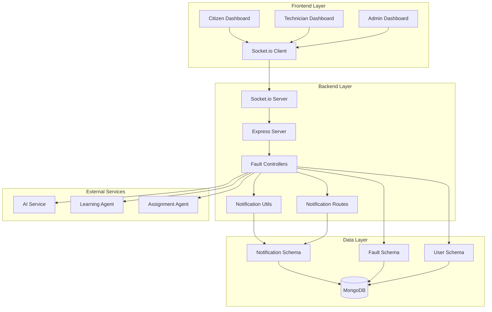
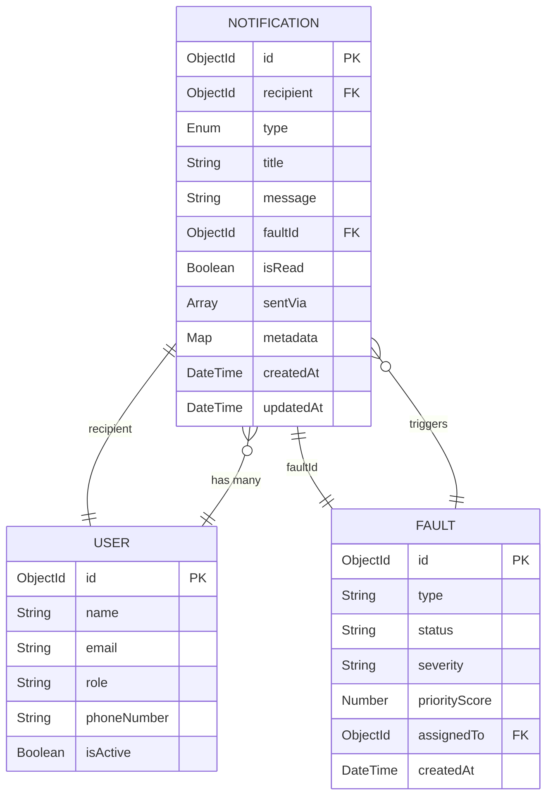
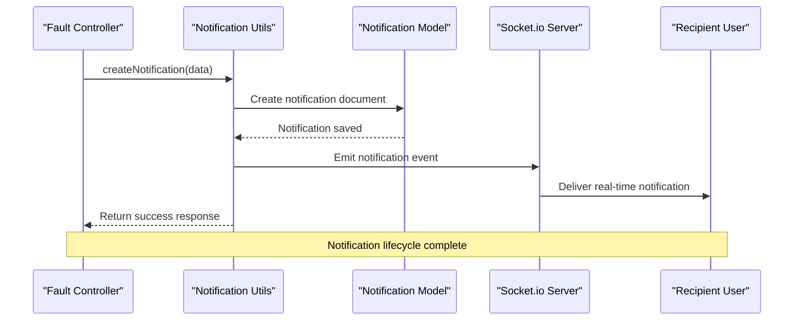
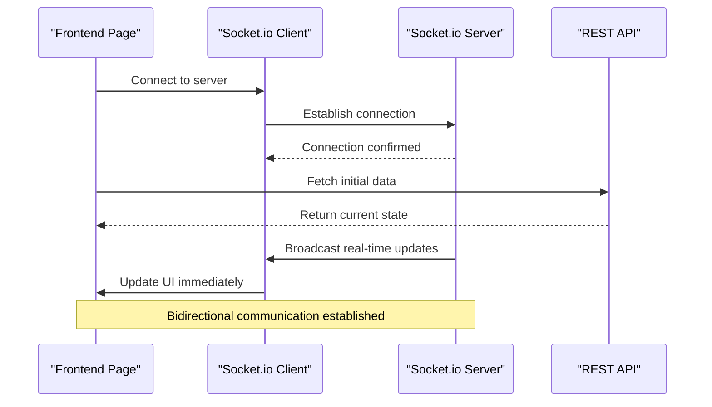
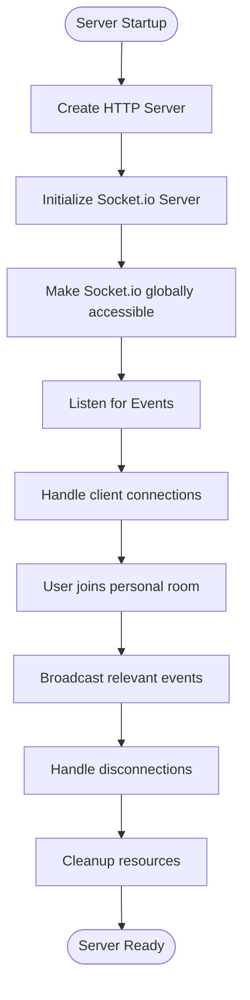
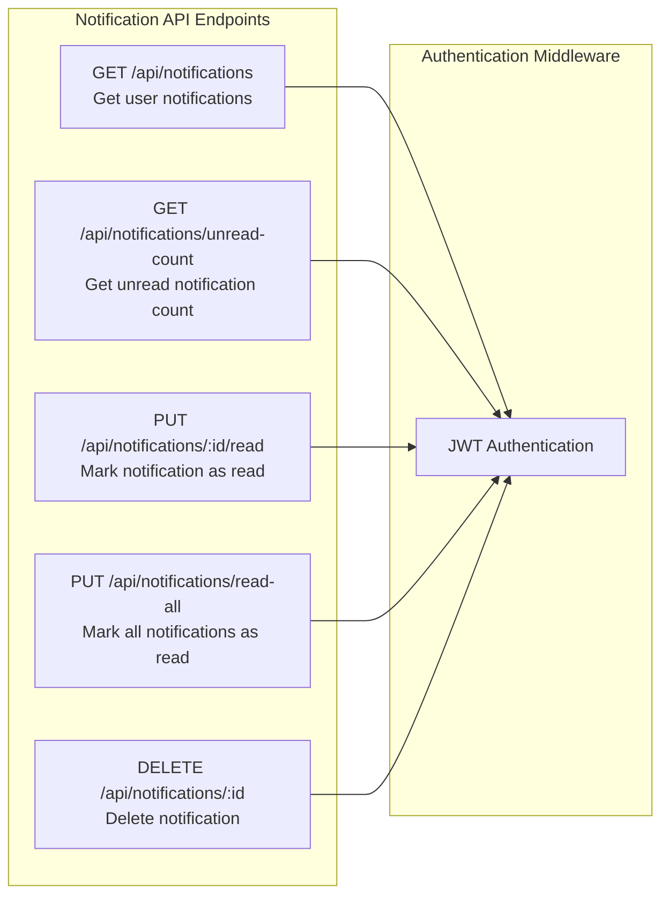

# Real-time Notifications

<cite>
**Referenced Files in This Document**
- [Notification.js](file://backend/src/models/Notification.js)
- [notifier.js](file://backend/src/utils/notifier.js)
- [notificationRoutes.js](file://backend/src/routes/notificationRoutes.js)
- [server.js](file://backend/src/server.js)
- [faultController.js](file://backend/src/controllers/faultController.js)
- [Dashboard.jsx](file://frontend/src/pages/Dashboard.jsx)
- [TechnicianDashboard.jsx](file://frontend/src/pages/TechnicianDashboard.jsx)
- [AdminDashboard.jsx](file://frontend/src/pages/AdminDashboard.jsx)
- [App.jsx](file://frontend/src/App.jsx)
</cite>

## Table of Contents
1. [Introduction](#introduction)
2. [System Architecture](#system-architecture)
3. [Notification Model](#notification-model)
4. [Backend Implementation](#backend-implementation)
5. [Frontend Integration](#frontend-integration)
6. [Real-time Communication](#real-time-communication)
7. [Notification Types](#notification-types)
8. [API Endpoints](#api-endpoints)
9. [Performance Considerations](#performance-considerations)
10. [Troubleshooting Guide](#troubleshooting-guide)
11. [Conclusion](#conclusion)

## Introduction

The Real-time Notifications system is a comprehensive communication framework designed for the Agentic AI Utility System. This system enables instant, bidirectional communication between the backend services and frontend applications, providing real-time updates for fault assignments, status changes, and system alerts across multiple user roles including citizens, technicians, and administrators.

The notification system leverages modern web technologies including MongoDB for persistent storage, Express.js for backend APIs, Socket.io for real-time bidirectional communication, and React for dynamic frontend interfaces. It supports multiple notification channels including in-app notifications, email, and SMS, with automatic synchronization between persistent storage and real-time delivery.

## System Architecture

The notification system follows a microservices architecture pattern with clear separation of concerns between data persistence, real-time communication, and user interface components.

**Diagram sources**
- [server.js:1-74](file://backend/src/server.js#L1-L74)
- [notifier.js:1-113](file://backend/src/utils/notifier.js#L1-L113)
- [notificationRoutes.js:1-95](file://backend/src/routes/notificationRoutes.js#L1-L95)

## Notification Model

The notification system is built around a robust MongoDB schema that supports comprehensive notification tracking and management across different user roles and notification types.

**Diagram sources**
- [Notification.js:1-28](file://backend/src/models/Notification.js#L1-L28)

The notification model supports multiple notification types including fault assignments, status updates, system alerts, and administrative notifications. Each notification includes metadata for additional context and tracking purposes.

**Section sources**
- [Notification.js:1-28](file://backend/src/models/Notification.js#L1-L28)

## Backend Implementation

The backend implementation consists of three primary components: the notification model, utility functions, and REST API endpoints that work together to provide comprehensive notification functionality.

### Notification Utilities

The notification utility module provides core functionality for creating, managing, and distributing notifications across the system.

**Diagram sources**
- [notifier.js:7-43](file://backend/src/utils/notifier.js#L7-L43)
- [server.js:27-44](file://backend/src/server.js#L27-L44)

### Notification Types and Triggers

The system automatically generates notifications based on various fault lifecycle events and user actions:

| Event Type | Trigger Condition | Notification Recipient | Notification Type |
|------------|-------------------|----------------------|-------------------|
| Fault Assigned | Technician assigned to fault | Assigned Technician | fault_assigned |
| Fault Accepted | Technician accepts fault assignment | Fault Reporter | fault_accepted |
| Status Updated | Fault status changes | Fault Reporter | status_update |
| Fault Rejected | Technician rejects fault assignment | Fault Reporter | fault_rejected |
| Fault Completed | Fault marked as completed | Fault Reporter | fault_completed |
| System Alert | System maintenance or updates | All Users | system |

**Section sources**
- [notifier.js:1-113](file://backend/src/utils/notifier.js#L1-L113)
- [faultController.js:71-78](file://backend/src/controllers/faultController.js#L71-L78)

## Frontend Integration

The frontend components integrate seamlessly with the notification system through Socket.io connections and REST API endpoints, providing real-time updates and notification management capabilities.

### Socket.io Integration

Each frontend page establishes its own Socket.io connection to receive real-time updates:

**Diagram sources**
- [Dashboard.jsx:36-42](file://frontend/src/pages/Dashboard.jsx#L36-L42)
- [TechnicianDashboard.jsx:70-76](file://frontend/src/pages/TechnicianDashboard.jsx#L70-L76)
- [AdminDashboard.jsx:70-77](file://frontend/src/pages/AdminDashboard.jsx#L70-L77)

### Role-based Notification Display

Different user roles receive tailored notification experiences based on their permissions and responsibilities:

| User Role | Notification Features | Access Level |
|-----------|----------------------|--------------|
| Citizen | Basic fault status updates, system alerts | Read-only |
| Technician | Fault assignments, status updates, availability controls | Full interaction |
| Administrator | All notifications, system-wide alerts | Administrative access |

**Section sources**
- [Dashboard.jsx:1-133](file://frontend/src/pages/Dashboard.jsx#L1-L133)
- [TechnicianDashboard.jsx:1-425](file://frontend/src/pages/TechnicianDashboard.jsx#L1-L425)
- [AdminDashboard.jsx:1-603](file://frontend/src/pages/AdminDashboard.jsx#L1-L603)

## Real-time Communication

The real-time communication layer utilizes Socket.io to provide instant bidirectional messaging between clients and servers, enabling seamless updates across all connected devices.

### Socket.io Server Configuration

The Socket.io server is configured with global accessibility and user-specific room management:

**Diagram sources**
- [server.js:20-44](file://backend/src/server.js#L20-L44)

### Event Broadcasting Patterns

The system implements efficient event broadcasting patterns to minimize unnecessary network traffic while ensuring critical updates reach all intended recipients.

**Section sources**
- [server.js:1-74](file://backend/src/server.js#L1-L74)

## Notification Types

The notification system supports a comprehensive range of notification types designed to cover all aspects of the fault management lifecycle and system communications.

### Notification Type Definitions

| Type | Purpose | Trigger Conditions | Delivery Channels |
|------|---------|-------------------|-------------------|
| fault_assigned | New fault assignment | Technician assigned to fault | In-app, Email, SMS |
| fault_accepted | Technician acceptance | Technician accepts assignment | In-app, Email |
| fault_completed | Fault completion | Status changed to completed | In-app, Email |
| fault_rejected | Assignment rejection | Technician rejects assignment | In-app, Email |
| status_update | General status change | Any fault status update | In-app |
| system | System alerts | Maintenance, updates, errors | In-app, Email |

### Metadata Support

Each notification can include structured metadata for enhanced context and processing capabilities, supporting features like priority levels, escalation requirements, and integration with external systems.

**Section sources**
- [Notification.js:5-9](file://backend/src/models/Notification.js#L5-L9)
- [notifier.js:14-21](file://backend/src/utils/notifier.js#L14-L21)

## API Endpoints

The notification system exposes a comprehensive REST API for managing notifications, with endpoints designed for different user roles and operational needs.

### Notification Management Endpoints

**Diagram sources**
- [notificationRoutes.js:1-95](file://backend/src/routes/notificationRoutes.js#L1-L95)

### Endpoint Specifications

| Endpoint | Method | Description | Authentication Required |
|----------|--------|-------------|------------------------|
| `/api/notifications` | GET | Retrieve user's notifications with optional filtering | Yes |
| `/api/notifications/unread-count` | GET | Get count of unread notifications | Yes |
| `/api/notifications/:id/read` | PUT | Mark specific notification as read | Yes |
| `/api/notifications/read-all` | PUT | Mark all user notifications as read | Yes |
| `/api/notifications/:id` | DELETE | Delete specific notification | Yes |

**Section sources**
- [notificationRoutes.js:12-92](file://backend/src/routes/notificationRoutes.js#L12-L92)

## Performance Considerations

The notification system is designed with scalability and performance optimization in mind, implementing several strategies to handle high-volume notification traffic efficiently.

### Database Optimization

The notification schema includes strategic indexing to optimize common query patterns:

- Composite index on `{ recipient: 1, isRead: 1 }` for efficient unread notification queries
- Index on `{ createdAt: -1 }` for chronological sorting
- Proper schema design supporting efficient filtering and pagination

### Real-time Scalability

Socket.io implementation includes connection pooling and room-based message routing to minimize memory usage and maximize throughput across multiple concurrent users.

### Caching Strategies

The system implements intelligent caching for frequently accessed notification data, reducing database load during peak usage periods while maintaining data consistency through proper cache invalidation strategies.

## Troubleshooting Guide

Common issues and their solutions for the notification system:

### Connection Issues

**Problem**: Socket.io connections failing
- Verify server is running on correct port
- Check CORS configuration for cross-origin requests
- Ensure proper event listener setup on client side

**Problem**: Notifications not appearing in UI
- Confirm user is properly authenticated
- Verify socket connection establishment
- Check browser console for JavaScript errors

### Database Issues

**Problem**: Notification persistence failures
- Verify MongoDB connectivity and authentication
- Check notification schema validation
- Monitor database performance metrics

**Problem**: Slow notification retrieval
- Review database indexing strategy
- Optimize query parameters and limits
- Consider database connection pooling

### API Issues

**Problem**: REST API endpoint failures
- Verify authentication tokens are valid
- Check endpoint URL construction
- Review server logs for error details

**Section sources**
- [server.js:68-74](file://backend/src/server.js#L68-L74)
- [notificationRoutes.js:12-32](file://backend/src/routes/notificationRoutes.js#L12-L32)

## Conclusion

The Real-time Notifications system provides a robust, scalable foundation for real-time communication within the Agentic AI Utility System. By combining persistent storage with real-time bidirectional communication, the system ensures timely and reliable notification delivery across all user roles and interaction scenarios.

The modular architecture supports easy extension and customization, while the comprehensive API and frontend integrations provide flexible deployment options. The system's design prioritizes performance, reliability, and user experience, making it suitable for production environments with high user volumes and demanding real-time requirements.

Future enhancements could include advanced notification filtering, multi-language support, notification scheduling, and integration with external communication platforms for expanded delivery capabilities.