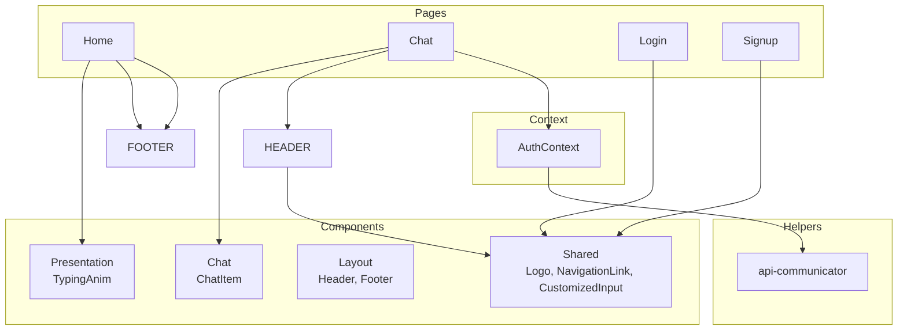
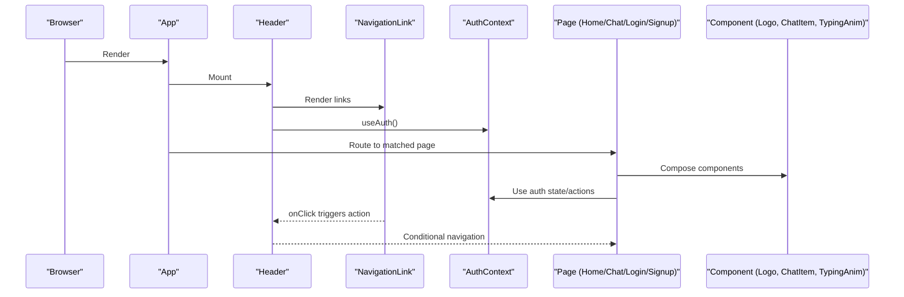
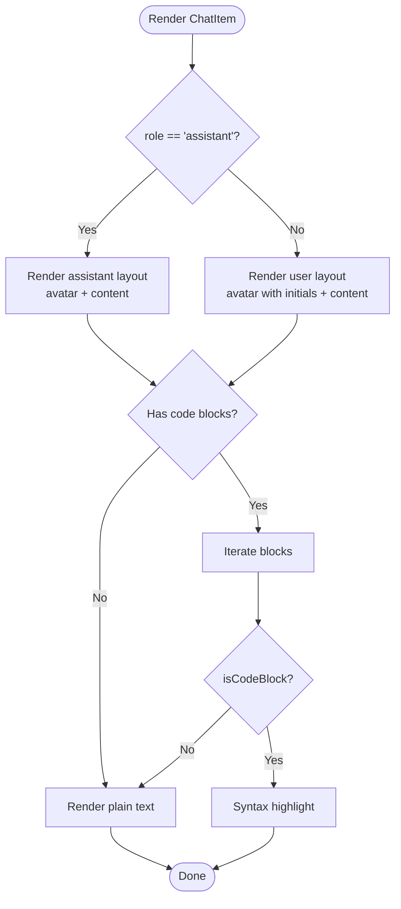
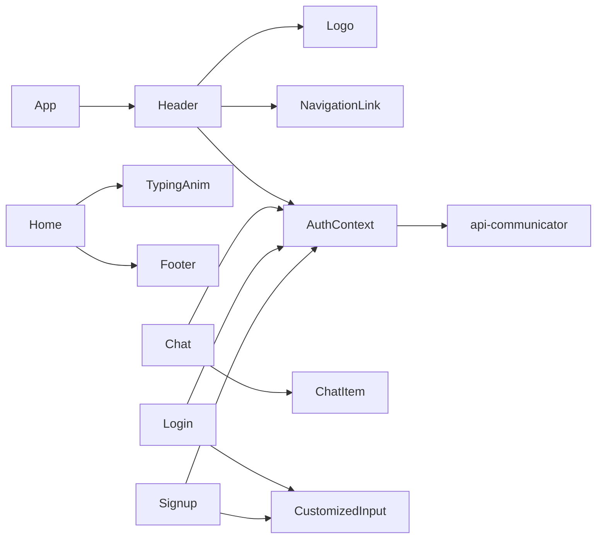

# UI Components Library

<cite>
**Referenced Files in This Document**
- [Logo.tsx](file://frontend/src/components/shared/Logo.tsx)
- [NavigationLink.tsx](file://frontend/src/components/shared/NavigationLink.tsx)
- [CustomizedInput.tsx](file://frontend/src/components/shared/CustomizedInput.tsx)
- [ChatItem.tsx](file://frontend/src/components/chat/ChatItem.tsx)
- [TypingAnim.tsx](file://frontend/src/components/typer/TypingAnim.tsx)
- [Header.tsx](file://frontend/src/components/Header.tsx)
- [Footer.tsx](file://frontend/src/components/footer/Footer.tsx)
- [AuthContext.tsx](file://frontend/src/context/AuthContext.tsx)
- [App.tsx](file://frontend/src/App.tsx)
- [Chat.tsx](file://frontend/src/pages/Chat.tsx)
- [Home.tsx](file://frontend/src/pages/Home.tsx)
- [Login.tsx](file://frontend/src/pages/Login.tsx)
- [Signup.tsx](file://frontend/src/pages/Signup.tsx)
- [api-communicator.ts](file://frontend/src/helpers/api-communicator.ts)
- [index.css](file://frontend/src/index.css)
- [App.css](file://frontend/src/App.css)
- [package.json](file://frontend/package.json)
</cite>

## Table of Contents
1. [Introduction](#introduction)
2. [Project Structure](#project-structure)
3. [Core Components](#core-components)
4. [Architecture Overview](#architecture-overview)
5. [Detailed Component Analysis](#detailed-component-analysis)
6. [Dependency Analysis](#dependency-analysis)
7. [Performance Considerations](#performance-considerations)
8. [Troubleshooting Guide](#troubleshooting-guide)
9. [Conclusion](#conclusion)
10. [Appendices](#appendices)

## Introduction
This document describes the UI components library and reusable component patterns used across the frontend. It covers component hierarchy, props, styling with Material-UI, responsive design, composition patterns, event handling, accessibility guidelines, testing approaches, and integration with the application architecture. The components are organized into three categories:
- Shared components: Logo, NavigationLink, CustomizedInput
- Chat-specific components: ChatItem
- Layout components: Header, Footer
- Additional presentation components: TypingAnim
- Pages that compose components: Home, Chat, Login, Signup

## Project Structure
The frontend is organized by feature and domain:
- components: Reusable UI building blocks grouped by domain (shared, chat, footer, typer)
- pages: Page-level views that orchestrate state and compose components
- context: Global application state (authentication)
- helpers: API communication utilities
- styles: Global CSS and animations

**Diagram sources**
- [Header.tsx:1-56](file://frontend/src/components/Header.tsx#L1-L56)
- [Footer.tsx:1-34](file://frontend/src/components/footer/Footer.tsx#L1-L34)
- [Logo.tsx:1-37](file://frontend/src/components/shared/Logo.tsx#L1-L37)
- [NavigationLink.tsx:1-24](file://frontend/src/components/shared/NavigationLink.tsx#L1-L24)
- [CustomizedInput.tsx:1-29](file://frontend/src/components/shared/CustomizedInput.tsx#L1-L29)
- [ChatItem.tsx:1-104](file://frontend/src/components/chat/ChatItem.tsx#L1-L104)
- [TypingAnim.tsx:1-28](file://frontend/src/components/typer/TypingAnim.tsx#L1-L28)
- [Home.tsx:1-68](file://frontend/src/pages/Home.tsx#L1-L68)
- [Chat.tsx:1-202](file://frontend/src/pages/Chat.tsx#L1-L202)
- [Login.tsx:1-97](file://frontend/src/pages/Login.tsx#L1-L97)
- [Signup.tsx:1-99](file://frontend/src/pages/Signup.tsx#L1-L99)
- [AuthContext.tsx:1-76](file://frontend/src/context/AuthContext.tsx#L1-L76)
- [api-communicator.ts:1-68](file://frontend/src/helpers/api-communicator.ts#L1-L68)

**Section sources**
- [App.tsx:1-30](file://frontend/src/App.tsx#L1-L30)
- [index.css:1-42](file://frontend/src/index.css#L1-L42)
- [App.css:1-43](file://frontend/src/App.css#L1-L43)

## Core Components
This section documents shared, chat-specific, and layout components, including props, styling, and composition patterns.

- Shared components
  - Logo: Renders a brand icon and text with responsive visibility and inverted image styling.
  - NavigationLink: A styled link wrapper with configurable background, text color, destination, and optional click handler.
  - CustomizedInput: A Material-UI TextField wrapper with consistent label and input styling.

- Chat-specific components
  - ChatItem: Renders assistant or user messages with avatar, typography, and optional code block highlighting.

- Layout components
  - Header: Composes Logo and NavigationLink, conditionally rendering auth actions via AuthContext.
  - Footer: Displays a branded footer with a linked profile.

- Presentation components
  - TypingAnim: Animated typing effect for hero text.

**Section sources**
- [Logo.tsx:1-37](file://frontend/src/components/shared/Logo.tsx#L1-L37)
- [NavigationLink.tsx:1-24](file://frontend/src/components/shared/NavigationLink.tsx#L1-L24)
- [CustomizedInput.tsx:1-29](file://frontend/src/components/shared/CustomizedInput.tsx#L1-L29)
- [ChatItem.tsx:1-104](file://frontend/src/components/chat/ChatItem.tsx#L1-L104)
- [Header.tsx:1-56](file://frontend/src/components/Header.tsx#L1-L56)
- [Footer.tsx:1-34](file://frontend/src/components/footer/Footer.tsx#L1-L34)
- [TypingAnim.tsx:1-28](file://frontend/src/components/typer/TypingAnim.tsx#L1-L28)

## Architecture Overview
The application composes components at the page level and manages global state with a context provider. Routing determines which pages render, and pages orchestrate component composition and event handling.

**Diagram sources**
- [App.tsx:1-30](file://frontend/src/App.tsx#L1-L30)
- [Header.tsx:1-56](file://frontend/src/components/Header.tsx#L1-L56)
- [NavigationLink.tsx:1-24](file://frontend/src/components/shared/NavigationLink.tsx#L1-L24)
- [AuthContext.tsx:1-76](file://frontend/src/context/AuthContext.tsx#L1-L76)
- [Home.tsx:1-68](file://frontend/src/pages/Home.tsx#L1-L68)
- [Chat.tsx:1-202](file://frontend/src/pages/Chat.tsx#L1-L202)
- [Login.tsx:1-97](file://frontend/src/pages/Login.tsx#L1-L97)
- [Signup.tsx:1-99](file://frontend/src/pages/Signup.tsx#L1-L99)
- [Logo.tsx:1-37](file://frontend/src/components/shared/Logo.tsx#L1-L37)
- [ChatItem.tsx:1-104](file://frontend/src/components/chat/ChatItem.tsx#L1-L104)
- [TypingAnim.tsx:1-28](file://frontend/src/components/typer/TypingAnim.tsx#L1-L28)

## Detailed Component Analysis

### Shared Components

#### Logo
- Purpose: Brand identity with responsive text and inverted icon.
- Props: None.
- Styling: Inline styles for layout and MUI Typography with responsive display.
- Accessibility: Uses alt text on the icon and semantic Link.

**Section sources**
- [Logo.tsx:1-37](file://frontend/src/components/shared/Logo.tsx#L1-L37)
- [index.css:12-14](file://frontend/src/index.css#L12-L14)

#### NavigationLink
- Purpose: Unified link button with background, text color, destination, and optional click handler.
- Props:
  - to: string (route)
  - bg: string (background)
  - text: string (label)
  - textColor: string (text color)
  - onClick?: () => Promise<void> (optional)
- Styling: Inline styles applied to Link; consistent nav-link class for typography and spacing.
- Composition: Used in Header to switch between auth and guest actions.

**Section sources**
- [NavigationLink.tsx:1-24](file://frontend/src/components/shared/NavigationLink.tsx#L1-L24)
- [Header.tsx:17-32](file://frontend/src/components/Header.tsx#L17-L32)
- [Header.tsx:33-48](file://frontend/src/components/Header.tsx#L33-L48)
- [index.css:15-24](file://frontend/src/index.css#L15-L24)

#### CustomizedInput
- Purpose: Consistent form input using Material-UI TextField.
- Props:
  - name: string
  - type: string
  - label: string
- Styling: Input label color, input container width, radius, and font size; global focus border color override.
- Composition: Used in Login and Signup forms.

**Section sources**
- [CustomizedInput.tsx:1-29](file://frontend/src/components/shared/CustomizedInput.tsx#L1-L29)
- [Login.tsx:69-70](file://frontend/src/pages/Login.tsx#L69-L70)
- [Signup.tsx:70-72](file://frontend/src/pages/Signup.tsx#L70-L72)
- [index.css:25-28](file://frontend/src/index.css#L25-L28)

### Chat-Specific Components

#### ChatItem
- Purpose: Render assistant or user messages with avatars and optional code highlighting.
- Props:
  - content: string
  - role: "user" | "assistant"
- Behavior:
  - Parses content for code fences and separates blocks.
  - Highlights code blocks using a syntax highlighter.
  - Uses AuthContext to render user initials for user role.
- Styling: MUI Box and Typography with theme-appropriate colors and spacing.

**Diagram sources**
- [ChatItem.tsx:7-28](file://frontend/src/components/chat/ChatItem.tsx#L7-L28)
- [ChatItem.tsx:29-101](file://frontend/src/components/chat/ChatItem.tsx#L29-L101)
- [AuthContext.tsx:15-25](file://frontend/src/context/AuthContext.tsx#L15-L25)

**Section sources**
- [ChatItem.tsx:1-104](file://frontend/src/components/chat/ChatItem.tsx#L1-L104)
- [AuthContext.tsx:75-76](file://frontend/src/context/AuthContext.tsx#L75-L76)

### Layout Components

#### Header
- Purpose: Top navigation bar with branding and auth controls.
- Composition: Uses Logo and NavigationLink; conditionally renders based on AuthContext.isLoggedIn.
- Events: NavigationLink onClick invokes auth.logout when logged in.

**Section sources**
- [Header.tsx:1-56](file://frontend/src/components/Header.tsx#L1-L56)
- [AuthContext.tsx:58-63](file://frontend/src/context/AuthContext.tsx#L58-L63)

#### Footer
- Purpose: Persistent footer with attribution and link.
- Styling: Inline styles for sizing and typography; uses nav-link class for link styling.

**Section sources**
- [Footer.tsx:1-34](file://frontend/src/components/footer/Footer.tsx#L1-L34)
- [index.css:15-24](file://frontend/src/index.css#L15-L24)

### Presentation Components

#### TypingAnim
- Purpose: Hero animation for dynamic text.
- Props: None.
- Styling: Inline styles for font size, color, shadow; controlled sequence and repeat behavior.

**Section sources**
- [TypingAnim.tsx:1-28](file://frontend/src/components/typer/TypingAnim.tsx#L1-L28)

### Page-Level Composition Patterns

#### Home
- Purpose: Landing page featuring animated typing and footer.
- Responsive: Uses MUI useTheme/useMediaQuery to adapt layout below medium breakpoints.
- Composition: Composes TypingAnim and Footer.

**Section sources**
- [Home.tsx:1-68](file://frontend/src/pages/Home.tsx#L1-L68)

#### Chat
- Purpose: Real-time chat interface with message history and input.
- State: Manages chatMessages, handles sending and clearing chats, loads saved chats on mount.
- Composition: Renders ChatItem instances, uses MUI components for layout and buttons.
- Events: Input submission and clear chats button.

**Section sources**
- [Chat.tsx:1-202](file://frontend/src/pages/Chat.tsx#L1-L202)

#### Login and Signup
- Purpose: Authentication forms using CustomizedInput and AuthContext.
- Events: Form submission dispatches auth.login or auth.signup; redirects on success.

**Section sources**
- [Login.tsx:1-97](file://frontend/src/pages/Login.tsx#L1-L97)
- [Signup.tsx:1-99](file://frontend/src/pages/Signup.tsx#L1-L99)

## Dependency Analysis
Component dependencies and integration points:
- Header depends on Logo and NavigationLink and consumes AuthContext.
- Chat page composes ChatItem and uses AuthContext and API helpers.
- Pages depend on shared components and helpers for routing and state.
- Global styles apply to shared components and inputs.

**Diagram sources**
- [App.tsx:1-30](file://frontend/src/App.tsx#L1-L30)
- [Header.tsx:1-56](file://frontend/src/components/Header.tsx#L1-L56)
- [Logo.tsx:1-37](file://frontend/src/components/shared/Logo.tsx#L1-L37)
- [NavigationLink.tsx:1-24](file://frontend/src/components/shared/NavigationLink.tsx#L1-L24)
- [Home.tsx:1-68](file://frontend/src/pages/Home.tsx#L1-L68)
- [TypingAnim.tsx:1-28](file://frontend/src/components/typer/TypingAnim.tsx#L1-L28)
- [Footer.tsx:1-34](file://frontend/src/components/footer/Footer.tsx#L1-L34)
- [Chat.tsx:1-202](file://frontend/src/pages/Chat.tsx#L1-L202)
- [ChatItem.tsx:1-104](file://frontend/src/components/chat/ChatItem.tsx#L1-L104)
- [Login.tsx:1-97](file://frontend/src/pages/Login.tsx#L1-L97)
- [Signup.tsx:1-99](file://frontend/src/pages/Signup.tsx#L1-L99)
- [CustomizedInput.tsx:1-29](file://frontend/src/components/shared/CustomizedInput.tsx#L1-L29)
- [AuthContext.tsx:1-76](file://frontend/src/context/AuthContext.tsx#L1-L76)
- [api-communicator.ts:1-68](file://frontend/src/helpers/api-communicator.ts#L1-L68)

**Section sources**
- [package.json:12-24](file://frontend/package.json#L12-L24)

## Performance Considerations
- Prefer server-side rendering or static generation if scaling, but current design relies on client-side routing and component composition.
- Memoize expensive computations inside ChatItem parsing if message sizes grow large.
- Lazy-load images and animations sparingly; current assets are small and cached.
- Minimize re-renders by keeping props stable and avoiding unnecessary context subscriptions outside components that need them.

## Troubleshooting Guide
- Authentication state not persisting:
  - Verify AuthContext initialization and cookie-based checks.
  - Ensure logout clears state and reloads the page.
- Styling issues:
  - Confirm global CSS selectors (.nav-link, .image-inverted) are present.
  - Check MUI focus overrides for inputs.
- Routing problems:
  - Ensure routes are declared conditionally when authenticated.
- API errors:
  - Inspect helper functions for proper status checks and error throwing.

**Section sources**
- [AuthContext.tsx:32-43](file://frontend/src/context/AuthContext.tsx#L32-L43)
- [AuthContext.tsx:58-63](file://frontend/src/context/AuthContext.tsx#L58-L63)
- [App.tsx:20-22](file://frontend/src/App.tsx#L20-L22)
- [api-communicator.ts:3-9](file://frontend/src/helpers/api-communicator.ts#L3-L9)
- [api-communicator.ts:15-22](file://frontend/src/helpers/api-communicator.ts#L15-L22)
- [api-communicator.ts:33-40](file://frontend/src/helpers/api-communicator.ts#L33-L40)
- [api-communicator.ts:42-49](file://frontend/src/helpers/api-communicator.ts#L42-L49)
- [api-communicator.ts:51-58](file://frontend/src/helpers/api-communicator.ts#L51-L58)
- [api-communicator.ts:60-67](file://frontend/src/helpers/api-communicator.ts#L60-L67)
- [index.css:12-14](file://frontend/src/index.css#L12-L14)
- [index.css:15-24](file://frontend/src/index.css#L15-L24)
- [index.css:25-28](file://frontend/src/index.css#L25-L28)

## Conclusion
The UI components library emphasizes reuse and consistency through shared components, clear prop contracts, and Material-UI styling. Pages orchestrate components and state, while AuthContext centralizes authentication logic. The design supports responsive layouts and provides a foundation for adding new components and pages with predictable patterns.

## Appendices

### Component Prop Interfaces and Composition Guidelines
- Shared components
  - Logo: No props; integrates with Header.
  - NavigationLink: to, bg, text, textColor, onClick?; used in Header.
  - CustomizedInput: name, type, label; used in Login and Signup.
- Chat-specific
  - ChatItem: content, role; used in Chat page.
- Layout
  - Header: composes shared components and AuthContext.
  - Footer: standalone with link styling.
- Presentation
  - TypingAnim: no props; used in Home.

**Section sources**
- [NavigationLink.tsx:3-9](file://frontend/src/components/shared/NavigationLink.tsx#L3-L9)
- [CustomizedInput.tsx:3-7](file://frontend/src/components/shared/CustomizedInput.tsx#L3-L7)
- [ChatItem.tsx:29-35](file://frontend/src/components/chat/ChatItem.tsx#L29-L35)
- [Header.tsx:17-32](file://frontend/src/components/Header.tsx#L17-L32)
- [Header.tsx:33-48](file://frontend/src/components/Header.tsx#L33-L48)
- [Login.tsx:69-70](file://frontend/src/pages/Login.tsx#L69-L70)
- [Signup.tsx:70-72](file://frontend/src/pages/Signup.tsx#L70-L72)

### Styling and Responsive Design Patterns
- Material-UI sx props for responsive breakpoints and spacing.
- Global CSS for cross-component styles (e.g., .nav-link, .image-inverted).
- Theme-aware media queries via MUI hooks in pages (e.g., Home).

**Section sources**
- [Logo.tsx:22-28](file://frontend/src/components/shared/Logo.tsx#L22-L28)
- [Header.tsx:11-12](file://frontend/src/components/Header.tsx#L11-L12)
- [Chat.tsx:77-78](file://frontend/src/pages/Chat.tsx#L77-L78)
- [Chat.tsx:132-137](file://frontend/src/pages/Chat.tsx#L132-L137)
- [Home.tsx:7-8](file://frontend/src/pages/Home.tsx#L7-L8)
- [Home.tsx:28-31](file://frontend/src/pages/Home.tsx#L28-L31)
- [index.css:15-24](file://frontend/src/index.css#L15-L24)

### Accessibility Best Practices
- Provide alt text for decorative and brand images.
- Ensure sufficient color contrast for text and backgrounds.
- Use semantic HTML (Typography, Button, Link) and maintain keyboard navigability.
- Keep focus styles visible and avoid overriding MUI focus styles unintentionally.

[No sources needed since this section provides general guidance]

### Testing Approaches
- Unit tests for pure logic (e.g., ChatItem parsing helpers).
- Component tests for rendering with props and simulating events (e.g., NavigationLink click).
- Integration tests for page flows (e.g., Login submit, AuthContext updates).
- Snapshot tests for stable layout rendering.

[No sources needed since this section provides general guidance]

### Creating New Components
- Place under appropriate folder (shared, chat, footer, typer) or create a new feature folder.
- Define a clear prop interface and default behavior.
- Use MUI sx props for styling and responsive design.
- Apply global CSS classes when consistent across components.
- Compose existing components rather than duplicating logic.
- Add tests covering rendering, props, and interactions.

[No sources needed since this section provides general guidance]