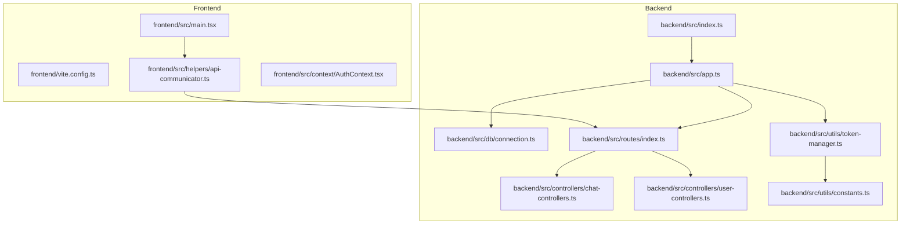
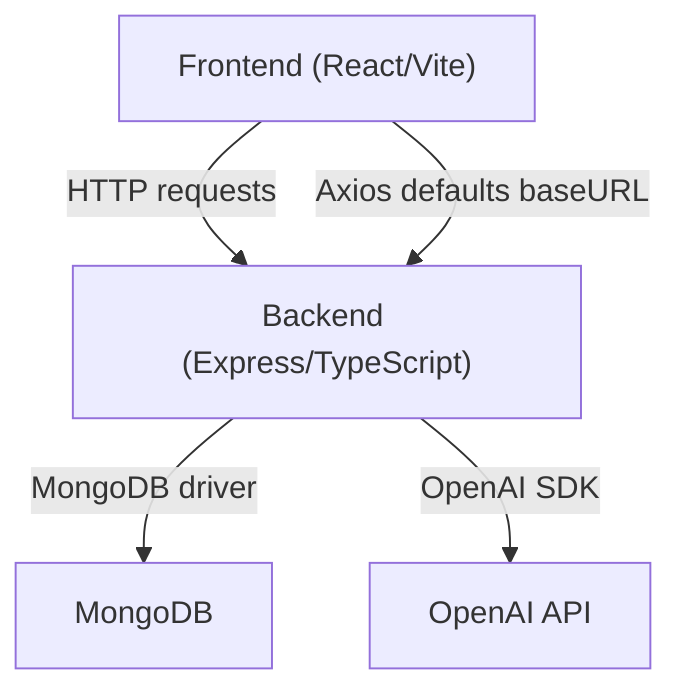
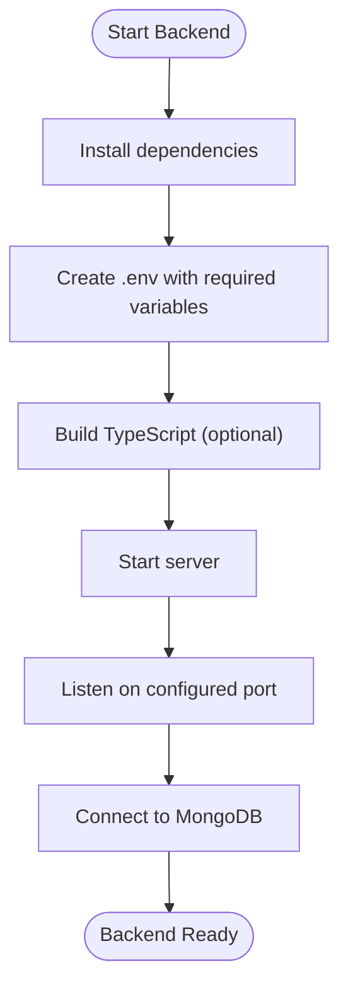
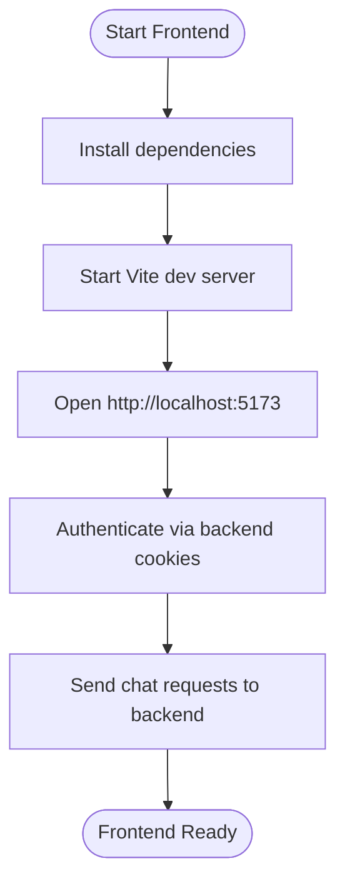
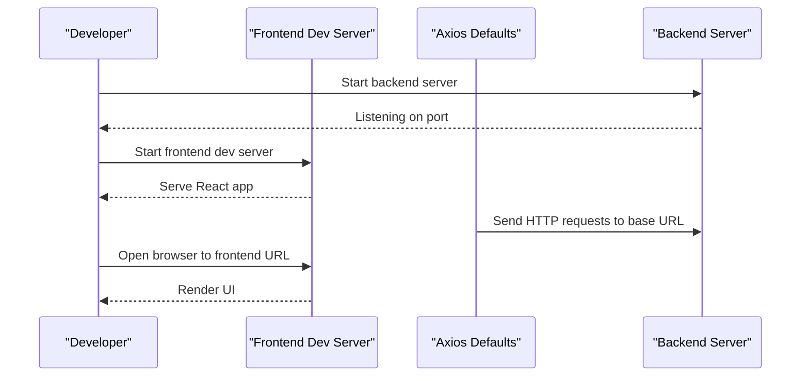
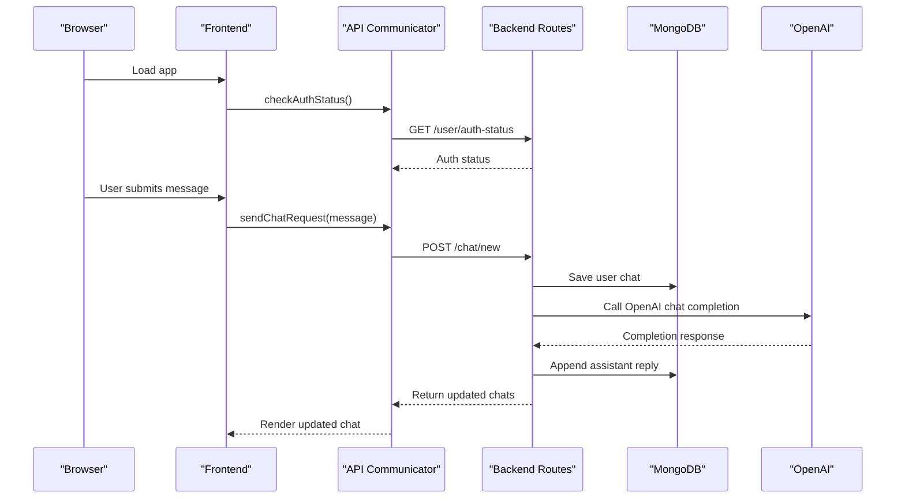
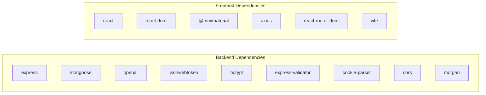

# Getting Started

<cite>
**Referenced Files in This Document**
- [README.md](file://README.md)
- [backend/package.json](file://backend/package.json)
- [frontend/package.json](file://frontend/package.json)
- [backend/src/index.ts](file://backend/src/index.ts)
- [backend/src/app.ts](file://backend/src/app.ts)
- [backend/src/db/connection.ts](file://backend/src/db/connection.ts)
- [backend/src/utils/constants.ts](file://backend/src/utils/constants.ts)
- [backend/src/utils/token-manager.ts](file://backend/src/utils/token-manager.ts)
- [backend/src/controllers/chat-controllers.ts](file://backend/src/controllers/chat-controllers.ts)
- [backend/src/controllers/user-controllers.ts](file://backend/src/controllers/user-controllers.ts)
- [backend/src/routes/index.ts](file://backend/src/routes/index.ts)
- [frontend/src/main.tsx](file://frontend/src/main.tsx)
- [frontend/vite.config.ts](file://frontend/vite.config.ts)
- [frontend/src/helpers/api-communicator.ts](file://frontend/src/helpers/api-communicator.ts)
- [frontend/src/context/AuthContext.tsx](file://frontend/src/context/AuthContext.tsx)
</cite>

## Table of Contents
1. [Introduction](#introduction)
2. [Project Structure](#project-structure)
3. [Core Components](#core-components)
4. [Architecture Overview](#architecture-overview)
5. [Detailed Component Analysis](#detailed-component-analysis)
6. [Dependency Analysis](#dependency-analysis)
7. [Performance Considerations](#performance-considerations)
8. [Troubleshooting Guide](#troubleshooting-guide)
9. [Conclusion](#conclusion)
10. [Appendices](#appendices)

## Introduction
This guide helps you set up and run the SMAN-GPT AI Chat Application locally and prepare for production deployment. The application is a full-stack MERN-based chat interface integrated with OpenAI’s API, featuring secure user authentication via JWT and HTTP-only cookies, chat persistence in MongoDB, and a modern React frontend served alongside the backend during development.

## Project Structure
The repository is organized into two primary directories:
- backend: Node.js/Express server with TypeScript, MongoDB integration, and OpenAI API usage
- frontend: React application using Vite, Material UI, and Axios for API communication

**Diagram sources**
- [backend/src/index.ts:1-13](file://backend/src/index.ts#L1-L13)
- [backend/src/app.ts:1-21](file://backend/src/app.ts#L1-L21)
- [backend/src/db/connection.ts:1-21](file://backend/src/db/connection.ts#L1-L21)
- [backend/src/routes/index.ts:1-11](file://backend/src/routes/index.ts#L1-L11)
- [backend/src/controllers/chat-controllers.ts:1-89](file://backend/src/controllers/chat-controllers.ts#L1-L89)
- [backend/src/controllers/user-controllers.ts:1-163](file://backend/src/controllers/user-controllers.ts#L1-L163)
- [backend/src/utils/token-manager.ts:1-35](file://backend/src/utils/token-manager.ts#L1-L35)
- [backend/src/utils/constants.ts:1-2](file://backend/src/utils/constants.ts#L1-L2)
- [frontend/src/main.tsx:1-30](file://frontend/src/main.tsx#L1-L30)
- [frontend/vite.config.ts:1-9](file://frontend/vite.config.ts#L1-L9)
- [frontend/src/helpers/api-communicator.ts:1-68](file://frontend/src/helpers/api-communicator.ts#L1-L68)
- [frontend/src/context/AuthContext.tsx:1-76](file://frontend/src/context/AuthContext.tsx#L1-L76)

**Section sources**
- [README.md:1-127](file://README.md#L1-L127)
- [backend/package.json:1-40](file://backend/package.json#L1-L40)
- [frontend/package.json:1-39](file://frontend/package.json#L1-L39)

## Core Components
- Backend server initialization and database connection
- Express app with CORS, JSON parsing, cookie parsing, logging, and route mounting
- Environment-driven configuration for MongoDB, JWT, and OpenAI
- Authentication flow using JWT and HTTP-only cookies
- Chat completion pipeline integrating with OpenAI API and persisting chats to MongoDB
- Frontend bootstrapping with Axios defaults, routing, theming, and authentication context

**Section sources**
- [backend/src/index.ts:1-13](file://backend/src/index.ts#L1-L13)
- [backend/src/app.ts:1-21](file://backend/src/app.ts#L1-L21)
- [backend/src/db/connection.ts:1-21](file://backend/src/db/connection.ts#L1-L21)
- [backend/src/utils/token-manager.ts:1-35](file://backend/src/utils/token-manager.ts#L1-L35)
- [backend/src/utils/constants.ts:1-2](file://backend/src/utils/constants.ts#L1-L2)
- [backend/src/controllers/chat-controllers.ts:1-89](file://backend/src/controllers/chat-controllers.ts#L1-L89)
- [backend/src/controllers/user-controllers.ts:1-163](file://backend/src/controllers/user-controllers.ts#L1-L163)
- [frontend/src/main.tsx:1-30](file://frontend/src/main.tsx#L1-L30)

## Architecture Overview
The application follows a classic MERN architecture with a Node/Express backend serving a React frontend. During development, the frontend runs on Vite and communicates with the backend via HTTP requests. Authentication is handled via signed HTTP-only cookies containing JWTs. Chat messages are stored per user in MongoDB and sent to OpenAI for completions.

**Diagram sources**
- [frontend/src/main.tsx:10-11](file://frontend/src/main.tsx#L10-L11)
- [backend/src/app.ts:11-18](file://backend/src/app.ts#L11-L18)
- [backend/src/db/connection.ts:4-4](file://backend/src/db/connection.ts#L4-L4)
- [backend/src/controllers/chat-controllers.ts:20-29](file://backend/src/controllers/chat-controllers.ts#L20-L29)

## Detailed Component Analysis

### Prerequisites
- Node.js and npm installed on your machine
- MongoDB installed and running
- OpenAI API key

These prerequisites are required to run the application locally and integrate with OpenAI.

**Section sources**
- [README.md:47-50](file://README.md#L47-L50)

### Backend Setup
- Navigate to the backend directory and install dependencies
- Create a .env file with the following keys:
  - PORT
  - MONGODB_URL
  - JWT_SECRET
  - OPENAI_API_KEY
  - Optionally OPENAI_ORGANIZATION_ID if your OpenAI account requires it
- Start the backend server

**Diagram sources**
- [backend/src/index.ts:5-12](file://backend/src/index.ts#L5-L12)
- [backend/src/db/connection.ts:4-8](file://backend/src/db/connection.ts#L4-L8)
- [backend/src/app.ts:7-18](file://backend/src/app.ts#L7-L18)

**Section sources**
- [README.md:63-83](file://README.md#L63-L83)
- [backend/package.json:7-11](file://backend/package.json#L7-L11)

### Frontend Setup
- Navigate to the frontend directory and install dependencies
- Start the frontend development server

**Diagram sources**
- [frontend/src/main.tsx:10-11](file://frontend/src/main.tsx#L10-L11)
- [frontend/vite.config.ts:5-8](file://frontend/vite.config.ts#L5-L8)
- [frontend/src/helpers/api-communicator.ts:3-38](file://frontend/src/helpers/api-communicator.ts#L3-L38)

**Section sources**
- [README.md:84-96](file://README.md#L84-L96)
- [frontend/package.json:6-11](file://frontend/package.json#L6-L11)

### Environment Variables
Configure the backend .env file with:
- PORT: server port (default used if unset)
- MONGODB_URL: MongoDB connection string
- JWT_SECRET: signing secret for JWT tokens
- OPENAI_API_KEY: OpenAI API key
- OPENAI_ORGANIZATION_ID: optional organization ID

These variables are consumed by the Express app, database connection, JWT utilities, and chat controller.

**Section sources**
- [README.md:73-78](file://README.md#L73-L78)
- [backend/src/app.ts:7-18](file://backend/src/app.ts#L7-L18)
- [backend/src/db/connection.ts:4-4](file://backend/src/db/connection.ts#L4-L4)
- [backend/src/utils/token-manager.ts:7-9](file://backend/src/utils/token-manager.ts#L7-L9)
- [backend/src/controllers/chat-controllers.ts:20-23](file://backend/src/controllers/chat-controllers.ts#L20-L23)

### Development Server Startup
- Backend: The server listens on the configured port after connecting to MongoDB
- Frontend: Vite serves the React app on its default port; Axios defaults point to the backend API base URL

**Diagram sources**
- [backend/src/index.ts:5-12](file://backend/src/index.ts#L5-L12)
- [frontend/src/main.tsx:10-11](file://frontend/src/main.tsx#L10-L11)
- [frontend/vite.config.ts:5-8](file://frontend/vite.config.ts#L5-L8)

**Section sources**
- [backend/src/index.ts:5-12](file://backend/src/index.ts#L5-L12)
- [frontend/src/main.tsx:10-11](file://frontend/src/main.tsx#L10-L11)

### Initial Application Launch
- Open the frontend URL in your browser
- Sign up or log in to establish an authenticated session
- Start chatting; messages are persisted and sent to OpenAI

**Diagram sources**
- [frontend/src/context/AuthContext.tsx:32-43](file://frontend/src/context/AuthContext.tsx#L32-L43)
- [frontend/src/helpers/api-communicator.ts:24-48](file://frontend/src/helpers/api-communicator.ts#L24-L48)
- [backend/src/routes/index.ts:7-8](file://backend/src/routes/index.ts#L7-L8)
- [backend/src/controllers/chat-controllers.ts:7-42](file://backend/src/controllers/chat-controllers.ts#L7-L42)
- [backend/src/db/connection.ts:4-4](file://backend/src/db/connection.ts#L4-L4)

**Section sources**
- [README.md:98-104](file://README.md#L98-L104)
- [frontend/src/context/AuthContext.tsx:32-43](file://frontend/src/context/AuthContext.tsx#L32-L43)
- [frontend/src/helpers/api-communicator.ts:33-48](file://frontend/src/helpers/api-communicator.ts#L33-L48)

### Production Deployment Considerations
- Backend
  - Set NODE_ENV appropriately
  - Configure production CORS origins and credentials
  - Use HTTPS and secure cookie attributes
  - Centralize environment variables outside the repo
  - Build TypeScript before starting the server
- Frontend
  - Build static assets and host behind a reverse proxy or CDN
  - Point Axios base URL to the production backend endpoint
  - Ensure SameSite/Lax/Strict cookie policies align with cross-site usage
- Infrastructure
  - Host MongoDB (prefer managed service)
  - Scale backend horizontally behind a load balancer
  - Monitor OpenAI API usage and costs

[No sources needed since this section provides general guidance]

## Dependency Analysis
The backend and frontend each declare their own dependency sets. The backend depends on Express, Mongoose, OpenAI SDK, JWT, and related type packages. The frontend depends on React, Vite, Material UI, and Axios.

**Diagram sources**
- [backend/package.json:15-27](file://backend/package.json#L15-L27)
- [backend/package.json:28-38](file://backend/package.json#L28-L38)
- [frontend/package.json:12-24](file://frontend/package.json#L12-L24)
- [frontend/package.json:25-37](file://frontend/package.json#L25-L37)

**Section sources**
- [backend/package.json:15-38](file://backend/package.json#L15-L38)
- [frontend/package.json:12-37](file://frontend/package.json#L12-L37)

## Performance Considerations
- Use production builds for both backend and frontend
- Enable gzip compression on the backend or reverse proxy
- Cache frequently accessed data and avoid unnecessary OpenAI calls
- Optimize MongoDB queries and indexes for user chat collections
- Limit concurrent chat requests and implement rate limiting

[No sources needed since this section provides general guidance]

## Troubleshooting Guide
Common setup issues and resolutions:
- MongoDB connection errors
  - Verify MONGODB_URL is correct and the database is reachable
  - Ensure the database server is running and accepts connections
- JWT signature mismatches
  - Confirm JWT_SECRET matches across backend processes
  - Clear browser cookies if switching environments
- OpenAI API failures
  - Validate OPENAI_API_KEY and permissions
  - Check API quotas and billing status
- CORS or cookie issues
  - Confirm CORS origin and credentials configuration
  - Ensure cookie domain/path align with frontend/backend ports
- Frontend cannot reach backend
  - Confirm Axios base URL points to the backend address
  - Check firewall/proxy settings for blocked ports

**Section sources**
- [backend/src/db/connection.ts:4-8](file://backend/src/db/connection.ts#L4-L8)
- [backend/src/utils/token-manager.ts:7-9](file://backend/src/utils/token-manager.ts#L7-L9)
- [backend/src/app.ts:11-18](file://backend/src/app.ts#L11-L18)
- [frontend/src/main.tsx:10-11](file://frontend/src/main.tsx#L10-L11)

## Conclusion
You now have the essentials to install, configure, and run SMAN-GPT locally, along with guidance for production readiness. Ensure environment variables are correctly set, the backend connects to MongoDB, and the frontend communicates with the backend before launching the application.

[No sources needed since this section summarizes without analyzing specific files]

## Appendices

### Verification Steps
- Backend
  - Confirm server logs show successful database connection
  - Test endpoints using a client (e.g., curl or Postman) under /api/v1
- Frontend
  - Log in and verify cookies are set
  - Send a test chat and confirm response updates the UI

**Section sources**
- [backend/src/index.ts:7-11](file://backend/src/index.ts#L7-L11)
- [backend/src/routes/index.ts:7-10](file://backend/src/routes/index.ts#L7-L10)
- [frontend/src/helpers/api-communicator.ts:24-48](file://frontend/src/helpers/api-communicator.ts#L24-L48)