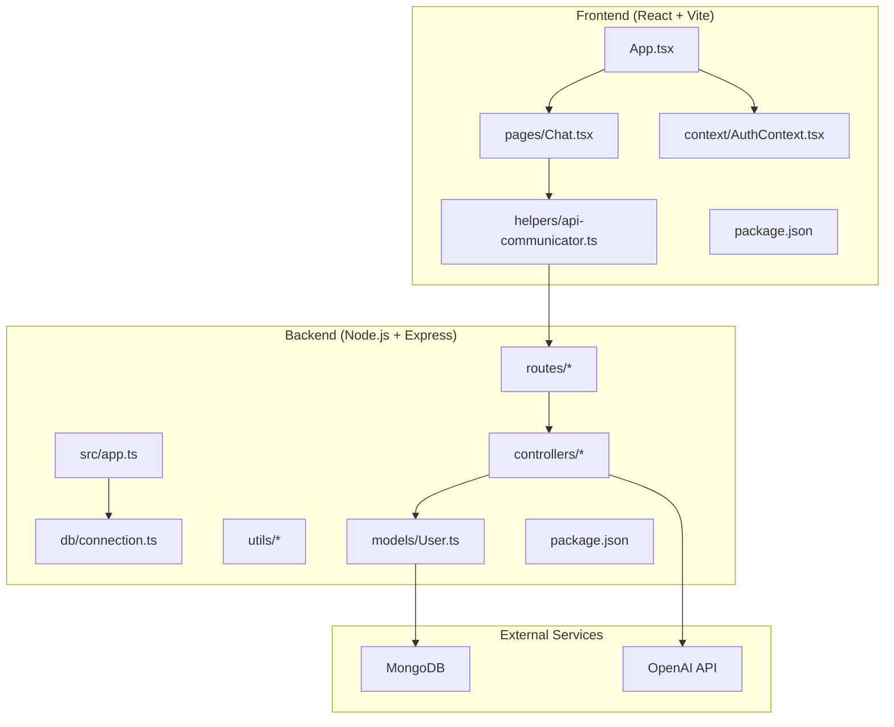
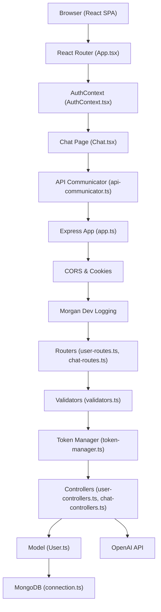
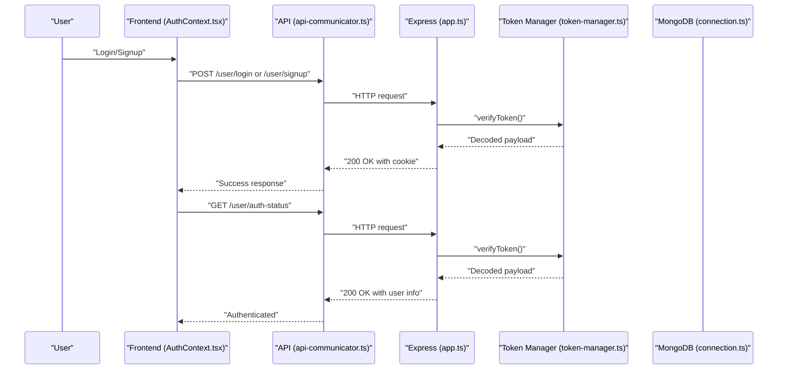
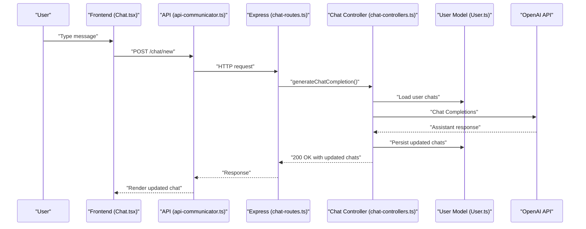
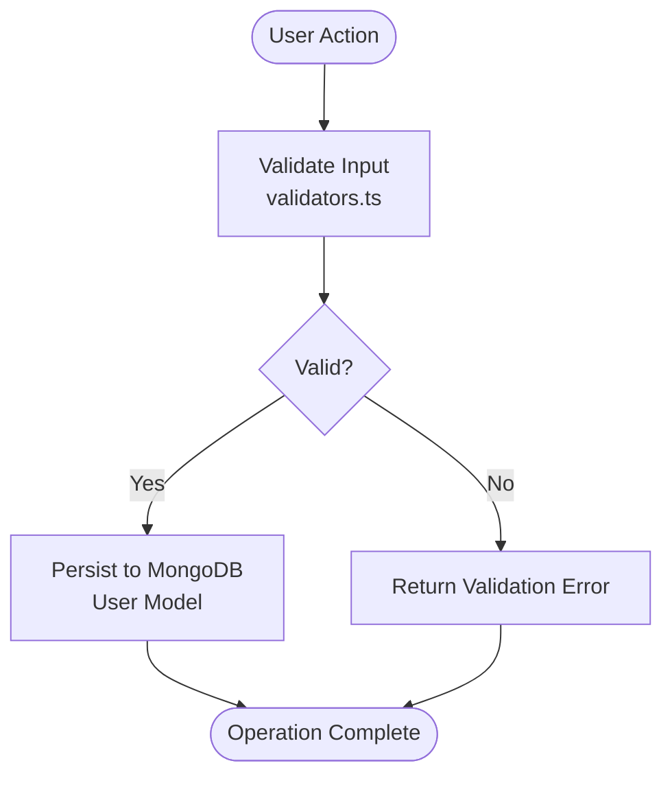
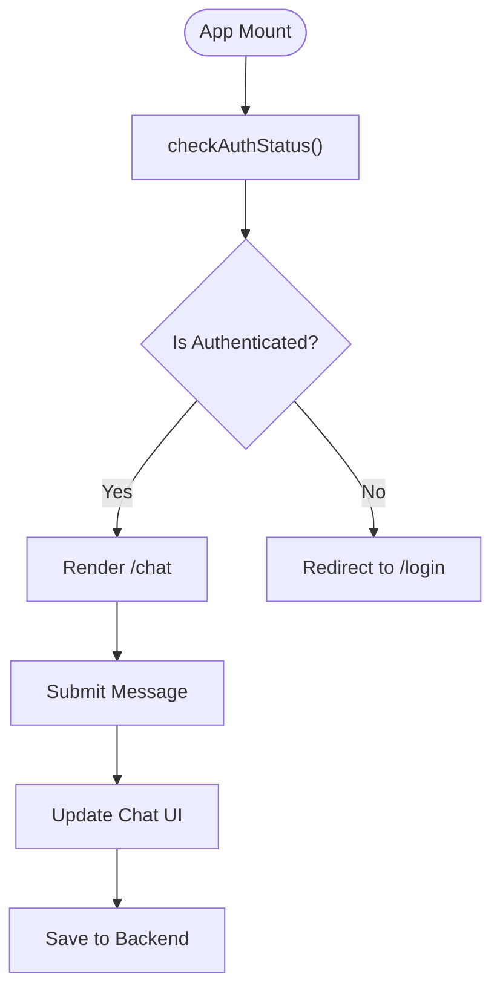
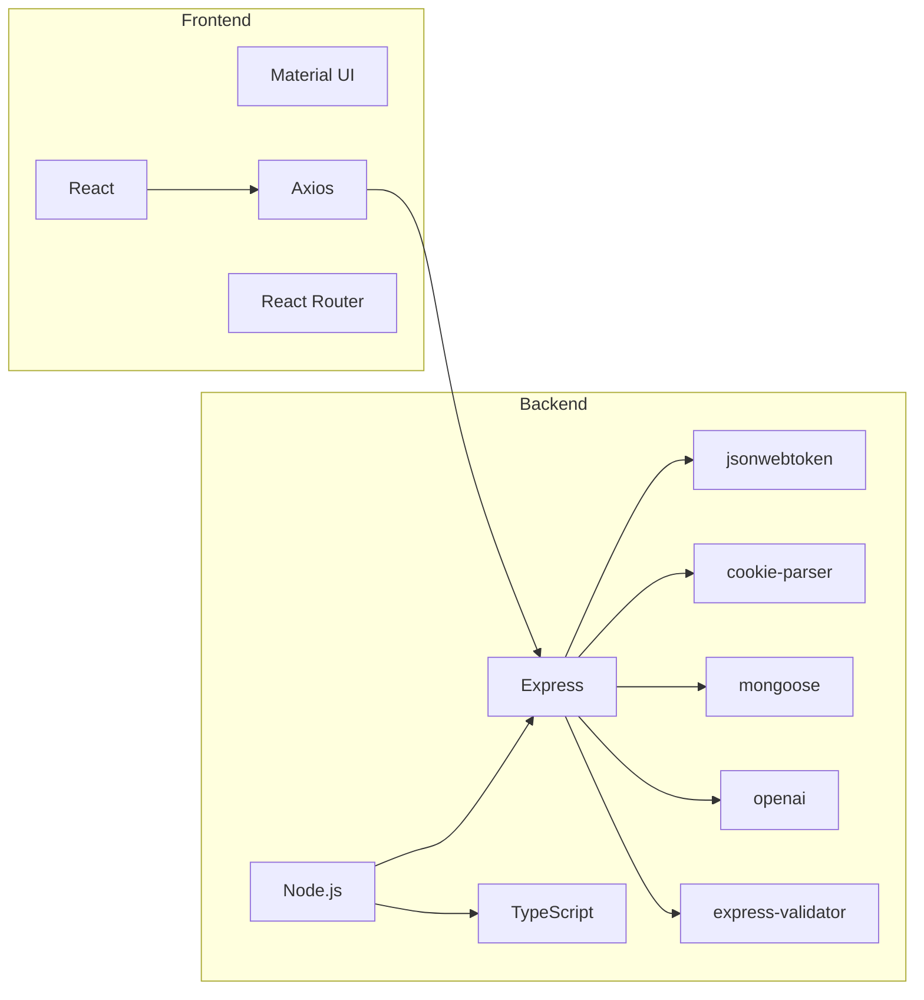

# Project Overview

<cite>
**Referenced Files in This Document**
- [README.md](file://README.md)
- [backend/README.md](file://backend/README.md)
- [backend/package.json](file://backend/package.json)
- [frontend/package.json](file://frontend/package.json)
- [backend/src/app.ts](file://backend/src/app.ts)
- [backend/src/db/connection.ts](file://backend/src/db/connection.ts)
- [backend/src/utils/constants.ts](file://backend/src/utils/constants.ts)
- [backend/src/utils/token-manager.ts](file://backend/src/utils/token-manager.ts)
- [backend/src/utils/validators.ts](file://backend/src/utils/validators.ts)
- [backend/src/models/User.ts](file://backend/src/models/User.ts)
- [backend/src/controllers/user-controllers.ts](file://backend/src/controllers/user-controllers.ts)
- [backend/src/controllers/chat-controllers.ts](file://backend/src/controllers/chat-controllers.ts)
- [backend/src/routes/user-routes.ts](file://backend/src/routes/user-routes.ts)
- [backend/src/routes/chat-routes.ts](file://backend/src/routes/chat-routes.ts)
- [frontend/src/App.tsx](file://frontend/src/App.tsx)
- [frontend/src/context/AuthContext.tsx](file://frontend/src/context/AuthContext.tsx)
- [frontend/src/pages/Chat.tsx](file://frontend/src/pages/Chat.tsx)
- [frontend/src/helpers/api-communicator.ts](file://frontend/src/helpers/api-communicator.ts)
</cite>

## Table of Contents
1. [Introduction](#introduction)
2. [Project Structure](#project-structure)
3. [Core Components](#core-components)
4. [Architecture Overview](#architecture-overview)
5. [Detailed Component Analysis](#detailed-component-analysis)
6. [Dependency Analysis](#dependency-analysis)
7. [Performance Considerations](#performance-considerations)
8. [Troubleshooting Guide](#troubleshooting-guide)
9. [Conclusion](#conclusion)

## Introduction
SMAN-GPT is a full-stack, ChatGPT-like conversational application built with the MERN stack and integrated with OpenAI’s API. Its purpose is to deliver a secure, responsive, and modern chat experience where users can authenticate, engage in intelligent conversations powered by AI, and persist their chat history in MongoDB. The application emphasizes robust security via JWT and HTTP-only cookies, structured route protection, and a clean separation of concerns between frontend and backend.

At its core, SMAN-GPT provides:
- A modern React frontend with Material UI and responsive design
- A Node.js/Express backend with TypeScript
- MongoDB for user and chat persistence
- OpenAI integration for AI-powered responses
- End-to-end user authentication and session management

This overview targets both beginners and experienced developers, offering conceptual clarity and technical highlights aligned with the codebase.

## Project Structure
The repository follows a clear frontend-backend split with modular backend architecture and a lightweight frontend SPA.

**Diagram sources**
- [frontend/src/App.tsx:1-30](file://frontend/src/App.tsx#L1-L30)
- [frontend/src/pages/Chat.tsx:1-202](file://frontend/src/pages/Chat.tsx#L1-L202)
- [frontend/src/context/AuthContext.tsx:1-76](file://frontend/src/context/AuthContext.tsx#L1-L76)
- [frontend/src/helpers/api-communicator.ts:1-68](file://frontend/src/helpers/api-communicator.ts#L1-L68)
- [backend/src/app.ts:1-21](file://backend/src/app.ts#L1-L21)
- [backend/src/routes/user-routes.ts:1-25](file://backend/src/routes/user-routes.ts#L1-L25)
- [backend/src/routes/chat-routes.ts:1-22](file://backend/src/routes/chat-routes.ts#L1-L22)
- [backend/src/controllers/user-controllers.ts:1-163](file://backend/src/controllers/user-controllers.ts#L1-L163)
- [backend/src/controllers/chat-controllers.ts:1-89](file://backend/src/controllers/chat-controllers.ts#L1-L89)
- [backend/src/models/User.ts:1-35](file://backend/src/models/User.ts#L1-L35)
- [backend/src/db/connection.ts:1-21](file://backend/src/db/connection.ts#L1-L21)

**Section sources**
- [README.md:1-127](file://README.md#L1-L127)
- [backend/README.md:1-12](file://backend/README.md#L1-L12)
- [frontend/package.json:1-39](file://frontend/package.json#L1-L39)
- [backend/package.json:1-40](file://backend/package.json#L1-L40)

## Core Components
- Frontend SPA with routing and state management:
  - App shell and protected routes orchestrated by React Router
  - Authentication context managing login, signup, and logout flows
  - Chat page rendering conversation history and accepting new messages
  - API communication helpers encapsulating HTTP requests to backend endpoints
- Backend API with layered architecture:
  - Express app wiring CORS, cookies, logging, and router mounting
  - Route modules for user and chat operations
  - Controllers implementing business logic for authentication, chat generation, retrieval, and deletion
  - Models defining user schema and nested chat entries
  - Utilities for JWT creation/verification and request validation
  - Database connection module for MongoDB lifecycle

Key value propositions:
- Secure user authentication with JWT and HTTP-only cookies
- Persistent chat history per user in MongoDB
- AI-powered responses via OpenAI integration
- Modern UI with Material UI and responsive layout
- Clean separation of concerns and TypeScript-based backend

**Section sources**
- [frontend/src/App.tsx:1-30](file://frontend/src/App.tsx#L1-L30)
- [frontend/src/context/AuthContext.tsx:1-76](file://frontend/src/context/AuthContext.tsx#L1-L76)
- [frontend/src/pages/Chat.tsx:1-202](file://frontend/src/pages/Chat.tsx#L1-L202)
- [frontend/src/helpers/api-communicator.ts:1-68](file://frontend/src/helpers/api-communicator.ts#L1-L68)
- [backend/src/app.ts:1-21](file://backend/src/app.ts#L1-L21)
- [backend/src/routes/user-routes.ts:1-25](file://backend/src/routes/user-routes.ts#L1-L25)
- [backend/src/routes/chat-routes.ts:1-22](file://backend/src/routes/chat-routes.ts#L1-L22)
- [backend/src/controllers/user-controllers.ts:1-163](file://backend/src/controllers/user-controllers.ts#L1-L163)
- [backend/src/controllers/chat-controllers.ts:1-89](file://backend/src/controllers/chat-controllers.ts#L1-L89)
- [backend/src/models/User.ts:1-35](file://backend/src/models/User.ts#L1-L35)
- [backend/src/utils/token-manager.ts:1-35](file://backend/src/utils/token-manager.ts#L1-L35)
- [backend/src/db/connection.ts:1-21](file://backend/src/db/connection.ts#L1-L21)

## Architecture Overview
The system integrates a React frontend with a Node.js/Express backend, secured by JWT and persisted in MongoDB. AI responses are generated by invoking OpenAI’s chat completions API.

**Diagram sources**
- [frontend/src/App.tsx:1-30](file://frontend/src/App.tsx#L1-L30)
- [frontend/src/context/AuthContext.tsx:1-76](file://frontend/src/context/AuthContext.tsx#L1-L76)
- [frontend/src/pages/Chat.tsx:1-202](file://frontend/src/pages/Chat.tsx#L1-L202)
- [frontend/src/helpers/api-communicator.ts:1-68](file://frontend/src/helpers/api-communicator.ts#L1-L68)
- [backend/src/app.ts:1-21](file://backend/src/app.ts#L1-L21)
- [backend/src/routes/user-routes.ts:1-25](file://backend/src/routes/user-routes.ts#L1-L25)
- [backend/src/routes/chat-routes.ts:1-22](file://backend/src/routes/chat-routes.ts#L1-L22)
- [backend/src/utils/validators.ts](file://backend/src/utils/validators.ts)
- [backend/src/utils/token-manager.ts:1-35](file://backend/src/utils/token-manager.ts#L1-L35)
- [backend/src/controllers/user-controllers.ts:1-163](file://backend/src/controllers/user-controllers.ts#L1-L163)
- [backend/src/controllers/chat-controllers.ts:1-89](file://backend/src/controllers/chat-controllers.ts#L1-L89)
- [backend/src/models/User.ts:1-35](file://backend/src/models/User.ts#L1-L35)
- [backend/src/db/connection.ts:1-21](file://backend/src/db/connection.ts#L1-L21)

## Detailed Component Analysis

### Authentication and Session Management
- JWT-based authentication with HTTP-only, signed cookies for enhanced security
- Token creation payload includes user identity and expiration policy
- Middleware verifies cookies against the configured secret and attaches decoded data to request locals
- Protected routes enforce token verification before allowing access to user actions

**Diagram sources**
- [frontend/src/context/AuthContext.tsx:1-76](file://frontend/src/context/AuthContext.tsx#L1-L76)
- [frontend/src/helpers/api-communicator.ts:1-68](file://frontend/src/helpers/api-communicator.ts#L1-L68)
- [backend/src/app.ts:1-21](file://backend/src/app.ts#L1-L21)
- [backend/src/utils/token-manager.ts:1-35](file://backend/src/utils/token-manager.ts#L1-L35)
- [backend/src/db/connection.ts:1-21](file://backend/src/db/connection.ts#L1-L21)

**Section sources**
- [backend/src/utils/constants.ts:1-2](file://backend/src/utils/constants.ts#L1-L2)
- [backend/src/utils/token-manager.ts:1-35](file://backend/src/utils/token-manager.ts#L1-L35)
- [backend/src/controllers/user-controllers.ts:1-163](file://backend/src/controllers/user-controllers.ts#L1-L163)
- [backend/src/routes/user-routes.ts:1-25](file://backend/src/routes/user-routes.ts#L1-L25)

### Chat Workflow and AI Integration
- Users submit messages from the chat page; the frontend sends a POST request to the backend
- The backend controller retrieves the current user from JWT-verified request locals, builds a conversation array, and invokes OpenAI’s chat completions endpoint
- Responses are appended to the user’s chat history and persisted in MongoDB

**Diagram sources**
- [frontend/src/pages/Chat.tsx:1-202](file://frontend/src/pages/Chat.tsx#L1-L202)
- [frontend/src/helpers/api-communicator.ts:1-68](file://frontend/src/helpers/api-communicator.ts#L1-L68)
- [backend/src/routes/chat-routes.ts:1-22](file://backend/src/routes/chat-routes.ts#L1-L22)
- [backend/src/controllers/chat-controllers.ts:1-89](file://backend/src/controllers/chat-controllers.ts#L1-L89)
- [backend/src/models/User.ts:1-35](file://backend/src/models/User.ts#L1-L35)

**Section sources**
- [backend/src/controllers/chat-controllers.ts:1-89](file://backend/src/controllers/chat-controllers.ts#L1-L89)
- [backend/src/routes/chat-routes.ts:1-22](file://backend/src/routes/chat-routes.ts#L1-L22)
- [backend/src/models/User.ts:1-35](file://backend/src/models/User.ts#L1-L35)

### Data Persistence and Validation
- MongoDB schema defines user fields and an embedded array of chat entries with role and content
- Express-validators middleware enforces input validation rules before invoking controllers
- Database connection utilities centralize connect/disconnect logic

**Diagram sources**
- [backend/src/utils/validators.ts](file://backend/src/utils/validators.ts)
- [backend/src/models/User.ts:1-35](file://backend/src/models/User.ts#L1-L35)
- [backend/src/db/connection.ts:1-21](file://backend/src/db/connection.ts#L1-L21)

**Section sources**
- [backend/src/models/User.ts:1-35](file://backend/src/models/User.ts#L1-L35)
- [backend/src/utils/validators.ts](file://backend/src/utils/validators.ts)
- [backend/src/db/connection.ts:1-21](file://backend/src/db/connection.ts#L1-L21)

### Frontend Routing and UI
- App routes define public and protected paths; the chat route is rendered only when authenticated
- Auth context initializes session state by checking auth status on mount
- Chat page renders conversation history, supports sending new messages, and clearing chat history
- Material UI components provide a responsive, accessible interface

**Diagram sources**
- [frontend/src/App.tsx:1-30](file://frontend/src/App.tsx#L1-L30)
- [frontend/src/context/AuthContext.tsx:1-76](file://frontend/src/context/AuthContext.tsx#L1-L76)
- [frontend/src/pages/Chat.tsx:1-202](file://frontend/src/pages/Chat.tsx#L1-L202)

**Section sources**
- [frontend/src/App.tsx:1-30](file://frontend/src/App.tsx#L1-L30)
- [frontend/src/context/AuthContext.tsx:1-76](file://frontend/src/context/AuthContext.tsx#L1-L76)
- [frontend/src/pages/Chat.tsx:1-202](file://frontend/src/pages/Chat.tsx#L1-L202)

## Dependency Analysis
Technology stack integration across frontend and backend:

**Diagram sources**
- [frontend/package.json:1-39](file://frontend/package.json#L1-L39)
- [backend/package.json:1-40](file://backend/package.json#L1-L40)

**Section sources**
- [frontend/package.json:1-39](file://frontend/package.json#L1-L39)
- [backend/package.json:1-40](file://backend/package.json#L1-L40)

## Performance Considerations
- Frontend
  - Use React Router for client-side navigation to minimize full-page reloads
  - Debounce or throttle input submission to reduce API churn during rapid typing
  - Lazy-load heavy components if needed and leverage Material UI’s built-in optimizations
- Backend
  - Keep MongoDB indexes minimal and targeted; consider indexing frequently queried fields
  - Stream or paginate long chat histories if users accumulate large datasets
  - Cache non-sensitive metadata and avoid unnecessary re-hashing of passwords
- AI Integration
  - Batch or coalesce multiple small prompts when feasible
  - Monitor OpenAI rate limits and implement retry/backoff strategies
- Observability
  - Use Morgan in development for request tracing; disable or restrict in production
  - Centralize error logging and consider structured logs for correlation

## Troubleshooting Guide
Common issues and resolutions:
- Authentication failures
  - Verify JWT_SECRET and COOKIE_SECRET are set consistently in environment variables
  - Ensure cookies are sent with correct domain/path and are HTTP-only and signed
- CORS errors
  - Confirm frontend origin matches backend CORS configuration
- Database connectivity
  - Validate MONGODB_URL and network accessibility; confirm connection utilities are invoked at startup
- OpenAI integration
  - Confirm OPENAI_API_KEY and organization ID are configured; check quotas and rate limits
- Chat persistence
  - Inspect user document structure and nested chat arrays; ensure updates are saved after each interaction

**Section sources**
- [backend/src/utils/token-manager.ts:1-35](file://backend/src/utils/token-manager.ts#L1-L35)
- [backend/src/app.ts:1-21](file://backend/src/app.ts#L1-L21)
- [backend/src/db/connection.ts:1-21](file://backend/src/db/connection.ts#L1-L21)
- [backend/src/controllers/chat-controllers.ts:1-89](file://backend/src/controllers/chat-controllers.ts#L1-L89)

## Conclusion
SMAN-GPT delivers a secure, scalable, and user-friendly AI chat experience by combining a modern React frontend with a robust Node.js/Express backend, MongoDB persistence, and OpenAI integration. Its emphasis on JWT-based authentication, validated inputs, and organized routing ensures maintainability and reliability. Whether you are evaluating the product or extending its capabilities, the architecture and components outlined here provide a clear foundation for understanding and building upon the system.