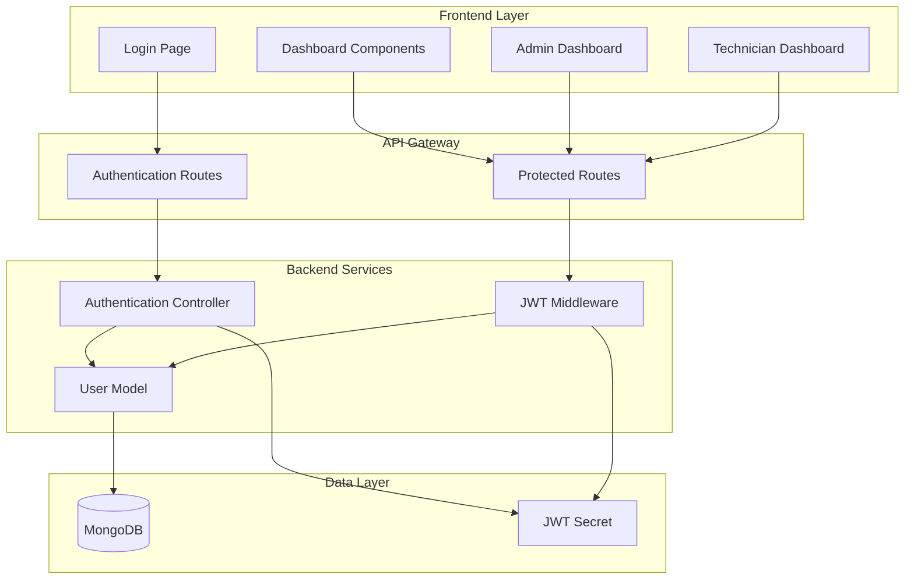
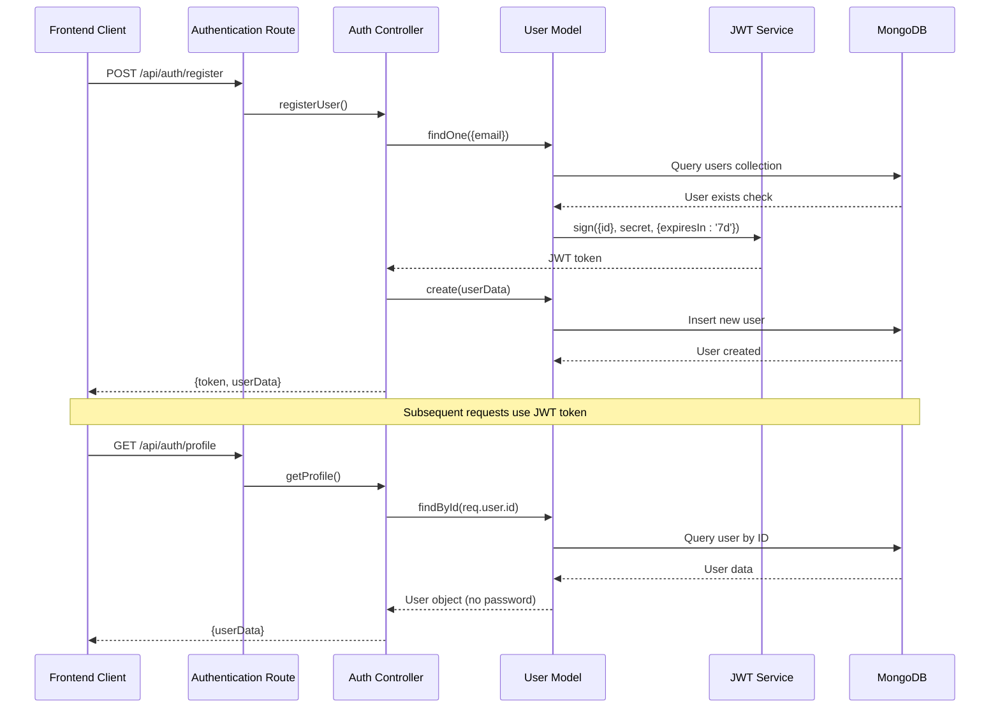
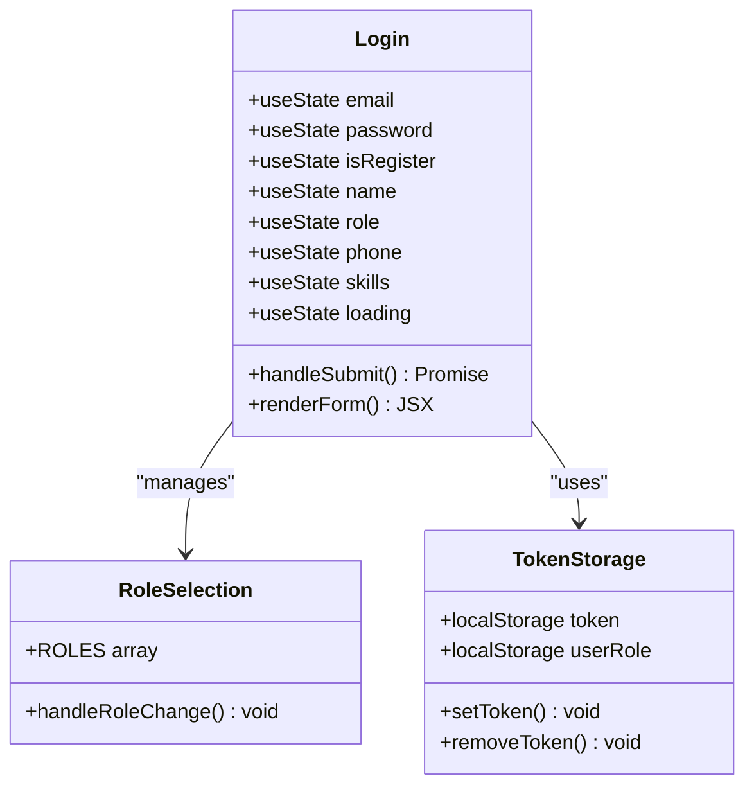
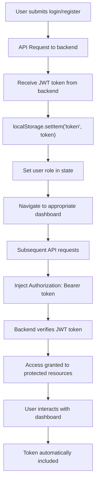
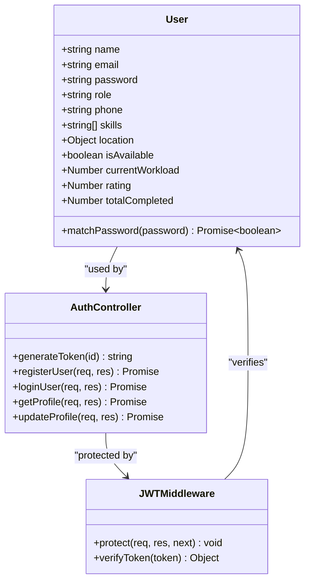
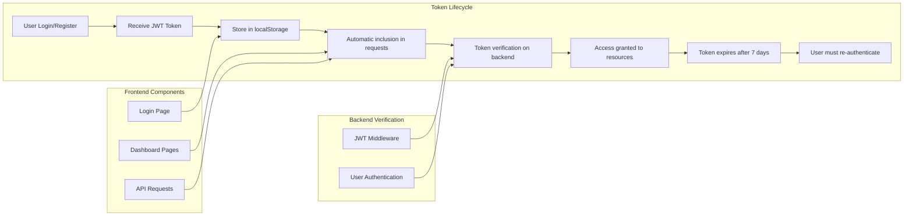
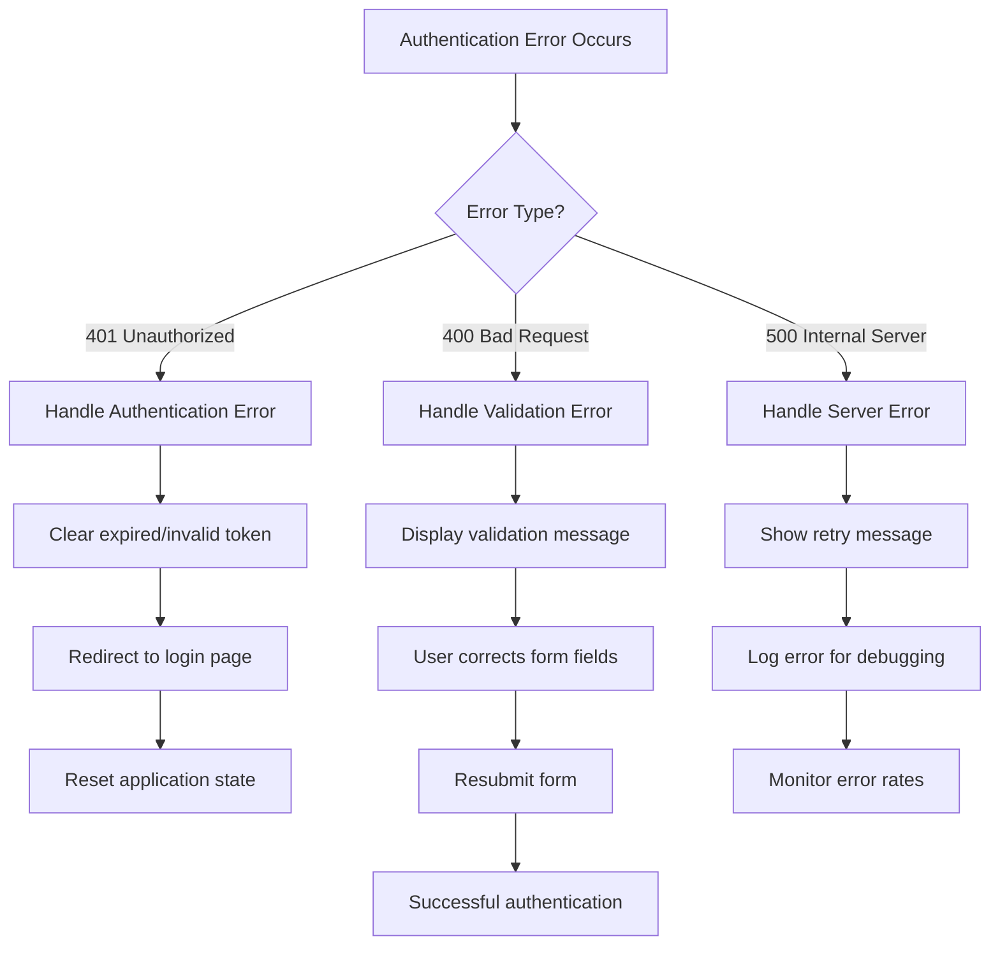
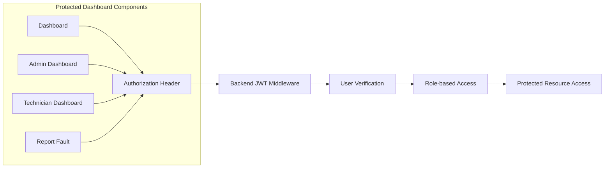

# Authentication System

<cite>
**Referenced Files in This Document**
- [authController.js](file://backend/src/controllers/authController.js)
- [auth.js](file://backend/src/middleware/auth.js)
- [authRoutes.js](file://backend/src/routes/authRoutes.js)
- [User.js](file://backend/src/models/User.js)
- [Login.jsx](file://frontend/src/pages/Login.jsx)
- [App.jsx](file://frontend/src/App.jsx)
- [Dashboard.jsx](file://frontend/src/pages/Dashboard.jsx)
- [AdminDashboard.jsx](file://frontend/src/pages/AdminDashboard.jsx)
- [TechnicianDashboard.jsx](file://frontend/src/pages/TechnicianDashboard.jsx)
- [server.js](file://backend/src/server.js)
- [db.js](file://backend/src/config/db.js)
- [package.json](file://backend/package.json)
</cite>

## Table of Contents
1. [Introduction](#introduction)
2. [System Architecture](#system-architecture)
3. [Authentication Flow](#authentication-flow)
4. [Frontend Implementation](#frontend-implementation)
5. [Backend Implementation](#backend-implementation)
6. [Security Features](#security-features)
7. [Token Management](#token-management)
8. [Error Handling](#error-handling)
9. [Integration Points](#integration-points)
10. [Troubleshooting Guide](#troubleshooting-guide)
11. [Conclusion](#conclusion)

## Introduction

The Agentic AI Utility System implements a comprehensive authentication system built on JWT (JSON Web Token) technology for secure user access across three distinct roles: citizens, technicians, and administrators. This system provides seamless authentication and authorization mechanisms for a smart utility monitoring platform that manages infrastructure faults and maintenance operations.

The authentication system follows modern security practices with encrypted password storage, role-based access control, and secure token-based session management. Users can register as either citizens seeking utility assistance or technicians providing maintenance services, with administrators having full system oversight capabilities.

## System Architecture

The authentication system is structured as a client-server architecture with clear separation of concerns between frontend and backend components:

**Diagram sources**
- [authRoutes.js:1-13](file://backend/src/routes/authRoutes.js#L1-L13)
- [authController.js:1-98](file://backend/src/controllers/authController.js#L1-L98)
- [auth.js:1-18](file://backend/src/middleware/auth.js#L1-L18)

## Authentication Flow

The authentication process follows a standardized JWT-based workflow that ensures secure user verification and session management:

**Diagram sources**
- [authController.js:7-36](file://backend/src/controllers/authController.js#L7-L36)
- [auth.js:3-15](file://backend/src/middleware/auth.js#L3-L15)
- [User.js:26-34](file://backend/src/models/User.js#L26-L34)

**Section sources**
- [authController.js:1-98](file://backend/src/controllers/authController.js#L1-L98)
- [auth.js:1-18](file://backend/src/middleware/auth.js#L1-L18)

## Frontend Implementation

The frontend authentication implementation provides a responsive login interface with role-based registration options and seamless token management:

### Login Component Architecture

**Diagram sources**
- [Login.jsx:12-49](file://frontend/src/pages/Login.jsx#L12-L49)

### Token Management Strategy

The frontend implements robust token management through localStorage with automatic token injection for protected API requests:

**Diagram sources**
- [Login.jsx:41-43](file://frontend/src/pages/Login.jsx#L41-L43)
- [Dashboard.jsx:23-33](file://frontend/src/pages/Dashboard.jsx#L23-L33)

**Section sources**
- [Login.jsx:1-167](file://frontend/src/pages/Login.jsx#L1-L167)
- [App.jsx:8-32](file://frontend/src/App.jsx#L8-L32)

## Backend Implementation

The backend authentication system implements comprehensive security measures including JWT token generation, password hashing, and role-based access control:

### User Model and Security Features

**Diagram sources**
- [User.js:4-34](file://backend/src/models/User.js#L4-L34)
- [authController.js:4-5](file://backend/src/controllers/authController.js#L4-L5)
- [auth.js:3-15](file://backend/src/middleware/auth.js#L3-L15)

### Password Security Implementation

The backend implements industry-standard password security through bcrypt hashing with salt rounds of 10:

| Security Feature | Implementation | Purpose |
|------------------|----------------|---------|
| Password Hashing | bcrypt.hash(password, 10) | Secure password storage |
| Password Verification | bcrypt.compare(password, hash) | Authenticate user credentials |
| Token Expiration | jwt.sign({id}, secret, {expiresIn: '7d'}) | Limited session duration |
| Role-based Access | User role field with enum validation | Principle of least privilege |

**Section sources**
- [User.js:26-34](file://backend/src/models/User.js#L26-L34)
- [authController.js:4-5](file://backend/src/controllers/authController.js#L4-L5)

## Security Features

The authentication system incorporates multiple layers of security to protect user data and maintain system integrity:

### Token-Based Authentication

- **JWT Implementation**: Stateless authentication using JSON Web Tokens
- **Token Expiration**: 7-day expiration period for session tokens
- **Authorization Header**: Bearer token format for API requests
- **Automatic Token Injection**: Frontend automatically includes tokens in protected requests

### Data Protection

- **Password Encryption**: bcrypt hashing with 10 salt rounds
- **Sensitive Data Omission**: Passwords excluded from user profile responses
- **Environment Variables**: JWT secret and database connection strings stored securely
- **Input Validation**: Comprehensive field validation during registration and login

### Access Control

- **Role-based Permissions**: Three distinct user roles with specific access levels
- **Protected Routes**: Middleware verification for all authenticated endpoints
- **Real-time Updates**: Socket.io integration with user-specific room management

**Section sources**
- [auth.js:3-15](file://backend/src/middleware/auth.js#L3-L15)
- [User.js:8-12](file://backend/src/models/User.js#L8-L12)

## Token Management

The system implements comprehensive token lifecycle management with automatic renewal and cleanup mechanisms:

### Token Storage and Retrieval

**Diagram sources**
- [Login.jsx:41-43](file://frontend/src/pages/Login.jsx#L41-L43)
- [Dashboard.jsx:23-33](file://frontend/src/pages/Dashboard.jsx#L23-L33)

### Token Security Measures

| Security Aspect | Implementation | Benefits |
|-----------------|----------------|----------|
| Token Storage | localStorage | Persistent session across browser restarts |
| Token Transmission | Authorization header | Prevents token leakage in URLs |
| Token Expiration | 7-day expiry | Limits session duration risk |
| Token Revocation | Server-side invalidation | Immediate access revocation possible |
| Cross-origin Protection | CORS configuration | Prevents unauthorized domain access |

**Section sources**
- [Login.jsx:41-43](file://frontend/src/pages/Login.jsx#L41-L43)
- [Dashboard.jsx:23-33](file://frontend/src/pages/Dashboard.jsx#L23-L33)

## Error Handling

The authentication system implements comprehensive error handling across all layers to provide meaningful feedback and maintain system stability:

### Error Categories and Responses

| Error Type | HTTP Status | Frontend Handling | Backend Response |
|------------|-------------|-------------------|------------------|
| Invalid Credentials | 401 Unauthorized | Display error message | "Invalid credentials" |
| User Already Exists | 400 Bad Request | Show registration error | "User already exists" |
| Missing Fields | 400 Bad Request | Highlight required fields | "All fields required" |
| Invalid Token | 401 Unauthorized | Redirect to login | "Not authorized, invalid token" |
| No Token Provided | 401 Unauthorized | Redirect to login | "Not authorized, no token" |
| Internal Server Error | 500 Internal Server | Generic error message | Error message from server |

### Error Recovery Mechanisms

**Diagram sources**
- [authController.js:10-15](file://backend/src/controllers/authController.js#L10-L15)
- [auth.js:5-14](file://backend/src/middleware/auth.js#L5-L14)

**Section sources**
- [authController.js:10-15](file://backend/src/controllers/authController.js#L10-L15)
- [auth.js:5-14](file://backend/src/middleware/auth.js#L5-L14)

## Integration Points

The authentication system integrates seamlessly with the broader application ecosystem through well-defined interfaces and middleware patterns:

### API Endpoint Structure

| Endpoint | Method | Description | Authentication Required | Response |
|----------|--------|-------------|-------------------------|----------|
| `/api/auth/register` | POST | User registration | No | JWT token + user info |
| `/api/auth/login` | POST | User authentication | No | JWT token + user info |
| `/api/auth/profile` | GET | Get user profile | Yes | User data (no password) |
| `/api/auth/profile` | PUT | Update user profile | Yes | Success + updated user |

### Frontend Dashboard Integration

Each dashboard component implements consistent authentication patterns:

**Diagram sources**
- [Dashboard.jsx:23-33](file://frontend/src/pages/Dashboard.jsx#L23-L33)
- [AdminDashboard.jsx:38-64](file://frontend/src/pages/AdminDashboard.jsx#L38-L64)
- [TechnicianDashboard.jsx:32-64](file://frontend/src/pages/TechnicianDashboard.jsx#L32-L64)

**Section sources**
- [authRoutes.js:7-10](file://backend/src/routes/authRoutes.js#L7-L10)
- [Dashboard.jsx:23-33](file://frontend/src/pages/Dashboard.jsx#L23-L33)

## Troubleshooting Guide

Common authentication issues and their resolution strategies:

### Login Issues

**Problem**: Users cannot log in despite correct credentials
- **Check**: Verify JWT_SECRET environment variable is set
- **Check**: Confirm MongoDB connection is active
- **Check**: Validate user account exists in database
- **Solution**: Restart backend service and verify environment configuration

**Problem**: Token expires immediately after login
- **Check**: Verify JWT_SECRET consistency across deployments
- **Check**: Confirm system clock synchronization
- **Check**: Validate token expiration configuration
- **Solution**: Update JWT configuration and clear browser cache

### Frontend Authentication Problems

**Problem**: Dashboard shows unauthorized despite successful login
- **Check**: Verify localStorage contains token
- **Check**: Confirm Authorization header format
- **Check**: Validate token expiration
- **Solution**: Clear browser localStorage and re-login

**Problem**: Registration fails with validation errors
- **Check**: Verify required fields (name, email, password)
- **Check**: Confirm unique email constraint
- **Check**: Validate password strength requirements
- **Solution**: Correct form validation errors and retry

### Backend Authentication Issues

**Problem**: JWT verification fails consistently
- **Check**: Verify JWT_SECRET environment variable
- **Check**: Confirm token signing algorithm compatibility
- **Check**: Validate token structure and expiration
- **Solution**: Regenerate JWT secret and update all clients

**Section sources**
- [auth.js:3-15](file://backend/src/middleware/auth.js#L3-L15)
- [authController.js:38-55](file://backend/src/controllers/authController.js#L38-L55)

## Conclusion

The authentication system in the Agentic AI Utility System provides a robust, scalable, and secure foundation for user management across multiple roles and use cases. The implementation demonstrates best practices in modern web application security through:

- **JWT-based stateless authentication** ensuring scalability and reliability
- **Comprehensive password security** with bcrypt encryption and salt rounds
- **Role-based access control** enabling fine-grained permission management
- **Seamless frontend integration** with automatic token management
- **Robust error handling** providing clear feedback and recovery mechanisms
- **Production-ready security** through environment-based configuration and validation

The system successfully balances security requirements with user experience, providing transparent authentication that enables citizens, technicians, and administrators to access appropriate resources while maintaining strict security boundaries. The modular architecture supports future enhancements including multi-factor authentication, OAuth integration, and advanced audit logging capabilities.