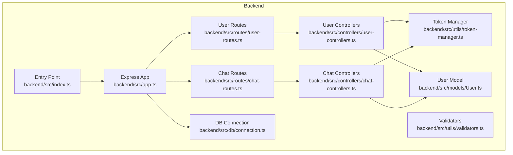
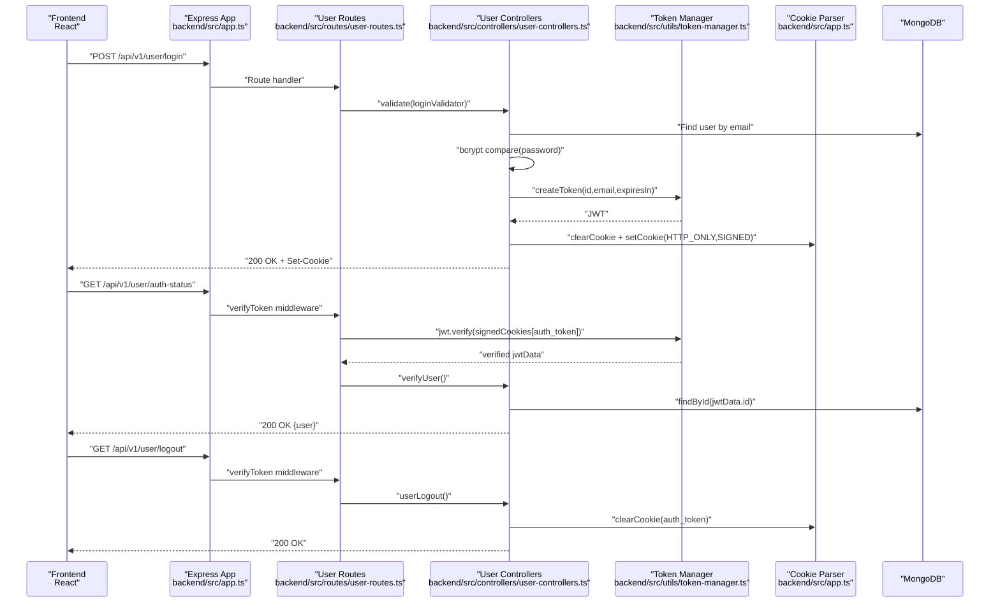
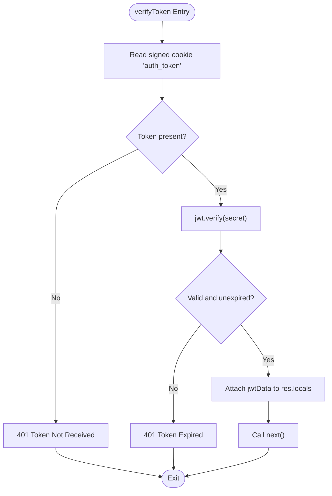
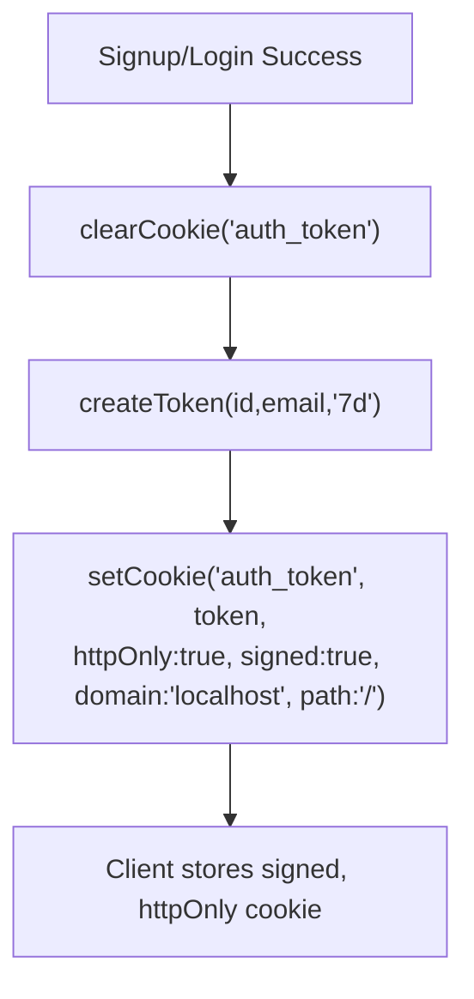
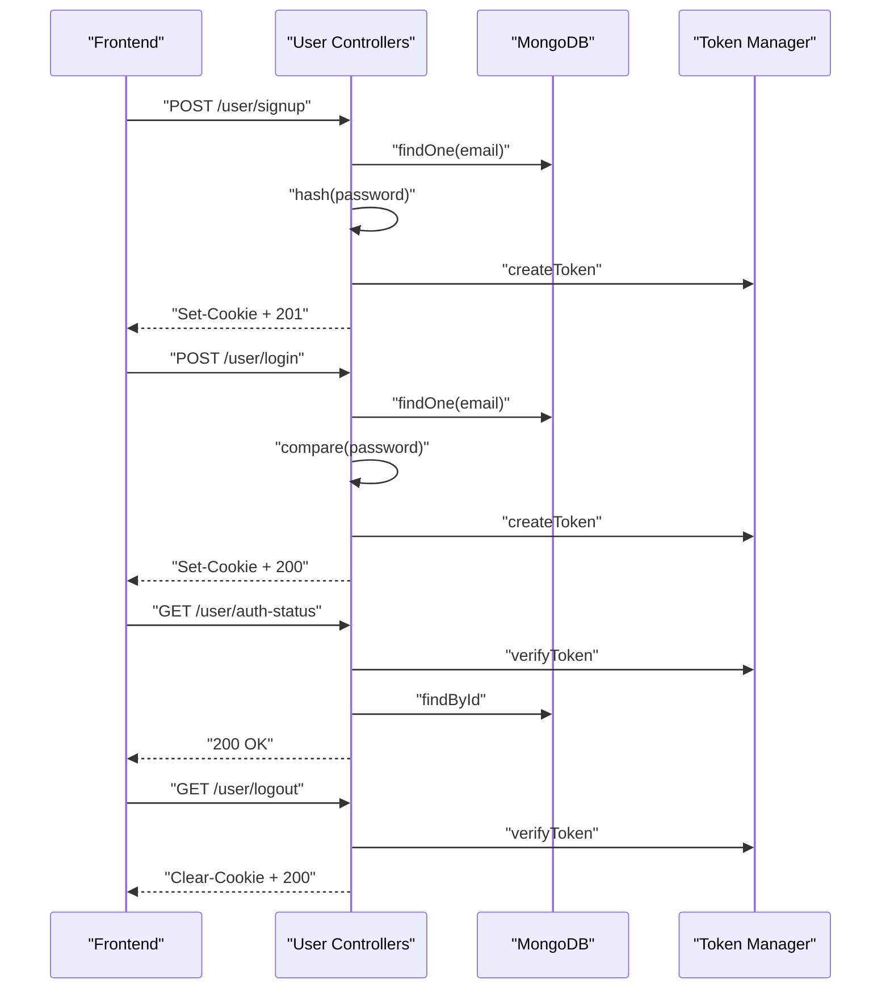
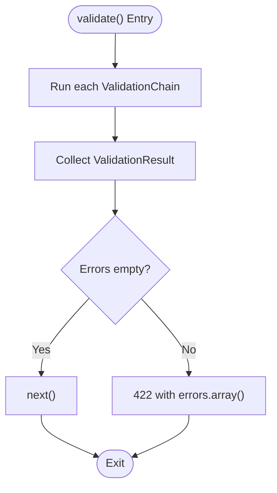
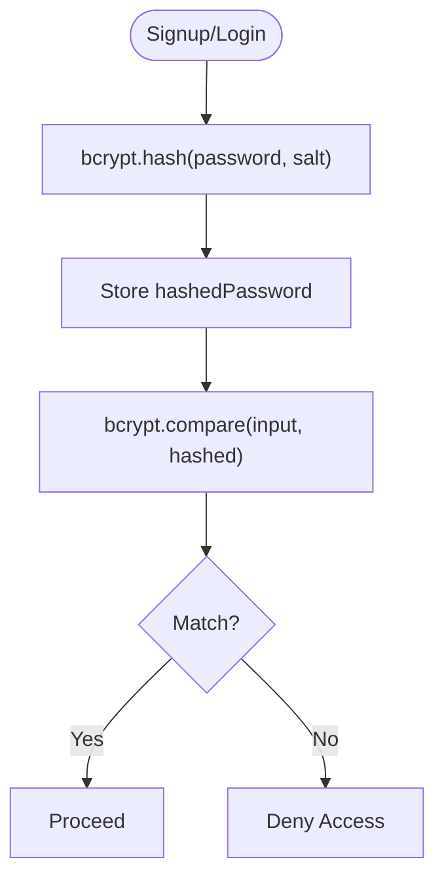
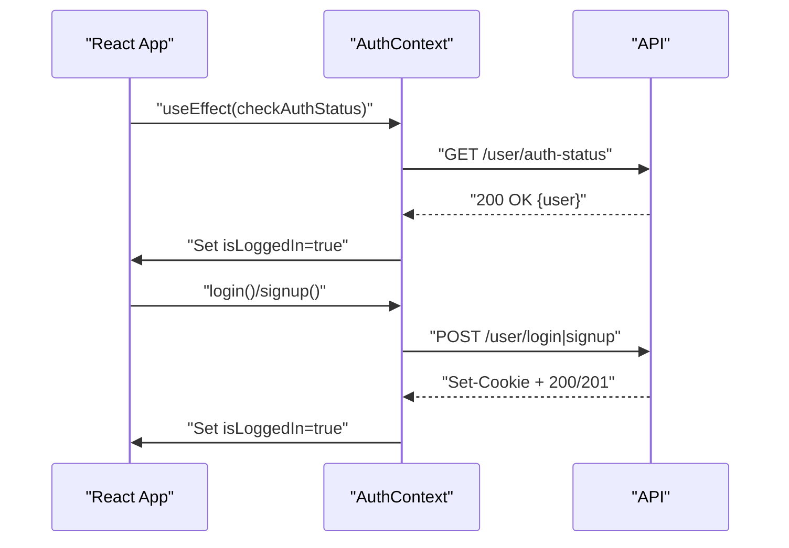
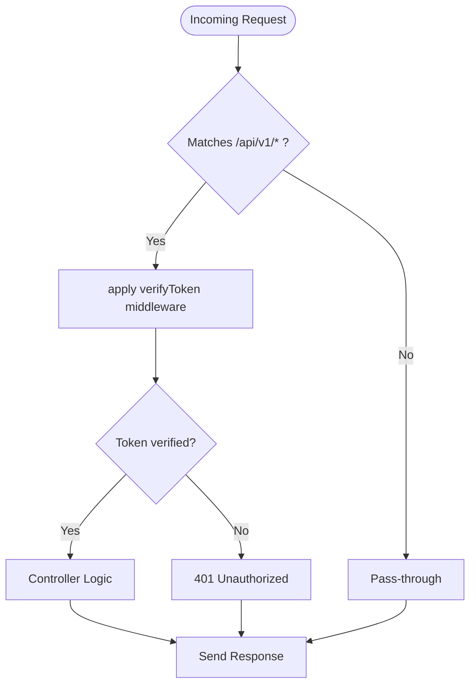
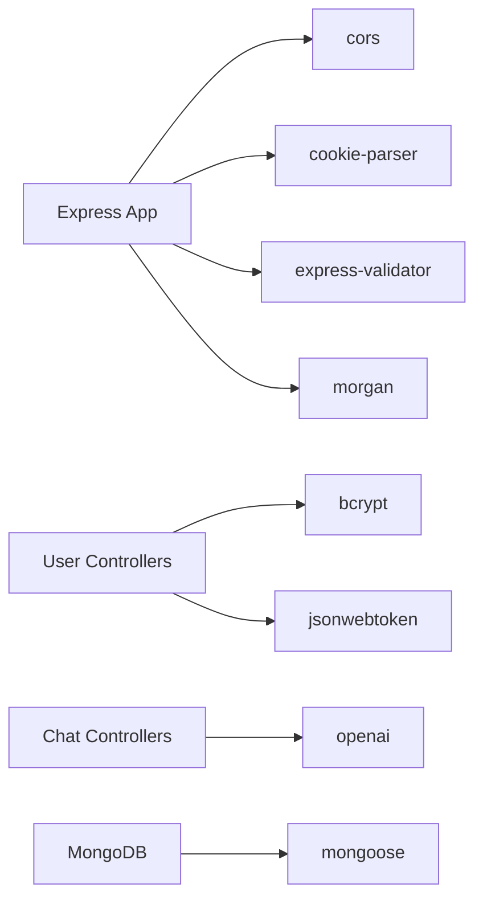

# Security Implementation

<cite>
**Referenced Files in This Document**
- [backend/src/app.ts](file://backend/src/app.ts)
- [backend/src/utils/constants.ts](file://backend/src/utils/constants.ts)
- [backend/src/utils/token-manager.ts](file://backend/src/utils/token-manager.ts)
- [backend/src/utils/validators.ts](file://backend/src/utils/validators.ts)
- [backend/src/controllers/user-controllers.ts](file://backend/src/controllers/user-controllers.ts)
- [backend/src/controllers/chat-controllers.ts](file://backend/src/controllers/chat-controllers.ts)
- [backend/src/routes/user-routes.ts](file://backend/src/routes/user-routes.ts)
- [backend/src/routes/chat-routes.ts](file://backend/src/routes/chat-routes.ts)
- [backend/src/models/User.ts](file://backend/src/models/User.ts)
- [backend/src/db/connection.ts](file://backend/src/db/connection.ts)
- [backend/src/index.ts](file://backend/src/index.ts)
- [backend/package.json](file://backend/package.json)
- [frontend/src/context/AuthContext.tsx](file://frontend/src/context/AuthContext.tsx)
- [frontend/src/helpers/api-communicator.ts](file://frontend/src/helpers/api-communicator.ts)
- [frontend/src/pages/Login.tsx](file://frontend/src/pages/Login.tsx)
- [frontend/src/pages/Signup.tsx](file://frontend/src/pages/Signup.tsx)
</cite>

## Table of Contents
1. [Introduction](#introduction)
2. [Project Structure](#project-structure)
3. [Core Components](#core-components)
4. [Architecture Overview](#architecture-overview)
5. [Detailed Component Analysis](#detailed-component-analysis)
6. [Dependency Analysis](#dependency-analysis)
7. [Performance Considerations](#performance-considerations)
8. [Troubleshooting Guide](#troubleshooting-guide)
9. [Conclusion](#conclusion)
10. [Appendices](#appendices)

## Introduction
This document provides comprehensive security implementation documentation for the SMAN-GPT AI Chat Application. It focuses on JWT token lifecycle management, HTTP-only cookie configuration, session-like state via signed cookies, authentication flow, input validation and sanitization, password hashing, CORS configuration, CSRF considerations, secure headers, best practices, vulnerability prevention, audit logging strategies, authentication state management, route protection, and secure API communication patterns. Guidance for security testing, penetration testing approaches, and incident response procedures is included.

## Project Structure
The backend is a modular Express server with TypeScript, organized by concerns:
- Routes define protected/unprotected endpoints and apply middleware.
- Controllers encapsulate business logic and integrate with models and token utilities.
- Models define data schemas and relationships.
- Utilities provide token management and input validation.
- App initialization configures middleware, CORS, and cookie parsing.

**Diagram sources**
- [backend/src/app.ts:1-21](file://backend/src/app.ts#L1-L21)
- [backend/src/routes/user-routes.ts:1-25](file://backend/src/routes/user-routes.ts#L1-L25)
- [backend/src/routes/chat-routes.ts:1-22](file://backend/src/routes/chat-routes.ts#L1-L22)
- [backend/src/controllers/user-controllers.ts:1-163](file://backend/src/controllers/user-controllers.ts#L1-L163)
- [backend/src/controllers/chat-controllers.ts:1-89](file://backend/src/controllers/chat-controllers.ts#L1-L89)
- [backend/src/utils/token-manager.ts:1-35](file://backend/src/utils/token-manager.ts#L1-L35)
- [backend/src/utils/validators.ts:1-36](file://backend/src/utils/validators.ts#L1-L36)
- [backend/src/models/User.ts:1-35](file://backend/src/models/User.ts#L1-L35)
- [backend/src/db/connection.ts:1-21](file://backend/src/db/connection.ts#L1-L21)
- [backend/src/index.ts:1-13](file://backend/src/index.ts#L1-L13)

**Section sources**
- [backend/src/app.ts:1-21](file://backend/src/app.ts#L1-L21)
- [backend/src/index.ts:1-13](file://backend/src/index.ts#L1-L13)

## Core Components
- JWT Token Management: Creation, verification, and expiration handling via a dedicated utility.
- Cookie-Based Session: HTTP-only, signed cookies for stateless session persistence.
- Authentication Flow: Registration, login, verification, and logout orchestrated by controllers and middleware.
- Input Validation: Express-Validator chains for sanitization and validation.
- Password Encryption: bcrypt hashing and comparison.
- Route Protection: Middleware applied to protected routes.
- CORS Configuration: Allowlist-based origin with credentials enabled.
- Audit Logging: Development-time logging via Morgan; production logging should be configured separately.

**Section sources**
- [backend/src/utils/token-manager.ts:1-35](file://backend/src/utils/token-manager.ts#L1-L35)
- [backend/src/utils/constants.ts:1-2](file://backend/src/utils/constants.ts#L1-L2)
- [backend/src/utils/validators.ts:1-36](file://backend/src/utils/validators.ts#L1-L36)
- [backend/src/controllers/user-controllers.ts:1-163](file://backend/src/controllers/user-controllers.ts#L1-L163)
- [backend/src/controllers/chat-controllers.ts:1-89](file://backend/src/controllers/chat-controllers.ts#L1-L89)
- [backend/src/routes/user-routes.ts:1-25](file://backend/src/routes/user-routes.ts#L1-L25)
- [backend/src/routes/chat-routes.ts:1-22](file://backend/src/routes/chat-routes.ts#L1-L22)
- [backend/src/app.ts:1-21](file://backend/src/app.ts#L1-L21)

## Architecture Overview
The authentication and security architecture centers around signed HTTP-only cookies carrying JWTs, validated by middleware before controller actions execute. Input validation precedes controller logic, and bcrypt secures stored passwords.

**Diagram sources**
- [backend/src/app.ts:1-21](file://backend/src/app.ts#L1-L21)
- [backend/src/routes/user-routes.ts:1-25](file://backend/src/routes/user-routes.ts#L1-L25)
- [backend/src/controllers/user-controllers.ts:1-163](file://backend/src/controllers/user-controllers.ts#L1-L163)
- [backend/src/utils/token-manager.ts:1-35](file://backend/src/utils/token-manager.ts#L1-L35)

## Detailed Component Analysis

### JWT Token Management
- Token creation embeds user identity and sets an expiration policy.
- Token verification reads the signed cookie, validates signature and expiration, and attaches decoded payload to request locals for downstream use.
- Expiration handling relies on JWT’s built-in expiry; expired tokens are rejected with a 401 response.

**Diagram sources**
- [backend/src/utils/token-manager.ts:13-34](file://backend/src/utils/token-manager.ts#L13-L34)

**Section sources**
- [backend/src/utils/token-manager.ts:1-35](file://backend/src/utils/token-manager.ts#L1-L35)
- [backend/src/utils/constants.ts:1-2](file://backend/src/utils/constants.ts#L1-L2)

### HTTP-Only Cookie Configuration and Session Management
- Cookies are cleared and set during registration and login to establish a session.
- Configuration includes httpOnly, signed, domain, path, and expiry.
- Signed cookies prevent tampering client-side; httpOnly mitigates XSS risks.

**Diagram sources**
- [backend/src/controllers/user-controllers.ts:36-53](file://backend/src/controllers/user-controllers.ts#L36-L53)
- [backend/src/controllers/user-controllers.ts:81-99](file://backend/src/controllers/user-controllers.ts#L81-L99)

**Section sources**
- [backend/src/controllers/user-controllers.ts:1-163](file://backend/src/controllers/user-controllers.ts#L1-L163)
- [backend/src/utils/constants.ts:1-2](file://backend/src/utils/constants.ts#L1-L2)

### Authentication Flow
- Registration: Validates inputs, checks uniqueness, hashes password, creates token, sets cookie.
- Login: Validates inputs, finds user, compares password, creates token, sets cookie.
- Verification: Uses middleware to confirm token validity and user existence.
- Logout: Clears the cookie after verifying the token and user.

**Diagram sources**
- [backend/src/controllers/user-controllers.ts:22-62](file://backend/src/controllers/user-controllers.ts#L22-L62)
- [backend/src/controllers/user-controllers.ts:64-108](file://backend/src/controllers/user-controllers.ts#L64-L108)
- [backend/src/controllers/user-controllers.ts:110-131](file://backend/src/controllers/user-controllers.ts#L110-L131)
- [backend/src/controllers/user-controllers.ts:133-162](file://backend/src/controllers/user-controllers.ts#L133-L162)
- [backend/src/utils/token-manager.ts:13-34](file://backend/src/utils/token-manager.ts#L13-L34)

**Section sources**
- [backend/src/controllers/user-controllers.ts:1-163](file://backend/src/controllers/user-controllers.ts#L1-L163)
- [backend/src/routes/user-routes.ts:1-25](file://backend/src/routes/user-routes.ts#L1-L25)

### Input Validation Strategies (Express-Validators)
- Centralized validator runner ensures all specified validations execute and aggregates errors.
- Specific validators enforce presence, format, length, and trimming for sensitive fields.
- On validation failure, a structured 422 response is returned with error details.

**Diagram sources**
- [backend/src/utils/validators.ts:4-18](file://backend/src/utils/validators.ts#L4-L18)

**Section sources**
- [backend/src/utils/validators.ts:1-36](file://backend/src/utils/validators.ts#L1-L36)

### Password Encryption with bcrypt
- Passwords are hashed using a high work factor before storage.
- During login, plaintext password is compared against stored hash.
- This prevents rainbow table attacks and brute-force reuse of credentials.

**Diagram sources**
- [backend/src/controllers/user-controllers.ts:32-33](file://backend/src/controllers/user-controllers.ts#L32-L33)
- [backend/src/controllers/user-controllers.ts:76-79](file://backend/src/controllers/user-controllers.ts#L76-L79)

**Section sources**
- [backend/src/controllers/user-controllers.ts:1-163](file://backend/src/controllers/user-controllers.ts#L1-L163)

### Data Sanitization Techniques
- Trimming whitespace from inputs reduces risk of subtle injection vectors.
- Validation enforces minimum lengths and formats for robustness.
- Frontend forms capture controlled inputs; backend re-validates to ensure integrity.

**Section sources**
- [backend/src/utils/validators.ts:20-35](file://backend/src/utils/validators.ts#L20-L35)
- [frontend/src/pages/Login.tsx:11-24](file://frontend/src/pages/Login.tsx#L11-L24)
- [frontend/src/pages/Signup.tsx:11-25](file://frontend/src/pages/Signup.tsx#L11-L25)

### CORS Configuration
- Allowlist-based origin permits only the frontend origin to access the API.
- Credentials are enabled to support cookie-based authentication.

**Section sources**
- [backend/src/app.ts:11](file://backend/src/app.ts#L11)

### CSRF Protection
- Current implementation does not include CSRF tokens or SameSite cookie enforcement.
- Recommendations:
  - Enforce SameSite=Lax|Strict on cookies.
  - Implement CSRF tokens for state-changing operations.
  - Validate Origin/Header for same-origin checks.

[No sources needed since this section provides general guidance]

### Secure Headers Implementation
- No explicit security headers are configured in the current codebase.
- Recommendations:
  - Add Helmet or equivalent middleware to set CSP, HSTS, X-Frame-Options, X-Content-Type-Options, Referrer-Policy.
  - Enforce HTTPS in production and configure HSTS.

[No sources needed since this section provides general guidance]

### Authentication State Management (Frontend)
- React context manages logged-in state and user profile.
- On mount, the app checks authentication status via a protected endpoint.
- Successful login/signup updates context and triggers navigation.

**Diagram sources**
- [frontend/src/context/AuthContext.tsx:28-43](file://frontend/src/context/AuthContext.tsx#L28-L43)
- [frontend/src/context/AuthContext.tsx:44-63](file://frontend/src/context/AuthContext.tsx#L44-L63)
- [frontend/src/helpers/api-communicator.ts:24-31](file://frontend/src/helpers/api-communicator.ts#L24-L31)

**Section sources**
- [frontend/src/context/AuthContext.tsx:1-76](file://frontend/src/context/AuthContext.tsx#L1-L76)
- [frontend/src/helpers/api-communicator.ts:1-68](file://frontend/src/helpers/api-communicator.ts#L1-L68)

### Route Protection Mechanisms
- Protected routes require a valid JWT via middleware before invoking controller logic.
- Controllers re-verify user existence and ID matching to prevent token replays or ID spoofing.

**Diagram sources**
- [backend/src/routes/user-routes.ts:21-22](file://backend/src/routes/user-routes.ts#L21-L22)
- [backend/src/routes/chat-routes.ts:12-19](file://backend/src/routes/chat-routes.ts#L12-L19)
- [backend/src/utils/token-manager.ts:13-34](file://backend/src/utils/token-manager.ts#L13-L34)

**Section sources**
- [backend/src/routes/user-routes.ts:1-25](file://backend/src/routes/user-routes.ts#L1-L25)
- [backend/src/routes/chat-routes.ts:1-22](file://backend/src/routes/chat-routes.ts#L1-L22)
- [backend/src/utils/token-manager.ts:1-35](file://backend/src/utils/token-manager.ts#L1-L35)

### Secure API Communication Patterns
- All protected endpoints are prefixed under /api/v1.
- Requests rely on cookies for authentication; ensure HTTPS in production.
- Frontend uses Axios with relative paths; ensure proxy or CORS is configured for development.

**Section sources**
- [backend/src/app.ts:18](file://backend/src/app.ts#L18)
- [frontend/src/helpers/api-communicator.ts:1-68](file://frontend/src/helpers/api-communicator.ts#L1-L68)

### Audit Logging Strategies
- Development logging via Morgan is enabled; production should use structured logging and centralized log aggregation.
- Log authentication events (login, logout, token verification outcomes), validation failures, and unexpected errors with minimal PII.

**Section sources**
- [backend/src/app.ts:15-16](file://backend/src/app.ts#L15-L16)

## Dependency Analysis
The backend depends on several libraries for security and transport:
- jsonwebtoken: JWT signing/verification.
- bcrypt: Password hashing and comparison.
- express-validator: Input validation and sanitization.
- cookie-parser: Signed cookie parsing.
- cors: Cross-origin policy enforcement.
- dotenv: Environment variable loading.
- morgan: HTTP request logging.

**Diagram sources**
- [backend/src/app.ts:1-21](file://backend/src/app.ts#L1-L21)
- [backend/src/controllers/user-controllers.ts:1-163](file://backend/src/controllers/user-controllers.ts#L1-L163)
- [backend/src/controllers/chat-controllers.ts:1-89](file://backend/src/controllers/chat-controllers.ts#L1-L89)
- [backend/package.json:15-27](file://backend/package.json#L15-L27)

**Section sources**
- [backend/package.json:15-27](file://backend/package.json#L15-L27)

## Performance Considerations
- Token verification occurs per request; keep secret keys strong and avoid excessive middleware overhead.
- Validation runs before controller logic; batching validations efficiently reduces redundant work.
- Database queries should be indexed on email for fast lookup; consider connection pooling and timeouts.

[No sources needed since this section provides general guidance]

## Troubleshooting Guide
Common issues and resolutions:
- 401 Token Not Received: Ensure the client sends the signed cookie and the cookie domain/path matches.
- 401 Token Expired: Renew token by re-authenticating; adjust token expiry policy if appropriate.
- 401 Permissions didn’t match: Verify the token payload id matches the requested resource owner.
- 403 Incorrect Password: Confirm bcrypt comparison and that the correct user record is retrieved.
- 422 Validation Errors: Review validator chains and ensure inputs meet requirements.

**Section sources**
- [backend/src/utils/token-manager.ts:18-33](file://backend/src/utils/token-manager.ts#L18-L33)
- [backend/src/controllers/user-controllers.ts:73-79](file://backend/src/controllers/user-controllers.ts#L73-L79)
- [backend/src/utils/validators.ts:12-16](file://backend/src/utils/validators.ts#L12-L16)

## Conclusion
The SMAN-GPT application implements a robust, stateless authentication model using signed HTTP-only cookies and JWTs, with input validation and bcrypt-based password storage. Route protection is enforced via middleware, and CORS is configured for the development origin. To harden the system further, implement CSRF protections, secure headers, and production-grade logging and monitoring. Adopt continuous security testing and incident response procedures to maintain trust and resilience.

[No sources needed since this section summarizes without analyzing specific files]

## Appendices

### Security Best Practices Checklist
- Enforce HTTPS and HSTS in production.
- Set SameSite cookies to Lax or Strict.
- Implement CSRF tokens for sensitive mutations.
- Add Content Security Policy and security headers.
- Rotate secrets regularly; restrict JWT and cookie secrets.
- Monitor and alert on failed authentication attempts.
- Sanitize logs to avoid exposing tokens or PII.

[No sources needed since this section provides general guidance]

### Security Testing and Penetration Testing Approaches
- Static Analysis: Scan for hardcoded secrets, weak crypto, and unsafe deserialization.
- Dynamic Analysis: Automated scanning of endpoints for SQLi, XSS, CSRF, and IDOR.
- Manual Pen Testing: Test cookie theft, token replay, brute force, and session fixation.
- Load Testing: Validate rate limiting and resilience under attack load.
- Incident Response: Define playbooks for token leaks, credential breaches, and DDoS.

[No sources needed since this section provides general guidance]

### Incident Response Procedures
- Immediate: Revoke compromised tokens, rotate secrets, notify affected users.
- Investigation: Correlate logs, identify attack vectors, assess scope.
- Mitigation: Patch vulnerabilities, strengthen controls, monitor for recurrence.
- Recovery: Restore services, communicate transparently, improve detection.

[No sources needed since this section provides general guidance]