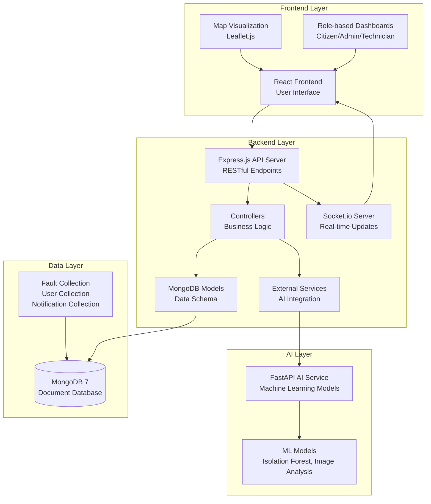
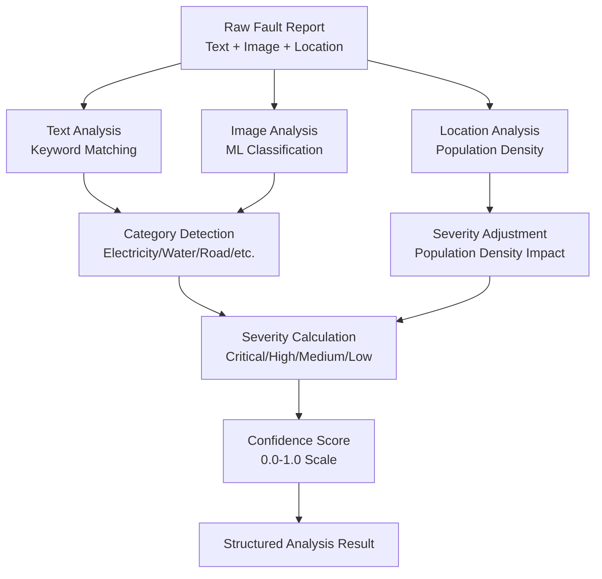
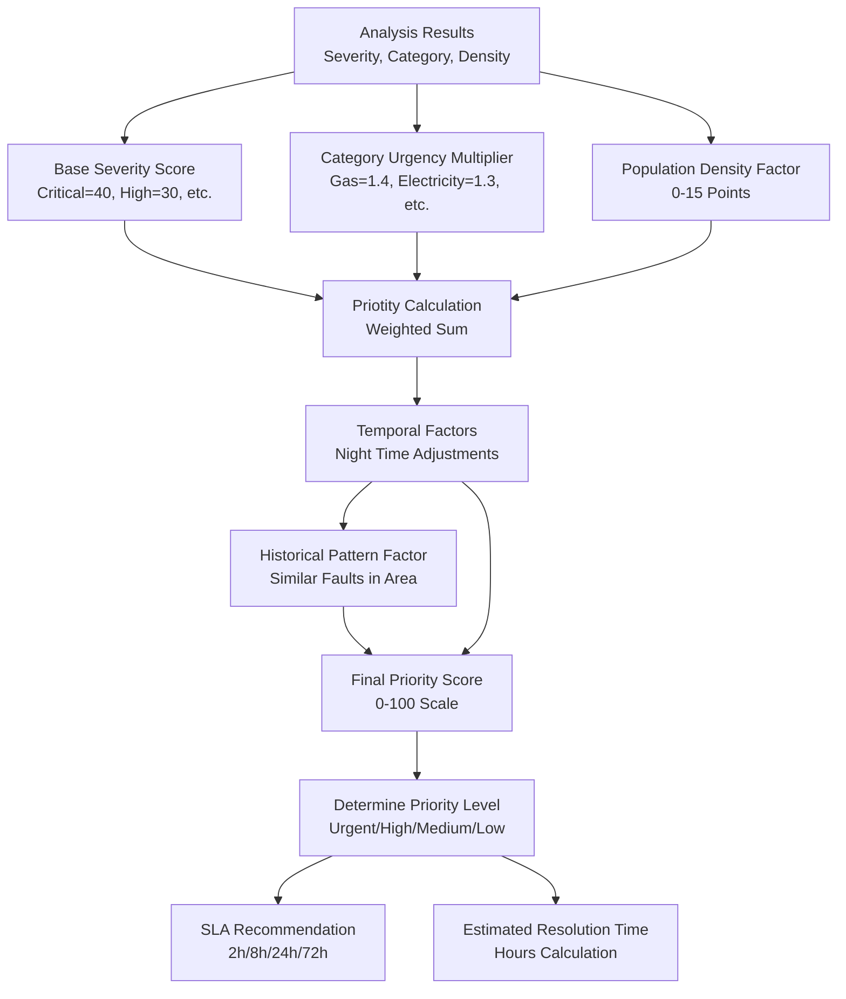
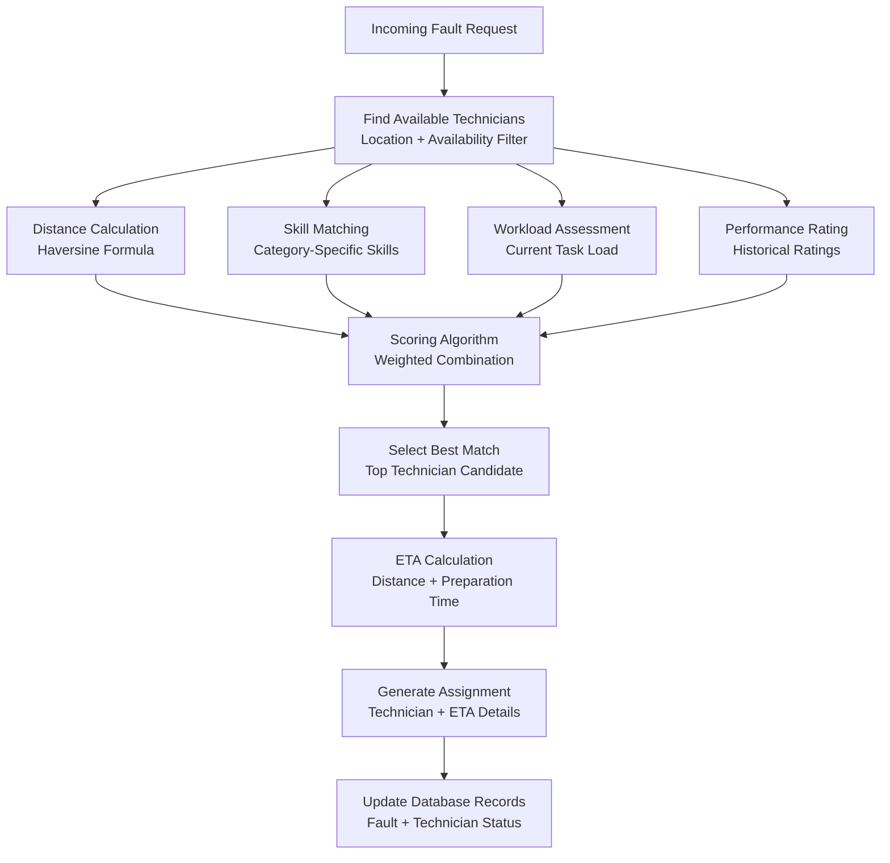
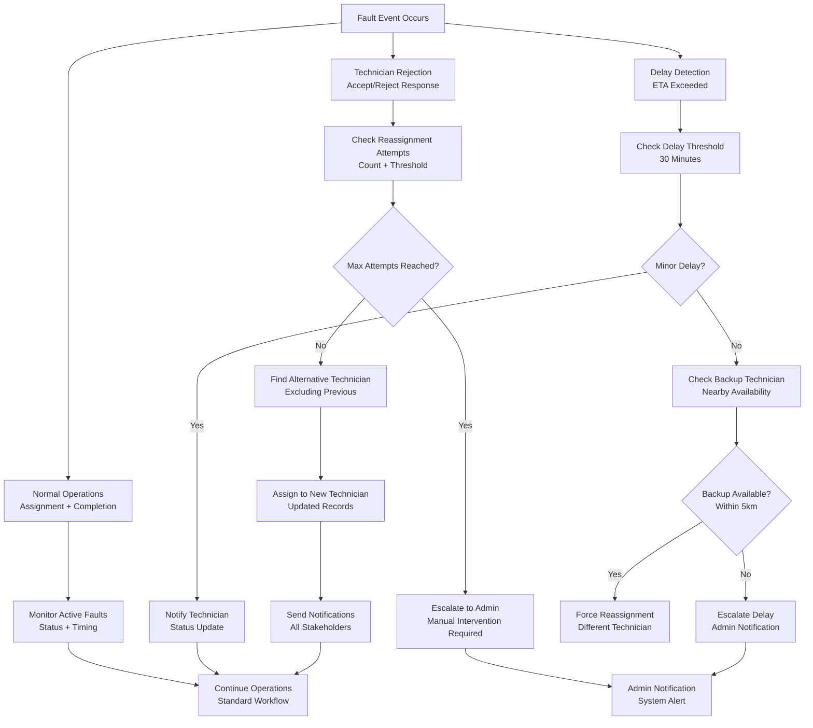
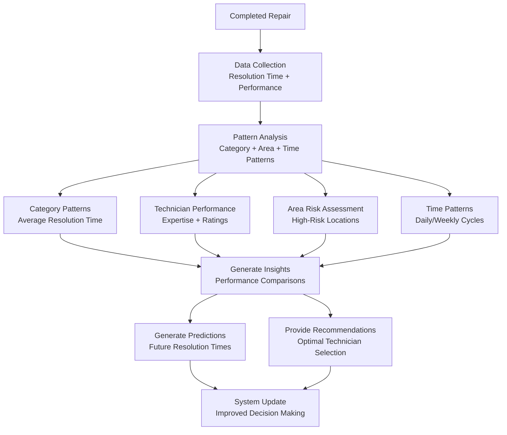
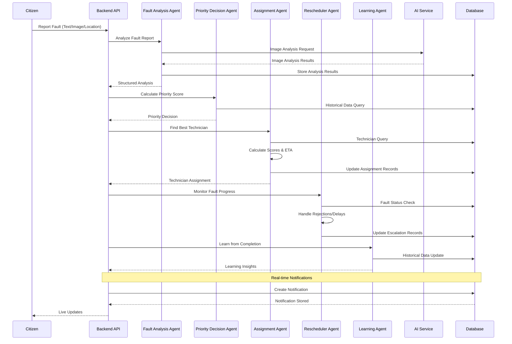
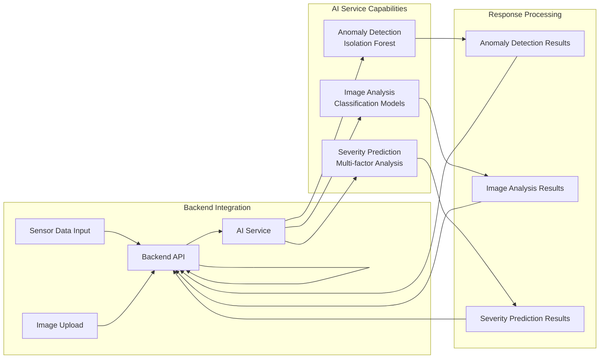
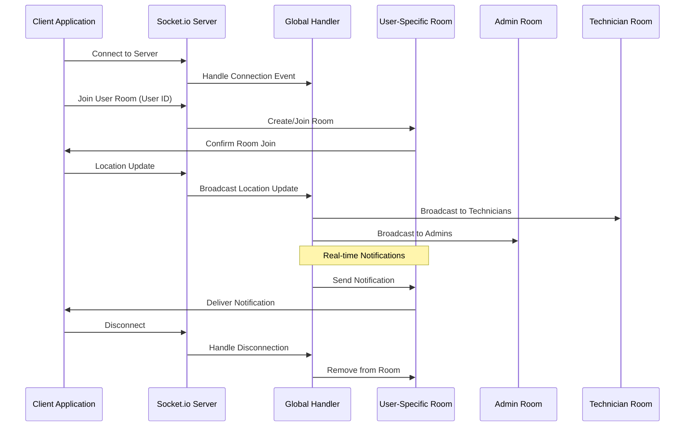
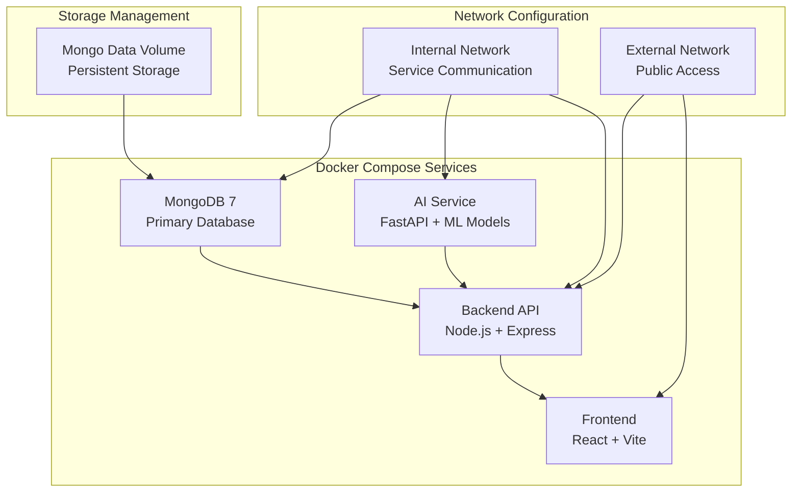

# Multi-Agent Architecture

<cite>
**Referenced Files in This Document**
- [README.md](file://README.md)
- [docker-compose.yml](file://docker-compose.yml)
- [server.js](file://backend/src/server.js)
- [main.py](file://ai-service/main.py)
- [faultAnalysisAgent.js](file://backend/src/agents/faultAnalysisAgent.js)
- [priorityDecisionAgent.js](file://backend/src/agents/priorityDecisionAgent.js)
- [assignmentAgent.js](file://backend/src/agents/assignmentAgent.js)
- [reschedulerAgent.js](file://backend/src/agents/reschedulerAgent.js)
- [learningAgent.js](file://backend/src/agents/learningAgent.js)
- [decisionAgent.js](file://backend/src/agents/decisionAgent.js)
- [aiService.js](file://backend/src/services/aiService.js)
- [Fault.js](file://backend/src/models/Fault.js)
- [User.js](file://backend/src/models/User.js)
- [notifier.js](file://backend/src/utils/notifier.js)
- [App.jsx](file://frontend/src/App.jsx)
</cite>

## Table of Contents
1. [Introduction](#introduction)
2. [System Architecture](#system-architecture)
3. [AI Agent Architecture](#ai-agent-architecture)
4. [Core Agent Components](#core-agent-components)
5. [Data Flow and Processing](#data-flow-and-processing)
6. [Integration Points](#integration-points)
7. [Real-time Communication](#real-time-communication)
8. [Performance Considerations](#performance-considerations)
9. [Deployment Architecture](#deployment-architecture)
10. [Conclusion](#conclusion)

## Introduction

The Valtryek_001 Multi-Agent AI Public Utility System is an intelligent, autonomous platform designed for smart city applications that enables citizens to report utility faults while AI agents automatically analyze, prioritize, and assign repairs. The system operates as a distributed multi-agent architecture with five specialized AI agents working in concert to provide efficient public utility management.

This system represents a sophisticated implementation of agent-based computing, where each agent specializes in specific aspects of the fault management lifecycle. The architecture leverages modern technologies including Node.js with Express.js for the backend API, React for the frontend interface, MongoDB for data persistence, and Python with FastAPI for AI services.

## System Architecture

The Valtryek_001 system follows a microservices architecture with clear separation of concerns across three main domains: frontend presentation, backend API services, and AI processing services.



**Diagram sources**
- [docker-compose.yml:1-42](file://docker-compose.yml#L1-L42)
- [server.js:1-74](file://backend/src/server.js#L1-L74)
- [main.py:1-209](file://ai-service/main.py#L1-L209)

The architecture employs a client-server model with real-time communication capabilities. The system is containerized using Docker and orchestrated with Docker Compose, enabling easy deployment and scaling across different environments.

**Section sources**
- [README.md:47-108](file://README.md#L47-L108)
- [docker-compose.yml:1-42](file://docker-compose.yml#L1-L42)

## AI Agent Architecture

The system implements a comprehensive multi-agent AI architecture consisting of five specialized agents, each responsible for distinct aspects of the fault management process. These agents work collaboratively to provide autonomous decision-making and intelligent resource allocation.

```mermaid
graph TB
subgraph "Multi-Agent AI System"
FA[Fault Analysis Agent<br/>Text + Image + Location Analysis]
PD[Priority Decision Agent<br/>Urgency Scoring & SLA]
AS[Assignment Agent<br/>Optimal Technician Matching]
RS[Rescheduler Agent<br/>Self-healing & Escalation]
LA[Learning Agent<br/>Pattern Recognition & Improvement]
end
subgraph "External Systems"
AI[AI Service<br/>ML Model Predictions]
DB[(MongoDB)<br/>Historical Data]
Users[(Users)<br/>Citizens, Technicians, Admins]
end
FA --> PD
PD --> AS
AS --> RS
RS --> LA
LA --> FA
FA --> AI
PD --> DB
AS --> DB
RS --> DB
LA --> DB
FA --> Users
AS --> Users
RS --> Users
```

**Diagram sources**
- [README.md:13-46](file://README.md#L13-L46)
- [faultAnalysisAgent.js:1-149](file://backend/src/agents/faultAnalysisAgent.js#L1-L149)
- [priorityDecisionAgent.js:1-177](file://backend/src/agents/priorityDecisionAgent.js#L1-L177)
- [assignmentAgent.js:1-258](file://backend/src/agents/assignmentAgent.js#L1-L258)
- [reschedulerAgent.js:1-304](file://backend/src/agents/reschedulerAgent.js#L1-L304)
- [learningAgent.js:1-396](file://backend/src/agents/learningAgent.js#L1-L396)

Each agent operates with specific responsibilities and maintains its own decision-making logic while coordinating with other agents through shared data structures and communication protocols.

**Section sources**
- [README.md:13-46](file://README.md#L13-L46)

## Core Agent Components

### Fault Analysis Agent

The Fault Analysis Agent serves as the initial intelligence layer, processing raw fault reports from multiple data sources including text descriptions, image uploads, and geographic coordinates. This agent performs comprehensive analysis to determine fault categories, severity levels, and confidence scores.



**Diagram sources**
- [faultAnalysisAgent.js:32-89](file://backend/src/agents/faultAnalysisAgent.js#L32-L89)

The agent utilizes predefined keyword dictionaries for category classification and severity indicator patterns. It also incorporates location-based analysis to adjust severity based on population density estimates, providing more nuanced fault prioritization.

**Section sources**
- [faultAnalysisAgent.js:1-149](file://backend/src/agents/faultAnalysisAgent.js#L1-L149)

### Priority Decision Agent

The Priority Decision Agent transforms raw fault analysis results into actionable priority scores using sophisticated weighting algorithms. This agent considers multiple factors including severity, category urgency, population density, historical patterns, and temporal factors.



**Diagram sources**
- [priorityDecisionAgent.js:37-111](file://backend/src/agents/priorityDecisionAgent.js#L37-L111)

The agent implements dynamic scoring algorithms that adapt to various operational contexts, ensuring appropriate resource allocation based on real-time conditions and historical patterns.

**Section sources**
- [priorityDecisionAgent.js:1-177](file://backend/src/agents/priorityDecisionAgent.js#L1-L177)

### Assignment Agent

The Assignment Agent optimizes technician allocation through comprehensive scoring algorithms that consider distance, skill matching, workload balance, and performance ratings. This agent ensures efficient resource utilization while maintaining service quality standards.



**Diagram sources**
- [assignmentAgent.js:127-190](file://backend/src/agents/assignmentAgent.js#L127-L190)

The agent implements a sophisticated multi-criteria decision-making process with mathematical formulas for distance calculations, skill matching algorithms, and workload balancing mechanisms.

**Section sources**
- [assignmentAgent.js:1-258](file://backend/src/agents/assignmentAgent.js#L1-L258)

### Rescheduler Agent

The Rescheduler Agent provides self-healing capabilities through automated conflict resolution, delay management, and escalation protocols. This agent ensures system resilience and maintains operational continuity even under adverse conditions.



**Diagram sources**
- [reschedulerAgent.js:27-112](file://backend/src/agents/reschedulerAgent.js#L27-L112)

The agent implements comprehensive error handling and recovery mechanisms, ensuring system reliability and continuous operation through intelligent conflict resolution.

**Section sources**
- [reschedulerAgent.js:1-304](file://backend/src/agents/reschedulerAgent.js#L1-L304)

### Learning Agent

The Learning Agent serves as the system's adaptive intelligence component, continuously improving decision-making capabilities through machine learning and pattern recognition. This agent maintains historical knowledge and generates actionable insights for system optimization.



**Diagram sources**
- [learningAgent.js:26-59](file://backend/src/agents/learningAgent.js#L26-L59)

The agent implements sophisticated statistical analysis and machine learning techniques to provide data-driven recommendations and predictive capabilities.

**Section sources**
- [learningAgent.js:1-396](file://backend/src/agents/learningAgent.js#L1-L396)

## Data Flow and Processing

The system orchestrates complex data flows between agents and external services, implementing a pipeline that transforms raw fault reports into actionable maintenance assignments.



**Diagram sources**
- [server.js:27-44](file://backend/src/server.js#L27-L44)
- [notifier.js:7-43](file://backend/src/utils/notifier.js#L7-L43)

The data flow implements asynchronous processing patterns with proper error handling and fallback mechanisms. Each stage maintains data integrity through database transactions and validation checks.

**Section sources**
- [server.js:1-74](file://backend/src/server.js#L1-L74)
- [notifier.js:1-113](file://backend/src/utils/notifier.js#L1-L113)

## Integration Points

The system integrates multiple external services and APIs to provide comprehensive functionality across different domains.

### AI Service Integration

The backend integrates with the AI service through HTTP requests, leveraging machine learning models for advanced fault analysis and prediction capabilities.



**Diagram sources**
- [aiService.js:3-8](file://backend/src/services/aiService.js#L3-L8)
- [main.py:46-64](file://ai-service/main.py#L46-L64)
- [main.py:70-106](file://ai-service/main.py#L70-L106)
- [main.py:112-174](file://ai-service/main.py#L112-L174)

### Database Integration

The system utilizes MongoDB for comprehensive data storage and retrieval, implementing optimized schemas for different entity types and indexing strategies for performance.

**Section sources**
- [aiService.js:1-9](file://backend/src/services/aiService.js#L1-L9)
- [Fault.js:1-75](file://backend/src/models/Fault.js#L1-L75)
- [User.js:1-37](file://backend/src/models/User.js#L1-L37)

## Real-time Communication

The system implements comprehensive real-time communication capabilities using Socket.io to provide live updates and notifications across all user roles.



**Diagram sources**
- [server.js:27-44](file://backend/src/server.js#L27-L44)

The real-time communication system supports multiple room-based communication patterns, enabling targeted notifications for different user roles and facilitating collaborative fault management workflows.

**Section sources**
- [server.js:1-74](file://backend/src/server.js#L1-L74)

## Performance Considerations

The multi-agent architecture implements several performance optimization strategies to ensure efficient operation under varying load conditions.

### Agent Coordination Optimization

Each agent maintains focused responsibilities with minimal inter-agent dependencies, reducing coupling and enabling parallel processing capabilities. The system employs asynchronous processing patterns to maximize throughput while maintaining data consistency.

### Database Performance

The MongoDB implementation utilizes strategic indexing on frequently queried fields including status, creation timestamps, and geographic coordinates. The fault schema includes compound indexes for common query patterns, optimizing performance for dashboard views and analytical queries.

### Memory Management

The Learning Agent maintains in-memory data structures for improved response times while implementing periodic persistence to persistent storage. This hybrid approach balances performance with data durability requirements.

### Scalability Patterns

The microservices architecture enables independent scaling of different components based on demand. The AI service can be scaled independently from the main API, allowing for specialized resource allocation based on machine learning computational requirements.

## Deployment Architecture

The system employs containerized deployment using Docker and orchestrated with Docker Compose, providing consistent environments across development, testing, and production deployments.



**Diagram sources**
- [docker-compose.yml:12-39](file://docker-compose.yml#L12-L39)

The deployment architecture ensures service isolation while maintaining efficient communication channels. Environment-specific configurations enable flexible deployment across different infrastructure environments.

**Section sources**
- [docker-compose.yml:1-42](file://docker-compose.yml#L1-L42)

## Conclusion

The Valtryek_001 Multi-Agent Architecture represents a sophisticated implementation of intelligent systems for public utility management. The five specialized AI agents work in harmony to provide autonomous fault detection, analysis, prioritization, assignment, and learning capabilities.

The system demonstrates advanced architectural patterns including microservices decomposition, real-time communication, machine learning integration, and adaptive learning systems. The modular design enables easy maintenance, scalability, and extension of functionality as requirements evolve.

Key strengths of the architecture include its self-healing capabilities through the Rescheduler Agent, continuous improvement via the Learning Agent, comprehensive real-time communication, and robust error handling mechanisms. The system provides a foundation for smart city infrastructure management while maintaining operational reliability and user satisfaction.

The multi-agent approach enables autonomous decision-making while preserving human oversight capabilities, striking an optimal balance between automation and human judgment in critical infrastructure management scenarios.