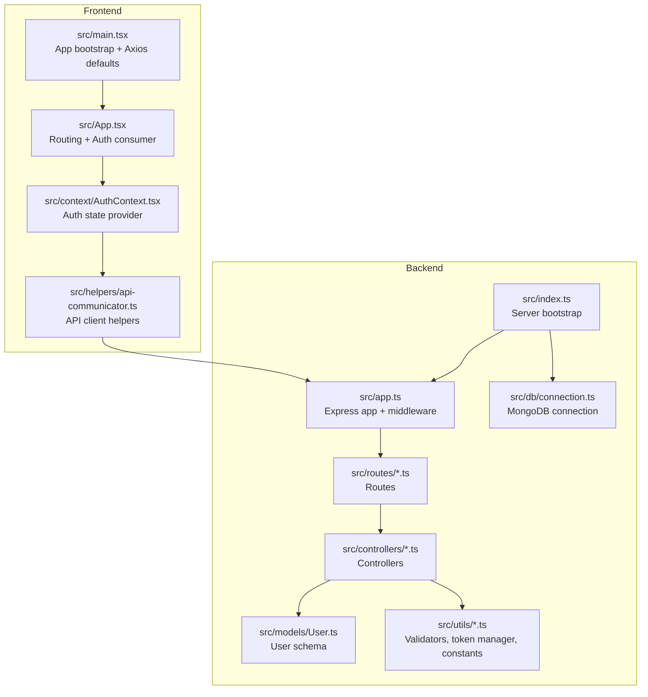
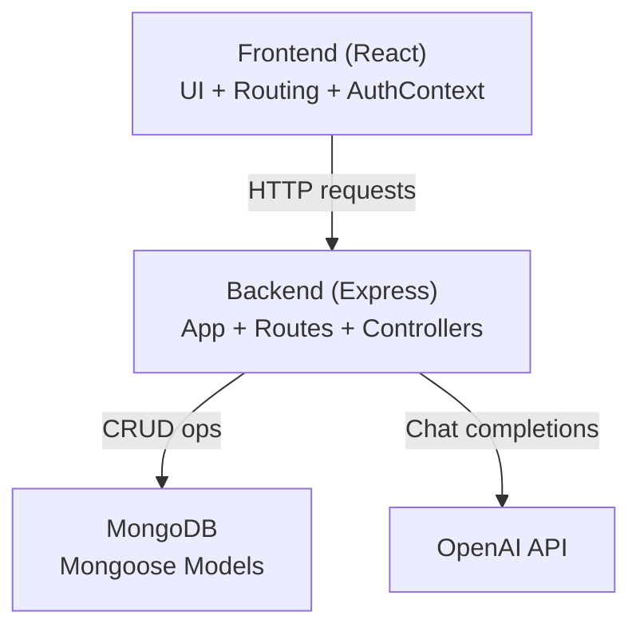
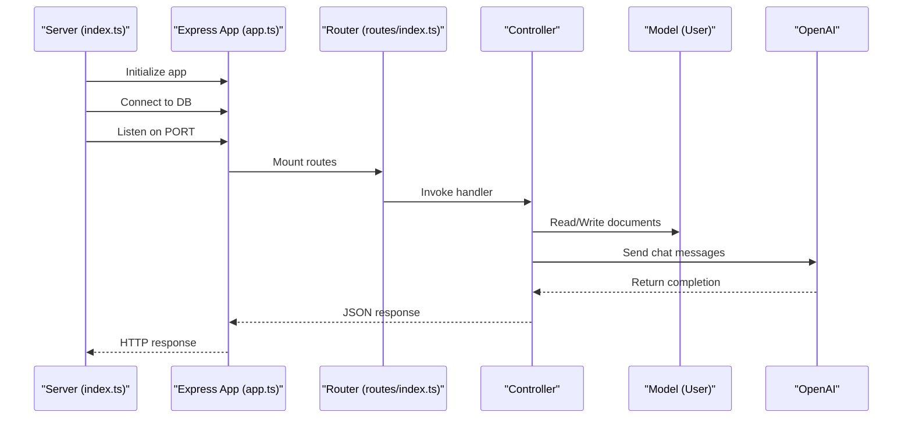
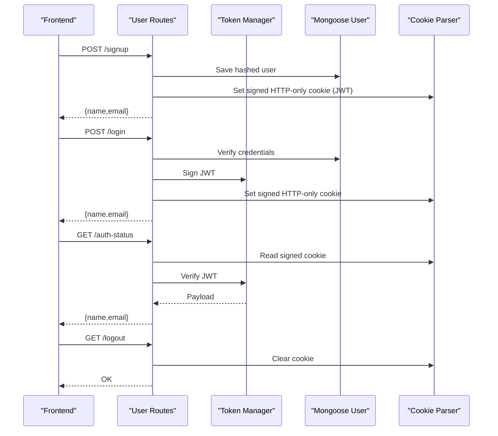
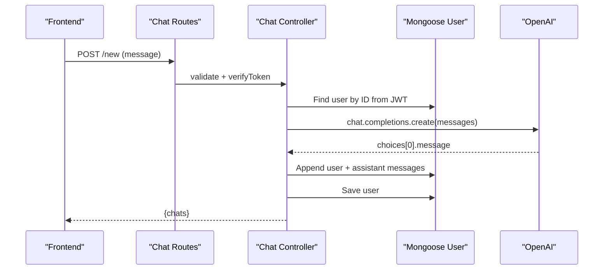
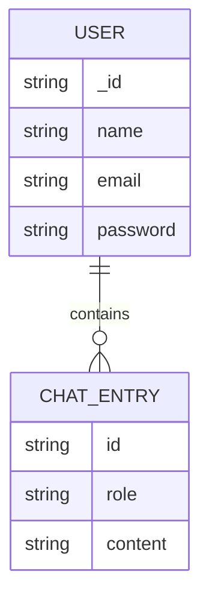
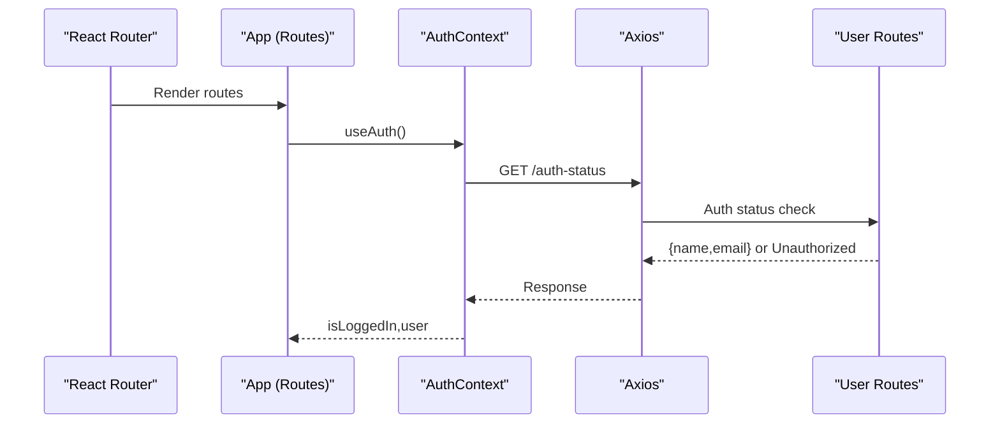
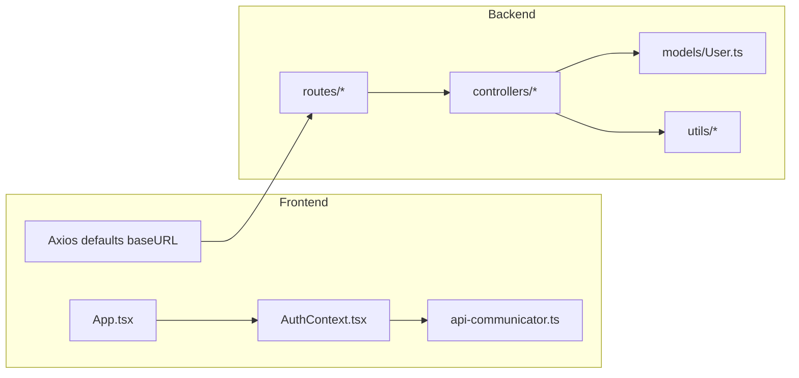
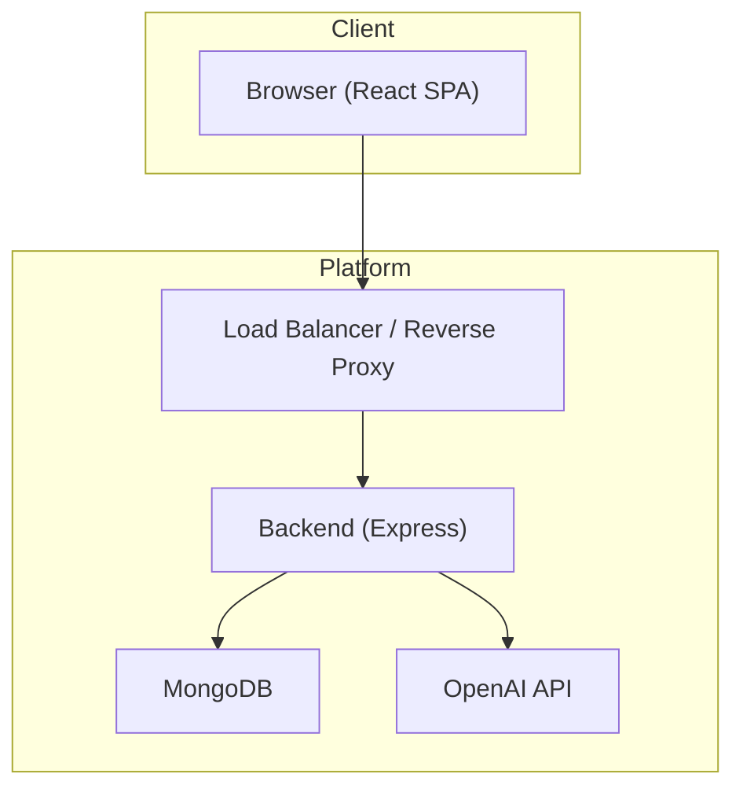

# System Architecture

<cite>
**Referenced Files in This Document**
- [README.md](file://README.md)
- [backend/src/index.ts](file://backend/src/index.ts)
- [backend/src/app.ts](file://backend/src/app.ts)
- [backend/src/db/connection.ts](file://backend/src/db/connection.ts)
- [backend/src/models/User.ts](file://backend/src/models/User.ts)
- [backend/src/controllers/chat-controllers.ts](file://backend/src/controllers/chat-controllers.ts)
- [backend/src/controllers/user-controllers.ts](file://backend/src/controllers/user-controllers.ts)
- [backend/src/routes/chat-routes.ts](file://backend/src/routes/chat-routes.ts)
- [backend/src/routes/user-routes.ts](file://backend/src/routes/user-routes.ts)
- [backend/src/utils/token-manager.ts](file://backend/src/utils/token-manager.ts)
- [backend/src/utils/validators.ts](file://backend/src/utils/validators.ts)
- [backend/src/utils/constants.ts](file://backend/src/utils/constants.ts)
- [frontend/src/main.tsx](file://frontend/src/main.tsx)
- [frontend/src/App.tsx](file://frontend/src/App.tsx)
- [frontend/src/context/AuthContext.tsx](file://frontend/src/context/AuthContext.tsx)
- [frontend/src/helpers/api-communicator.ts](file://frontend/src/helpers/api-communicator.ts)
</cite>

## Table of Contents
1. [Introduction](#introduction)
2. [Project Structure](#project-structure)
3. [Core Components](#core-components)
4. [Architecture Overview](#architecture-overview)
5. [Detailed Component Analysis](#detailed-component-analysis)
6. [Dependency Analysis](#dependency-analysis)
7. [Performance Considerations](#performance-considerations)
8. [Security and Authentication](#security-and-authentication)
9. [Real-Time Communication Patterns](#real-time-communication-patterns)
10. [Deployment Topology](#deployment-topology)
11. [Troubleshooting Guide](#troubleshooting-guide)
12. [Conclusion](#conclusion)

## Introduction
This document describes the system architecture of the SMAN-GPT AI Chat Application, a full-stack MERN-based chat platform integrating OpenAI’s API. The backend is implemented with Express and TypeScript, the frontend with React and Vite, and the database is MongoDB via Mongoose. Cross-cutting concerns include JWT-based authentication with HTTP-only cookies, request validation, and secure OpenAI integration. The system follows a layered architecture aligned with Model-View-Control (MVC) and employs patterns such as route protection, data validation, and centralized token verification.

## Project Structure
The repository is organized into two primary directories:
- backend: Express server with routing, controllers, models, database connection, and utilities.
- frontend: React application bootstrapped with Vite, Material UI, and a custom authentication context.

**Diagram sources**
- [backend/src/index.ts:1-13](file://backend/src/index.ts#L1-L13)
- [backend/src/app.ts:1-21](file://backend/src/app.ts#L1-L21)
- [backend/src/db/connection.ts:1-21](file://backend/src/db/connection.ts#L1-L21)
- [backend/src/models/User.ts:1-35](file://backend/src/models/User.ts#L1-L35)
- [backend/src/controllers/chat-controllers.ts:1-89](file://backend/src/controllers/chat-controllers.ts#L1-L89)
- [backend/src/controllers/user-controllers.ts:1-163](file://backend/src/controllers/user-controllers.ts#L1-L163)
- [backend/src/routes/chat-routes.ts:1-22](file://backend/src/routes/chat-routes.ts#L1-L22)
- [backend/src/routes/user-routes.ts:1-25](file://backend/src/routes/user-routes.ts#L1-L25)
- [backend/src/utils/token-manager.ts:1-35](file://backend/src/utils/token-manager.ts#L1-L35)
- [backend/src/utils/validators.ts:1-36](file://backend/src/utils/validators.ts#L1-L36)
- [backend/src/utils/constants.ts:1-2](file://backend/src/utils/constants.ts#L1-L2)
- [frontend/src/main.tsx:1-30](file://frontend/src/main.tsx#L1-L30)
- [frontend/src/App.tsx:1-30](file://frontend/src/App.tsx#L1-L30)
- [frontend/src/context/AuthContext.tsx:1-76](file://frontend/src/context/AuthContext.tsx#L1-L76)
- [frontend/src/helpers/api-communicator.ts](file://frontend/src/helpers/api-communicator.ts)

**Section sources**
- [README.md:27-42](file://README.md#L27-L42)
- [backend/src/index.ts:1-13](file://backend/src/index.ts#L1-L13)
- [backend/src/app.ts:1-21](file://backend/src/app.ts#L1-L21)
- [frontend/src/main.tsx:1-30](file://frontend/src/main.tsx#L1-L30)

## Core Components
- Backend server bootstrap and middleware pipeline:
  - Server initialization connects to MongoDB and listens on a configured port.
  - Express app configures CORS, JSON parsing, cookie parsing, logging, and mounts API routes under a versioned base path.
- Controllers:
  - User controller handles sign-up, login, verification, and logout with token creation and cookie management.
  - Chat controller manages AI chat completion via OpenAI, persists conversations per user, and supports retrieval and deletion of chat history.
- Models:
  - User model defines schema with nested chat entries (id, role, content).
- Routes:
  - User routes expose endpoints for listing users, signing up, logging in, verifying session, and logging out.
  - Chat routes expose endpoints for generating completions, retrieving chats, and deleting chats; all protected by token verification.
- Utilities:
  - Token manager creates and verifies JWTs and populates request locals for downstream handlers.
  - Validators enforce request field constraints using express-validator.
  - Constants define cookie name used across auth flows.
- Frontend:
  - App bootstraps with theme provider, routing, and authentication provider.
  - Auth context maintains logged-in state, user profile, and exposes login/signup/logout actions.
  - API helpers encapsulate HTTP calls to backend endpoints.

**Section sources**
- [backend/src/index.ts:1-13](file://backend/src/index.ts#L1-L13)
- [backend/src/app.ts:1-21](file://backend/src/app.ts#L1-L21)
- [backend/src/controllers/user-controllers.ts:1-163](file://backend/src/controllers/user-controllers.ts#L1-L163)
- [backend/src/controllers/chat-controllers.ts:1-89](file://backend/src/controllers/chat-controllers.ts#L1-L89)
- [backend/src/models/User.ts:1-35](file://backend/src/models/User.ts#L1-L35)
- [backend/src/routes/user-routes.ts:1-25](file://backend/src/routes/user-routes.ts#L1-L25)
- [backend/src/routes/chat-routes.ts:1-22](file://backend/src/routes/chat-routes.ts#L1-L22)
- [backend/src/utils/token-manager.ts:1-35](file://backend/src/utils/token-manager.ts#L1-L35)
- [backend/src/utils/validators.ts:1-36](file://backend/src/utils/validators.ts#L1-L36)
- [backend/src/utils/constants.ts:1-2](file://backend/src/utils/constants.ts#L1-L2)
- [frontend/src/main.tsx:1-30](file://frontend/src/main.tsx#L1-L30)
- [frontend/src/context/AuthContext.tsx:1-76](file://frontend/src/context/AuthContext.tsx#L1-L76)

## Architecture Overview
The system follows a layered MERN architecture with clear separation of concerns:
- Presentation Layer (React): Renders UI, manages routing, and state via a custom context provider.
- Application Layer (Express): Orchestrates requests, applies middleware, enforces validation, and delegates to controllers.
- Domain Layer (Controllers): Implements business logic for user and chat operations.
- Persistence Layer (MongoDB/Mongoose): Stores user profiles and chat histories.
- External Integration (OpenAI): Consumed by chat controller to generate AI responses.

**Diagram sources**
- [frontend/src/main.tsx:1-30](file://frontend/src/main.tsx#L1-L30)
- [frontend/src/App.tsx:1-30](file://frontend/src/App.tsx#L1-L30)
- [frontend/src/context/AuthContext.tsx:1-76](file://frontend/src/context/AuthContext.tsx#L1-L76)
- [backend/src/app.ts:1-21](file://backend/src/app.ts#L1-L21)
- [backend/src/routes/user-routes.ts:1-25](file://backend/src/routes/user-routes.ts#L1-L25)
- [backend/src/routes/chat-routes.ts:1-22](file://backend/src/routes/chat-routes.ts#L1-L22)
- [backend/src/controllers/user-controllers.ts:1-163](file://backend/src/controllers/user-controllers.ts#L1-L163)
- [backend/src/controllers/chat-controllers.ts:1-89](file://backend/src/controllers/chat-controllers.ts#L1-L89)
- [backend/src/models/User.ts:1-35](file://backend/src/models/User.ts#L1-L35)

## Detailed Component Analysis

### Backend Bootstrapping and Middleware Pipeline
- Server startup initializes database connection and starts the HTTP server.
- Express app configures CORS for the frontend origin, JSON parsing, cookie parsing with a secret, development logging, and mounts the API router under a versioned base path.

**Diagram sources**
- [backend/src/index.ts:1-13](file://backend/src/index.ts#L1-L13)
- [backend/src/app.ts:1-21](file://backend/src/app.ts#L1-L21)
- [backend/src/routes/chat-routes.ts:1-22](file://backend/src/routes/chat-routes.ts#L1-L22)
- [backend/src/controllers/chat-controllers.ts:1-89](file://backend/src/controllers/chat-controllers.ts#L1-L89)
- [backend/src/models/User.ts:1-35](file://backend/src/models/User.ts#L1-L35)

**Section sources**
- [backend/src/index.ts:1-13](file://backend/src/index.ts#L1-L13)
- [backend/src/app.ts:1-21](file://backend/src/app.ts#L1-L21)

### User Authentication Flow
- Registration and login hash passwords, create a JWT, and set an HTTP-only signed cookie.
- Verification endpoint reads the cookie, validates the JWT, and returns user info.
- Logout clears the cookie and returns a success message.

**Diagram sources**
- [backend/src/routes/user-routes.ts:1-25](file://backend/src/routes/user-routes.ts#L1-L25)
- [backend/src/controllers/user-controllers.ts:1-163](file://backend/src/controllers/user-controllers.ts#L1-L163)
- [backend/src/utils/token-manager.ts:1-35](file://backend/src/utils/token-manager.ts#L1-L35)
- [backend/src/utils/constants.ts:1-2](file://backend/src/utils/constants.ts#L1-L2)
- [backend/src/models/User.ts:1-35](file://backend/src/models/User.ts#L1-L35)

**Section sources**
- [backend/src/controllers/user-controllers.ts:22-108](file://backend/src/controllers/user-controllers.ts#L22-L108)
- [backend/src/utils/token-manager.ts:13-34](file://backend/src/utils/token-manager.ts#L13-L34)
- [backend/src/utils/constants.ts:1-2](file://backend/src/utils/constants.ts#L1-L2)

### Chat Completion Workflow
- The chat controller retrieves the current user from request locals, composes the conversation history, sends it to OpenAI, appends the assistant’s reply, persists the updated chat array, and returns the full conversation.

**Diagram sources**
- [backend/src/routes/chat-routes.ts:1-22](file://backend/src/routes/chat-routes.ts#L1-L22)
- [backend/src/controllers/chat-controllers.ts:7-43](file://backend/src/controllers/chat-controllers.ts#L7-L43)
- [backend/src/models/User.ts:1-35](file://backend/src/models/User.ts#L1-L35)

**Section sources**
- [backend/src/controllers/chat-controllers.ts:7-43](file://backend/src/controllers/chat-controllers.ts#L7-L43)
- [backend/src/routes/chat-routes.ts:10-19](file://backend/src/routes/chat-routes.ts#L10-L19)

### Data Model: User and Chat Entries
The User model embeds an array of chat entries, each with an id, role, and content. This enables storing conversational history alongside user data.

**Diagram sources**
- [backend/src/models/User.ts:1-35](file://backend/src/models/User.ts#L1-L35)

**Section sources**
- [backend/src/models/User.ts:1-35](file://backend/src/models/User.ts#L1-L35)

### Frontend Integration and State Management
- The React app sets Axios defaults to the backend base URL and enables credential passing for cookie support.
- The Auth provider initializes login state by checking the backend auth status, and exposes login/signup/logout functions that update local state and trigger navigation.

**Diagram sources**
- [frontend/src/App.tsx:1-30](file://frontend/src/App.tsx#L1-L30)
- [frontend/src/context/AuthContext.tsx:1-76](file://frontend/src/context/AuthContext.tsx#L1-L76)
- [frontend/src/main.tsx:1-30](file://frontend/src/main.tsx#L1-L30)
- [backend/src/routes/user-routes.ts:21](file://backend/src/routes/user-routes.ts#L21)

**Section sources**
- [frontend/src/main.tsx:9-11](file://frontend/src/main.tsx#L9-L11)
- [frontend/src/context/AuthContext.tsx:28-43](file://frontend/src/context/AuthContext.tsx#L28-L43)
- [frontend/src/App.tsx:10-26](file://frontend/src/App.tsx#L10-L26)

## Dependency Analysis
- Backend dependencies:
  - Express app depends on routes, controllers, models, and utilities.
  - Controllers depend on models and external services (OpenAI).
  - Routes depend on validators and token verification middleware.
- Frontend dependencies:
  - App depends on routing and AuthContext.
  - AuthContext depends on API helpers that call backend endpoints.
  - Axios defaults target the backend API base URL.

**Diagram sources**
- [frontend/src/App.tsx:1-30](file://frontend/src/App.tsx#L1-L30)
- [frontend/src/context/AuthContext.tsx:1-76](file://frontend/src/context/AuthContext.tsx#L1-L76)
- [frontend/src/main.tsx:9-11](file://frontend/src/main.tsx#L9-L11)
- [backend/src/routes/chat-routes.ts:1-22](file://backend/src/routes/chat-routes.ts#L1-L22)
- [backend/src/routes/user-routes.ts:1-25](file://backend/src/routes/user-routes.ts#L1-L25)
- [backend/src/controllers/chat-controllers.ts:1-89](file://backend/src/controllers/chat-controllers.ts#L1-L89)
- [backend/src/controllers/user-controllers.ts:1-163](file://backend/src/controllers/user-controllers.ts#L1-L163)
- [backend/src/models/User.ts:1-35](file://backend/src/models/User.ts#L1-L35)
- [backend/src/utils/token-manager.ts:1-35](file://backend/src/utils/token-manager.ts#L1-L35)
- [backend/src/utils/validators.ts:1-36](file://backend/src/utils/validators.ts#L1-L36)

**Section sources**
- [backend/src/app.ts:4-18](file://backend/src/app.ts#L4-L18)
- [backend/src/routes/user-routes.ts:1-25](file://backend/src/routes/user-routes.ts#L1-L25)
- [backend/src/routes/chat-routes.ts:1-22](file://backend/src/routes/chat-routes.ts#L1-L22)
- [frontend/src/main.tsx:9-11](file://frontend/src/main.tsx#L9-L11)

## Performance Considerations
- Request validation reduces unnecessary controller work by short-circuiting invalid requests early.
- JWT verification occurs once per protected route and caches decoded payload in request locals for downstream handlers.
- OpenAI API calls are synchronous within request handling; consider asynchronous streaming or batching for improved responsiveness in future enhancements.
- Cookie-based sessions avoid repeated token transmission overhead while maintaining security.

[No sources needed since this section provides general guidance]

## Security and Authentication
- Authentication flow:
  - Tokens are created on successful sign-up/login and stored as HTTP-only signed cookies.
  - Protected routes enforce token verification middleware before invoking controllers.
  - Logout clears the cookie to invalidate the session.
- Data validation:
  - Express-validator enforces field presence and length/format constraints prior to controller execution.
- Environment variables:
  - Secrets for JWT, MongoDB, and OpenAI are loaded from environment configuration.

**Section sources**
- [backend/src/controllers/user-controllers.ts:36-53](file://backend/src/controllers/user-controllers.ts#L36-L53)
- [backend/src/controllers/user-controllers.ts:90-99](file://backend/src/controllers/user-controllers.ts#L90-L99)
- [backend/src/utils/token-manager.ts:13-34](file://backend/src/utils/token-manager.ts#L13-L34)
- [backend/src/utils/validators.ts:20-35](file://backend/src/utils/validators.ts#L20-L35)
- [backend/src/app.ts:11-13](file://backend/src/app.ts#L11-L13)

## Real-Time Communication Patterns
- Current implementation uses RESTful HTTP requests for chat generation and history retrieval.
- No WebSocket or server-sent events are present in the codebase; therefore, real-time streaming updates are not implemented.

[No sources needed since this section analyzes absence of features]

## Deployment Topology
- Frontend runs on a static server or SPA hosting and communicates with the backend API.
- Backend serves the API and stores data in MongoDB.
- OpenAI API is accessed over HTTPS from the backend.

[No sources needed since this diagram shows conceptual deployment topology]

## Troubleshooting Guide
- Server fails to start:
  - Verify database connectivity and environment variables for the backend.
- CORS errors:
  - Confirm frontend origin matches the configured CORS origin and credentials are enabled.
- Authentication failures:
  - Ensure cookies are being sent with requests and the cookie secret is consistent.
- Validation errors:
  - Inspect returned validation errors for missing or malformed fields.
- OpenAI integration issues:
  - Confirm API key and organization ID are set and reachable from the backend runtime.

**Section sources**
- [backend/src/db/connection.ts:1-21](file://backend/src/db/connection.ts#L1-L21)
- [backend/src/app.ts:11-18](file://backend/src/app.ts#L11-L18)
- [backend/src/utils/validators.ts:4-18](file://backend/src/utils/validators.ts#L4-L18)
- [backend/src/controllers/chat-controllers.ts:20-29](file://backend/src/controllers/chat-controllers.ts#L20-L29)

## Conclusion
SMAN-GPT implements a clean, layered MERN architecture with Express controllers managing user and chat operations, Mongoose models persisting user and chat data, and a React frontend handling routing and authentication state. JWT-based session management with HTTP-only cookies ensures secure authentication, while express-validator provides robust input validation. OpenAI integration is encapsulated within the chat controller, enabling scalable extension. The current design relies on REST for real-time communication, but the modular structure supports future enhancements such as WebSocket integration.