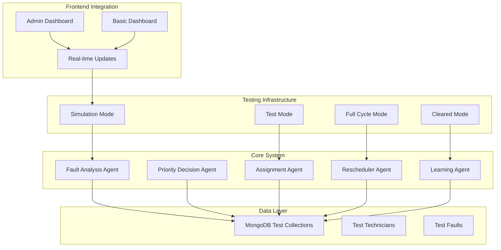
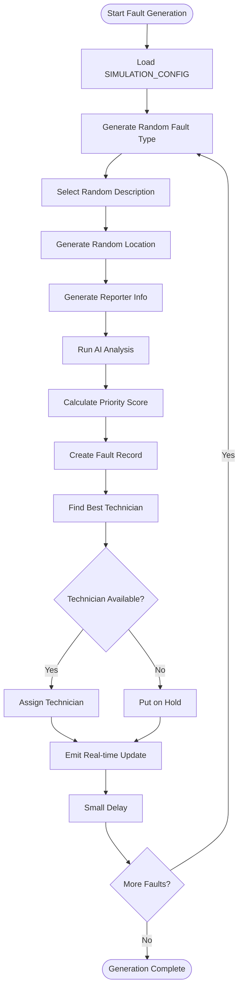
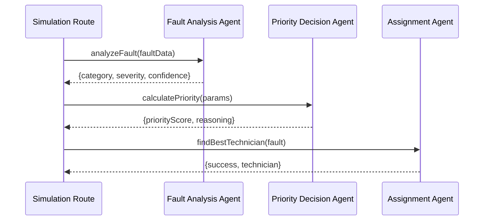
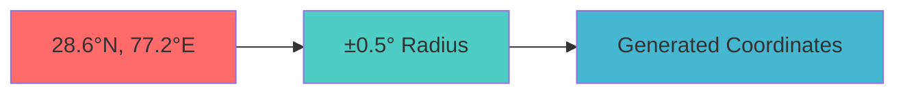

# Simulation and Testing Mode

<cite>
**Referenced Files in This Document**
- [simulationRoutes.js](file://backend/src/routes/simulationRoutes.js)
- [faultController.js](file://backend/src/controllers/faultController.js)
- [Fault.js](file://backend/src/models/Fault.js)
- [aiService.js](file://backend/src/services/aiService.js)
- [AdminDashboard.jsx](file://frontend/src/pages/AdminDashboard.jsx)
- [Dashboard.jsx](file://frontend/src/pages/Dashboard.jsx)
- [faultAnalysisAgent.js](file://backend/src/agents/faultAnalysisAgent.js)
- [priorityDecisionAgent.js](file://backend/src/agents/priorityDecisionAgent.js)
- [assignmentAgent.js](file://backend/src/agents/assignmentAgent.js)
- [reschedulerAgent.js](file://backend/src/agents/reschedulerAgent.js)
- [learningAgent.js](file://backend/src/agents/learningAgent.js)
- [server.js](file://backend/src/server.js)
- [docker-compose.yml](file://docker-compose.yml)
- [Dockerfile](file://backend/Dockerfile)
- [frontend Dockerfile](file://frontend/Dockerfile)
</cite>

## Table of Contents
1. [Introduction](#introduction)
2. [System Architecture](#system-architecture)
3. [Core Simulation Components](#core-simulation-components)
4. [Testing Mode Features](#testing-mode-features)
5. [AI Agent Integration](#ai-agent-integration)
6. [Real-time Simulation](#real-time-simulation)
7. [Data Generation Patterns](#data-generation-patterns)
8. [Performance Considerations](#performance-considerations)
9. [Troubleshooting Guide](#troubleshooting-guide)
10. [Conclusion](#conclusion)

## Introduction

The Simulation and Testing Mode is a comprehensive testing framework designed to validate the complete fault management system workflow. This mode enables developers and administrators to generate synthetic data, simulate real-world scenarios, and test system behavior under various conditions without affecting production data.

The system provides four distinct simulation modes: fault generation, technician simulation, response simulation, and full cycle simulation. Each mode serves specific testing objectives while maintaining data isolation through dedicated test datasets.

## System Architecture

The simulation system operates as an integrated component within the larger fault management platform, leveraging the same core infrastructure while providing isolated testing environments.

**Diagram sources**
- [simulationRoutes.js:102-434](file://backend/src/routes/simulationRoutes.js#L102-L434)
- [server.js:1-74](file://backend/src/server.js#L1-L74)

## Core Simulation Components

### Fault Generation Engine

The fault generation engine creates realistic synthetic faults using predefined templates and randomization algorithms. It generates diverse fault types, severities, and locations within configurable geographic boundaries.

**Diagram sources**
- [simulationRoutes.js:84-168](file://backend/src/routes/simulationRoutes.js#L84-L168)

### Technician Simulation System

The technician simulation creates a pool of test technicians with predefined skills, locations, and availability status. These virtual technicians serve as test subjects for assignment algorithms and workflow validation.

**Section sources**
- [simulationRoutes.js:174-228](file://backend/src/routes/simulationRoutes.js#L174-L228)

### Response Simulation Engine

The response simulation validates technician acceptance/rejection workflows and automated rescheduling mechanisms. It simulates realistic response rates and failure scenarios.

**Section sources**
- [simulationRoutes.js:234-272](file://backend/src/routes/simulationRoutes.js#L234-L272)

### Full Cycle Simulation

The full cycle simulation orchestrates complete end-to-end testing by coordinating all simulation components in proper sequence: technician creation → fault generation → response simulation → completion simulation.

**Section sources**
- [simulationRoutes.js:326-434](file://backend/src/routes/simulationRoutes.js#L326-L434)

## Testing Mode Features

### Isolated Test Data Management

The system maintains strict separation between test and production data through naming conventions and filtering mechanisms:

- **Test Faults**: Identified by reporter names starting with "Citizen"
- **Test Technicians**: Identified by email domains ending with "@test.com"
- **Automatic Cleanup**: Dedicated endpoint for removing all test data

### Configurable Simulation Parameters

Each simulation mode supports customizable parameters for realistic testing scenarios:

| Parameter | Default Value | Description |
|-----------|---------------|-------------|
| Fault Count | 5 | Number of faults to generate |
| Acceptance Rate | 0.8 | Probability of technician acceptance |
| Completion Rate | 0.3 | Probability of fault completion |
| Geographic Radius | 0.5° | Testing area coverage in degrees |

### Real-time Monitoring

The simulation system integrates with the real-time notification system, allowing live monitoring of generated events through WebSocket connections.

**Section sources**
- [simulationRoutes.js:440-463](file://backend/src/routes/simulationRoutes.js#L440-L463)

## AI Agent Integration

The simulation system leverages the same AI agents used in production, ensuring accurate and realistic behavior testing.

### Fault Analysis Integration

**Diagram sources**
- [simulationRoutes.js:110-136](file://backend/src/routes/simulationRoutes.js#L110-L136)
- [faultAnalysisAgent.js:32-89](file://backend/src/agents/faultAnalysisAgent.js#L32-L89)
- [priorityDecisionAgent.js:37-111](file://backend/src/agents/priorityDecisionAgent.js#L37-L111)
- [assignmentAgent.js:127-190](file://backend/src/agents/assignmentAgent.js#L127-L190)

### Priority Calculation Validation

The simulation validates priority calculation logic by generating faults with known characteristics and verifying score calculations against expected values.

**Section sources**
- [priorityDecisionAgent.js:37-111](file://backend/src/agents/priorityDecisionAgent.js#L37-L111)

### Assignment Algorithm Testing

The assignment system is tested by generating faults with varying distances, skill requirements, and workload conditions to validate optimal assignment logic.

**Section sources**
- [assignmentAgent.js:127-190](file://backend/src/agents/assignmentAgent.js#L127-L190)

## Real-time Simulation

The simulation system integrates with Socket.io for real-time event broadcasting, enabling live monitoring of generated activities.

### Event Broadcasting

| Event Type | Trigger | Data Payload |
|------------|---------|--------------|
| newFault | Fault Generated | Fault details + Priority + Technician |
| faultStatusUpdated | Status Change | Updated fault record |
| faultReassigned | Technician Change | Reassignment details |
| technicianLocationUpdate | Location Update | Technician position |

### Frontend Integration

The React frontend components automatically subscribe to simulation events and update displays in real-time:

- **Admin Dashboard**: Comprehensive fault monitoring with filtering capabilities
- **Basic Dashboard**: Simplified fault display with real-time updates
- **Map Visualization**: Interactive fault location mapping

**Section sources**
- [AdminDashboard.jsx:66-77](file://frontend/src/pages/AdminDashboard.jsx#L66-L77)
- [Dashboard.jsx:35-42](file://frontend/src/pages/Dashboard.jsx#L35-L42)

## Data Generation Patterns

### Geographic Distribution

The simulation system generates faults within a configurable geographic boundary centered around Delhi NCR coordinates:

**Diagram sources**
- [simulationRoutes.js:66-79](file://backend/src/routes/simulationRoutes.js#L66-L79)

### Fault Type Distribution

The system generates balanced distributions across seven fault categories with category-specific description sets.

**Section sources**
- [simulationRoutes.js:12-69](file://backend/src/routes/simulationRoutes.js#L12-L69)

## Performance Considerations

### Scalability Limits

The simulation system includes built-in throttling mechanisms to prevent overwhelming the system during large-scale testing:

- **Generation Delays**: 100ms delays between fault creations
- **Batch Processing**: Sequential processing to maintain stability
- **Memory Management**: In-memory cleanup after simulation completion

### Resource Optimization

- **Lazy Loading**: Agents are dynamically imported only when needed
- **Database Indexing**: Optimized queries for test data filtering
- **Connection Pooling**: Efficient database connection management

### Monitoring and Metrics

The system provides comprehensive logging and metrics collection for performance analysis:

- **Error Tracking**: Comprehensive error handling and reporting
- **Execution Timing**: Performance measurement for critical operations
- **Resource Usage**: Memory and CPU utilization monitoring

**Section sources**
- [simulationRoutes.js:154-156](file://backend/src/routes/simulationRoutes.js#L154-L156)

## Troubleshooting Guide

### Common Issues and Solutions

| Issue | Symptoms | Solution |
|-------|----------|----------|
| No Test Technicians | Simulation fails with "No available technicians" | Run `/api/simulate/technicians` endpoint |
| Fault Generation Errors | Errors during fault creation | Verify MongoDB connectivity and agent availability |
| Socket Connection Failures | Real-time updates not appearing | Check Socket.io server configuration |
| Performance Degradation | Slow simulation execution | Reduce fault count or increase delays |

### Debugging Tools

The system provides several debugging endpoints:

- **Status Endpoint**: `/api/simulate/status` - Current system state
- **Clear Data**: `/api/simulate/clear` - Remove all test data
- **Health Check**: Root endpoint `/` - System health verification

### Error Handling

All simulation endpoints include comprehensive error handling with detailed error messages and appropriate HTTP status codes.

**Section sources**
- [simulationRoutes.js:469-488](file://backend/src/routes/simulationRoutes.js#L469-L488)

## Conclusion

The Simulation and Testing Mode provides a comprehensive framework for validating the fault management system's functionality, performance, and reliability. By generating realistic synthetic data and simulating complete workflow scenarios, it enables thorough testing without impacting production systems.

Key benefits include:

- **Complete Workflow Validation**: Tests entire fault lifecycle from reporting to completion
- **Realistic Scenario Generation**: Creates diverse and representative test data
- **Real-time Monitoring**: Live event streaming for immediate feedback
- **Isolated Testing Environment**: Safe testing without production data contamination
- **Performance Benchmarking**: Validates system performance under various load conditions

The modular architecture ensures that individual components can be tested independently while maintaining the ability to validate end-to-end workflows. This comprehensive testing capability is essential for maintaining system quality and reliability in production environments.