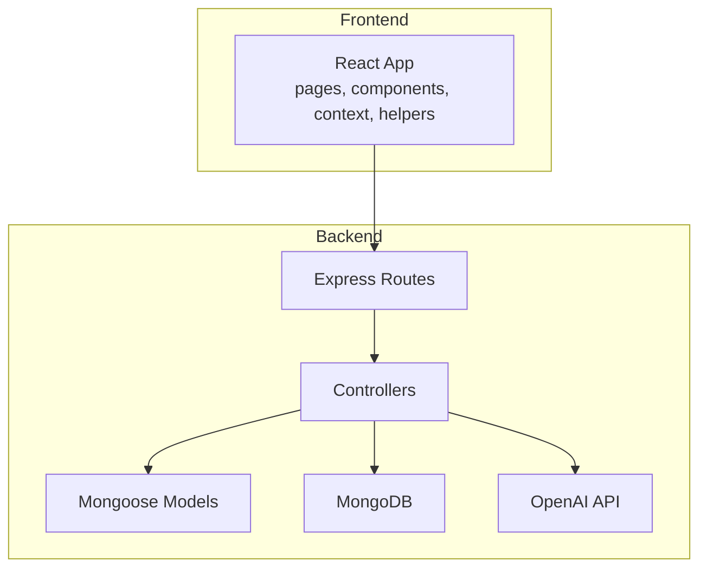
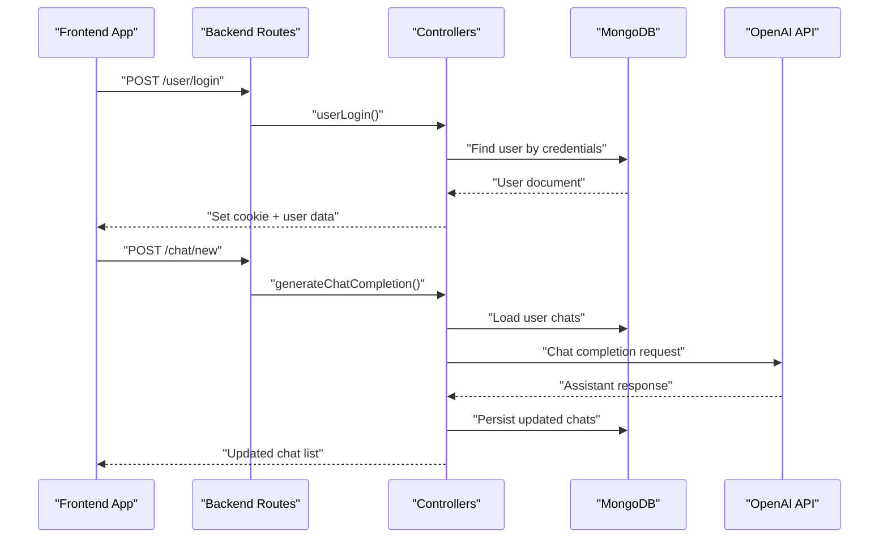
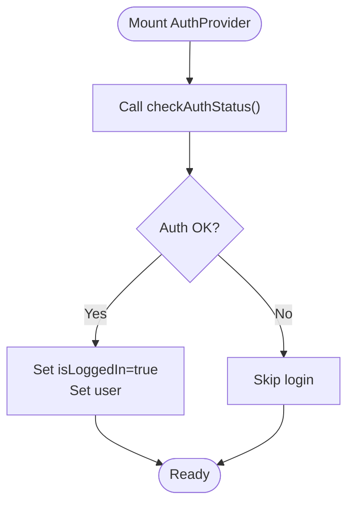
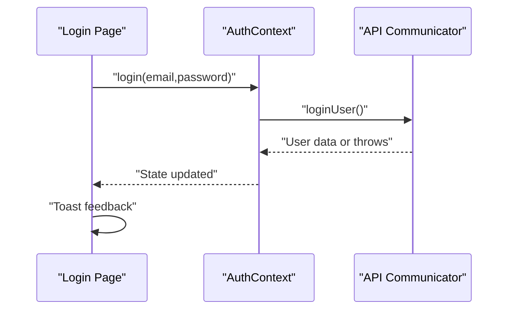
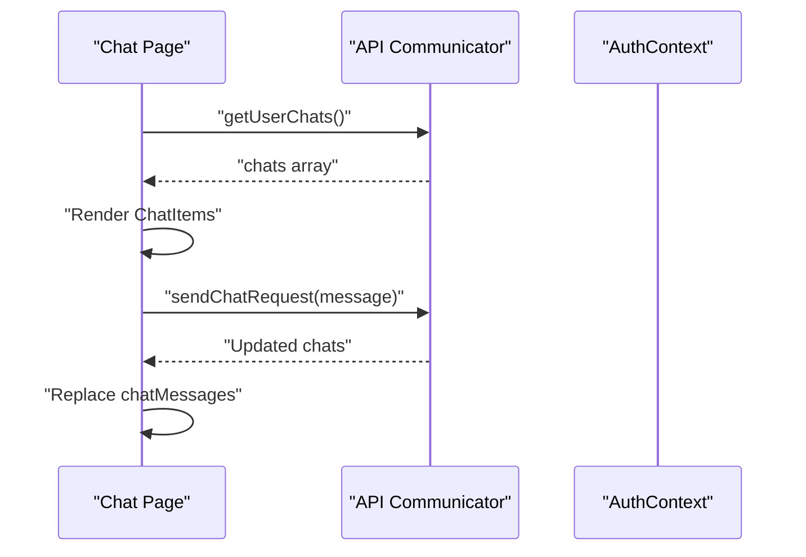
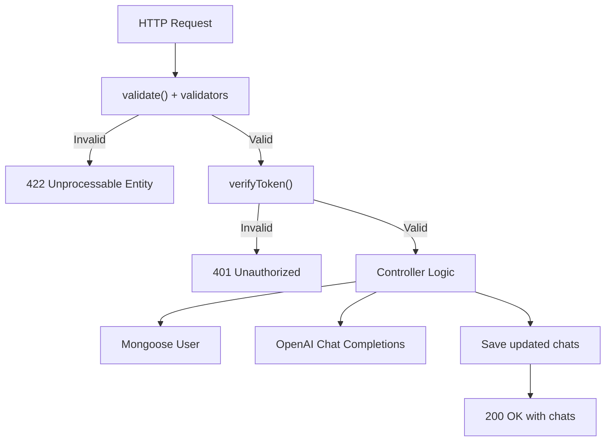
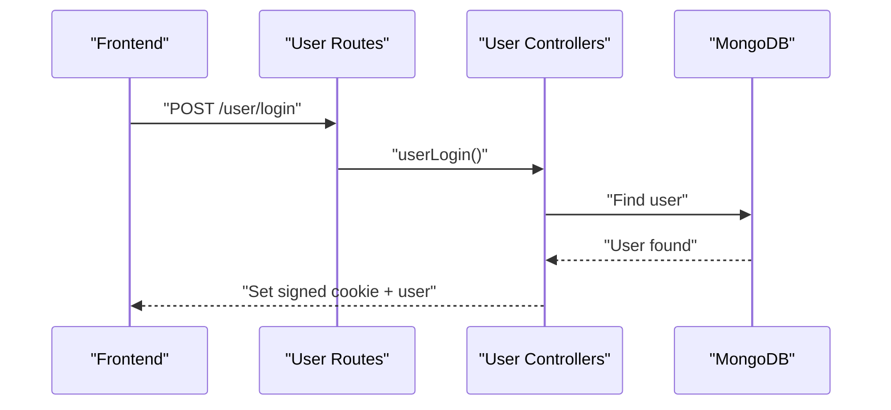
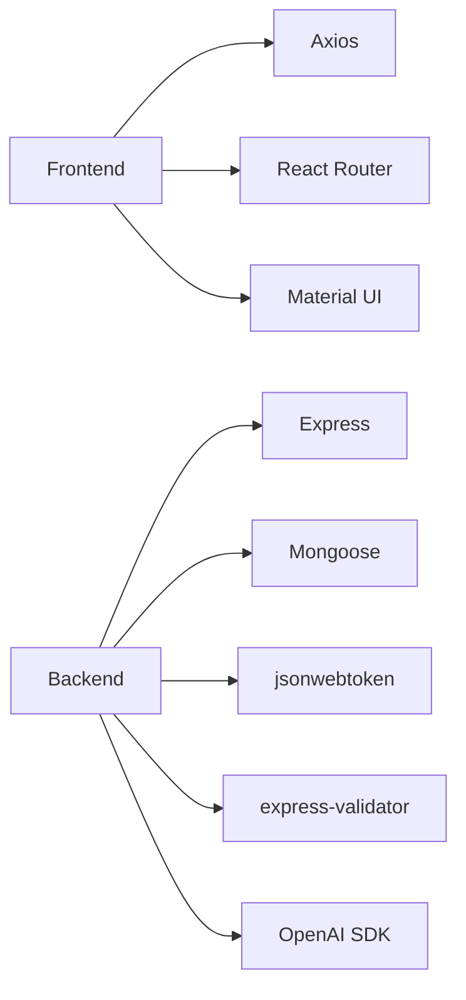

# Testing Strategy

<cite>
**Referenced Files in This Document**
- [README.md](file://README.md)
- [frontend/package.json](file://frontend/package.json)
- [backend/package.json](file://backend/package.json)
- [frontend/src/context/AuthContext.tsx](file://frontend/src/context/AuthContext.tsx)
- [frontend/src/helpers/api-communicator.ts](file://frontend/src/helpers/api-communicator.ts)
- [frontend/src/pages/Login.tsx](file://frontend/src/pages/Login.tsx)
- [frontend/src/pages/Chat.tsx](file://frontend/src/pages/Chat.tsx)
- [frontend/src/components/Header.tsx](file://frontend/src/components/Header.tsx)
- [frontend/vite.config.ts](file://frontend/vite.config.ts)
- [backend/src/controllers/chat-controllers.ts](file://backend/src/controllers/chat-controllers.ts)
- [backend/src/controllers/user-controllers.ts](file://backend/src/controllers/user-controllers.ts)
- [backend/src/routes/chat-routes.ts](file://backend/src/routes/chat-routes.ts)
- [backend/src/routes/user-routes.ts](file://backend/src/routes/user-routes.ts)
- [backend/src/utils/token-manager.ts](file://backend/src/utils/token-manager.ts)
- [backend/src/utils/validators.ts](file://backend/src/utils/validators.ts)
- [backend/src/models/User.ts](file://backend/src/models/User.ts)
- [backend/src/db/connection.ts](file://backend/src/db/connection.ts)
- [.gitignore](file://.gitignore)
</cite>

## Table of Contents
1. [Introduction](#introduction)
2. [Project Structure](#project-structure)
3. [Core Components](#core-components)
4. [Architecture Overview](#architecture-overview)
5. [Detailed Component Analysis](#detailed-component-analysis)
6. [Dependency Analysis](#dependency-analysis)
7. [Performance Considerations](#performance-considerations)
8. [Security Testing Methodologies](#security-testing-methodologies)
9. [Testing Environment Setup](#testing-environment-setup)
10. [Test Data Management](#test-data-management)
11. [Continuous Integration Workflows](#continuous-integration-workflows)
12. [Unit Testing Best Practices](#unit-testing-best-practices)
13. [Mocking Strategies for External Dependencies](#mocking-strategies-for-external-dependencies)
14. [End-to-End Testing Approaches](#end-to-end-testing-approaches)
15. [Test Coverage Requirements](#test-coverage-requirements)
16. [Writing Maintainable Tests](#writing-maintainable-tests)
17. [Debugging Test Failures](#debugging-test-failures)
18. [Conclusion](#conclusion)

## Introduction
This document defines a comprehensive testing strategy for the SMAN-GPT AI Chat Application. The application is a full-stack MERN-based chat platform integrating OpenAI’s API, with secure user authentication via JWT and HTTP-only cookies. The strategy covers frontend testing (component testing, state management testing, API integration), backend testing (controller testing, database testing, API integration), environment setup, test data management, CI workflows, performance/security testing, and maintainability practices.

## Project Structure
The repository follows a clear separation of concerns:
- Frontend: React + Vite, Material UI, Axios-based API helpers, React Router, and React Context for authentication.
- Backend: Express + TypeScript, Mongoose for MongoDB, OpenAI SDK integration, JWT-based route protection, and express-validator for input validation.

**Diagram sources**
- [frontend/src/pages/Chat.tsx:1-202](file://frontend/src/pages/Chat.tsx#L1-L202)
- [frontend/src/helpers/api-communicator.ts:1-68](file://frontend/src/helpers/api-communicator.ts#L1-L68)
- [backend/src/routes/chat-routes.ts:1-22](file://backend/src/routes/chat-routes.ts#L1-L22)
- [backend/src/controllers/chat-controllers.ts:1-89](file://backend/src/controllers/chat-controllers.ts#L1-L89)
- [backend/src/models/User.ts:1-35](file://backend/src/models/User.ts#L1-L35)
- [backend/src/db/connection.ts:1-21](file://backend/src/db/connection.ts#L1-L21)

**Section sources**
- [README.md:1-127](file://README.md#L1-L127)
- [frontend/package.json:1-39](file://frontend/package.json#L1-L39)
- [backend/package.json:1-40](file://backend/package.json#L1-L40)

## Core Components
- Frontend authentication context and API helpers:
  - AuthContext manages logged-in state and exposes login/signup/logout actions backed by API helpers.
  - API helpers encapsulate HTTP requests to backend endpoints (/user/* and /chat/*).
- Backend controllers and routes:
  - Chat controllers implement OpenAI integration and MongoDB persistence.
  - User routes and controllers handle authentication and session management.
  - Validators enforce input constraints; token manager verifies JWT cookies.

Key testing targets:
- Frontend: AuthContext state transitions, Login page form submission, Chat page message lifecycle, Header navigation behavior.
- Backend: Controllers for chat completion, retrieval, deletion; user login/signup/auth-status/logout; JWT verification; input validation.

**Section sources**
- [frontend/src/context/AuthContext.tsx:1-76](file://frontend/src/context/AuthContext.tsx#L1-L76)
- [frontend/src/helpers/api-communicator.ts:1-68](file://frontend/src/helpers/api-communicator.ts#L1-L68)
- [frontend/src/pages/Login.tsx:1-97](file://frontend/src/pages/Login.tsx#L1-L97)
- [frontend/src/pages/Chat.tsx:1-202](file://frontend/src/pages/Chat.tsx#L1-L202)
- [frontend/src/components/Header.tsx:1-56](file://frontend/src/components/Header.tsx#L1-L56)
- [backend/src/controllers/chat-controllers.ts:1-89](file://backend/src/controllers/chat-controllers.ts#L1-L89)
- [backend/src/routes/chat-routes.ts:1-22](file://backend/src/routes/chat-routes.ts#L1-L22)
- [backend/src/utils/token-manager.ts:1-35](file://backend/src/utils/token-manager.ts#L1-L35)
- [backend/src/utils/validators.ts:1-36](file://backend/src/utils/validators.ts#L1-L36)

## Architecture Overview
The application’s runtime flow involves client-server communication with JWT-protected endpoints and OpenAI API calls.

**Diagram sources**
- [frontend/src/helpers/api-communicator.ts:1-68](file://frontend/src/helpers/api-communicator.ts#L1-L68)
- [backend/src/routes/chat-routes.ts:1-22](file://backend/src/routes/chat-routes.ts#L1-L22)
- [backend/src/controllers/chat-controllers.ts:1-89](file://backend/src/controllers/chat-controllers.ts#L1-L89)
- [backend/src/models/User.ts:1-35](file://backend/src/models/User.ts#L1-L35)

## Detailed Component Analysis

### Frontend: Authentication Context Testing
Focus areas:
- Initial auth status check on mount.
- Successful login/signup updates state and navigates.
- Logout clears state and reloads the page.
- Error handling for invalid credentials or auth failures.

Recommended tests:
- Unit tests for AuthContext provider behavior using React Testing Library.
- Mock axios to simulate success/failure scenarios.
- Verify state transitions and DOM updates after async actions.

**Diagram sources**
- [frontend/src/context/AuthContext.tsx:28-43](file://frontend/src/context/AuthContext.tsx#L28-L43)

**Section sources**
- [frontend/src/context/AuthContext.tsx:1-76](file://frontend/src/context/AuthContext.tsx#L1-L76)
- [frontend/src/helpers/api-communicator.ts:24-31](file://frontend/src/helpers/api-communicator.ts#L24-L31)

### Frontend: Login Page Component Testing
Focus areas:
- Form submission triggers auth.login with email/password.
- Toast notifications reflect loading/success/error states.
- Redirect to chat when already logged in.

Recommended tests:
- Simulate form submit and assert auth.login called with correct args.
- Mock axios and AuthContext to verify success/error branches.
- Assert navigation and toast messages.

**Diagram sources**
- [frontend/src/pages/Login.tsx:11-24](file://frontend/src/pages/Login.tsx#L11-L24)
- [frontend/src/context/AuthContext.tsx:44-50](file://frontend/src/context/AuthContext.tsx#L44-L50)
- [frontend/src/helpers/api-communicator.ts:2-9](file://frontend/src/helpers/api-communicator.ts#L2-L9)

**Section sources**
- [frontend/src/pages/Login.tsx:1-97](file://frontend/src/pages/Login.tsx#L1-L97)
- [frontend/src/context/AuthContext.tsx:1-76](file://frontend/src/context/AuthContext.tsx#L1-L76)
- [frontend/src/helpers/api-communicator.ts:1-68](file://frontend/src/helpers/api-communicator.ts#L1-L68)

### Frontend: Chat Page Component Testing
Focus areas:
- Loading user chats on mount and displaying them.
- Submitting a new message and appending to chat list.
- Deleting all chats and clearing UI state.
- Guarding access to chat page based on auth state.

Recommended tests:
- Mock getUserChats and sendChatRequest to validate data flow.
- Simulate empty vs populated chat histories.
- Verify toast messages and UI updates.

**Diagram sources**
- [frontend/src/pages/Chat.tsx:45-58](file://frontend/src/pages/Chat.tsx#L45-L58)
- [frontend/src/pages/Chat.tsx:23-33](file://frontend/src/pages/Chat.tsx#L23-L33)
- [frontend/src/helpers/api-communicator.ts:42-49](file://frontend/src/helpers/api-communicator.ts#L42-L49)
- [frontend/src/helpers/api-communicator.ts:33-40](file://frontend/src/helpers/api-communicator.ts#L33-L40)

**Section sources**
- [frontend/src/pages/Chat.tsx:1-202](file://frontend/src/pages/Chat.tsx#L1-L202)
- [frontend/src/helpers/api-communicator.ts:1-68](file://frontend/src/helpers/api-communicator.ts#L1-L68)

### Backend: Chat Controllers Testing
Focus areas:
- JWT verification middleware integration.
- Input validation via express-validator.
- OpenAI API call and MongoDB persistence.
- Error handling and appropriate HTTP responses.

Recommended tests:
- Controller unit tests with mocked Mongoose User model and OpenAI client.
- Route integration tests using supertest against in-memory Express app.
- Database tests with a separate test DB instance or in-memory alternatives.

**Diagram sources**
- [backend/src/routes/chat-routes.ts:1-22](file://backend/src/routes/chat-routes.ts#L1-L22)
- [backend/src/utils/validators.ts:4-18](file://backend/src/utils/validators.ts#L4-L18)
- [backend/src/utils/token-manager.ts:13-34](file://backend/src/utils/token-manager.ts#L13-L34)
- [backend/src/controllers/chat-controllers.ts:7-43](file://backend/src/controllers/chat-controllers.ts#L7-L43)

**Section sources**
- [backend/src/controllers/chat-controllers.ts:1-89](file://backend/src/controllers/chat-controllers.ts#L1-L89)
- [backend/src/routes/chat-routes.ts:1-22](file://backend/src/routes/chat-routes.ts#L1-L22)
- [backend/src/utils/validators.ts:1-36](file://backend/src/utils/validators.ts#L1-L36)
- [backend/src/utils/token-manager.ts:1-35](file://backend/src/utils/token-manager.ts#L1-L35)
- [backend/src/models/User.ts:1-35](file://backend/src/models/User.ts#L1-L35)

### Backend: User Routes and Controllers Testing
Focus areas:
- User registration and login validation.
- Auth status verification and logout.
- JWT creation and cookie setting.

Recommended tests:
- Unit tests for user controllers with mocked Mongoose and bcrypt.
- Integration tests for /user/* routes with cookie handling.
- Edge cases: missing cookies, expired tokens, invalid inputs.

**Diagram sources**
- [backend/src/routes/user-routes.ts:1-25](file://backend/src/routes/user-routes.ts#L1-L25)
- [backend/src/utils/token-manager.ts:5-11](file://backend/src/utils/token-manager.ts#L5-L11)

**Section sources**
- [backend/src/routes/user-routes.ts:1-25](file://backend/src/routes/user-routes.ts#L1-L25)
- [backend/src/utils/token-manager.ts:1-35](file://backend/src/utils/token-manager.ts#L1-L35)

## Dependency Analysis
Frontend and backend dependencies relevant to testing:
- Frontend: React, React Router, Material UI, Axios, React Testing Library (recommended), Vite config for plugins.
- Backend: Express, Mongoose, OpenAI SDK, express-validator, jsonwebtoken, cookie-parser, morgan.

**Diagram sources**
- [frontend/package.json:12-24](file://frontend/package.json#L12-L24)
- [frontend/package.json:25-37](file://frontend/package.json#L25-L37)
- [backend/package.json:15-26](file://backend/package.json#L15-L26)
- [backend/package.json:28-38](file://backend/package.json#L28-L38)

**Section sources**
- [frontend/package.json:1-39](file://frontend/package.json#L1-L39)
- [backend/package.json:1-40](file://backend/package.json#L1-L40)

## Performance Considerations
- Frontend:
  - Measure render performance of ChatItem lists under large histories.
  - Use virtualization for long chat histories.
  - Debounce input submission to reduce API churn.
- Backend:
  - Profile OpenAI API latency and rate limits.
  - Add circuit breaker patterns around external API calls.
  - Monitor DB queries and consider indexing strategies for user chats.

## Security Testing Methodologies
- Authentication:
  - Verify JWT cookie presence and expiration during protected routes.
  - Test malformed/expired tokens and unauthorized access attempts.
- Authorization:
  - Ensure users can only access their own chat data.
- Input validation:
  - Fuzz invalid inputs to confirm 422 responses.
- Secrets and environment:
  - Confirm secrets are not exposed in logs or test artifacts.

## Testing Environment Setup
- Frontend:
  - Configure Vite with React plugin for fast rebuilds.
  - Use environment-specific .env.test files for isolated test runs.
- Backend:
  - Use separate .env.test with test DB URI and dummy secrets.
  - Ensure .gitignore excludes .env.test and coverage folders.

Recommended additions to .gitignore for test artifacts:
- coverage/
- .jest-test-results.json

**Section sources**
- [.gitignore:38-44](file://.gitignore#L38-L44)
- [frontend/vite.config.ts:1-9](file://frontend/vite.config.ts#L1-L9)

## Test Data Management
- Backend:
  - Use a dedicated test database URI in .env.test.
  - Seed minimal user documents for auth and chat tests.
  - Clean up test data after suites using transactions or drop collections.
- Frontend:
  - Use deterministic fixtures for API responses.
  - Snapshot test UI components to detect regressions.

## Continuous Integration Workflows
- Suggested pipeline stages:
  - Lint: Run ESLint on TypeScript/TSX files.
  - Unit: Execute frontend and backend unit tests.
  - Integration: Run backend integration tests against a managed DB container.
  - E2E: Optional Cypress suite for critical user journeys.
  - Coverage: Report and enforce minimum thresholds.

## Unit Testing Best Practices
- Keep tests focused and isolated.
- Use beforeEach/afterEach to reset mocks and state.
- Prefer deterministic data and stable timestamps.
- Assert side effects (DOM updates, toast messages) rather than internal state when testing UI.

## Mocking Strategies for External Dependencies
- OpenAI API:
  - Mock the OpenAI client constructor and chat.completions.create method.
  - Return controlled responses for success and error scenarios.
- Database:
  - Mock Mongoose methods (findById, save) to avoid real DB writes.
  - For integration tests, use a test DB instance or in-memory alternatives.
- HTTP client:
  - Mock axios interceptors or create a test instance with axios-mock-adapter.

## End-to-End Testing Approaches
- Critical flows:
  - Login → redirect to chat → send message → view response → clear chats.
  - Auth guard prevents unauthenticated access to chat.
- Tools:
  - Cypress or Playwright for browser automation.
  - Use deterministic usernames and seeded DB for reproducibility.

## Test Coverage Requirements
- Target:
  - Frontend: >80% statement and branch coverage for components and helpers.
  - Backend: >80% line and branch coverage for controllers and utilities.
- Enforce via CI thresholds to prevent regressions.

## Writing Maintainable Tests
- Use descriptive test names and clear arrange-act-assert structure.
- Centralize shared mocks and helpers.
- Keep test fixtures small and readable.
- Document assumptions and edge cases in comments.

## Debugging Test Failures
- Enable verbose logging for failing tests.
- Capture network traces for API tests.
- Use deterministic seeds for stateful tests.
- Isolate flaky tests and mark them pending while investigating.

## Conclusion
A robust testing strategy for SMAN-GPT should combine frontend component/unit tests, backend controller and integration tests, database isolation, and security-focused checks. By establishing clear environments, managing test data, and enforcing coverage, teams can deliver reliable, secure, and maintainable features for the AI chat application.