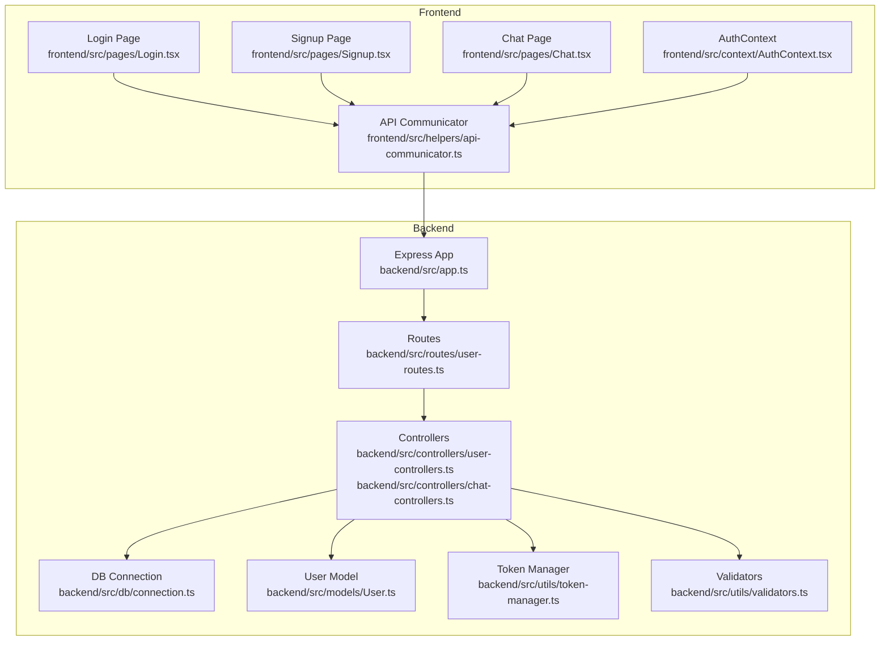
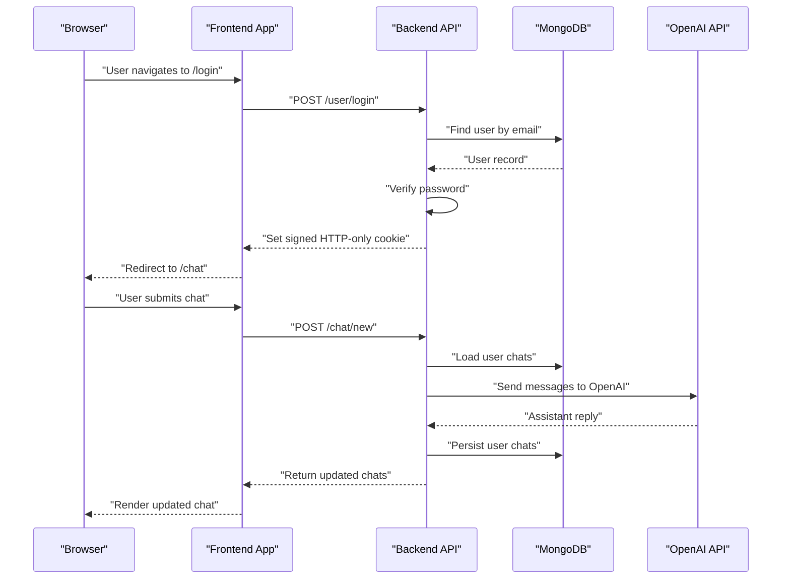
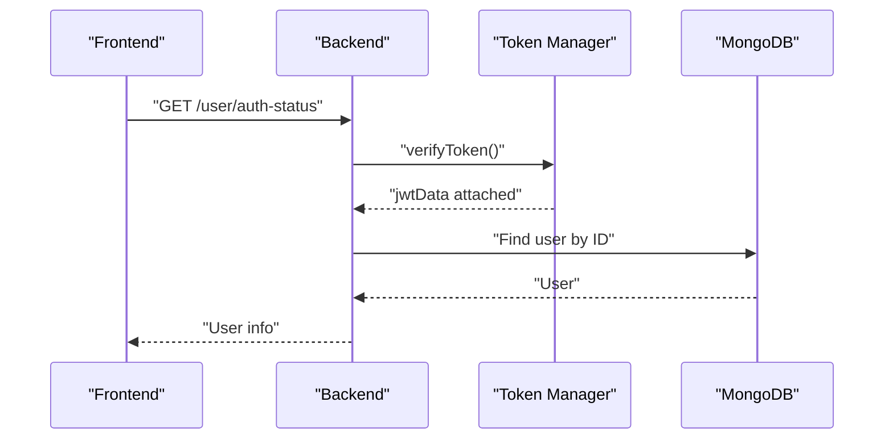
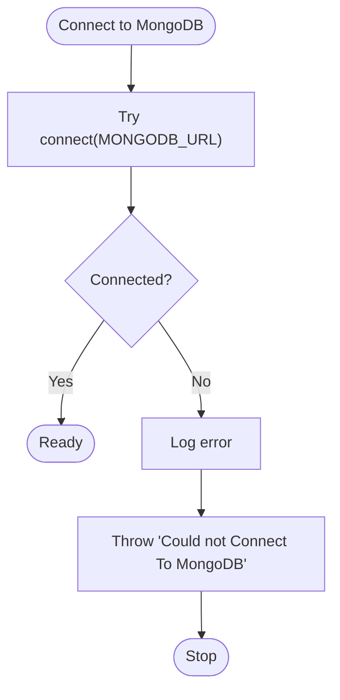
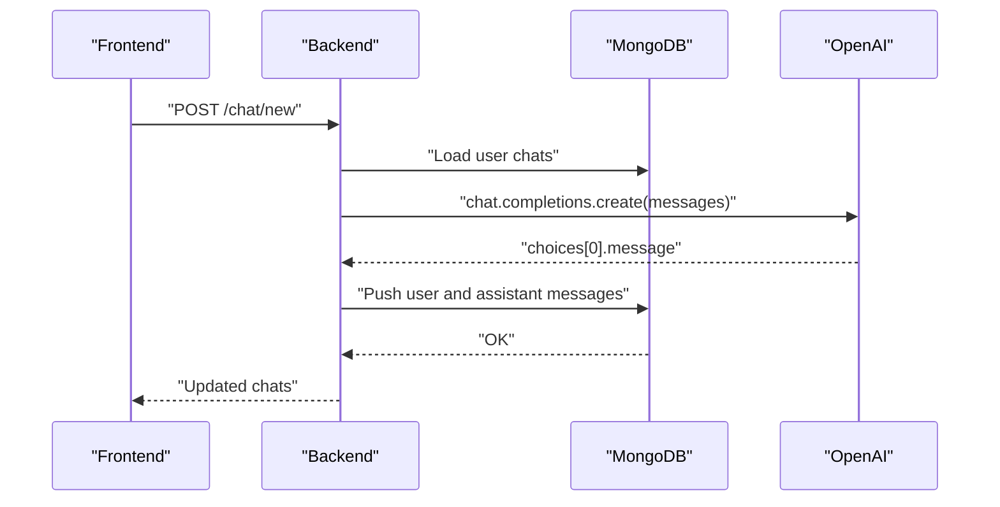
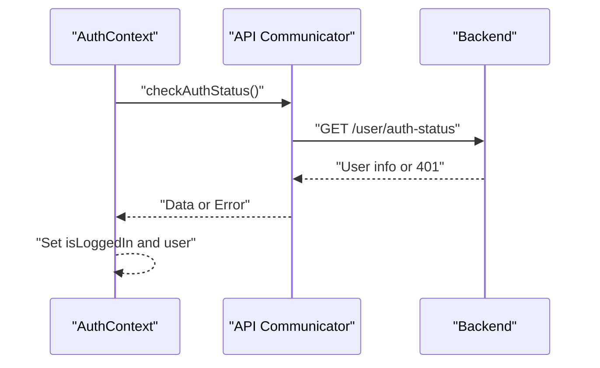
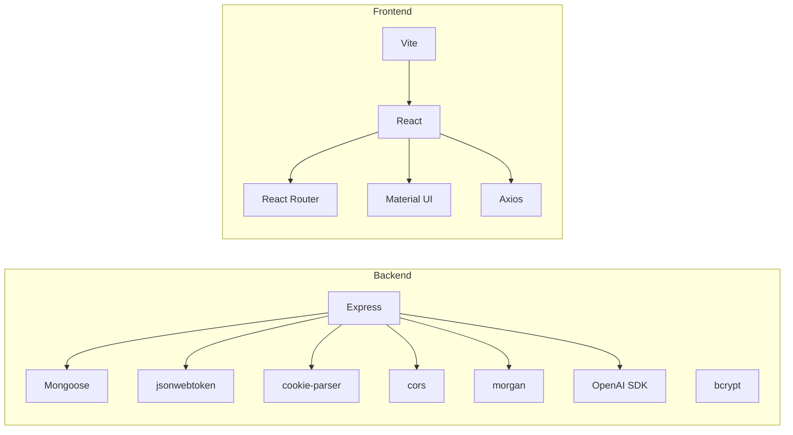

# Troubleshooting and FAQ

<cite>
**Referenced Files in This Document**
- [README.md](file://README.md)
- [backend/package.json](file://backend/package.json)
- [frontend/package.json](file://frontend/package.json)
- [backend/src/app.ts](file://backend/src/app.ts)
- [backend/src/db/connection.ts](file://backend/src/db/connection.ts)
- [backend/src/utils/constants.ts](file://backend/src/utils/constants.ts)
- [backend/src/utils/token-manager.ts](file://backend/src/utils/token-manager.ts)
- [backend/src/utils/validators.ts](file://backend/src/utils/validators.ts)
- [backend/src/models/User.ts](file://backend/src/models/User.ts)
- [backend/src/routes/user-routes.ts](file://backend/src/routes/user-routes.ts)
- [backend/src/controllers/user-controllers.ts](file://backend/src/controllers/user-controllers.ts)
- [backend/src/controllers/chat-controllers.ts](file://backend/src/controllers/chat-controllers.ts)
- [frontend/src/helpers/api-communicator.ts](file://frontend/src/helpers/api-communicator.ts)
- [frontend/src/context/AuthContext.tsx](file://frontend/src/context/AuthContext.tsx)
- [frontend/src/pages/Login.tsx](file://frontend/src/pages/Login.tsx)
- [frontend/src/pages/Signup.tsx](file://frontend/src/pages/Signup.tsx)
- [frontend/src/pages/Chat.tsx](file://frontend/src/pages/Chat.tsx)
</cite>

## Table of Contents
1. [Introduction](#introduction)
2. [Project Structure](#project-structure)
3. [Core Components](#core-components)
4. [Architecture Overview](#architecture-overview)
5. [Detailed Component Analysis](#detailed-component-analysis)
6. [Dependency Analysis](#dependency-analysis)
7. [Performance Considerations](#performance-considerations)
8. [Troubleshooting Guide](#troubleshooting-guide)
9. [Conclusion](#conclusion)
10. [Appendices](#appendices)

## Introduction
This document provides a comprehensive troubleshooting and FAQ guide for the SMAN-GPT AI Chat Application. It focuses on diagnosing and resolving common issues across authentication, database connectivity, OpenAI API integration, and frontend build/runtime behavior. It also includes performance optimization tips, debugging techniques, logging strategies, monitoring approaches, environment-specific pitfalls, dependency conflicts, configuration problems, preventive measures, best practices, and escalation procedures.

## Project Structure
The application follows a clear separation of concerns:
- Backend: Express server with TypeScript, JWT-based authentication, MongoDB via Mongoose, OpenAI integration, and route/controller layers.
- Frontend: React application using Vite, Material UI, Axios for HTTP requests, and React Router for navigation. Authentication state is managed via a context provider.

**Diagram sources**
- [backend/src/app.ts:1-21](file://backend/src/app.ts#L1-L21)
- [backend/src/routes/user-routes.ts:1-25](file://backend/src/routes/user-routes.ts#L1-L25)
- [backend/src/controllers/user-controllers.ts:1-163](file://backend/src/controllers/user-controllers.ts#L1-L163)
- [backend/src/controllers/chat-controllers.ts:1-89](file://backend/src/controllers/chat-controllers.ts#L1-L89)
- [backend/src/db/connection.ts:1-21](file://backend/src/db/connection.ts#L1-L21)
- [backend/src/models/User.ts:1-35](file://backend/src/models/User.ts#L1-L35)
- [backend/src/utils/token-manager.ts:1-35](file://backend/src/utils/token-manager.ts#L1-L35)
- [backend/src/utils/validators.ts:1-36](file://backend/src/utils/validators.ts#L1-L36)
- [frontend/src/helpers/api-communicator.ts:1-68](file://frontend/src/helpers/api-communicator.ts#L1-L68)
- [frontend/src/context/AuthContext.tsx:1-76](file://frontend/src/context/AuthContext.tsx#L1-L76)
- [frontend/src/pages/Login.tsx:1-97](file://frontend/src/pages/Login.tsx#L1-L97)
- [frontend/src/pages/Signup.tsx:1-99](file://frontend/src/pages/Signup.tsx#L1-L99)
- [frontend/src/pages/Chat.tsx:1-202](file://frontend/src/pages/Chat.tsx#L1-L202)

**Section sources**
- [README.md:1-127](file://README.md#L1-L127)
- [backend/package.json:1-40](file://backend/package.json#L1-L40)
- [frontend/package.json:1-39](file://frontend/package.json#L1-L39)

## Core Components
- Authentication and Authorization
  - JWT creation and verification with HTTP-only signed cookies.
  - Route protection middleware to validate tokens.
  - User registration, login, logout, and session verification endpoints.
- Database Layer
  - MongoDB connection management and error propagation.
  - User model with nested chat history schema.
- OpenAI Integration
  - Chat completion controller sends accumulated user messages to OpenAI and persists assistant replies.
- Frontend
  - Axios-based API client for user and chat endpoints.
  - Auth context to manage logged-in state and cookie-backed session.
  - Pages for login, signup, and chat with persistent chat history.

**Section sources**
- [backend/src/utils/token-manager.ts:1-35](file://backend/src/utils/token-manager.ts#L1-L35)
- [backend/src/routes/user-routes.ts:1-25](file://backend/src/routes/user-routes.ts#L1-L25)
- [backend/src/controllers/user-controllers.ts:1-163](file://backend/src/controllers/user-controllers.ts#L1-L163)
- [backend/src/db/connection.ts:1-21](file://backend/src/db/connection.ts#L1-L21)
- [backend/src/models/User.ts:1-35](file://backend/src/models/User.ts#L1-L35)
- [backend/src/controllers/chat-controllers.ts:1-89](file://backend/src/controllers/chat-controllers.ts#L1-L89)
- [frontend/src/helpers/api-communicator.ts:1-68](file://frontend/src/helpers/api-communicator.ts#L1-L68)
- [frontend/src/context/AuthContext.tsx:1-76](file://frontend/src/context/AuthContext.tsx#L1-L76)

## Architecture Overview
The system uses a client-server architecture:
- Frontend (React/Vite) communicates with backend (Express) via HTTP endpoints.
- Backend validates JWT tokens, accesses MongoDB for user and chat persistence, and integrates with OpenAI for chat completions.
- CORS and cookie parsing are configured at the Express level.

**Diagram sources**
- [frontend/src/pages/Login.tsx:1-97](file://frontend/src/pages/Login.tsx#L1-L97)
- [frontend/src/pages/Chat.tsx:1-202](file://frontend/src/pages/Chat.tsx#L1-L202)
- [frontend/src/helpers/api-communicator.ts:1-68](file://frontend/src/helpers/api-communicator.ts#L1-L68)
- [backend/src/controllers/user-controllers.ts:64-108](file://backend/src/controllers/user-controllers.ts#L64-L108)
- [backend/src/controllers/chat-controllers.ts:7-43](file://backend/src/controllers/chat-controllers.ts#L7-L43)
- [backend/src/db/connection.ts:1-21](file://backend/src/db/connection.ts#L1-L21)

## Detailed Component Analysis

### Authentication Flow and Cookie Handling
- Cookie name and attributes are centralized for consistent behavior across endpoints.
- Token verification middleware reads signed cookies and attaches decoded payload to request locals.
- Routes enforce token verification before allowing protected actions.

**Diagram sources**
- [backend/src/utils/token-manager.ts:13-34](file://backend/src/utils/token-manager.ts#L13-L34)
- [backend/src/routes/user-routes.ts:21-22](file://backend/src/routes/user-routes.ts#L21-L22)
- [backend/src/controllers/user-controllers.ts:110-131](file://backend/src/controllers/user-controllers.ts#L110-L131)
- [backend/src/utils/constants.ts:1-2](file://backend/src/utils/constants.ts#L1-L2)

**Section sources**
- [backend/src/utils/constants.ts:1-2](file://backend/src/utils/constants.ts#L1-L2)
- [backend/src/utils/token-manager.ts:1-35](file://backend/src/utils/token-manager.ts#L1-L35)
- [backend/src/routes/user-routes.ts:1-25](file://backend/src/routes/user-routes.ts#L1-L25)
- [backend/src/controllers/user-controllers.ts:1-163](file://backend/src/controllers/user-controllers.ts#L1-L163)

### Database Connectivity and Error Handling
- Connection attempts to MongoDB are wrapped with error handling and explicit error throwing.
- Disconnection logic mirrors connection with error propagation.

**Diagram sources**
- [backend/src/db/connection.ts:1-21](file://backend/src/db/connection.ts#L1-L21)

**Section sources**
- [backend/src/db/connection.ts:1-21](file://backend/src/db/connection.ts#L1-L21)

### OpenAI Integration and Chat Persistence
- Chat completion controller loads user chats, appends the new user message, calls OpenAI, appends the assistant reply, and saves the updated chat array.

**Diagram sources**
- [backend/src/controllers/chat-controllers.ts:7-43](file://backend/src/controllers/chat-controllers.ts#L7-L43)
- [backend/src/models/User.ts:3-32](file://backend/src/models/User.ts#L3-L32)

**Section sources**
- [backend/src/controllers/chat-controllers.ts:1-89](file://backend/src/controllers/chat-controllers.ts#L1-L89)
- [backend/src/models/User.ts:1-35](file://backend/src/models/User.ts#L1-L35)

### Frontend Authentication State and API Calls
- Auth context performs initial auth check on mount, exposes login/signup/logout functions, and updates state accordingly.
- API communicator encapsulates endpoint calls and error handling.

**Diagram sources**
- [frontend/src/context/AuthContext.tsx:32-43](file://frontend/src/context/AuthContext.tsx#L32-L43)
- [frontend/src/helpers/api-communicator.ts:24-31](file://frontend/src/helpers/api-communicator.ts#L24-L31)
- [backend/src/controllers/user-controllers.ts:110-131](file://backend/src/controllers/user-controllers.ts#L110-L131)

**Section sources**
- [frontend/src/context/AuthContext.tsx:1-76](file://frontend/src/context/AuthContext.tsx#L1-L76)
- [frontend/src/helpers/api-communicator.ts:1-68](file://frontend/src/helpers/api-communicator.ts#L1-L68)

## Dependency Analysis
- Backend dependencies include Express, Mongoose, bcrypt, JWT, OpenAI SDK, Morgan, cookie-parser, and CORS.
- Frontend dependencies include React, React Router, Material UI, Axios, and Vite.

**Diagram sources**
- [backend/package.json:15-27](file://backend/package.json#L15-L27)
- [frontend/package.json:12-24](file://frontend/package.json#L12-L24)

**Section sources**
- [backend/package.json:1-40](file://backend/package.json#L1-L40)
- [frontend/package.json:1-39](file://frontend/package.json#L1-L39)

## Performance Considerations
- Memory Management
  - Avoid retaining large chat histories in frontend state; consider pagination or trimming older entries after a threshold.
  - Debounce user input events to reduce rapid re-renders during typing.
  - Use React.memo for chat items and stable references to prevent unnecessary re-renders.
- Database Query Optimization
  - Limit chat history retrieval to recent N messages when feasible.
  - Add indexes on frequently queried fields (e.g., email) if growth requires.
  - Batch writes when appending multiple messages to minimize round-trips.
- Frontend Rendering Performance
  - Virtualize long chat lists to render only visible items.
  - Lazy-load images and heavy components.
  - Minimize deep object cloning; use immutable update patterns.
- OpenAI API Efficiency
  - Reuse conversation context efficiently; avoid sending the entire history on every request if not required.
  - Use streaming responses when supported to improve perceived latency.
- Logging and Monitoring
  - Enable Morgan in development for request logs; consider structured logging in production.
  - Instrument OpenAI SDK calls with timing metrics and error counters.
  - Monitor database connection pool health and query durations.

[No sources needed since this section provides general guidance]

## Troubleshooting Guide

### Authentication Problems
Common symptoms:
- Redirect loops to login despite being logged in.
- “Token Not Received” or “Token Expired” responses.
- Login/signup failing with validation errors.

Diagnostics:
- Verify environment variables for JWT secret and cookie secret are present and correct.
- Confirm frontend and backend share the same cookie domain/path and signed cookie configuration.
- Check that the frontend is sending credentials and cookies with cross-origin requests.

Resolution steps:
- Ensure cookie parser is initialized with the correct cookie secret and CORS allows credentials.
- Validate token creation and verification logic; confirm expiration and signing align with frontend expectations.
- Confirm that login/signup endpoints clear any stale cookies before setting a new signed cookie.
- Use browser developer tools to inspect cookies and network requests for missing or mismatched tokens.

Verification:
- After login, verify a signed HTTP-only cookie is present and accepted by subsequent requests.
- Call the auth-status endpoint to confirm successful token verification.

**Section sources**
- [backend/src/app.ts:11-16](file://backend/src/app.ts#L11-L16)
- [backend/src/utils/token-manager.ts:13-34](file://backend/src/utils/token-manager.ts#L13-L34)
- [backend/src/utils/constants.ts:1-2](file://backend/src/utils/constants.ts#L1-L2)
- [backend/src/controllers/user-controllers.ts:37-53](file://backend/src/controllers/user-controllers.ts#L37-L53)
- [backend/src/controllers/user-controllers.ts:83-99](file://backend/src/controllers/user-controllers.ts#L83-L99)
- [frontend/src/helpers/api-communicator.ts:24-31](file://frontend/src/helpers/api-communicator.ts#L24-L31)

### Database Connection Errors
Common symptoms:
- Application fails to start or throws a MongoDB connection error.
- Runtime disconnections or inability to persist user data.

Diagnostics:
- Confirm the MongoDB URI is reachable and credentials are correct.
- Check for firewall/network restrictions blocking the connection.
- Verify the database service is running and accepting connections.

Resolution steps:
- Update the MongoDB URI in environment variables.
- Ensure the connection function is invoked during server startup.
- Add retry logic and circuit breaker patterns for transient failures.

Verification:
- On startup, confirm successful connection logs.
- Perform a simple read/write operation to validate connectivity.

**Section sources**
- [backend/src/db/connection.ts:1-21](file://backend/src/db/connection.ts#L1-L21)

### OpenAI API Integration Failures
Common symptoms:
- Chat requests fail with internal server errors.
- No response from OpenAI or timeouts.

Diagnostics:
- Verify the OpenAI API key and organization ID are set in environment variables.
- Check rate limits and account validity.
- Inspect network connectivity and proxy/firewall settings.

Resolution steps:
- Correct environment variables for API key and organization ID.
- Implement exponential backoff and retries for transient failures.
- Add fallback behavior or graceful degradation when the API is unavailable.

Verification:
- Send a test chat request and confirm the assistant’s reply is appended to user chats.
- Monitor response times and error rates.

**Section sources**
- [backend/src/controllers/chat-controllers.ts:20-29](file://backend/src/controllers/chat-controllers.ts#L20-L29)

### Frontend Build Issues
Common symptoms:
- Build fails with module resolution errors.
- Development server does not start or hot reload is not working.

Diagnostics:
- Confirm Node.js and npm versions meet project requirements.
- Check for conflicting dependency versions.
- Validate Vite configuration and plugin compatibility.

Resolution steps:
- Clean node_modules and reinstall dependencies.
- Align TypeScript and Vite plugin versions with the project’s configuration.
- Resolve peer dependency warnings.

Verification:
- Run the development server and confirm the UI loads without errors.
- Build the project and preview the production bundle.

**Section sources**
- [frontend/package.json:6-11](file://frontend/package.json#L6-L11)
- [frontend/package.json:25-36](file://frontend/package.json#L25-L36)

### Environment-Specific Issues
Common symptoms:
- Working locally but failing in staging/production.
- CORS or cookie-related errors in deployed environments.

Diagnostics:
- Compare environment variable configurations across environments.
- Validate CORS origin and credentials settings for production domains.
- Confirm cookie security flags (SameSite, Secure) for HTTPS deployments.

Resolution steps:
- Centralize environment variables and use a secure secrets manager.
- Adjust CORS origin to match the production frontend domain.
- Enforce HTTPS and configure cookie security policies appropriately.

**Section sources**
- [backend/src/app.ts:11-16](file://backend/src/app.ts#L11-L16)

### Dependency Conflicts
Common symptoms:
- Runtime errors due to incompatible library versions.
- Build warnings about duplicate packages.

Resolution steps:
- Use a lock file to ensure deterministic installs.
- Audit dependencies and resolve conflicts by aligning versions.
- Prefer peer dependencies and shared libraries where appropriate.

**Section sources**
- [backend/package.json:15-38](file://backend/package.json#L15-L38)
- [frontend/package.json:12-36](file://frontend/package.json#L12-L36)

### Configuration Problems
Common symptoms:
- Unexpected behavior due to incorrect configuration.
- Missing or misnamed environment variables.

Resolution steps:
- Create a template .env file with all required keys.
- Validate configuration loading at startup.
- Add configuration validation and early failure on missing values.

**Section sources**
- [README.md:73-82](file://README.md#L73-L82)

### Debugging Techniques
- Backend
  - Enable Morgan for request logging in development.
  - Use console logs strategically around authentication, database, and OpenAI calls.
  - Add error boundaries and structured error responses for easier diagnosis.
- Frontend
  - Use React DevTools to inspect component props and state.
  - Log API responses and errors in the API communicator.
  - Inspect network tab for failed requests and cookie presence.

**Section sources**
- [backend/src/app.ts:15-16](file://backend/src/app.ts#L15-L16)
- [frontend/src/helpers/api-communicator.ts:1-68](file://frontend/src/helpers/api-communicator.ts#L1-L68)

### Monitoring Approaches
- Backend
  - Track request latency, error rates, and database query durations.
  - Monitor OpenAI API usage and latency.
- Frontend
  - Capture user session duration and page load metrics.
  - Track toast-level error reporting and user feedback.

[No sources needed since this section provides general guidance]

### Preventive Measures and Best Practices
- Environment Variables
  - Store secrets securely and never commit them to version control.
  - Use environment-specific configuration files and validation.
- Security
  - Enforce HTTPS, secure cookies, and SameSite policies.
  - Sanitize inputs and apply rate limiting.
- Reliability
  - Implement retries and circuit breakers for external APIs.
  - Add health checks and readiness probes.
- Observability
  - Centralize logs and add correlation IDs.
  - Instrument critical paths with metrics.

[No sources needed since this section provides general guidance]

### Escalation Procedures
- If local fixes do not resolve the issue:
  - Collect environment details, dependency versions, and configuration snapshots.
  - Provide reproducible steps and logs.
  - Engage maintainers or community channels with minimal, complete reports.

[No sources needed since this section provides general guidance]

## Conclusion
By following the diagnostics and resolution steps outlined above, most common issues in the SMAN-GPT application can be quickly identified and resolved. Adopting the recommended performance optimizations, debugging techniques, logging strategies, and preventive measures will help maintain a robust and scalable system.

## Appendices

### Quick Diagnostic Commands
- Backend
  - Start in development mode and watch logs: [backend/package.json:8-10](file://backend/package.json#L8-L10)
  - Verify environment variables are loaded: [backend/src/app.ts:7-8](file://backend/src/app.ts#L7-L8)
- Frontend
  - Start development server: [frontend/package.json:7-10](file://frontend/package.json#L7-L10)
  - Build for production: [frontend/package.json:8-9](file://frontend/package.json#L8-L9)

**Section sources**
- [backend/package.json:8-10](file://backend/package.json#L8-L10)
- [backend/src/app.ts:7-8](file://backend/src/app.ts#L7-L8)
- [frontend/package.json:7-10](file://frontend/package.json#L7-L10)
- [frontend/package.json:8-9](file://frontend/package.json#L8-L9)